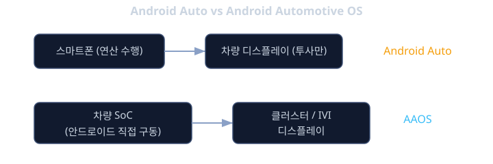
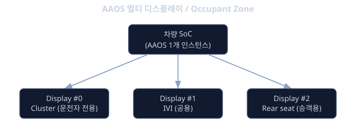

# Android Automotive OS

앞의 `aosp` 레슨에서는 안드로이드 소스를 직접 받아 빌드하고, 전체 구조가 어떤 레이어로 나뉘는지 살펴봤습니다. 그런데 그렇게 빌드한 결과물을 그대로 차량에 올리면 될까요? 답은 "아니요"입니다. 스마트폰은 화면이 하나이고, 사용자도 보통 한 명이며, 전원을 끄고 켜는 생명주기도 단순합니다. 차량은 전혀 다릅니다. 계기판(클러스터), 중앙 인포테인먼트(IVI), 경우에 따라 조수석 디스플레이까지 여러 화면이 동시에 켜져 있고, 운전자와 동승자가 각각 다른 화면을 봅니다. 시동을 걸고 끄는 순간마다 시스템이 빠르게 뜨고 내려가야 하고, 운전 중에는 화면에 정보를 띄우는 방식 자체가 법규와 안전 가이드라인의 제약을 받습니다.

Android Automotive OS(AAOS)는 이런 차량의 특수성을 반영해서 안드로이드를 확장한 변형입니다. 핵심은 "안드로이드 자체가 차량 헤드유닛의 메인 운영체제로 직접 구동된다"는 점입니다. 폰이 옆에 없어도, 심지어 폰이라는 개념 자체가 없어도 차량은 AAOS 위에서 내비게이션을 켜고, 음악을 재생하고, 클러스터에 속도를 표시합니다. 이 레슨에서는 AAOS가 일반 안드로이드와 무엇이 다른지, 왜 흔히 혼동되는 Android Auto와 완전히 다른 물건인지, 그리고 멀티 디스플레이·멀티 유저·OEM 커스터마이징 같은 차량 특유의 구조를 하나씩 짚어봅니다.

이 레슨은 **플랫폼 & OS** 트랙의 **Android Automotive** 단계입니다. 선수 학습은 `aosp` 이며, 이후에는 차량 신호에 접근하는 구체적인 방법을 다루는 레슨들로 이어집니다.

## 학습 목표

- AAOS와 Android Auto의 근본적인 차이를 정확히 구분해서 설명할 수 있다.
- 하나의 AAOS 인스턴스가 클러스터와 IVI 같은 여러 디스플레이를 어떻게 동시에 관리하는지 이해한다.
- 운전자·동승자를 위한 멀티 유저 구조와 게스트 모드의 개념을 설명할 수 있다.
- CarLauncher, SystemUI 같은 구성요소를 OEM이 왜, 어떻게 커스터마이징하는지 이해한다.
- GAS 포함 빌드와 AOSP-only 빌드의 차이, 그리고 차량 특화 권한 모델의 존재를 인지한다.
- 실제 차량 없이 에뮬레이터로 AAOS를 띄워 볼 수 있다는 것을 안다.

## AAOS 는 Android Auto 가 아닙니다

이 둘을 구분하지 못하면 이후 내용이 전부 헷갈리게 되므로 가장 먼저 명확히 해야 합니다.

Android Auto는 "투사(projection)" 방식입니다. 운전자의 스마트폰을 USB나 무선으로 차량에 연결하면, 폰 안에서 실제 앱이 동작하고 그 화면을 차량 디스플레이에 투사해서 보여줍니다. 연산은 여전히 폰에서 일어나고, 차량 쪽 유닛은 폰이 보내는 화면을 받아 그리는 역할에 가깝습니다. 폰을 차에서 분리하면 Android Auto 화면도 사라집니다.

AAOS는 완전히 다릅니다. 안드로이드 운영체제 자체가 차량 헤드유닛의 SoC 위에서 직접 부팅되고 실행됩니다. 내비게이션 앱, 미디어 앱, 클러스터에 속도를 그리는 시스템 서비스 모두 차량의 하드웨어에서 돌아가는 네이티브 프로세스입니다. 운전자의 폰이 연결되어 있지 않아도, 심지어 운전자가 폰을 아예 갖고 있지 않아도 차량은 정상적으로 동작합니다. 쉽게 말해 "폰 화면을 빌려 쓰는 것"이 Android Auto이고, "차량 자체가 안드로이드 기기인 것"이 AAOS입니다.

실제로는 둘이 공존할 수 있습니다. AAOS가 깔린 헤드유닛 위에서 Android Auto 호스트 앱이 돌아가서, 운전자가 폰을 연결하면 그 화면을 다시 AAOS 화면 안의 한 화면으로 띄워주는 구성도 흔합니다. 즉 AAOS는 플랫폼이고, Android Auto는 그 플랫폼 위에서 실행될 수 있는 앱 중 하나로 생각하면 자연스럽습니다.

```text
스마트폰용 안드로이드  : 화면 1개, 사용자 1명, 폰의 생명주기
Android Auto           : 폰에서 실행 + 차량 화면에 투사 (연산은 폰)
Android Automotive OS  : 차량 헤드유닛에서 안드로이드 자체가 직접 구동 (연산은 차량)
```



## 하나의 안드로이드가 여러 화면을 동시에 책임집니다

스마트폰 안드로이드는 화면 하나를 전제로 설계되어 있습니다. AAOS는 여기에 멀티 디스플레이 구조를 추가해서, 같은 안드로이드 프레임워크 인스턴스가 물리적으로 분리된 여러 디스플레이를 동시에 관리하도록 만들었습니다.

가장 대표적인 조합이 IVI 디스플레이와 클러스터 디스플레이입니다. IVI는 중앙 콘솔에 있는 큰 화면으로, 내비게이션, 미디어, 전화 같은 인포테인먼트 기능을 보여줍니다. 클러스터는 운전자 바로 앞의 계기판 화면으로, 속도계, RPM, 경고등처럼 운전에 직결되는 정보만 보여줍니다. 하나의 SoC가 이 두 화면을 동시에 구동하면서, 운전 중에는 클러스터에는 속도와 경고만 단순하게 표시하고 IVI에는 내비게이션 지도를 크게 띄우는 식으로 역할을 분리합니다.

중요한 점은 두 화면의 "권한 수준"이 다르다는 것입니다. IVI는 비교적 자유롭게 서드파티 앱을 띄울 수 있지만, 클러스터는 운전 중 정보 과부하와 주의분산을 막기 위해 훨씬 제한적입니다. 보통 클러스터에는 OEM이 직접 만든 시스템 수준의 화면만 올라가고, 일반 앱이 마음대로 클러스터를 차지하도록 허용하지 않습니다. 디스플레이마다 어떤 사용자와 어떤 앱이 올라갈 수 있는지를 묶어서 관리하는 단위를 occupant zone(탑승자 구역) 이라고 부르는데, 이를 통해 "이 디스플레이는 운전자 전용, 저 디스플레이는 뒷좌석 승객용" 같은 매핑을 시스템이 관리합니다.

```text
SoC 1개
 ├─ Display #0 (Cluster)  → 운전자 전용, 제한된 시스템 UI만 허용
 ├─ Display #1 (IVI)      → 운전자/동승자 공용, 서드파티 앱 허용
 └─ Display #2 (Rear seat, 선택) → 뒷좌석 승객용, 별도 사용자 세션
```



## 운전자와 승객은 서로 다른 사용자입니다

스마트폰에서는 보통 한 사람이 한 기기를 씁니다. 차량은 다릅니다. 가족 구성원이 번갈아 운전하기도 하고, 렌터카처럼 모르는 사람이 잠깐 빌려 타기도 하며, 동승자가 자신의 설정으로 뒷좌석 화면을 쓰고 싶어하기도 합니다. AAOS는 안드로이드가 원래 갖고 있던 멀티 유저(multi-user) 기능을 차량에 맞게 확장해서 이 문제를 풀어냅니다.

차량에 로그인하는 각 운전자는 자신만의 사용자 프로필을 가질 수 있습니다. 즐겨 찾는 라디오 채널, 시트 위치, 자주 가는 목적지 같은 정보가 사용자별로 분리되어 저장됩니다. 차를 다른 사람에게 잠깐 맡겨야 할 때는 게스트 모드를 켜서, 개인 정보에 접근하지 못하는 제한된 임시 세션으로 차를 쓰게 할 수도 있습니다. 앞서 언급한 occupant zone 구조와 결합하면, 운전석과 뒷좌석 디스플레이에 서로 다른 사용자 세션을 동시에 띄우는 것도 가능합니다.

## OEM 이 옷을 갈아입히는 지점: CarLauncher 와 SystemUI

AAOS는 오픈소스 플랫폼이지만, 실제로 양산되는 차량마다 화면 디자인과 사용자 경험은 전혀 다릅니다. 이것이 가능한 이유는 AAOS가 처음부터 특정 구성요소를 OEM이 쉽게 교체하도록 설계되었기 때문입니다.

대표적으로 CarLauncher는 시동을 걸었을 때 가장 먼저 보이는 홈 화면, 즉 런처입니다. AOSP는 참조용 CarLauncher를 기본으로 제공하지만, 실제 양산차에서는 각 브랜드가 자신들의 디자인 언어에 맞춘 런처로 통째로 교체하는 경우가 많습니다. SystemUI도 마찬가지입니다. 상태 표시줄, 알림 패널, 빠른 설정 같은 시스템 UI 요소들이 차량용으로 다시 구성되어 있고(흔히 CarSystemUI라고 부릅니다), OEM은 이것 역시 자사 디자인에 맞게 손을 댑니다.

즉 "AAOS"라는 이름 하나로 묶여 있어도, 실제 화면에 보이는 모습은 제조사마다 다르게 보이는 것이 정상입니다. 핵심 프레임워크와 멀티 디스플레이·멀티 유저 같은 하부 구조는 공통이지만, 그 위에 어떤 런처와 UI를 얹느냐는 OEM의 선택입니다.

## GAS 포함 빌드와 AOSP-only 빌드, 그리고 차량 권한

AAOS 빌드는 구글 서비스를 포함하는지 여부로 크게 두 갈래로 나뉩니다. Google Automotive Services(GAS)는 플레이 스토어, 구글 어시스턴트, 구글 맵 같은 구글의 서비스 패키지를 말합니다. OEM이 구글과 라이선스 계약을 맺으면 GAS를 포함한 빌드를 만들 수 있고, 이 경우 운전자는 폰에서처럼 플레이 스토어로 앱을 설치할 수 있습니다. 반대로 AOSP-only 빌드는 이런 구글 패키지 없이 순수 오픈소스 구성요소만으로 만들어지며, 라이선스 비용이나 구글 서비스 의존을 피하려는 제조사가 선택하는 경로입니다. 이 선택은 차량의 브랜드 전략과 지역 규제에 따라 달라지는 사업적 결정이라는 정도로만 이해하면 충분합니다.

차량 특화 권한 모델도 이 레슨에서 꼭 짚어야 할 부분입니다. 일반 안드로이드 앱이 카메라나 위치 정보에 접근하려면 런타임 권한을 요청하듯, AAOS에서 차량의 속도나 연료 상태 같은 신호에 접근하려는 앱은 별도의 car permission을 선언해야 합니다. 아래는 그런 선언이 어떤 형태인지 감을 잡기 위한 예시입니다.

```xml
<!-- AndroidManifest.xml 예시: 차량 속도 신호에 접근하려는 앱 -->
<uses-permission android:name="android.car.permission.CAR_SPEED" />
```

이런 권한이 왜 필요하고, 실제로 어떤 신호들을 읽거나 제어할 수 있는지, 그리고 그 신호가 하드웨어에서 안드로이드까지 어떻게 전달되는지는 매우 깊은 주제라서 이 레슨에서는 다루지 않습니다. 이 부분은 다음 레슨들에서 차량 신호 추상화 계층과 그 위의 프레임워크를 다루면서 본격적으로 파고들 예정입니다. 지금은 "차량 신호에 접근하려면 일반 앱 권한과는 별도의 차량 전용 권한이 필요하다"는 사실만 기억해 두면 됩니다.

## 차 없이 개발하기: 에뮬레이터

AAOS를 공부하거나 앱을 개발하기 위해 매번 실제 차량이 필요하다면 진입 장벽이 너무 높을 것입니다. 다행히 Android Automotive 전용 에뮬레이터 이미지가 제공되어서, 개발용 PC에서 가상의 차량 헤드유닛을 띄워 볼 수 있습니다. 이 에뮬레이터는 IVI 화면뿐 아니라 클러스터 화면까지 함께 보여주는 구성도 있어서, 앞서 설명한 멀티 디스플레이 구조를 실물 차량 없이도 체험할 수 있습니다.

```text
# 개발 환경에서 Android Automotive 에뮬레이터 이미지를 고르는 흐름 (개념적 예시)
1. Android Studio의 AVD Manager 를 연다.
2. Device Definitions 목록에서 "Automotive" 계열 기기를 고른다.
   (예: 1024p 차량용, 1080p landscape, distant display 포함 버전 등)
3. 필요에 따라 "Automotive with Play Store" 또는 플레이 스토어가 없는
   이미지 중 하나를 선택해 시스템 이미지를 내려받는다.
4. 에뮬레이터를 실행하면 IVI 화면이 뜨고, 구성에 따라 클러스터 화면
   창이 별도로 함께 열린다.
```

처음 공부할 때는 실제 차량의 신호나 센서 없이도, 이 에뮬레이터만으로 멀티 디스플레이·멀티 유저·런처 교체 같은 구조를 눈으로 확인하면서 익히는 것을 추천합니다.

에뮬레이터가 특히 유용한 이유는 "가짜 차량 신호"를 직접 흘려 넣어 볼 수 있다는 점입니다. 실제 차량에서는 속도나 연료량 같은 값이 CAN 버스에서 올라오지만, 에뮬레이터는 이 값을 명령줄이나 설정 파일로 임의로 바꿔 넣을 수 있는 가상의 차량 신호 소스를 함께 제공합니다. 예를 들어 에뮬레이터 콘솔에서 가상의 속도 값을 60으로 바꾸면, 클러스터 화면의 속도계가 그 값을 반영해 바뀌는 것을 확인할 수 있습니다. 이 가상 신호가 실제로 안드로이드 프레임워크까지 전달되는 경로, 즉 "신호가 어떤 표준 형식으로 변환되어 올라오는가"는 다음 레슨에서 차량 신호 추상화 계층을 다루며 자세히 살펴봅니다. 지금은 에뮬레이터 덕분에 실차 없이도 신호 변화에 따른 화면 반응까지 끝까지 실습해 볼 수 있다는 점만 기억해 두면 충분합니다.

<details><summary><b>심화: 클러스터가 유독 엄격하게 제한되는 이유</b></summary>

IVI 화면은 서드파티 앱을 비교적 자유롭게 허용하지만 클러스터는 그렇지 않습니다. 이유는 단순합니다. 클러스터는 운전자가 운전 중 가장 자주, 가장 짧은 시간 동안 시선을 주는 화면이기 때문에, 여기에 예측 불가능한 UI나 과도한 정보가 떠오르면 운전자 주의분산으로 직결됩니다. 그래서 클러스터에는 보통 OEM이 직접 검증한 시스템 수준의 화면만 올라가도록 플랫폼 차원에서 제한을 둡니다. 일반 앱 개발자가 자유롭게 클러스터를 차지하는 그림은 AAOS에서 기본적으로 허용되지 않는 설계라고 이해하면 됩니다.

</details>

<details><summary><b>심화: occupant zone 과 디스플레이 매핑</b></summary>

차량에 디스플레이가 늘어날수록 "어떤 화면이 누구를 위한 것인가"를 시스템이 알아야 합니다. 이를 위해 AAOS는 occupant zone이라는 개념으로 좌석(운전석, 조수석, 뒷좌석 등)과 디스플레이, 그리고 그 위에서 실행되는 사용자 세션을 묶어서 관리합니다. 예를 들어 운전석 zone에는 클러스터와 IVI 두 디스플레이가 함께 묶이고, 뒷좌석 zone에는 별도의 엔터테인먼트 디스플레이가 묶이는 식입니다. 지금은 "디스플레이와 좌석, 사용자를 하나의 묶음으로 관리하는 개념이 있다"는 정도만 기억해 두고, 실제 설정 방법은 더 깊은 레슨에서 다룹니다.

</details>

<details><summary><b>심화: 왜 운전 중 UI는 더 단순해져야 하는가</b></summary>

AAOS에는 운전자 주의분산을 줄이기 위한 가이드라인이 플랫폼 차원에 반영되어 있습니다. 예를 들어 미디어나 메시징처럼 운전 중 접근성이 중요한 앱 카테고리는, 자유로운 레이아웃 대신 플랫폼이 정해 둔 제한된 형태의 화면(큰 버튼, 단순한 목록 등)으로만 구성하도록 유도됩니다. 이런 제약은 귀찮은 규제처럼 느껴질 수 있지만, 결국 "운전 중 짧은 시선으로도 이해할 수 있는 화면"을 보장하기 위한 설계 철학의 결과물입니다.

</details>

**확인 문제.** 어떤 사람이 "내 폰을 차에 USB로 연결했더니 차 화면에 내 지도 앱이 떴어. 이게 AAOS구나"라고 말했습니다. 이 말은 정확한 설명일까요? 왜 그런지 설명해 보세요.

<details><summary>답 보기</summary>

정확하지 않습니다. 폰을 연결해서 폰의 화면을 차량 디스플레이에 투사하는 것은 Android Auto의 동작입니다. 이 경우 실제 연산은 여전히 폰에서 일어나고, 차량 쪽은 그 화면을 받아 보여주는 역할입니다. 폰을 분리하면 그 화면도 사라집니다. 반면 AAOS는 안드로이드 자체가 차량 헤드유닛에서 직접 구동되는 것으로, 폰이 연결되어 있지 않아도 차량 스스로 안드로이드 앱(내비게이션, 미디어 등)을 실행할 수 있습니다. 두 기술이 한 차량에 공존할 수는 있지만, 질문의 상황은 AAOS가 아니라 Android Auto를 경험한 것입니다.

</details>

**확인 문제.** AAOS에서 같은 차량 안의 클러스터 디스플레이와 IVI 디스플레이가 "권한 수준"이 다르다고 했습니다. 이것이 왜 필요한지, 멀티 디스플레이 구조와 연결해서 설명해 보세요.

<details><summary>답 보기</summary>

클러스터는 속도, RPM, 경고등처럼 운전에 직결되는 정보를 보여주는 화면으로, 운전자가 매우 짧고 빈번하게 시선을 주는 곳입니다. 여기에 서드파티 앱이나 예측 불가능한 UI가 자유롭게 올라가면 운전자 주의분산으로 이어질 위험이 큽니다. 반면 IVI는 내비게이션, 미디어 등 상대적으로 여유 있게 볼 수 있는 화면이라 서드파티 앱을 더 자유롭게 허용할 수 있습니다. 하나의 AAOS 인스턴스가 여러 디스플레이를 동시에 관리하기 때문에, 디스플레이별로 다른 권한 수준과 occupant zone 설정을 둬서 "이 화면에는 이런 앱만 허용한다"를 시스템이 강제할 수 있는 것입니다.

</details>

## 정리

AAOS는 스마트폰용 안드로이드를 그대로 차량에 올린 것이 아니라, 차량의 특수한 요구사항(멀티 디스플레이, 멀티 유저, 운전 중 주의분산 방지, 차량 신호 접근)을 반영해 확장한 변형입니다. 가장 먼저 기억할 것은 AAOS와 Android Auto의 차이입니다. Android Auto는 폰 화면을 차량에 투사하는 것이고, AAOS는 안드로이드 자체가 차량 헤드유닛에서 직접 구동되는 것입니다. 이 위에 클러스터와 IVI 같은 여러 디스플레이를 하나의 시스템이 동시에 관리하는 구조, 운전자·동승자를 위한 멀티 유저와 게스트 모드, OEM이 CarLauncher와 SystemUI를 교체해 브랜드 경험을 입히는 구조, GAS 포함 여부에 따른 빌드 분기, 그리고 차량 신호에 접근하려면 별도의 car permission이 필요하다는 점까지가 이 레슨에서 다룬 핵심입니다. 실제 신호가 하드웨어에서 안드로이드까지 어떻게 전달되고, 앱이 그 신호를 어떻게 읽고 쓰는지는 이어지는 레슨들에서 차량 신호 추상화 계층과 그 위의 프레임워크를 통해 더 깊이 다루게 됩니다.

## 참고 자료

- Android Automotive OS 공식 개발자 문서의 개요 및 아키텍처 설명
- Android for Cars App Library 와 운전자 주의분산 가이드라인 문서
- Android Automotive 에뮬레이터 이미지 설정 가이드(AVD Manager 관련 문서)
- AOSP 소스 내 CarLauncher, CarSystemUI 참조 구현 코드
- Google Automotive Services(GAS) 개요 자료
