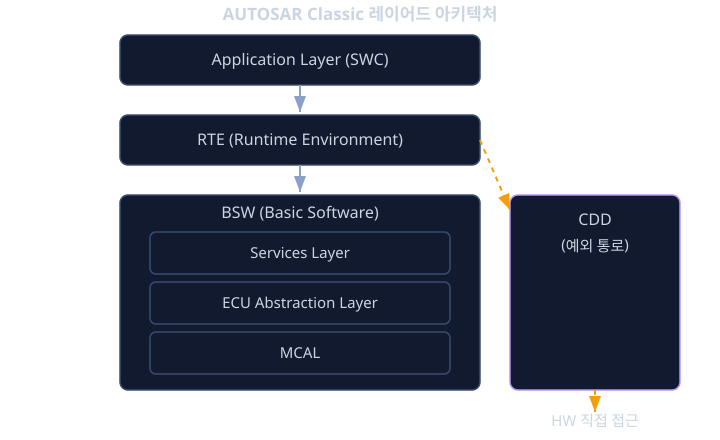
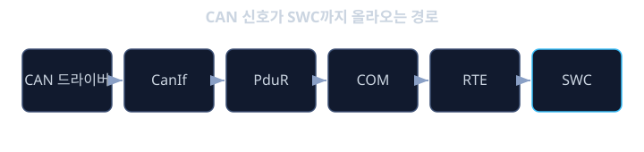

# AUTOSAR Classic

앞서 `embedded-sw`에서 우리는 하나의 ECU(Electronic Control Unit) 안에서 MCU, RTOS, 태스크 스케줄링, 인터럽트, 세마포어/뮤텍스가 어떻게 어우러져 실시간 제어기를 구성하는지 살펴봤다. 그런데 현대 자동차 한 대에는 이런 ECU가 수십 개에서 많게는 백 개 이상 들어간다. 엔진, 변속기, 브레이크, 에어백, 조향, 공조, 계기판까지 거의 모든 기능이 각자의 ECU 위에서 돌아간다. 문제는 이 ECU들을 서로 다른 부품 공급사(supplier)가 만들고, 완성차 업체(OEM)마다 요구사항이 다르다는 데 있다.

이런 상황에서 각 공급사가 ECU 소프트웨어를 저마다의 방식으로 짜면 어떤 일이 벌어질까. 어떤 회사는 CAN 통신 코드를 A라는 구조로, 다른 회사는 B라는 구조로 작성한다. OEM이 공급사를 바꾸거나 같은 제어 로직을 다른 MCU로 이식하려 하면, 하드웨어를 직접 만지는 코드부터 통신 코드까지 거의 전부를 다시 짜야 한다. 제어 알고리즘 자체는 그대로인데도 말이다. 또한 서로 다른 회사가 만든 모듈을 한 ECU 안에 조립하려 해도 인터페이스가 제각각이라 맞물리지 않는다. 자동차 산업이 커질수록 이 "표준의 부재"는 엄청난 중복 개발과 비용, 그리고 품질 위험을 낳았다.

AUTOSAR(AUTomotive Open System ARchitecture)는 바로 이 문제를 풀기 위해 완성차 업체와 공급사, 반도체 회사들이 함께 만든 산업 공통 아키텍처다. 핵심 발상은 단순하다. ECU 소프트웨어를 "하드웨어에 의존하는 부분"과 "제어 로직을 담은 부분"으로 명확히 분리하고, 그 사이에 표준화된 인터페이스 계층을 둔다. 그러면 제어 로직은 하드웨어가 바뀌어도 그대로 재사용할 수 있고, 서로 다른 회사의 모듈도 같은 규칙 위에서 조립된다. 이번 장에서는 제어 ECU를 위한 고전(Classic) AUTOSAR가 이 분리를 레이어드 아키텍처, SWC, RTE, BSW, AUTOSAR OS, 그리고 ARXML 기반 개발 방법론으로 어떻게 구체화하는지 단계적으로 살펴본다.

## 학습 목표

- AUTOSAR Classic의 레이어드 아키텍처(Application / RTE / BSW)와 BSW 내부 구조를 설명할 수 있다.
- 소프트웨어 구성요소(SWC)와 Port, Sender-Receiver / Client-Server 인터페이스의 차이를 구분할 수 있다.
- VFB(Virtual Functional Bus) 개념과 RTE가 왜 "생성"되는 코드인지 설명할 수 있다.
- CAN 신호가 BSW를 거쳐 SWC까지 올라오는 신호 흐름을 모듈 단위로 따라갈 수 있다.
- AUTOSAR OS가 OSEK/VDX 기반의 정적·고정우선순위 선점형 OS라는 점을 `embedded-sw`에서 배운 RTOS 개념과 연결해 이해한다.
- ARXML과 Top-down 개발 방법론(VFB 설계 → ECU 추출 → RTE/코드 생성)의 흐름을 설명할 수 있다.

## 레이어드 아키텍처: 하드웨어와 로직을 갈라놓기

AUTOSAR Classic의 뼈대는 세 개의 큰 층으로 이루어진다. 가장 위가 애플리케이션 레이어(Application Layer)로, 제어 로직을 담은 소프트웨어 구성요소(SWC, Software Component)들이 모여 있다. 가장 아래가 기초 소프트웨어(BSW, Basic Software)로, OS·통신 스택·메모리 관리·진단처럼 하드웨어에 가까운 서비스 전부를 담당한다. 그리고 이 둘 사이에 런타임 환경(RTE, Runtime Environment)이라는 중간 계층이 끼어 있다. RTE는 위쪽 SWC와 아래쪽 BSW를 이어주는 "접착제"이자 유일한 통로다.

이 3단 구조의 핵심은 "애플리케이션은 하드웨어를 직접 만지지 않는다"는 원칙이다. SWC는 센서 값을 읽거나 다른 ECU로 신호를 보낼 때 항상 RTE를 거치고, 결코 CAN 컨트롤러 레지스터나 ADC를 직접 건드리지 않는다. 덕분에 제어 로직은 하드웨어 독립적(hardware-independent)으로 남고, MCU가 바뀌어도 BSW의 하드웨어 밀착 부분만 교체하면 된다.

BSW는 다시 네 부분으로 나뉜다. 가장 아래 마이크로컨트롤러 추상화 계층(MCAL, Microcontroller Abstraction Layer)은 MCU의 레지스터를 직접 다루는 드라이버들(ADC, PWM, CAN 드라이버, SPI 등)로, MCU가 바뀌면 이 층이 바뀐다. 그 위 ECU 추상화 계층(ECU Abstraction Layer)은 MCAL을 감싸서 "이 신호가 어느 핀, 어느 주변장치에 붙어 있는가" 같은 ECU 보드 수준의 배선 차이를 흡수한다. 그 위 서비스 계층(Services Layer)은 통신·메모리·진단·OS 같은 상위 서비스를 제공한다. 이 세 층과 별개로, 표준 구조에 억지로 끼워 맞추기 어려운 특수 하드웨어(예: 매우 빠른 타이밍이 필요한 센서)는 복합 장치 드라이버(CDD, Complex Device Driver)라는 예외 통로를 통해 여러 층을 가로질러 직접 접근할 수 있게 열어둔다.



## SWC와 Port: 제어 로직을 담는 블록

소프트웨어 구성요소(SWC)는 하나의 기능 단위를 담는 블록이다. 예를 들어 "운전자 요구 토크 계산" SWC, "배터리 온도 감시" SWC처럼, 제어 로직의 한 덩어리가 하나의 SWC가 된다. 더 쪼갤 수 없는 최소 단위를 아토믹 SWC(atomic SWC)라 부르며, 이 아토믹 SWC는 반드시 하나의 ECU 위에 통째로 배치된다(여러 ECU에 쪼개 담을 수 없다).

SWC가 바깥세상과 데이터를 주고받는 유일한 창구는 포트(Port)다. 포트에는 두 종류가 있다. 데이터를 제공(내보내는)하는 P-Port(Provided Port)와, 데이터를 요구(받는)하는 R-Port(Required Port)다. "토크 계산" SWC가 목표 토크 값을 P-Port로 내보내면, "엔진 제어" SWC가 R-Port로 그 값을 받는 식이다. 두 SWC는 서로의 내부 구현을 전혀 모른 채, 오직 포트와 그 포트에 붙은 인터페이스(interface)의 약속만으로 연결된다.

포트에 붙는 인터페이스는 크게 두 가지다.

- Sender-Receiver 인터페이스: 데이터 값을 일방적으로 흘려보내는 방식이다. 송신 측은 그냥 값을 쓰고(write), 수신 측은 최근 값을 읽는다(read). 차속, 엔진 회전수, 온도처럼 "계속 갱신되는 신호"에 적합하다. 송신 측은 누가 받는지 신경 쓰지 않고, 수신 측은 언제 갱신됐는지보다 지금 값이 무엇인지에 관심을 둔다.
- Client-Server 인터페이스: 함수 호출처럼 요청하고 응답을 받는 방식이다. 클라이언트(R-Port)가 서버(P-Port)에게 "이 연산을 해 달라"고 요청하면 서버가 처리하고 결과를 돌려준다. "현재 고장 코드를 읽어 달라", "EEPROM에 이 값을 저장해 달라"처럼 명확한 요청-응답이 필요한 동작에 적합하다.

이 두 인터페이스의 구분은 뒤에서 다룰 RTE API 모양에도 그대로 반영된다. Sender-Receiver는 읽기/쓰기, Client-Server는 호출의 형태를 띤다.

## RTE와 VFB: 배치를 모르고 설계하기

AUTOSAR의 가장 우아한 아이디어가 가상 기능 버스(VFB, Virtual Functional Bus)와 RTE다. 설계자는 처음에 SWC들을 그리면서, 각 SWC가 실제로 "어느 ECU에 올라갈지"를 전혀 정하지 않는다. 그저 "토크 계산 SWC의 P-Port가 엔진 제어 SWC의 R-Port에 연결된다"처럼 논리적 연결만 그린다. 이 가상의, 아직 물리적으로 구현되지 않은 연결망이 바로 VFB다. VFB 위에서는 모든 SWC가 "나는 어떤 거대한 버스에 연결되어 있고, 포트로 신호를 주고받는다"고만 가정한다. 상대가 같은 ECU 안에 있는지, 아니면 CAN 건너편의 다른 ECU에 있는지는 알지 못한다.

그렇다면 이 추상적인 연결이 실제 코드에서는 어떻게 동작할까. 여기서 RTE가 등장한다. RTE는 사람이 손으로 짜는 라이브러리가 아니라, 설정 정보를 바탕으로 자동 생성(generate)되는 코드다. RTE 생성기는 "어떤 SWC가 어떤 ECU에 배치되었는지"를 보고, VFB의 논리적 연결을 실제 구현으로 번역한다. 두 SWC가 같은 ECU에 있으면, 한 SWC의 P-Port 쓰기가 다른 SWC의 R-Port 읽기로 이어지도록 그냥 직접 함수 호출이나 공유 변수 접근 코드를 만든다. 반대로 두 SWC가 다른 ECU에 있으면, 송신 측 데이터를 통신 스택(COM, PduR, CAN 드라이버)으로 넘겨 CAN 프레임으로 내보내고, 수신 측 ECU에서는 역방향으로 받아 R-Port에 꽂아주는 코드를 생성한다.

핵심은 이것이다. SWC의 소스 코드는 두 경우 모두 똑같다. SWC 입장에서는 그저 `Rte_Write_...`로 값을 쓰고 `Rte_Read_...`로 값을 읽을 뿐, 그 신호가 ECU 내부에서 처리되는지 CAN을 타고 넘어가는지 전혀 모른다. 배치가 바뀌면 RTE만 다시 생성하면 되고, 제어 로직은 손대지 않는다. 이것이 "설계는 하드웨어 독립적으로, 구현은 배치에 맞춰 자동 생성"이라는 AUTOSAR의 생산성 비결이다.

## BSW 통신 스택: CAN 신호가 SWC까지 올라오는 길

BSW 서비스 계층에는 수많은 모듈이 있지만, 신호가 어떻게 흐르는지 한 줄기를 따라가 보면 그림이 또렷해진다. 대표적인 모듈 몇 개를 보자.

- COM(Communication, 신호 기반 통신): 개별 신호(차속, 회전수 등)와 네트워크가 실제로 전송하는 바이트 묶음(PDU, Protocol Data Unit) 사이를 변환한다. SWC가 다루는 "신호" 세계와 버스가 다루는 "PDU" 세계의 경계다.
- PduR(PDU Router): PDU를 적절한 하위 모듈로 라우팅한다. 이 PDU는 CAN으로, 저 PDU는 진단 모듈로 보내는 식의 교통정리를 한다.
- NvM(NVRAM Manager): EEPROM이나 플래시 같은 비휘발성 메모리에 데이터를 안전하게 읽고 쓰는 일을 담당한다. 학습값이나 고장 이력을 전원이 꺼져도 유지해야 할 때 쓴다.
- Dcm(Diagnostic Communication Manager): 정비소 진단기와 통신하며 고장 코드 읽기, 액추에이터 강제 구동 같은 진단 서비스를 처리한다.
- EcuM(ECU State Manager): ECU의 시동(startup)과 종료(shutdown), 저전력(sleep) 같은 상태 전환을 총괄한다.

이제 다른 ECU가 보낸 차속 신호가 우리 ECU의 SWC까지 올라오는 길을 따라가 보자. 먼저 CAN 버스에 프레임이 도착하면 MCAL의 CAN 드라이버가 이를 받아 상위로 올린다. 그 위 CanIf(CAN Interface)가 하드웨어 차이를 감추고 PDU 형태로 PduR에게 전달한다. PduR은 이 PDU가 신호 기반 통신 대상임을 보고 COM에게 넘긴다. COM은 PDU 안의 비트들을 풀어 "차속 = 72 km/h" 같은 개별 신호 값으로 분해한다. 마지막으로 RTE가 이 신호 값을 해당 SWC의 R-Port에 연결해 주고, SWC는 `Rte_Read`로 그 값을 읽는다. 송신은 이 과정을 정확히 거꾸로 밟는다. 이렇게 각 층이 한 가지 변환만 책임지도록 쪼개져 있어서, 어느 한 부분이 바뀌어도 나머지에 영향이 적다.



## AUTOSAR OS: OSEK 위에 세운 표준 OS

AUTOSAR OS는 `embedded-sw`에서 배운 RTOS 개념을 자동차 산업 표준으로 구체화한 것으로, 그 뿌리는 OSEK/VDX라는 유럽 자동차 OS 규격이다. 몇 가지 성격이 일반 RTOS와 구분된다.

첫째, 정적(static) 구성이다. 태스크의 개수, 우선순위, 스택 크기, 어떤 리소스를 쓰는지가 모두 빌드 전에 설정 파일로 고정된다. 실행 중에 태스크를 동적으로 만들거나 없애지 않는다. 이렇게 하면 메모리 사용량과 동작이 예측 가능해져 검증과 안전성 분석이 쉬워진다. 둘째, 고정우선순위 선점형 스케줄링(fixed-priority preemptive scheduling)이다. 이는 `embedded-sw`에서 다룬 우선순위 기반 선점 스케줄링 바로 그것으로, 더 높은 우선순위 태스크가 준비되면 낮은 우선순위 태스크를 즉시 선점한다.

또한 AUTOSAR OS는 리소스 공유 시 우선순위 역전을 막기 위해, 뮤텍스보다 더 엄격하고 결정론적인 우선순위 상한 프로토콜(OSEK PCP, Priority Ceiling Protocol)을 쓴다. 각 리소스에 그것을 쓰는 태스크 중 최고 우선순위를 미리 "상한"으로 정해두고, 리소스를 잡는 순간 태스크 우선순위를 그 상한까지 올린다. 이렇게 하면 `embedded-sw`에서 본 우선순위 역전뿐 아니라 교착(deadlock)까지 정적으로 방지할 수 있다. 여기에 더해, 주기적으로 깨어나는 태스크를 구동하기 위한 알람(Alarm)과 카운터(Counter), 그리고 여러 태스크의 실행 시점을 시간표처럼 짜 맞추는 스케줄 테이블(Schedule Table) 같은 시간 동기화 장치도 표준으로 제공한다.

## ARXML과 개발 방법론: 설정이 곧 설계

AUTOSAR 개발에서 코드만큼 중요한 것이 설정(configuration)이다. SWC의 포트, 인터페이스, ECU 배치, 신호-PDU 매핑, OS 태스크 구성까지 거의 모든 설계 정보가 ARXML(AUTOSAR XML)이라는 표준 XML 형식의 파일에 담긴다. ARXML은 사람이 손으로 외워 쓰는 것이 아니라, 전용 설정 도구에서 그래픽으로 편집하고 기계가 읽어 코드 생성에 사용하는 "기계가 읽는 설계도"에 가깝다.

전형적인 개발 흐름은 하향식(Top-down)이다. 먼저 VFB 수준에서 SWC들과 그 연결을 설계한다(아직 ECU 배치는 없다). 다음으로 이 SWC들을 실제 ECU에 할당하는 ECU 추출(ECU extraction) 단계를 거친다. 그다음 각 ECU에 대해 BSW 모듈들을 설정하고, 마지막으로 이 모든 설정 정보를 바탕으로 RTE와 BSW 설정 코드를 자동 생성한다. 개발자는 SWC 안의 제어 로직(런너블)만 손으로 작성하면 되고, 모듈을 이어 붙이는 방대한 접착 코드는 도구가 만들어 준다.

<details><summary><b>심화: 런너블과 RTE API 호출 규약</b></summary>

SWC 내부의 실제 코드는 런너블(Runnable Entity)이라는 함수 단위로 들어간다. 런너블은 스스로 도는 것이 아니라, RTE가 특정 이벤트에 맞춰 호출해 준다. 대표적인 이벤트가 주기적 실행을 위한 TimingEvent(예: 10 ms마다 호출)와, 데이터가 도착했을 때 깨어나는 DataReceivedEvent다. RTE는 설정에 따라 이 런너블들을 적절한 OS 태스크에 매핑해, 결국 AUTOSAR OS의 태스크 스케줄링 위에서 돌아가게 만든다. 즉 SWC 설계자는 OS 태스크를 직접 다루지 않고 "이 런너블은 10 ms 주기"라고 선언만 하며, 태스크로의 배치는 RTE/설정이 책임진다.

런너블이 포트를 통해 바깥과 소통할 때 쓰는 함수들이 RTE API이며, 이름 규약이 일정하다.

- Sender-Receiver의 송신은 `Rte_Write_<Port>_<Element>(값)`, 수신은 `Rte_Read_<Port>_<Element>(&변수)` 형태다.
- Client-Server의 요청은 `Rte_Call_<Port>_<Operation>(인자들)` 형태로, 함수 호출처럼 서버의 연산을 부른다.

예를 들어 토크 계산 런너블은 이렇게 생겼을 수 있다.

```c
void TorqueCalc_Run(void)
{
    float pedal;
    Rte_Read_PedalIn_Position(&pedal);   /* 가속 페달 신호 수신 */
    float target = pedal * MAX_TORQUE;   /* 제어 로직 */
    Rte_Write_TorqueOut_Target(target);  /* 목표 토크 송신 */
}
```

이 코드 어디에도 CAN이나 공유 변수, 다른 SWC 이름이 등장하지 않는다. 그 연결은 전적으로 RTE 생성 결과에 달려 있고, 런너블은 순수한 제어 로직만 담는다.

</details>

<details><summary><b>심화: OS-Application과 메모리 보호 — Freedom from Interference</b></summary>

안전이 중요한 ECU에서는 ASIL 등급이 높은(안전 중요도가 큰) 기능과 낮은 기능이 같은 MCU 위에 함께 돌아가는 경우가 많다. 이때 중요도가 낮은 모듈의 버그(예: 잘못된 포인터로 엉뚱한 메모리를 덮어쓰는 오류)가 중요도가 높은 모듈의 데이터를 망가뜨리면 안 된다. ISO 26262는 이렇게 "서로 다른 안전 수준의 기능이 서로를 간섭하지 않아야 한다"는 요구를 간섭으로부터의 자유(Freedom from Interference)라 부른다.

AUTOSAR OS는 이를 위해 태스크와 ISR을 OS-Application이라는 묶음으로 그룹화하고, MCU의 메모리 보호 장치(MPU, Memory Protection Unit)를 이용해 각 그룹에 자신만 접근할 수 있는 메모리 영역을 할당한다. 신뢰(trusted) 영역과 비신뢰(non-trusted) 영역을 구분해, 비신뢰 OS-Application이 허락되지 않은 메모리나 주변장치에 접근하려 하면 보호 위반으로 걸러낸다. 여기에 더해 각 태스크의 실행 시간을 감시하는 타이밍 보호(timing protection)까지 결합하면, 한 기능의 오작동이 공간적으로도 시간적으로도 다른 기능을 침범하지 못하도록 격리할 수 있다. 이것이 하나의 ECU 안에서 서로 다른 안전 수준의 소프트웨어를 함께 돌리는 기반이 된다.

</details>

**확인 문제.** 어떤 "배터리 온도 감시" SWC가 계산한 온도 값을, 지금은 같은 ECU 안의 "열관리 제어" SWC가 받아서 쓴다. 그런데 설계 변경으로 열관리 제어 SWC가 다른 ECU로 옮겨가 CAN을 통해 그 온도를 받아야 하게 되었다. 이때 배터리 온도 감시 SWC의 제어 로직 코드를 고쳐야 하는가? 그 이유를 VFB와 RTE 개념으로 설명하라.

<details><summary>답 보기</summary>

고치지 않아도 된다. SWC는 VFB 위에서 설계되어, 자신의 신호를 받는 상대가 같은 ECU에 있는지 다른 ECU에 있는지 알지 못한 채 그저 `Rte_Write`로 온도 값을 쓸 뿐이다. 배치가 "같은 ECU"에서 "다른 ECU"로 바뀌면, 바뀌는 것은 RTE가 생성하는 코드뿐이다. 이전에는 RTE가 직접 함수 호출이나 공유 변수 접근 코드를 만들었다면, 이제는 그 쓰기를 통신 스택(COM → PduR → CAN 드라이버)으로 연결해 CAN 프레임으로 내보내는 코드를 생성한다. 수신 측 ECU에서도 역방향 경로가 자동 생성된다. 따라서 ECU 배치 정보를 바꾸고 RTE를 다시 생성하기만 하면 되고, SWC 안의 온도 계산 로직은 그대로 재사용된다. 이것이 AUTOSAR가 제어 로직을 하드웨어·배치로부터 독립시킨 핵심 효과다.

</details>

**확인 문제.** 정비소 진단기가 보낸 "고장 코드 읽기" 요청이 특정 SWC까지 전달될 때, 이를 Sender-Receiver 인터페이스로 설계하는 것과 Client-Server 인터페이스로 설계하는 것 중 어느 쪽이 더 적절한가? 이유를 설명하라.

<details><summary>답 보기</summary>

Client-Server 인터페이스가 더 적절하다. "고장 코드를 읽어 달라"는 동작은 명확한 요청과 그에 대한 응답(고장 코드 목록)이 짝을 이루는, 함수 호출에 가까운 상호작용이기 때문이다. 클라이언트가 서버에게 `Rte_Call`로 연산을 요청하고 서버가 결과를 돌려주는 Client-Server 모델이 이 의미를 그대로 표현한다. 반면 Sender-Receiver는 차속이나 온도처럼 계속 갱신되는 값을 일방적으로 흘려보내고 최근 값을 읽는 데 적합하며, 명시적인 요청-응답의 짝이 없다. 진단처럼 "이 시점에 이 연산을 수행하고 그 결과를 받는" 동작에는 Client-Server가 맞다.

</details>

## 정리

- AUTOSAR는 여러 OEM과 공급사가 각자 다른 구조로 ECU 소프트웨어를 만들며 생기던 중복 개발과 호환성 문제를 풀기 위해, 하드웨어 의존 부분과 제어 로직을 표준 인터페이스로 분리한 산업 공통 아키텍처다.
- 레이어드 아키텍처는 Application(SWC) / RTE / BSW의 3단으로 나뉘고, BSW는 다시 Services, ECU Abstraction, MCAL과 예외 통로인 CDD로 구성된다.
- SWC는 Port(P-Port/R-Port)로만 소통하며, 값 흐름에는 Sender-Receiver, 요청-응답에는 Client-Server 인터페이스를 쓴다.
- VFB 위에서 SWC는 배치를 모른 채 설계되고, RTE는 실제 ECU 배치에 맞춰 같은 ECU면 직접 호출, 다른 ECU면 통신 스택을 거치는 코드를 자동 생성한다.
- CAN 신호는 CAN 드라이버 → CanIf → PduR → COM → RTE를 거쳐 SWC의 R-Port까지 올라오며, 각 BSW 모듈은 한 가지 변환만 책임진다.
- AUTOSAR OS는 OSEK/VDX 기반의 정적·고정우선순위 선점형 OS로, `embedded-sw`에서 배운 RTOS 개념을 산업 표준과 안전 메커니즘(우선순위 상한, 메모리 보호)으로 구체화한다.
- 설계 정보는 ARXML에 담기고, VFB 설계 → ECU 추출 → RTE/코드 생성이라는 Top-down 방법론을 따른다.

이렇게 AUTOSAR Classic은 `embedded-sw`에서 다룬 "하나의 ECU 안에서 돌아가는 실시간 소프트웨어"를, 수십 개의 ECU가 모여 하나의 차량 시스템을 이루는 산업 현장의 규모로 끌어올리는 표준이다. 제어 로직을 하드웨어와 배치로부터 분리해 재사용성과 안전성을 동시에 확보하는 이 사고방식은, 이후 차량 네트워크와 더 상위의 차량 소프트웨어 플랫폼을 이해하는 바탕이 된다.

## 참고 자료

- AUTOSAR Classic Platform 공식 명세 (Layered Software Architecture, RTE, OS, COM 등 각 모듈 규격 문서)
- OSEK/VDX Operating System Specification (AUTOSAR OS의 기반 규격)
- ISO 26262 (도로 차량 기능안전, Freedom from Interference 관련 파트)
- Robert Bosch GmbH, "Automotive Handbook" (자동차 전자·네트워크 전반)
- AUTOSAR Methodology 문서 (VFB 설계부터 ECU 추출·코드 생성까지의 개발 방법론)
