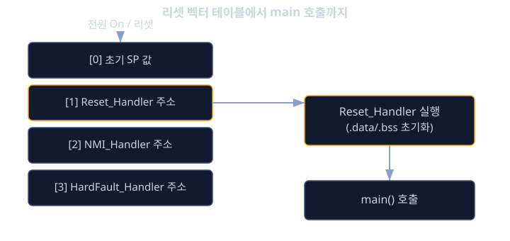
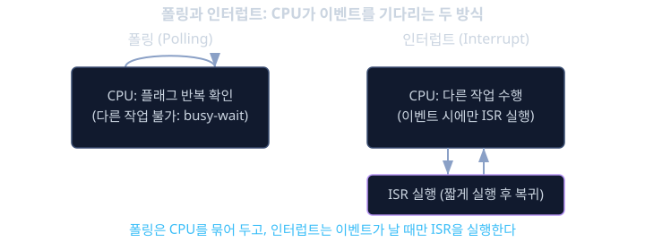

# 베어메탈 펌웨어

새로 설계한 바디 제어 유닛(BCU) 보드가 막 조립되어 손에 들어왔다고 해보자. 보드에는 아직 어떤 소프트웨어도 올라가 있지 않다. 디버거를 연결하고 전원을 넣는 순간, CPU 안에서는 무슨 일이 벌어질까. 화면도 없고, 로그를 찍어주는 운영체제도 없고, "프로그램이 시작되었다"는 것을 알려주는 쉘 프롬프트 하나도 없다. 이 순간 펌웨어 개발자가 손으로 챙겨야 하는 모든 단계, 즉 리셋 직후 CPU가 가장 먼저 실행하는 명령이 무엇인지, 전역 변수들이 어떻게 초기값을 갖게 되는지, 스택은 누가 설정하는지를 전혀 모른다면 보드에 불이 들어오지 않을 때 무엇부터 확인해야 할지조차 알 수 없다.

선수 레슨에서는 MCU 내부에 CPU 코어와 플래시, RAM, 그리고 ADC·타이머 같은 주변장치가 함께 들어 있고, 이들이 레지스터라는 특정 메모리 주소를 통해 제어된다는 것을 배웠다. RTOS는 이런 레지스터 조작과 인터럽트 처리 위에 태스크 스케줄링이라는 소프트웨어 층을 하나 더 얹은 것일 뿐이다. 즉 RTOS의 세마포어, 태스크 전환, 틱 인터럽트 같은 기능도 결국 그 밑바닥에서는 특정 레지스터를 읽고 쓰고, 특정 인터럽트 벡터에 함수를 등록하는 코드로 구현되어 있다. RTOS를 가져다 쓰는 것과, RTOS를 새 보드에 포팅하거나 그 안에서 발생한 이상 동작을 디버깅하는 것은 전혀 다른 수준의 일이며, 후자는 이번 레슨에서 다루는 베어메탈(bare-metal) 지식 없이는 손을 댈 수 없다.

집에 전기가 들어오는 상황에 비유하면 이해가 쉽다. 보일러와 조명을 중앙에서 알아서 관리해 주는 집사가 있는 집이라면(운영체제가 있는 상황), 집주인은 "실내 온도를 22도로 유지해 줘"라고 말만 하면 된다. 하지만 집사가 없는 집(베어메탈)이라면, 온도 센서 값을 직접 확인하고 그 값에 따라 보일러 밸브를 직접 열고 닫는 코드를 처음부터 끝까지 전부 손으로 작성해야 한다. 베어메탈 프로그래밍이란 바로 이 "집사 없는 집"에서, 하드웨어의 모든 스위치와 다이얼을 프로그래머가 직접 조작하는 방식의 소프트웨어를 말한다.

이번 레슨에서는 전원이 켜진 순간부터 `main` 함수가 실행되기까지 CPU 내부에서 일어나는 일, 즉 리셋 벡터와 스타트업 코드를 먼저 살펴본다. 이어서 레지스터를 직접 읽고 써서 하드웨어를 제어하는 메모리 매핑 입출력(MMIO)의 원리, 그리고 CPU가 외부 이벤트를 기다리는 두 가지 전략인 폴링(polling)과 인터럽트(interrupt)를 비교한다.

## 학습 목표

- 리셋 벡터와 벡터 테이블이 무엇이며, CPU가 전원 인가 직후 어떤 순서로 명령을 실행하는지 설명할 수 있다.
- 스타트업 코드가 `.data`와 `.bss` 영역을 초기화하고 스택 포인터를 설정한 뒤 `main`으로 진입하는 과정을 설명할 수 있다.
- 메모리 매핑 레지스터(MMIO)의 개념을 이해하고, 레지스터 읽기/쓰기로 GPIO 같은 주변장치를 제어하는 코드를 작성할 수 있다.
- 폴링 방식과 인터럽트 방식의 동작 차이와 각각이 적합한 상황을 구분할 수 있다.
- `volatile` 키워드가 왜 필요한지와 컴파일러 최적화가 하드웨어 레지스터 접근을 어떻게 방해할 수 있는지 설명할 수 있다.

## 전원이 켜지는 순간: 리셋과 벡터 테이블

CPU에 전원이 들어오거나 리셋 핀이 해제되면, CPU는 미리 정해진 하나의 메모리 주소에서 첫 번째 명령을 가져와 실행한다. 이 특정 주소를 리셋 벡터(reset vector)라 부른다. ARM Cortex-M 계열 MCU에서는 이 리셋 벡터가 메모리의 가장 앞부분, 보통 플래시 메모리의 시작 주소 근처에 자리한 벡터 테이블(vector table)이라는 작은 표 안에 들어 있다. 벡터 테이블은 스택 포인터의 초기값과, 리셋·여러 인터럽트가 발생했을 때 실행할 함수들의 주소를 순서대로 모아놓은 배열이다.

예를 들어 Cortex-M 벡터 테이블의 맨 앞 두 칸은 다음과 같은 역할을 한다.

```c
/* 벡터 테이블의 앞부분 (의사 코드) */
const uint32_t vector_table[] = {
    (uint32_t)&_stack_top,     /* 0번째: 초기 스택 포인터 값 */
    (uint32_t)Reset_Handler,   /* 1번째: 리셋 시 실행할 함수의 주소 */
    (uint32_t)NMI_Handler,     /* 2번째: NMI 인터럽트 핸들러 */
    (uint32_t)HardFault_Handler,
    /* 이후 각종 인터럽트 핸들러 주소가 이어진다 */
};
```

CPU는 리셋이 풀리면 이 테이블의 0번째 칸을 읽어 스택 포인터(SP) 레지스터에 넣고, 1번째 칸에 적힌 주소로 점프해서 그 함수, 즉 `Reset_Handler`를 실행하기 시작한다. 여기서 중요한 점은 아직 `main` 함수는 실행되지 않았다는 것이다. `Reset_Handler`는 `main`을 호출하기 전에 몇 가지 준비 작업을 먼저 수행하는데, 이것이 바로 스타트업 코드(startup code)다.



## 스타트업 코드: main 이전에 일어나는 일

C 언어로 짠 프로그램은 전역 변수가 초기값을 가진 채로 시작된다고 당연하게 생각한다. 그런데 이 전역 변수들의 초기값이 플래시 메모리가 아닌 RAM에 저장되어야 `main` 안에서 자유롭게 읽고 쓸 수 있다. 문제는 전원이 꺼지면 RAM의 내용이 모두 사라진다는 것이다. 즉 "초기값을 가진 전역 변수"를 실제로 쓸 수 있게 만들려면, 전원이 켜질 때마다 그 초기값을 플래시에서 RAM으로 복사해 주는 코드가 `main`보다 먼저 실행되어야 한다. 이 역할을 하는 것이 스타트업 코드다.

스타트업 코드가 하는 일은 보통 다음 순서로 요약된다.

- 스택 포인터를 벡터 테이블에 적힌 초기값으로 설정한다(대부분 하드웨어가 리셋 과정에서 자동으로 처리한다).
- 초기값이 있는 전역/정적 변수들의 데이터를 플래시의 `.data` 영역에서 RAM의 `.data` 영역으로 복사한다.
- 초기값이 명시되지 않은(0으로 시작해야 하는) 전역/정적 변수들이 모인 `.bss` 영역을 RAM에서 전부 0으로 채운다.
- 필요하다면 C++ 전역 객체의 생성자처럼 `main` 실행 전에 호출되어야 하는 초기화 함수들을 호출한다.
- 마지막으로 `main` 함수를 호출한다.

아래는 이 과정을 단순화한 C 의사 코드다.

```c
void Reset_Handler(void) {
    /* .data: 플래시에 있는 초기값을 RAM으로 복사 */
    uint32_t *src = &_data_flash_start;
    uint32_t *dst = &_data_ram_start;
    while (dst < &_data_ram_end) {
        *dst++ = *src++;
    }

    /* .bss: 초기화되지 않은 전역 변수 영역을 0으로 채움 */
    uint32_t *bss = &_bss_start;
    while (bss < &_bss_end) {
        *bss++ = 0;
    }

    /* 이제서야 안전하게 main을 호출할 수 있다 */
    main();

    /* main이 반환되면 보통 무한 루프에 가둔다 */
    while (1) { }
}
```

`_data_flash_start`, `_bss_end` 같은 심볼들은 프로그래머가 직접 숫자로 정하는 것이 아니라, 다음 레슨에서 다룰 링커 스크립트가 빌드 과정에서 자동으로 계산해 넣어준다. 지금 단계에서는 "이 심볼들이 가리키는 메모리 구간을 스타트업 코드가 복사하고 지운다"는 동작의 흐름만 기억하면 충분하다. 중요한 점은, 이 모든 과정이 끝나기 전까지는 전역 변수의 값을 신뢰할 수 없다는 것이다. 만약 스타트업 코드에 버그가 있어서 `.bss`를 지우지 않고 지나간다면, 0으로 시작해야 할 변수가 의미 없는 쓰레기 값으로 시작하면서 프로그램이 알 수 없는 방식으로 오동작하게 된다.

## 레지스터를 직접 두드리기: 메모리 매핑 입출력

베어메탈 프로그래밍의 핵심은 결국 레지스터를 직접 읽고 쓰는 일이다. MCU의 주변장치(GPIO, 타이머, UART 등)는 각각 고유한 메모리 주소를 가지고 있고, 그 주소에 값을 쓰거나 읽는 행위가 곧 하드웨어를 조작하는 행위가 된다. 이런 방식을 메모리 매핑 입출력(Memory-Mapped I/O, MMIO)이라 부른다. 일반 변수를 읽고 쓰는 것과 문법은 똑같지만, 그 주소 뒤에는 진짜 메모리가 아니라 전기 신호를 만들어내는 하드웨어 회로가 연결되어 있다는 점이 다르다.

예를 들어 어떤 GPIO 포트의 출력 데이터 레지스터가 주소 `0x40020014`에 있고, 그 레지스터의 5번 비트를 1로 쓰면 5번 핀에 연결된 LED가 켜진다고 하자. 이를 C 코드로 표현하면 다음과 같다.

```c
/* BSRR: 상위 16비트에 쓰면 해당 핀이 LOW로, 하위 16비트에 쓰면 HIGH로 설정된다 */
#define GPIOB_BSRR (*(volatile uint32_t *)0x40020018UL)

void led_on(void) {
    GPIOB_BSRR = (1u << 5);         /* 5번 핀 SET -> LED 켜짐 */
}

void led_off(void) {
    GPIOB_BSRR = (1u << (5 + 16));  /* 5번 핀 RESET -> LED 꺼짐 */
}
```

여기서 `volatile` 키워드가 결정적인 역할을 한다. 컴파일러는 보통 코드를 최적화할 때 "이 변수는 한 번 읽어서 캐시해 두고, 나중에 같은 변수를 또 읽는 코드가 나오면 다시 메모리에 접근하지 않고 캐시된 값을 재사용"하는 식으로 불필요한 메모리 접근을 줄인다. 일반 변수라면 이런 최적화가 프로그램의 결과를 바꾸지 않으므로 전혀 문제가 없다. 그런데 `GPIOB_ODR`처럼 실제로는 하드웨어 레지스터인 주소를 이렇게 캐시해 버리면, 하드웨어가 그 사이에 값을 바꿨어도 생성된 코드는 그 변화를 읽지 않고 예전 캐시 값만 계속 사용하게 된다. `volatile`은 컴파일러에게 "이 주소는 내가 모르는 사이에 값이 바뀔 수 있으니, 코드에 적힌 그대로 매번 실제로 메모리에 접근하라"고 지시하는 키워드다. 하드웨어 레지스터를 가리키는 포인터에는 반드시 `volatile`을 붙여야 하는 이유가 여기에 있다.

## 폴링: 가장 단순하지만 CPU를 묶어두는 방식

주변장치의 상태 변화를 알아내는 가장 단순한 방법은 폴링(polling)이다. CPU가 특정 레지스터를 반복해서 읽으며 "원하는 상태가 되었는가"를 계속 확인하는 방식이다. 예를 들어 UART로 한 바이트를 전송할 때, 전송 레지스터가 비어 있는지를 나타내는 플래그 비트를 계속 확인하다가 비어 있으면 그제서야 데이터를 쓰는 식이다.

```c
#define UART_SR   (*(volatile uint32_t *)0x40011000UL)
#define UART_DR   (*(volatile uint32_t *)0x40011004UL)
#define UART_TXE  (1u << 7)   /* 송신 레지스터 비어 있음을 나타내는 플래그 */

void uart_send_byte(uint8_t byte) {
    while (!(UART_SR & UART_TXE)) {
        /* 아무것도 하지 않고 플래그가 설 때까지 계속 확인(busy-wait) */
    }
    UART_DR = byte;
}
```

폴링은 코드가 단순하고, 동작 순서를 눈으로 그대로 따라갈 수 있어서 이해하기 쉽다. 하지만 치명적인 단점이 있다. `while` 루프 안에서 CPU는 그 조건이 만족될 때까지 다른 어떤 일도 하지 못하고 그 자리에 묶여 있는다(busy-wait). UART 전송이 끝나기까지 1 ms가 걸린다면, 그 1 ms 동안 CPU는 오직 플래그만 쳐다보며 아무 쓸모 있는 일도 하지 못한다. 할 일이 한 가지뿐이고 그 작업이 전체 프로그램에서 가장 중요한 일이라면 폴링도 나쁘지 않은 선택이다. 그러나 동시에 센서도 읽고 다른 통신도 처리해야 하는 상황에서는 이런 낭비를 감당할 수 없다.

## 인터럽트: CPU를 기다림에서 풀어주기

인터럽트는 폴링의 이 낭비를 없애기 위한 메커니즘이다. CPU가 특정 레지스터를 반복해서 확인하는 대신, "이벤트가 발생하면 하드웨어가 CPU에게 직접 알려달라"고 미리 등록해 두고, 그 사이에는 다른 일을 자유롭게 한다. 이벤트가 실제로 발생하면 CPU는 지금 실행 중이던 코드를 멈추고, 벡터 테이블에 등록된 해당 인터럽트의 처리 함수, 즉 ISR(Interrupt Service Routine)로 자동으로 점프해서 실행한다. ISR이 끝나면 CPU는 멈췄던 원래 코드로 다시 돌아가 이어서 실행한다.

앞서 본 UART 송신을 인터럽트 방식으로 바꾸면 다음과 같은 구조가 된다.

```c
#define UART_CR   (*(volatile uint32_t *)0x40011008UL)
#define UART_ICR  (*(volatile uint32_t *)0x4001100CUL)  /* 쓰면 해당 플래그가 지워지는 전용 레지스터 */
#define UART_TXE_IRQ_EN (1u << 7)

volatile uint8_t tx_busy = 0;

void uart_send_byte_async(uint8_t byte) {
    tx_busy = 1;
    UART_DR = byte;              /* 전송을 시작만 시켜두고 바로 반환 */
    UART_CR |= UART_TXE_IRQ_EN;  /* 송신 완료 인터럽트를 활성화 */
}

/* 송신이 끝나면 하드웨어가 이 함수를 자동으로 호출한다 */
void UART_IRQHandler(void) {
    UART_ICR = UART_TXE;  /* 해당 비트에 1을 쓰면 플래그가 지워지는 전용 레지스터 */
    tx_busy = 0;
}
```

`uart_send_byte_async`는 전송을 걸어두기만 하고 즉시 반환되므로, CPU는 그 즉시 다른 코드를 계속 실행할 수 있다. 전송이 실제로 끝나는 순간에만 하드웨어가 `UART_IRQHandler`를 호출해 뒷정리를 맡긴다. 이렇게 하면 CPU가 아무 일도 안 하며 기다리는 시간이 사라진다. 다만 인터럽트에는 대가가 따른다. ISR은 지금 CPU가 어떤 코드를 실행하고 있든 상관없이 끼어들기 때문에, ISR 안의 코드는 가능한 한 짧고 빠르게 작성해야 한다. 또한 ISR과 메인 코드가 `tx_busy`처럼 같은 변수를 함께 다루는 경우, 그 변수에도 `volatile`을 붙여야 컴파일러가 ISR에 의한 값 변화를 무시하지 않는다.



<details><summary><b>심화: 워치독 타이머와 베어메탈 시스템의 안전장치</b></summary>

베어메탈 시스템에는 "운영체제가 멈췄다"는 것을 감시해 줄 존재가 없다. 만약 메인 루프가 예상치 못한 버그로 특정 조건을 영원히 기다리며 멈춰버리면(이를 행업, hang이라 부른다), 그 사실을 아무도 알려주지 않는다. 이를 막기 위해 거의 모든 자동차용 MCU에는 워치독 타이머(watchdog timer)라는 전용 하드웨어가 들어 있다.

워치독 타이머는 독립적으로 흐르는 카운터로서, 정해진 시간 안에 소프트웨어가 "나는 아직 정상적으로 살아서 동작하고 있다"는 신호(흔히 워치독을 먹인다, feeding the watchdog라 부른다)를 특정 레지스터에 써주지 않으면, 카운터가 다 되는 순간 CPU 전체를 강제로 리셋시켜 버린다. 정상적인 메인 루프라면 다음과 같이 루프를 한 바퀴 돌 때마다 워치독을 먹이는 코드를 넣는다.

```c
while (1) {
    read_sensors();
    run_control_logic();
    update_actuators();
    WATCHDOG_REFRESH_REG = WATCHDOG_MAGIC_VALUE;  /* "나 살아있다" 신호 */
}
```

만약 `run_control_logic` 안에서 무한 루프에 걸려 메인 루프 전체가 멈추면, 워치독을 먹이는 코드까지 함께 멈추게 되고, 정해진 시간(예: 100 ms)이 지나면 워치독이 자동으로 CPU를 리셋시킨다. 자동차 ECU처럼 사람이 직접 전원을 껐다 켤 수 없는 환경에서, 소프트웨어 결함으로 완전히 응답 불가 상태가 되는 것을 막는 최후의 안전망이 바로 이 워치독이다. ISO 26262 같은 기능안전 표준에서도 워치독 감시는 거의 필수적으로 요구되는 메커니즘이다.

</details>

<details><summary><b>심화: 중첩 인터럽트와 우선순위, 그리고 인터럽트 비활성화 구간</b></summary>

실제 MCU에는 보통 하나의 인터럽트만 있는 것이 아니라, GPIO·타이머·UART·CAN 등 수십 개의 인터럽트 소스가 동시에 존재한다. 이들 각각에는 우선순위가 부여되며, 더 높은 우선순위의 인터럽트가 발생하면 지금 실행 중인 낮은 우선순위의 ISR조차 다시 한번 멈추고 끼어들 수 있다. 이를 중첩 인터럽트(nested interrupt)라 한다. ARM Cortex-M의 NVIC(Nested Vectored Interrupt Controller)가 바로 이 우선순위 판단과 중첩 처리를 하드웨어적으로 자동화해 주는 장치다.

때로는 특정 코드 구간을 실행하는 동안 어떤 인터럽트도 끼어들지 못하게 막아야 할 때가 있다. 예를 들어 여러 바이트로 이루어진 값을 레지스터에 순서대로 쓰는 도중에 인터럽트가 끼어들어 같은 레지스터를 건드리면 값이 뒤섞일 수 있다. 이런 상황에서는 짧게 인터럽트를 전체적으로 비활성화한 뒤(Cortex-M의 `CPSID I` 명령 등으로), 임계 구간(critical section)을 지나고 나서 다시 활성화한다. 다만 이 비활성화 구간이 길어지면 그동안 정말 중요한 인터럽트(예: 에어백 충돌 감지)조차 지연되므로, 임계 구간은 항상 가능한 최소한으로 짧게 유지해야 한다는 것이 베어메탈 프로그래밍의 중요한 규칙이다.

</details>

**확인 문제.** 어떤 개발자가 하드웨어 레지스터를 가리키는 포인터를 `volatile` 없이 `uint32_t *reg = (uint32_t *)0x40020014;`로 선언하고, 반복문 안에서 `while ((*reg & 0x1) == 0) { }`로 특정 플래그 비트가 설정되기를 기다리는 폴링 코드를 작성했다. 최적화를 켠 컴파일러에서 이 코드가 어떤 문제를 일으킬 수 있는지 설명하라.
<details><summary>답 보기</summary>

`volatile`이 없으면 컴파일러는 `*reg`가 반복문 안에서 결코 변하지 않는다고 가정할 수 있다. 첫 번째 반복에서 `*reg`를 한 번 읽어 캐시해 두고, 그 값이 이미 조건을 만족시키지 않는다고 판단되면 이후의 모든 반복에서는 실제 메모리(하드웨어 레지스터)에 다시 접근하지 않고 캐시된 값만으로 조건을 계속 거짓으로 판단할 수 있다. 심한 경우 컴파일러가 조건이 절대 바뀌지 않으니 무한 루프라고 판단해 루프 전체를 최적화해 없애버리거나, 반대로 하드웨어가 실제로 플래그를 세운 뒤에도 프로그램이 영원히 그 사실을 알아채지 못하고 멈춰 있는 결과가 나올 수 있다. `volatile`을 붙이면 컴파일러는 매 반복마다 실제로 그 주소에 다시 접근하는 코드를 생성하므로, 하드웨어 상태 변화를 올바르게 반영할 수 있다.

</details>

**확인 문제.** 스타트업 코드가 `.bss` 영역을 0으로 채우는 단계를 건너뛰고 곧바로 `main`을 호출하도록 잘못 작성되었다면, 어떤 종류의 버그가 발생할 수 있는지 구체적인 예를 들어 설명하라.
<details><summary>답 보기</summary>

`.bss` 영역에는 초기값을 명시하지 않은 전역/정적 변수들, 예를 들어 `static uint32_t error_count;`처럼 C 프로그래머가 0에서 시작할 것이라고 암묵적으로 기대하는 변수들이 들어 있다. 이 영역을 지우지 않으면 RAM에는 그전 전원 인가 때 남아 있던 쓰레기 값이나 전원이 켜질 때 전기적으로 무작위에 가까운 값이 그대로 남아 있다. 그 결과 `error_count`가 0이 아닌 임의의 큰 값으로 시작해서, 실제로는 오류가 한 번도 발생하지 않았는데도 코드가 오류 횟수가 이미 한계를 넘었다고 잘못 판단해 버리는 등 재현하기 어려운 간헐적 오동작이 발생한다. 이런 버그는 보드를 켤 때마다 RAM에 남아 있는 값이 달라질 수 있어 증상이 매번 다르게 나타나기 때문에 디버깅이 특히 까다롭다.

</details>

## 정리

- CPU는 리셋이 풀리면 벡터 테이블에 적힌 스택 포인터 값과 `Reset_Handler` 주소를 읽어 실행을 시작하며, `main`이 호출되기 전에 스타트업 코드가 `.data` 복사와 `.bss` 초기화를 먼저 마쳐야 한다.
- 베어메탈 프로그래밍은 결국 메모리 매핑된 레지스터를 직접 읽고 쓰는 일이며, 하드웨어 레지스터를 가리키는 포인터에는 반드시 `volatile`을 붙여 컴파일러의 과도한 최적화를 막아야 한다.
- 폴링은 코드가 단순하지만 CPU가 조건을 만족할 때까지 아무 일도 못 하고 묶여 있는다는 한계가 있고, 인터럽트는 그 기다림을 하드웨어에 맡기고 CPU를 다른 작업에 돌릴 수 있게 해준다.
- 워치독 타이머는 소프트웨어가 멈췄을 때 자동으로 시스템을 리셋시켜 주는 최후의 안전망이며, 인터럽트의 중첩과 우선순위는 NVIC 같은 하드웨어가 관리한다.

이번 레슨에서 다룬 리셋 벡터, 스타트업 코드, 레지스터 직접 제어는 RTOS든 리눅스든 그 위에 어떤 소프트웨어 계층이 올라가더라도 변하지 않는 가장 바닥의 진실이다. 다음 단계로 나아가면, `.data`와 `.bss` 같은 메모리 영역이 실제로 어떻게 정의되고 배치되는지를 결정하는 링커 스크립트와 빌드 과정을 자세히 들여다보게 된다.

## 참고 자료

- Joseph Yiu, "The Definitive Guide to ARM Cortex-M3 and Cortex-M4 Processors"
- ARM, "Cortex-M4 Devices Generic User Guide" (ARM 공식 기술 문서)
- Elecia White, "Making Embedded Systems: Design Patterns for Great Software"
- Jonathan W. Valvano, "Embedded Systems: Real-Time Interfacing"
- 각 MCU 제조사(Infineon AURIX, NXP S32, STMicroelectronics 등)가 제공하는 레퍼런스 매뉴얼(Reference Manual)
