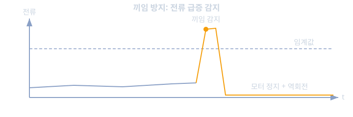
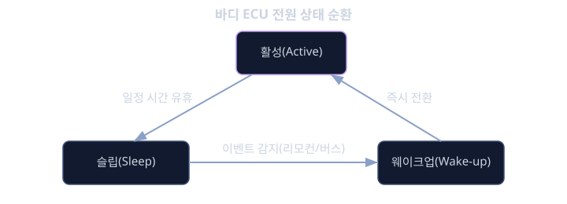

# 바디 · 섀시 ECU 응용

지금까지 배운 제어이론(control-theory)은 주로 "목표값을 정확하고 빠르게 추종해야 하는" 상황, 예를 들어 모터의 회전 속도를 정밀하게 제어하는 문제를 다뤘다. 그런데 자동차에는 그런 정밀 제어보다는 훨씬 단순해 보이는, 그러나 결코 가볍게 다룰 수 없는 수많은 기능이 있다. 운전석 창문이 손가락을 끼우면 자동으로 멈추는 것, 실내 온도가 설정값에 맞춰 유지되는 것, 방향지시등이 정확한 리듬으로 깜박이는 것, 도어가 주행 중에는 잠기고 충돌이 감지되면 자동으로 열리는 것 같은 기능들이다. 이런 기능을 담당하는 ECU를 통틀어 바디(Body) ECU라 부르고, 조금 더 차량의 움직임과 관련된 서스펜션, 스티어링 보조, 안정성 제어 같은 기능을 섀시(Chassis) ECU라 부른다.

이 기능들이 "단순해 보이지만 가볍게 다룰 수 없다"고 말한 이유가 있다. 창문이 자동으로 멈추지 않고 사람의 손가락이나 목을 계속 조이는 상황을 생각해보자. 겉보기에 창문 올리기는 엄청나게 단순한 기능이지만, 그 기능이 잘못 동작하면 실제 상해로 이어질 수 있는 안전 관련 기능이 된다. 그래서 파워윈도우 끼임 방지(anti-pinch) 기능은 ISO 26262 관점에서 낮지 않은 ASIL 등급을 받는 경우가 많다. 반대로 실내등이 꺼지지 않는 문제는 불편하지만 생명을 위협하지는 않으므로 QM(Quality Management, 안전 요구사항이 적용되지 않는 등급) 수준으로 분류된다. 즉 바디 ECU의 세계는 "안전과 무관한 사소한 편의 기능"부터 "잘못되면 다칠 수 있는 안전 관련 기능"까지 폭넓게 섞여 있으며, 같은 ECU 안에서도 기능별로 요구되는 안전 수준이 전혀 다를 수 있다는 특징을 가진다.

또 하나의 중요한 특징은, 바디·섀시 ECU는 흔히 수십 개가 차량 한 대 안에 함께 존재하며 서로 긴밀하게 통신한다는 것이다. 운전석 도어 ECU 하나만 해도 창문 모터, 도어락 액추에이터, 사이드미러 조정, 스피커 출력까지 여러 하위 기능을 거느리고, 이 ECU는 다시 차체 제어 모듈(Body Control Module, BCM)이나 게이트웨이를 통해 다른 ECU들과 신호를 주고받는다. 이렇게 많은 ECU가 모여 하나의 차량을 이루는 구조이기 때문에, 바디 ECU를 설계할 때는 개별 기능의 로직뿐 아니라 "다른 ECU와 어떻게 신호를 주고받고, 전원이나 통신이 끊겼을 때 어떤 상태로 전환해야 하는가"를 함께 고민해야 한다. 이 레슨에서는 끼임 방지 알고리즘, PWM 기반 모터 제어, 공조 시스템의 온도 제어, 그리고 바디 ECU 특유의 저전력·슬립(sleep) 설계를 중심으로 살펴본다.

## 학습 목표

- 바디 ECU가 다루는 기능들이 QM부터 높은 ASIL까지 폭넓게 분포하는 이유를 설명할 수 있다.
- 파워윈도우 끼임 방지처럼 전류·위치 추정을 이용한 이상 감지 알고리즘의 원리를 설명할 수 있다.
- PWM(펄스 폭 변조)을 이용한 모터·조명 제어의 원리와 듀티 사이클의 의미를 이해한다.
- 공조 시스템의 온도 제어에서 PID 제어기가 어떻게 적용되는지 설명할 수 있다.
- 바디 ECU의 전원 상태(활성·슬립·웨이크업) 관리가 왜 중요한지 설명할 수 있다.

## 끼임 방지: 전류로 "무언가에 부딫혔다"를 감지하기

파워윈도우가 올라가다가 장애물(사람의 손가락, 목, 또는 물체)에 부딫히면 모터에 걸리는 부하가 갑자기 커진다. 직류 모터(DC motor)는 부하가 커지면 회전 속도가 떨어지고, 동시에 모터에 흐르는 전류가 증가하는 특성을 가진다. 끼임 방지 알고리즘은 바로 이 특성을 이용해, 전류나 회전 속도의 변화를 지속적으로 감시하다가 비정상적인 변화가 감지되면 즉시 모터를 멈추고 반대 방향으로 되돌리는 동작을 한다.

```c
void monitor_window_motion(float current_ma, float prev_current_ma) {
    float delta = current_ma - prev_current_ma;
    if ((window_state == WINDOW_RISING) && (delta > PINCH_CURRENT_THRESHOLD)) {
        stop_motor();
        reverse_motor_briefly();
        set_fault(FAULT_PINCH_DETECTED);
    }
}
```

이 로직이 실제로 신뢰할 수 있으려면 몇 가지를 함께 고려해야 한다. 첫째, 창문이 끝단에 거의 다 닿았을 때도 정상적으로 부하가 커지는 구간(hard stop 근처)이 있으므로, 창문의 위치를 함께 추정해 "끝단 근처에서의 정상적인 부하 증가"와 "중간 구간에서의 비정상적인 부하 증가"를 구별해야 한다. 이 위치 추정은 보통 모터에 부착된 홀 센서(Hall sensor)로 회전수를 세어 계산한다. 둘째, 겨울철 저온에서는 창문 레일의 윤활유가 굳어 평소보다 부하가 커질 수 있으므로, 끼임을 판단하는 전류 임계값(threshold)을 온도에 따라 보정하는 경우도 많다. 임계값을 너무 낮게 잡으면 추운 날씨에 정상적인 창문 동작도 끼임으로 오판해 멈춰버리고(오탐, false positive), 너무 높게 잡으면 실제 끼임을 놓치는(미탐, false negative) 상황이 생긴다. 이 둘 사이의 균형을 어떻게 맞추느냐가 끼임 방지 설계의 핵심 난제다.



<details><summary><b>심화: 왜 끼임 방지는 ASIL이 부여되는 안전 관련 기능인가</b></summary>

끼임 방지 기능에 ASIL이 부여되는 근거를 ISO 26262의 틀로 따라가 보면, 심각도(Severity)는 신체 상해로 이어질 수 있어 낮지 않은 수준(S2 ~ S3에 해당)으로 평가되고, 노출도(Exposure)는 파워윈도우를 올리는 동작이 일상적으로 매우 자주 일어나므로 높은 수준(E3 ~ E4)으로 평가된다. 통제가능성(Controllability)은 상황에 따라 다르지만, 특히 어린아이가 혼자 조작하다가 끼이는 상황처럼 스스로 위험을 피하기 어려운 경우를 고려하면 통제가능성이 낮게(C2 ~ C3) 평가될 수 있다. 이 세 값의 조합은 ASIL B 또는 그 이상에 해당할 가능성이 크며, 실제로 많은 완성차 업체가 끼임 방지 기능에 ASIL B 등급을 할당한다. 이는 "창문을 올리고 내리는 단순한 기능"이라는 겉모습과, "체계적인 안전 분석을 거쳐야 하는 안전 관련 기능"이라는 실제 설계 요구사항 사이의 간극을 보여주는 좋은 사례다. 바디 ECU를 설계할 때는 이렇게 겉보기에 단순한 기능 하나하나에 대해서도 "이것이 정말 QM인가, 아니면 안전 분석이 필요한가"를 먼저 따져보는 습관이 필요하다.

</details>

## PWM: 모터와 조명을 아날로그처럼 제어하기

바디 ECU가 다루는 수많은 액추에이터(모터, 램프, 히터)는 대부분 디지털 신호로만 제어되는 스위치 소자(트랜지스터, MOSFET)를 통해 구동된다. 그런데 와이퍼 속도를 여러 단계로 조절하거나, 실내등의 밝기를 서서히 줄이는 디밍(dimming) 효과를 주려면 "켜짐과 꺼짐 두 가지뿐인" 디지털 신호로 어떻게 중간 정도의 세기를 표현할 수 있을까. 이때 쓰이는 기법이 펄스 폭 변조(Pulse Width Modulation, PWM)다.

PWM은 신호를 일정한 주기(period)로 반복되는 켜짐·꺼짐의 사각파로 만들고, 그 한 주기 안에서 "켜져 있는 시간의 비율"을 조절한다. 이 비율을 듀티 사이클(duty cycle)이라 부른다.

$$
V_{avg} = D \times V_{supply}
$$

여기서 $D$는 0 ~ 1 사이의 듀티 사이클이고 $V_{supply}$는 공급 전압이다. 예를 들어 12V 공급 전원에서 듀티 사이클을 30퍼센트로 설정하면, 전류가 흐르는 모터나 램프 입장에서는 평균적으로 약 3.6V에 해당하는 효과를 받는 것과 비슷하게 동작한다. 이는 전압을 실제로 3.6V로 낮춘 것이 아니라, 12V를 아주 짧은 간격으로 켜고 끄기를 반복해 "평균적으로" 그 정도의 효과를 내는 방식이다. 모터나 램프, 그리고 사람의 눈은 PWM의 주파수가 충분히 높으면(보통 수백 Hz 이상) 개별 켜짐·꺼짐을 인지하지 못하고 매끄러운 중간 밝기나 중간 속도로 느낀다.

```c
void set_dimmer_duty(uint8_t duty_percent) {
    uint16_t compare_value = (PWM_PERIOD_TICKS * duty_percent) / 100U;
    timer_set_compare(TIMER_CH_DIMMER, compare_value);
}
```

이 코드는 타이머 하드웨어의 비교값(compare value)을 설정해, 한 주기 안에서 신호가 켜져 있는 구간의 길이를 조절한다. 대부분의 마이크로컨트롤러는 PWM 생성을 전담하는 타이머 하드웨어를 내장하고 있어서, CPU가 매 순간 직접 켜고 끄기를 반복하지 않고도 하드웨어가 지정된 주기와 듀티 사이클로 신호를 자동 생성하도록 맡길 수 있다. 와이퍼 속도, 블로워 모터 속도, 실내등 밝기, 심지어 일부 스텝 모터가 아닌 DC 모터 기반 액추에이터의 속도 제어까지 상당수가 이 PWM 기법 위에서 구현된다.

## 공조 시스템: PID 제어기로 온도를 맞추기

실내 온도를 설정값에 맞춰 유지하는 공조(HVAC) 시스템은 앞서 제어이론에서 배운 피드백 제어의 전형적인 응용이다. 운전자가 22도로 설정했다면, 시스템은 실내 온도 센서 값을 지속적으로 측정하면서 목표값(22도)과 현재값의 차이, 즉 오차(error)를 계산하고, 그 오차를 줄이기 위해 블로워 속도와 히터·에어컨 출력을 조절한다. 이때 흔히 쓰이는 제어기가 PID(비례-적분-미분) 제어기다.

$$
u(t) = K_p e(t) + K_i \int_0^t e(\tau)\,d\tau + K_d \frac{de(t)}{dt}
$$

여기서 $e(t)$는 목표 온도와 현재 온도의 차이, $K_p$, $K_i$, $K_d$는 각각 비례, 적분, 미분 이득이다. 비례(P) 항은 "오차가 클수록 더 강하게 반응"하게 만들어 빠른 반응성을 주지만, 비례 항만으로는 보통 목표값에 정확히 도달하지 못하고 약간의 정상상태 오차(steady-state error)가 남는다. 적분(I) 항은 시간에 걸쳐 쌓인 오차를 반영해 이 정상상태 오차를 서서히 없애준다. 미분(D) 항은 오차가 변화하는 속도를 반영해, 목표값에 너무 급하게 다가가며 오버슈트(overshoot, 목표를 지나쳐버리는 현상)가 생기는 것을 억제하는 역할을 한다.

실내 공조에서는 이 세 항의 균형이 실제 체감 쾌적도에 큰 영향을 준다. 비례 이득만 지나치게 높으면 블로워가 과도하게 세게 돌다가 약해지는 것을 반복해 승객이 불편함을 느끼고, 적분 이득이 지나치게 높으면 온도가 목표값을 지나쳐 오버슈트된 뒤 다시 돌아오는 진동(oscillation)이 발생할 수 있다. 그래서 실제 공조 시스템 개발에서는 PID 이득을 이론적 계산만으로 정하지 않고, 실제 차량 실내 환경에서 반복적인 튜닝(tuning)을 거쳐 승객이 "온도 변화를 거의 느끼지 못할 정도로 매끄럽다"고 느끼는 지점을 찾아낸다.

## 전원 상태 관리: 슬립과 웨이크업

바디 ECU의 또 다른 중요한 특징은, 차량의 시동이 꺼진 뒤에도 일부 기능이 계속 살아 있어야 한다는 점이다. 예를 들어 리모컨으로 도어락을 열거나, 침입을 감지해 경보를 울리는 기능은 운전자가 차에 타고 있지 않은 동안에도 즉시 반응해야 한다. 그런데 모든 ECU가 시동이 꺼진 뒤에도 항상 완전히 켜진 상태로 대기한다면, 차량 배터리가 며칠 안에 완전히 방전되어 버릴 것이다.

이 문제를 해결하기 위해 바디 ECU는 보통 여러 전원 상태를 오가며 동작한다.

- 활성(Active) 상태: 정상적으로 모든 기능이 동작하는, 전력 소비가 가장 큰 상태.
- 슬립(Sleep) 상태: 대부분의 회로를 끄고, 아주 적은 전류만 소비하며 특정 이벤트(리모컨 신호, 도어 핸들 접촉, 통신 버스의 웨이크업 패턴)를 감시하는 상태.
- 웨이크업(Wake-up): 슬립 상태에서 감시하던 이벤트가 발생하면, ECU 전체 또는 필요한 부분만 다시 활성 상태로 전환한다.

이 전환이 제대로 설계되지 않으면 두 가지 문제가 생긴다. 슬립 상태로 전환하는 조건이 너무 느슨하면 ECU가 계속 깨어 있는 시간이 길어져 배터리가 빨리 소모되고(암 전류, quiescent current 문제), 반대로 너무 민감하게 깨어나는 조건을 설정하면 불필요한 웨이크업이 반복되어 같은 문제가 생긴다. 특히 여러 ECU가 서로 통신 버스로 연결되어 있을 때는, 한 ECU가 깨어나면서 버스에 신호를 보내면 다른 ECU들도 함께 깨어나는 경우가 있어서, "꼭 필요한 ECU만 깨어나게 하는" 설계가 차량 전체의 대기 전력을 좌우하는 중요한 요소가 된다. 이런 저전력 설계는 안전이나 보안만큼 눈에 띄지는 않지만, 실제 상품성(예를 들어 "몇 주 동안 주차해둬도 배터리가 방전되지 않는가")에 직접적인 영향을 미치는 바디 ECU 설계의 핵심 과제 중 하나다.



**확인 문제.** 어떤 파워윈도우 끼임 방지 시스템이 겨울철에 평소보다 훨씬 자주 "끼임 감지"를 오탐한다는 민원이 접수되었다. 이 문제를 전류 임계값 설계의 관점에서 어떻게 분석하고 개선할 수 있는지 설명하라.

<details><summary>답 보기</summary>

겨울철 저온에서는 창문 레일의 윤활유가 굳고 고무 웨더스트립(weatherstrip)도 뻣뻣해져, 실제로는 끼임이 없는 정상적인 동작에서도 모터 부하와 전류가 평소보다 높게 나타날 수 있다. 끼임 감지 임계값이 상온 기준으로 고정되어 있다면, 겨울철의 이 정상적인 부하 증가를 끼임으로 오판하게 된다. 개선 방법으로는 온도 센서 값을 함께 읽어, 저온 구간에서는 끼임 판단 임계값을 더 높게(또는 판단 전에 더 긴 확인 구간을 두도록) 보정하는 방식을 적용할 수 있다. 다만 임계값을 지나치게 높이면 실제 끼임을 놓치는 미탐 위험이 커지므로, 온도별 정상 부하 범위를 충분한 실측 데이터로 확보한 뒤 그 범위를 벗어나는 수준에서만 보정을 적용하는 것이 안전과 사용성의 균형을 지키는 방법이다.

</details>

**확인 문제.** 어떤 도어 ECU가 시동이 꺼진 뒤에도 슬립 상태로 전환하지 않고 계속 활성 상태를 유지한다면, 어떤 문제가 생기며 그 원인으로 어떤 설계 결함을 의심할 수 있는가?

<details><summary>답 보기</summary>

가장 직접적인 문제는 차량 배터리의 암 전류(quiescent current)가 과도하게 커져, 차량을 며칠만 세워두어도 배터리가 방전될 수 있다는 것이다. 이런 상황이 발생하면 슬립 전환 조건이 충족되지 않도록 막는 설계 결함을 의심해볼 수 있다. 예를 들어 슬립 진입을 막는 특정 플래그가 통신 버스의 다른 ECU로부터 지속적으로 "활성 유지" 신호를 받고 있거나, 센서 중 하나가 잘못된 값을 계속 보내 "이벤트가 아직 끝나지 않았다"고 판단하게 만들거나, 슬립 진입 타이머 로직 자체에 결함이 있어 조건이 충족되어도 전환이 실행되지 않는 경우 등이 흔한 원인이다. 이런 문제는 겉으로는 기능이 정상 동작하는 것처럼 보이기 때문에, 전류 소비를 직접 측정하는 별도의 검증 없이는 발견하기 어려운 경우가 많다.

</details>

## 정리

- 바디 ECU가 다루는 기능은 겉보기에는 단순해 보여도 QM부터 높은 ASIL까지 폭넓게 분포하며, 각 기능별로 요구되는 안전 분석 수준이 다르다.
- 끼임 방지는 모터 전류·회전수 변화를 이용해 비정상적인 부하 증가를 감지하되, 정상적인 끝단 구간이나 온도 변화와 구별해야 하는 까다로운 균형 문제를 가진다.
- PWM은 디지털 신호의 켜짐 시간 비율(듀티 사이클)을 조절해 모터 속도나 조명 밝기를 아날로그처럼 표현하는 기법이다.
- 공조 시스템의 온도 제어는 PID 제어기의 비례·적분·미분 항이 함께 작용해 빠른 반응성과 정확한 목표 도달, 오버슈트 억제를 동시에 추구한다.
- 활성·슬립·웨이크업으로 이어지는 전원 상태 관리는 바디 ECU가 시동이 꺼진 뒤에도 필요한 기능을 유지하면서 배터리 소모를 최소화하기 위한 핵심 설계 과제다.

바디·섀시 ECU는 자동차 전자 시스템 중 가장 눈에 띄지 않지만 가장 많은 수를 차지하는 영역이다. 이 레슨에서 다룬 끼임 방지, PWM 제어, PID 기반 온도 제어, 전원 상태 관리는 모두 겉보기에는 단순해 보이는 기능 안에 안전·성능·전력이라는 서로 다른 요구가 동시에 숨어 있음을 보여준다. 이런 응용 사례들은 앞서 배운 제어이론과 기능안전의 개념들이 실제 양산 차량의 평범한 기능 하나하나에 어떻게 스며들어 있는지를 구체적으로 확인할 수 있는 좋은 출발점이 된다.

## 참고 자료

- ISO 26262:2018, "Road vehicles — Functional safety" (끼임 방지 등 바디 기능의 ASIL 분류 사례 참고)
- SAE J1100, "Motor Vehicle Dimensions" 및 각 OEM의 파워윈도우 끼임 방지 성능 요구사항 자료
- Katsuhiko Ogata, "Modern Control Engineering" (PID 제어기 설계 및 튜닝 전반)
- Texas Instruments, "Understanding PWM for DC Motor Control" 애플리케이션 노트류
- AUTOSAR, "Specification of ECU State Manager" (전원 상태·웨이크업 관리 표준)
