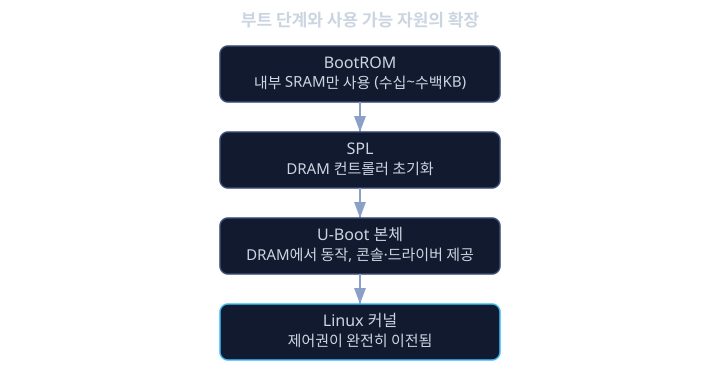
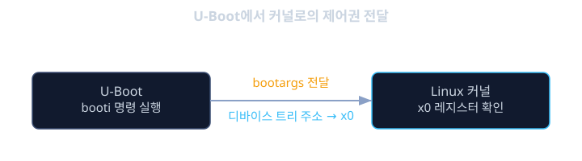

# 부트로더 (U-Boot)

앞 레슨에서 리눅스 커널이 프로세스를 격리하고 자원을 공정하게 나눠주는 똑똑한 소프트웨어라는 것을 배웠다. 그런데 정작 커널 이미지 그 자체는 플래시나 eMMC 같은 저장장치에 그냥 파일 형태로 놓여 있는, 스스로는 아무것도 할 수 없는 데이터 덩어리일 뿐이다. 전원이 막 들어온 CPU는 아직 커널이 어디에 있는지, DRAM이 제대로 동작하는지, 심지어 DRAM을 어떤 속도와 타이밍으로 다뤄야 하는지조차 전혀 모른다. 커널이 "자원을 공정하게 나눠주는 관리자" 역할을 하려면 먼저 그 커널 자체를 저장장치에서 읽어 메모리에 올려놓고, 실행할 준비를 마친 상태로 넘겨주는 누군가가 있어야 한다. 그 역할을 하는 것이 부트로더(bootloader)이고, 자동차와 임베디드 리눅스 분야에서 가장 널리 쓰이는 부트로더가 U-Boot다.

건물을 짓는 과정에 비유하면 이해가 쉽다. 완공된 건물(커널이 돌아가는 시스템)에는 전기가 들어오고 수도가 흐르고 엘리베이터가 움직인다. 하지만 이 모든 것이 가능하려면 그 전에 비어 있는 땅에 전선을 깔고 배관을 묻고 기초를 다지는 공사 과정이 선행되어야 한다. 부트로더는 바로 이 공사 과정을 담당한다. CPU 코어를 깨우고, DRAM 컨트롤러를 설정해서 비로소 큰 용량의 메모리를 쓸 수 있게 만들고, 저장장치 컨트롤러를 깨워서 거기 담긴 커널 이미지를 읽어낼 수 있게 만든다. 이 공사가 끝나야만 비로소 커널이라는 "건물의 운영"이 시작될 수 있다.

전원이 들어오고 커널이 화면에 로그를 찍기 시작하기까지, 실제로는 한 번에 모든 일이 끝나는 것이 아니라 여러 단계의 부트로더가 바통을 넘겨받으며 일을 나눠서 처리한다. 각 단계는 그 앞 단계보다 조금 더 많은 하드웨어를 쓸 수 있게 되고, 조금 더 복잡한 코드를 실행할 수 있게 된다. 이번 레슨에서는 이 단계들이 왜 나뉘어 있는지, U-Boot가 구체적으로 어떤 일을 하는지, 그리고 U-Boot가 커널에게 제어권을 넘길 때 정확히 무엇을 전달하는지를 살펴본다.

## 학습 목표

- 전원 인가 직후부터 커널이 실행되기까지, 부트 과정이 왜 단일 단계가 아니라 여러 단계로 나뉘어 있는지 설명할 수 있다.
- BootROM, SPL(Secondary Program Loader), U-Boot 본체(U-Boot proper)가 각각 어떤 역할을 맡고 왜 그 순서로 실행되는지 설명할 수 있다.
- U-Boot가 DRAM과 저장장치를 초기화하고 커널 이미지를 메모리로 읽어오는 과정을 설명할 수 있다.
- U-Boot가 커널에게 부트 인자(bootargs)와 디바이스 트리 주소를 전달하는 방식을 설명할 수 있다.
- U-Boot 콘솔에서 환경 변수를 확인하고 수정해 부트 과정을 제어하는 기본적인 명령을 사용할 수 있다.

## 전원 인가 직후: 왜 커널이 스스로 시작할 수 없는가

리눅스 커널 이미지는 보통 수 메가바이트에서 수십 메가바이트 크기이며, 압축된 형태로 eMMC나 NAND 플래시, SD 카드 같은 저장장치에 놓여 있다. 이 커널을 실행하려면 먼저 그만한 크기의 이미지를 담을 수 있는 충분히 큰 메모리, 즉 DRAM이 동작하고 있어야 한다. 그런데 DRAM은 SRAM과 달리 전원이 들어온다고 곧바로 쓸 수 있는 것이 아니라, 정확한 타이밍 파라미터와 리프레시 주기를 메모리 컨트롤러에 설정해 줘야만 비로소 데이터를 저장할 수 있게 되는 까다로운 하드웨어다. 전원이 막 들어온 CPU는 이 설정 작업조차 아직 하지 못한 상태다.

게다가 베어메탈 레슨에서 다룬 리셋 벡터와 비슷하게, CPU는 전원이 들어오면 정해진 아주 작은 메모리 영역(흔히 내부 SRAM이나 ROM)에서 첫 코드를 실행하기 시작하는데, 이 시점에는 아직 DRAM도, 저장장치도 쓸 준비가 안 되어 있다. 결국 "커널을 실행하려면 DRAM이 필요하고, DRAM을 쓰려면 초기화 코드가 필요하고, 그 초기화 코드는 아직 DRAM이 없는 상태에서 아주 작은 메모리 안에서 동작해야 한다"는 일종의 닭과 달걀 문제가 생긴다. 이 문제를 풀기 위해 부트 과정은 "점점 더 많은 자원을 쓸 수 있게 되는" 여러 단계로 나뉜다.

## 부트 단계 1: BootROM과 1차 부트로더

전원이 들어오면 CPU가 가장 먼저 실행하는 코드는 칩 제조사가 실리콘 안에 미리 새겨 넣은 BootROM(또는 마스크 롬)이다. 이 코드는 수정할 수 없고, 역할도 매우 제한적이다. 보통 "이 보드가 어떤 매체(SD 카드, eMMC, QSPI 플래시 등)로부터 부팅하도록 설정되어 있는지"를 보드의 부트 모드 핀(스트랩 핀)이나 퓨즈 값으로 확인하고, 그 매체의 맨 앞부분에서 작은 크기의 다음 단계 코드를 읽어 내부 SRAM에 올린 뒤 그곳으로 점프한다. 이 단계에서 CPU가 쓸 수 있는 메모리는 보통 수십 KB에서 수백 KB 수준의 작은 내부 SRAM뿐이며, DRAM은 아직 전혀 쓸 수 없다.

## 부트 단계 2: SPL과 DRAM 초기화

BootROM이 불러온 작은 코드가 바로 SPL(Secondary Program Loader, 2차 프로그램 로더)이다. SPL은 보통 32 KB에서 128 KB 정도의 매우 작은 크기로 만들어지는데, 이는 BootROM이 한 번에 읽어들일 수 있는 내부 SRAM의 용량 제약 때문이다. SPL의 가장 중요한 임무는 DRAM 컨트롤러를 초기화하는 일이다. 보드마다, 그리고 그 보드에 달린 DRAM 칩마다 정확한 타이밍 파라미터가 다르기 때문에, 이 초기화 코드는 보드 제조사나 SoC 제조사가 제공하는 상세한 설정값을 그대로 반영해야 한다. DRAM이 성공적으로 초기화되면 비로소 CPU는 수백 MB에서 수 GB에 이르는 큰 메모리 공간을 쓸 수 있게 된다.

DRAM이 준비되면 SPL은 저장장치(SD 카드, eMMC 등)에서 훨씬 더 크고 복잡한 다음 단계, 즉 U-Boot 본체(U-Boot proper)를 읽어 이번에는 DRAM 위에 올리고 그곳으로 점프한다. 여기까지가 "점점 더 많은 자원을 쓸 수 있게 되는" 부트 단계의 전형적인 흐름이다.

- BootROM: 변경 불가능한 최소 코드. 내부 SRAM만 사용. 역할은 다음 단계를 저장장치에서 찾아 읽어오는 것뿐.
- SPL: 작은 크기(수십 KB)의 코드. DRAM 컨트롤러 초기화가 핵심 임무. 끝나면 U-Boot 본체를 DRAM으로 읽어들인다.
- U-Boot 본체: DRAM 위에서 동작하는 훨씬 큰 코드(수백 KB 이상). 이때부터 본격적인 부트로더의 기능이 시작된다.



## U-Boot: 본격적인 부트로더의 역할

U-Boot 본체가 DRAM 위에서 실행되기 시작하면, 이제 복잡한 하드웨어 초기화, 저장장치 드라이버, 네트워크(이더넷) 드라이버, 그리고 사람이 직접 명령을 입력할 수 있는 셀(shell) 콘솔까지 동작한다. 보드에 시리얼 콘솔을 연결하면 익숙한 프롬프트를 볼 수 있다.

```
U-Boot 2024.01 (Oct 01 2026 - 10:00:00 +0900)

CPU:   Cortex-A53
DRAM:  2 GiB
MMC:   sdhci@fe330000: 0
In:    serial
Out:   serial
Err:   serial
=>
```

이 `=>` 프롬프트에서 사람이 직접 명령을 입력해 보드 상태를 확인하거나 부트 과정을 제어할 수 있다. 예를 들어 다음 명령은 eMMC의 특정 파티션에서 커널 이미지를 DRAM의 특정 주소로 읽어온다.

```sh
=> mmc dev 0 1
=> fatload mmc 0:1 0x80000000 Image
=> fatload mmc 0:1 0x83000000 vehicle-board.dtb
```

U-Boot는 환경 변수(environment variable)라는 설정 저장소를 가지고 있으며, 여기에는 "어떤 매체에서 무엇을 어느 주소로 읽어와서, 어떤 인자를 붙여 커널을 실행할지"를 담은 `bootcmd`라는 특수한 변수가 들어 있다. 사람이 콘솔에 개입하지 않으면 U-Boot는 정해진 짧은 대기 시간(`bootdelay`) 후 이 `bootcmd`를 자동으로 실행해 부팅을 이어간다.

```sh
=> printenv bootcmd
bootcmd=mmc dev 0 1; fatload mmc 0:1 0x80000000 Image; fatload mmc 0:1 0x83000000 vehicle-board.dtb; booti 0x80000000 - 0x83000000

=> printenv bootargs
bootargs=console=ttyS0,115200 root=/dev/mmcblk0p2 rootwait rw
```

## 커널로 넘기기: 이미지 로드와 부트 인자 전달

U-Boot가 커널 이미지와 디바이스 트리 이미지를 DRAM의 지정된 주소에 다 올려놓으면, 마지막으로 `booti`(ARM64용) 또는 `bootm` 같은 명령으로 실제 커널 실행을 시작시킨다. 이때 단순히 "이 주소로 점프해라"만 하는 것이 아니라, 커널이 올바르게 자신을 초기화할 수 있도록 두 가지 중요한 정보를 함께 넘겨준다.

하나는 부트 인자(bootargs)라는 문자열이다. 위 예시의 `console=ttyS0,115200 root=/dev/mmcblk0p2 rootwait rw`는 각각 "디버그 콘솔 출력은 시리얼 포트 ttyS0, 속도는 115200bps로 하라", "루트 파일시스템은 `/dev/mmcblk0p2` 파티션에 있다", "루트 디바이스가 준비될 때까지 기다려라(rootwait)", "루트 파일시스템을 읽기/쓰기(rw)로 마운트하라"는 뜻이다. 다른 하나는 디바이스 트리(device tree) 이미지의 메모리 주소로, 다음 레슨에서 다룰 하드웨어 구성 정보를 커널에게 전달하는 통로다. ARM64 아키텍처에서는 관례적으로 CPU 레지스터 `x0`에 디바이스 트리의 주소를 담아 커널의 시작 지점으로 점프하며, 커널은 실행을 시작하자마자 이 레지스터 값을 읽어 "지금 내가 어떤 하드웨어 위에서 돌고 있는지"를 알아낸다.

이 시점부터는 U-Boot가 쓰던 메모리와 스택도 더 이상 필요하지 않고, 제어권은 완전히 커널로 넘어간다. 커널은 전달받은 부트 인자와 디바이스 트리를 바탕으로 자신의 메모리 관리자, 파일시스템, 디바이스 드라이버를 차례로 초기화하고, 마지막으로 `root=` 인자에 지정된 루트 파일시스템을 마운트한 뒤 첫 번째 유저 공간 프로세스(흔히 `init` 또는 `systemd`)를 실행하면서 비로소 사람이 보는 로그인 화면이나 애플리케이션 화면이 뜨기 시작한다.



<details><summary><b>심화: Fallback 부팅과 A/B 부트 파티션</b></summary>

차량에 올라가는 ECU는 OTA(Over-The-Air) 업데이트로 소프트웨어가 바뀔 수 있는데, 업데이트 도중 전원이 끊기거나 새 이미지에 결함이 있어 부팅에 실패하면 차량이 영원히 켜지지 않는 심각한 상황(brick)이 벌어질 수 있다. 이를 막기 위해 널리 쓰는 기법이 A/B 부트 파티션이다. 저장장치에 커널과 루트 파일시스템을 담는 영역을 두 벌(슬롯 A, 슬롯 B) 준비해 두고, 업데이트는 항상 현재 쓰지 않는 슬롯에만 새로 기록한다. 업데이트가 끝나면 U-Boot의 환경 변수에서 "다음에는 B 슬롯으로 부팅하라"는 플래그만 바꿔준다.

U-Boot는 또한 부트 시도 횟수를 기록하는 카운터를 환경 변수에 남겨둘 수 있다. 새 슬롯으로 부팅을 시도했는데 커널이 정상적으로 "나는 잘 올라왔다"는 신호를 보내기 전에 몇 차례 연속으로 재부팅이 일어나면, U-Boot는 그 슬롯에 결함이 있다고 판단하고 자동으로 이전의 정상 슬롯으로 되돌아가 부팅한다. 이 메커니즘을 흔히 fallback 부팅이라 부르며, 자동차처럼 사람이 직접 리커버리 모드를 조작하기 어려운 환경에서 OTA 업데이트의 안전성을 보장하는 핵심 장치다.

</details>

<details><summary><b>심화: 보안 부팅과의 관계</b></summary>

U-Boot는 부트 과정에서 BootROM, SPL, U-Boot 본체, 커널로 이어지는 체인을 구성하는데, 각 단계에서 다음 단계로 넘어가기 전에 그 이미지가 서명된(signed) 정당한 이미지인지를 암호학적으로 검증하도록 구성할 수 있다. 이렇게 매 단계가 바로 다음 단계의 서명을 검증하며 신뢰를 이어가는 구조를 신뢰 체인(chain of trust)이라 부르고, 이를 기반으로 하는 전체 메커니즘을 보안 부팅(secure boot)이라 한다. 보안 부팅이 적용된 시스템에서는 공격자가 저장장치의 커널 이미지를 임의로 바꿔도, U-Boot가 서명 검증에 실패하면 그 이미지를 실행하지 않고 부팅을 중단한다.

이번 레슨에서는 U-Boot의 기본적인 부트 단계와 커널로의 제어권 전달에 집중했지만, 서명 검증의 구체적인 암호학적 원리와 하드웨어 신뢰 루트(root of trust)는 별도의 보안 부팅 레슨에서 더 깊이 다룬다. 지금 단계에서는 "부트 체인의 각 단계가 다음 단계를 검증할 수 있는 구조"라는 개념만 기억해 두면 충분하다.

</details>

**확인 문제.** BootROM이 DRAM 컨트롤러 초기화 코드를 포함한 U-Boot 본체 전체를 곧바로 내부 SRAM으로 읽어서 실행하면 안 되는 이유를 설명하라.
<details><summary>답 보기</summary>

내부 SRAM은 보통 수십 KB에서 수백 KB 수준의 매우 작은 용량만 가지고 있는데, U-Boot 본체는 저장장치 드라이버, 네트워크 드라이버, 콘솔 셀 등을 포함해 수백 KB 이상의 크기를 가지는 경우가 많아 작은 내부 SRAM에 전부 들어가지 않는다. 또한 U-Boot 본체는 DRAM이 이미 초기화되어 있다는 것을 전제로 동작하는 코드가 많다. 그래서 먼저 SPL이라는 훨씬 작은 코드를 내부 SRAM에 올려 DRAM 컨트롤러만 집중적으로 초기화하고, DRAM이 쓸 수 있게 된 다음에야 훨씬 크고 복잡한 U-Boot 본체를 그 넓은 DRAM 공간으로 읽어와 실행하는 단계적 구조가 필요하다.

</details>

**확인 문제.** U-Boot가 `booti` 명령으로 커널을 실행시킬 때 커널에게 전달하는 두 가지 핵심 정보는 무엇이며, 각각이 커널의 초기화 과정에서 어떤 역할을 하는지 설명하라.
<details><summary>답 보기</summary>

첫 번째는 부트 인자(bootargs) 문자열로, 콘솔 포트와 속도, 루트 파일시스템의 위치, 마운트 옵션 등 커널이 부팅 초반에 참고해야 하는 설정값들이 담겨 있다. 커널은 이 문자열을 해석해 디버그 로그를 어디로 출력할지, 어떤 디바이스를 루트 파일시스템으로 마운트할지를 결정한다. 두 번째는 디바이스 트리 이미지의 메모리 주소로, ARM64에서는 관례적으로 레지스터 `x0`에 담겨 전달된다. 커널은 이 주소에 있는 디바이스 트리를 읽어 지금 자신이 어떤 보드, 어떤 주변장치 구성 위에서 돌고 있는지를 알아내고 그에 맞게 드라이버를 초기화한다. 이 두 정보가 없으면 커널은 콘솔을 어디로 출력할지도, 어떤 하드웨어가 연결되어 있는지도 알 수 없다.

</details>

## 정리

- 부트 과정은 전원 인가 직후의 매우 제한된 자원(작은 내부 SRAM)에서 시작해, 점점 더 많은 자원(DRAM, 저장장치)을 쓸 수 있게 되는 여러 단계로 나뉘어 진행된다.
- BootROM은 변경 불가능한 최소 코드로 다음 단계를 찾아 읽어오고, SPL은 DRAM 컨트롤러를 초기화한 뒤 더 큰 U-Boot 본체를 DRAM으로 읽어온다.
- U-Boot 본체는 저장장치와 네트워크 드라이버, 콘솔 셀을 제공하며, 환경 변수의 `bootcmd`에 정의된 절차에 따라 커널 이미지와 디바이스 트리를 메모리에 읽어들인다.
- U-Boot는 커널에게 제어권을 넘길 때 부트 인자(bootargs)와 디바이스 트리 주소를 함께 전달하며, 이 정보 없이는 커널이 콘솔이나 루트 파일시스템 위치, 하드웨어 구성을 알 수 없다.
- A/B 부트 파티션과 fallback 부팅은 OTA 업데이트 실패로 차량이 영원히 부팅하지 못하는 상황을 막기 위한 U-Boot 레벨의 안전장치다.

이번 레슨에서는 U-Boot가 전원 인가부터 커널 실행까지 단계적으로 자원을 확보하며 제어권을 넘겨가는 과정을 살펴보았다. 다음 레슨에서는 U-Boot와 커널이 공통으로 참조하는 하드웨어 구성 정보, 즉 디바이스 트리가 어떻게 작성되고 해석되는지를 자세히 다룬다.

## 참고 자료

- Denx Software Engineering, "U-Boot 공식 문서" (U-Boot 소스 트리의 doc 디렉터리 및 공식 위키)
- ARM, "Trusted Base System Architecture" 관련 ARM 공식 기술 문서
- Chris Simmonds, "Mastering Embedded Linux Programming" (부트로더 및 부팅 과정 관련 장)
- Linux Kernel 공식 문서 (kernel.org Documentation, "Booting the Kernel on ARM64" 관련 절)
- Embedded Linux Wiki의 U-Boot 관련 문서(bootlin 등 임베디드 리눅스 교육기관이 공개한 자료)
