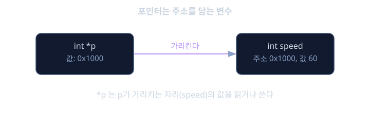
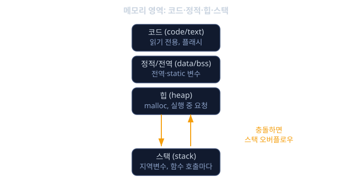

# C 언어 기초

차량에는 엔진 ECU, 변속기 제어기, ABS 모듈, 에어백 제어기처럼 수십 개의 작은 컴퓨터가 들어 있습니다. 이 컴퓨터들은 운영체제도 없이, 메모리도 수백 킬로바이트 수준으로 극히 제한된 환경에서 1밀리초 단위로 센서를 읽고 액추에이터를 움직입니다. 예를 들어 연료 분사 인젝터를 열려면 특정 메모리 주소에 있는 레지스터(register, 하드웨어를 제어하는 특수 메모리 칸)의 특정 비트를 1로 바꿔야 합니다. 이런 일을 하려면 "메모리의 몇 번지에 있는 값을 읽고 쓴다"는 개념을 다룰 수 있는 언어가 필요합니다. 파이썬이나 자바 같은 언어는 메모리 주소를 직접 조작하는 길을 막아 두었기 때문에, 이런 작업에는 애초에 쓸 수 없습니다.

C 언어가 지금도 자동차 임베디드 소프트웨어의 뼈대인 이유가 여기에 있습니다. C는 "고급 언어처럼 읽히지만 기계어처럼 동작하는" 언어입니다. 변수에 이름을 붙여 쓸 수 있으면서도, 그 변수가 메모리의 어느 번지에 있는지 알아내고 그 번지를 직접 가리키고 조작할 수 있습니다. 이 능력을 포인터(pointer)라고 부릅니다. 그리고 레지스터의 개별 비트를 켜고 끄는 작업은 비트 연산(bit operation)이라는 도구로 합니다. 이 둘을 모르면 ECU 코드 한 줄도 "왜 이렇게 쓰는지" 설명할 수 없습니다.

이 레슨은 선수 지식이 없는 출발점입니다. 프로그래밍을 아예 처음 보는 사람도 따라올 수 있도록, "변수가 메모리에 어떻게 저장되는가"부터 차근차근 쌓아 올립니다. 여기서 익히는 포인터·메모리·비트 연산 감각은 뒤에 나오는 디지털 논리, MCU 구조, C++ 레슨 전체의 바닥을 이룹니다.

## 학습 목표

- 변수가 메모리에 어떻게 저장되고 고유한 주소를 갖는지 설명할 수 있다.
- 포인터의 선언·역참조·배열과의 관계를 이해하고 실제 코드로 작성할 수 있다.
- 스택·힙·정적 영역·코드 영역의 차이와 임베디드 환경에서 왜 이 구분이 중요한지 설명할 수 있다.
- 비트 연산자(AND, OR, XOR, 시프트)로 레지스터의 특정 비트만 읽고 쓰는 코드를 작성할 수 있다.
- volatile 키워드가 왜 필요한지와 구조체 기반 레지스터 매핑의 원리를 이해한다.
- 고정폭 정수 타입을 쓰는 이유와 정수 오버플로우의 위험을 설명할 수 있다.

## 변수는 결국 메모리의 한 자리다

프로그램을 처음 배울 때 `int speed = 60;` 같은 코드를 보면 "speed라는 이름의 상자에 60이 들어간다"고 생각합니다. 틀린 설명은 아니지만, 임베디드 개발자에게는 한 단계 더 들어간 그림이 필요합니다. 컴퓨터의 메모리는 하나의 거대한 일렬 번호가 붙은 칸들의 모음입니다. 각 칸에는 고유한 번지(주소, address)가 있고, `int speed = 60;`이라는 선언은 "4바이트 크기의 칸을 하나 잡아서 그 자리에 60이라는 값을 넣고, 그 자리를 앞으로 speed라는 이름으로 부르겠다"는 뜻입니다.

이 사실이 왜 중요할까요. 32비트 MCU(microcontroller unit, 마이크로컨트롤러)에서는 메모리 전체가 하나의 평평한 주소 공간으로 되어 있고, 그 주소 공간의 어느 구간은 실제 RAM이고 어느 구간은 GPIO나 타이머 같은 하드웨어 레지스터로 연결되어 있습니다. 즉 "메모리의 0x40020000번지를 읽는다"는 것이 실제로는 "GPIO 포트 A의 상태를 읽는다"는 뜻이 될 수 있습니다. 변수와 메모리 번지가 같은 개념이라는 사실을 이해해야만, 이런 하드웨어 접근이 왜 평범한 변수 읽기와 똑같은 문법으로 쓰이는지 이해할 수 있습니다.

C에서는 `&` 연산자로 변수의 주소를 구할 수 있습니다.

```c
int speed = 60;
printf("speed의 값: %d\n", speed);
printf("speed의 주소: %p\n", &speed);
```

여기서 `&speed`는 "speed가 저장된 메모리 번지"를 의미합니다. 이 번지 값 자체를 담을 수 있는 변수가 바로 포인터입니다.

## 포인터: 주소를 담는 변수

포인터는 어려운 개념이 아니라, "주소값을 담는 변수"일 뿐입니다. 다만 그 주소에 어떤 종류의 데이터가 있는지도 같이 알아야 하므로, 포인터를 선언할 때는 가리키는 대상의 타입을 함께 적습니다.

```c
int speed = 60;
int *p = &speed;      // p는 int형 변수의 주소를 담는다
printf("%d\n", *p);   // *p는 "p가 가리키는 곳의 값" -> 60
*p = 72;               // p가 가리키는 자리에 72를 써 넣는다
printf("%d\n", speed); // speed도 72로 바뀌어 있다
```



`*p`를 역참조(dereference)라고 부릅니다. "포인터가 가리키는 자리로 가서 그 값을 읽거나 쓴다"는 뜻입니다. 이 한 줄이 왜 그렇게 중요할까요. 레지스터 접근이 정확히 이 모양이기 때문입니다.

```c
unsigned int *gpio_data_reg = (unsigned int *)0x40020014;
*gpio_data_reg = 0x00000001;  // GPIO 핀에 전류를 흘려 LED를 켠다
```

이 코드는 "0x40020014라는 고정된 번지를 가리키는 포인터를 만들고, 그 자리에 1을 써 넣는다"는 뜻입니다. 함수 호출도, 운영체제도, 특별한 드라이버 API도 없이, 포인터 하나로 하드웨어를 직접 제어한 것입니다. 이것이 C가 임베디드 세계에서 대체되지 않는 이유입니다.

함수에 변수를 넘길 때도 포인터가 핵심입니다. C에서 함수는 기본적으로 값을 복사해서 전달(call by value)하기 때문에, 함수 안에서 원본 변수를 바꾸고 싶으면 그 변수의 주소를 넘겨야 합니다.

```c
void increase(int *value) {
    *value = *value + 1;
}

int main(void) {
    int rpm = 800;
    increase(&rpm);   // rpm의 주소를 넘긴다
    // 이제 rpm은 801
}
```

센서 드라이버에서 "측정값을 out 파라미터로 돌려준다"는 패턴이 바로 이 구조입니다.

## 배열과 포인터의 관계

C에서 배열은 "같은 타입의 값들이 메모리에 연속으로 늘어선 덩어리"입니다. 배열의 이름은 사실 그 배열의 첫 번째 원소를 가리키는 포인터처럼 동작합니다.

```c
int sensor_buf[4] = {10, 20, 30, 40};
int *p = sensor_buf;      // 배열 이름 = 첫 원소의 주소
printf("%d\n", *(p + 2)); // 30 -> sensor_buf[2]와 동일
```

`p + 2`에서 중요한 점은, 포인터에 2를 더했을 때 실제로는 "2바이트"가 아니라 "int 크기(보통 4바이트)의 2배"만큼 주소가 이동한다는 것입니다. 이를 포인터 연산(pointer arithmetic)이라고 하며, 컴파일러가 가리키는 타입의 크기를 자동으로 곱해 줍니다. CAN 통신으로 받은 8바이트 데이터 프레임을 `uint8_t buf[8]`로 받아서 `buf[0]`부터 순서대로 파싱하는 코드, 센서 여러 개의 값을 배열에 모아 평균을 내는 코드 모두 이 원리 위에 있습니다.

문자열도 C에서는 특별한 타입이 아니라 `char` 배열의 끝에 0(널 문자, `'\0'`)이 붙은 형태일 뿐입니다. 진단 메시지나 로그 문자열을 다룰 때 이 사실을 알아야 버퍼 끝을 넘어서 읽는 실수를 피할 수 있습니다.

## 메모리 영역 구분: 스택, 힙, 정적, 코드

임베디드 MCU는 RAM이 보통 수십 킬로바이트에서 수백 킬로바이트 수준으로 매우 작습니다. 그래서 "메모리를 어디에 할당했는가"가 데스크톱 프로그램보다 훨씬 중요한 문제가 됩니다. C 프로그램이 쓰는 메모리는 크게 네 영역으로 나뉩니다.

- 코드 영역(code/text): 컴파일된 함수의 명령어 자체가 저장되는 곳. 보통 읽기 전용이며, 플래시(flash) 메모리에 들어갑니다.
- 정적/전역 영역(data/bss): 프로그램 시작부터 끝까지 살아있는 전역 변수, `static` 변수가 저장됩니다. 초기값이 있으면 `data`, 0으로 초기화되면 `bss` 영역에 들어갑니다.
- 스택(stack): 함수가 호출될 때마다 그 함수의 지역 변수, 매개변수, 돌아갈 주소가 쌓이는 영역입니다. 함수가 끝나면 자동으로 정리됩니다.
- 힙(heap): `malloc` 등으로 실행 중에 동적으로 요청해서 쓰는 영역입니다.

임베디드에서는 특히 스택과 힙을 조심해야 합니다. RAM이 8킬로바이트뿐인 MCU에서 재귀 호출을 깊게 하거나 큰 배열을 지역 변수로 선언하면 스택이 다른 영역을 덮어써 버리는 스택 오버플로우(stack overflow)가 일어나고, 이는 원인을 찾기 매우 어려운 오동작으로 이어집니다. 그래서 안전이 중요한 자동차 소프트웨어 표준인 MISRA-C는 동적 메모리 할당(`malloc`, `free`)을 아예 쓰지 말라고 권고합니다. 실행 중간에 메모리가 부족해지거나 메모리 파편화가 생기면 예측할 수 없는 동작으로 이어지기 때문입니다. 대신 필요한 메모리는 모두 컴파일 시점에 정적으로 크기를 정해 둡니다.



```c
void process(void) {
    int local_buf[256];   // 스택에 1KB 할당, 함수 끝나면 자동 해제
    static int counter;   // 정적 영역, 프로그램 종료까지 유지
    // int *p = malloc(1024);  // 임베디드 안전 코드에서는 지양
}
```

## 비트 연산: 레지스터의 한 비트만 다루기

하드웨어 레지스터는 보통 32비트 전체가 하나의 묶음이지만, 그 안의 각 비트가 서로 다른 기능을 의미합니다. 예를 들어 GPIO 설정 레지스터의 0번 비트는 "입력/출력 모드", 5번 비트는 "풀업 저항 사용 여부"를 뜻하는 식입니다. 레지스터 전체를 덮어쓰면 다른 비트의 설정이 날아가 버리므로, 원하는 비트만 정확히 바꾸는 기술이 필요합니다. 이것이 비트 연산입니다.

네 가지 연산이 기본입니다.

- AND(`&`)는 특정 비트만 남기거나(마스킹) 지울 때 씁니다.
- OR(`|`)는 특정 비트를 1로 세울 때 씁니다.
- XOR(`^`)는 특정 비트를 반전(토글)시킬 때 씁니다.
- 시프트(`<<`, `>>`)는 "몇 번째 비트"를 가리키는 1을 만들거나, 값을 자리 이동시킬 때 씁니다.

레지스터의 n번째 비트만 1로 켜는 코드는 다음과 같습니다.

```c
#define BIT(n) (1u << (n))

reg |= BIT(3);   // 3번 비트를 1로 세운다, 다른 비트는 그대로
reg &= ~BIT(3);  // 3번 비트를 0으로 지운다, 다른 비트는 그대로
reg ^= BIT(3);   // 3번 비트를 반전시킨다 (토글)
if (reg & BIT(3)) {
    // 3번 비트가 1인지 검사
}
```

`reg |= BIT(3)`를 풀어서 보면, `BIT(3)`은 `1u << 3`이므로 2진수로 `0000...1000`입니다. 이 값을 OR 연산하면 3번 비트만 1이 되고 나머지 비트는 원래 값이 0이든 1이든 그대로 OR의 성질(0과 OR 하면 원래 값 유지) 때문에 바뀌지 않습니다. 반대로 지울 때는 `~BIT(3)`으로 3번 비트만 0이고 나머지는 모두 1인 마스크를 만든 뒤 AND를 하면, 3번 비트는 무조건 0이 되고 나머지는 AND의 성질(1과 AND 하면 원래 값 유지) 때문에 그대로 남습니다. 이 패턴은 모든 MCU 드라이버 코드에서 수백 번씩 반복됩니다.

## volatile과 구조체로 레지스터 매핑하기

컴파일러는 성능을 위해 최적화를 합니다. 예를 들어 같은 변수를 두 번 읽는 코드가 있으면, 컴파일러는 "어차피 중간에 안 바뀌었으니 한 번만 읽고 재사용해도 되겠다"고 판단해 두 번째 읽기를 생략해 버릴 수 있습니다. 일반 변수라면 문제가 없지만, 그 변수가 사실은 하드웨어 레지스터라면 큰 문제가 생깁니다. 레지스터 값은 내가 코드를 안 건드려도 하드웨어가 (예를 들어 ADC 변환이 끝나서) 알아서 바꿔 놓을 수 있기 때문입니다. 컴파일러는 이 사실을 모르고 "값이 안 바뀐다"고 착각해 최적화를 해 버리면, 실제로는 바뀐 센서 값을 코드가 영원히 옛 값으로만 읽게 됩니다.

이 문제를 막는 키워드가 `volatile`입니다. `volatile`이 붙은 변수는 "컴파일러야, 이 값은 내가 모르는 사이에 바뀔 수 있으니 매번 실제로 메모리에서 다시 읽어라"라는 지시입니다.

```c
volatile uint32_t *adc_data_reg = (volatile uint32_t *)0x40012440;
while ((*adc_status_reg & BIT(1)) == 0) {
    // 변환 완료 비트가 설 때까지 대기 (volatile이 없으면 컴파일러가
    // 이 루프를 "한 번 읽고 끝"으로 최적화해서 무한루프가 되어버릴 수 있다)
}
uint32_t result = *adc_data_reg;
```

레지스터가 여러 개 모여 있는 하드웨어 모듈(예를 들어 타이머 하나가 설정 레지스터, 카운터 레지스터, 상태 레지스터를 묶어서 가지는 경우)은 구조체로 묶어서 표현하면 코드가 훨씬 깔끔해집니다.

```c
typedef struct {
    volatile uint32_t CTRL;    // 0x00 제어 레지스터
    volatile uint32_t STATUS;  // 0x04 상태 레지스터
    volatile uint32_t DATA;    // 0x08 데이터 레지스터
} Timer_TypeDef;

#define TIMER1 ((Timer_TypeDef *)0x40000000)

TIMER1->CTRL |= BIT(0);        // 타이머1 활성화
```

구조체 멤버는 메모리에 선언 순서대로, 보통 정렬 규칙에 따라 연속으로 배치되기 때문에, 구조체의 시작 주소를 실제 하드웨어 모듈의 시작 번지에 맞추면 `TIMER1->CTRL` 같은 익숙한 문법으로 레지스터에 접근할 수 있습니다. 실제 MCU 벤더가 제공하는 헤더 파일들이 바로 이런 방식으로 작성되어 있습니다.

마지막으로, 임베디드 C에서는 `int`, `long` 같은 타입 대신 `uint8_t`, `uint16_t`, `uint32_t`, `int16_t` 같은 고정폭 정수 타입(`<stdint.h>`에 정의)을 씁니다. 일반 `int`는 컴파일러와 플랫폼에 따라 크기가 다를 수 있지만, 레지스터는 정확히 몇 비트인지가 하드웨어 사양으로 고정되어 있기 때문에 타입 크기가 애매하면 안 됩니다. 또한 `uint8_t counter = 255; counter++;`처럼 타입의 최대값을 넘기면 값이 0으로 돌아가는 오버플로우(overflow)가 조용히 일어날 수 있는데, 이런 버그는 컴파일러가 경고해주지 않는 경우가 많아 특히 위험합니다.

<details><summary><b>심화: 포인터 타입 캐스팅과 strict aliasing</b></summary>

레지스터 주소를 가리키는 포인터를 만들 때 `(unsigned int *)0x40020014`처럼 정수 리터럴을 포인터 타입으로 캐스팅(변환)하는 모습을 자주 봅니다. 이 자체는 임베디드에서 흔히 쓰이는 관용구이지만, C 표준의 관점에서는 주의할 점이 있습니다. 서로 다른 타입의 포인터로 같은 메모리를 번갈아 접근하면 컴파일러가 "이 두 포인터는 서로 다른 객체를 가리키니 겹칠 리 없다"고 가정하고 최적화를 할 수 있는데, 이를 strict aliasing 규칙이라고 부릅니다. 레지스터 접근처럼 명확히 하드웨어 주소를 가리키는 경우는 보통 `volatile`과 함께 컴파일러 벤더가 제공하는 표준 헤더 매크로를 쓰기 때문에 실무에서는 문제가 거의 없지만, 임의로 구조체를 캐스팅해서 다른 타입으로 재해석하는 코드는 정의되지 않은 동작(undefined behavior)을 일으킬 수 있다는 점은 알아 두어야 합니다.

</details>

<details><summary><b>심화: MISRA-C와 포인터 사용 제한</b></summary>

자동차 소프트웨어는 사람의 생명과 직결되기 때문에, 신뢰할 수 없는 코드 패턴을 원천적으로 금지하는 코딩 표준인 MISRA-C(Motor Industry Software Reliability Association C)를 따릅니다. 이 표준은 포인터와 관련해 여러 규칙을 둡니다. 예를 들어 포인터 연산의 결과가 같은 배열의 범위를 벗어나면 안 되고, 함수 포인터를 데이터 포인터로 캐스팅하면 안 되며, 널(null) 포인터를 역참조하기 전에 항상 검사해야 합니다. 이런 규칙들은 포인터가 가진 강력함(아무 메모리나 가리킬 수 있는 자유로움)이 동시에 가장 위험한 버그의 원천이기도 하다는 사실을 반영합니다. 실제 양산 ECU 코드는 대부분 정적 분석 도구로 MISRA-C 위반 여부를 자동 검사한 뒤에야 빌드를 통과시킵니다.

</details>

**확인 문제.** 어떤 레지스터 `reg`의 2번 비트만 0으로 지우고, 나머지 비트는 원래 값을 그대로 유지하려면 어떤 코드를 써야 하는가? 그리고 왜 `reg = 0;`처럼 전체를 덮어쓰면 안 되는가?

<details><summary>답 보기</summary>

`reg &= ~(1u << 2);`를 쓰면 된다. `1u << 2`는 2진수로 2번 비트만 1이고 나머지는 0인 값(`...00000100`)이며, 이를 비트 반전(`~`)하면 2번 비트만 0이고 나머지는 모두 1인 마스크(`...11111011`)가 된다. 이 마스크를 `reg`와 AND 연산하면, 2번 비트는 무조건 0이 되고(0과 AND는 항상 0), 나머지 비트는 1과 AND 되어 원래 값이 그대로 유지된다. 반면 `reg = 0;`은 레지스터 전체를 0으로 덮어써서, 다른 비트가 담고 있던 설정(예를 들어 다른 핀의 입출력 모드나 인터럽트 활성화 여부)을 모두 지워 버린다. 레지스터는 보통 여러 독립된 기능 비트가 한 워드에 모여 있기 때문에, 하나의 설정을 바꿀 때는 항상 "그 비트만" 바꾸는 읽기-수정-쓰기(read-modify-write) 방식을 써야 한다.

</details>

**확인 문제.** 다음 함수에 치명적인 문제가 있다. 무엇이 문제이고 왜 위험한가.

```c
int *make_value(void) {
    int local = 42;
    return &local;
}
```

<details><summary>답 보기</summary>

`local`은 함수의 지역 변수이므로 스택에 할당되며, `make_value` 함수가 끝나는 순간 그 메모리 자리는 더 이상 유효하지 않다고 간주된다(다음에 호출되는 다른 함수가 같은 스택 자리를 덮어써 버릴 수 있다). 그런데 이 함수는 그 지역 변수의 주소를 반환해 버린다. 호출한 쪽에서 반환된 포인터를 역참조하면, 이미 사라졌어야 할 메모리를 읽게 되는 셈이라 값이 42일 수도 있고 전혀 다른 쓰레기 값일 수도 있다. 이런 버그를 댕글링 포인터(dangling pointer)라고 부르며, 발생 시점과 증상이 들어맞지 않아(당장은 우연히 동작하다가 나중에 다른 코드가 섞이면서 갑자기 오동작) 자동차 임베디드 코드에서 특히 찾기 어려운 버그 중 하나다.

</details>

## 정리

- 변수는 결국 메모리의 한 자리이며, 그 주소를 담는 변수가 포인터다. 포인터 하나로 함수 호출 없이 하드웨어 레지스터를 직접 읽고 쓸 수 있다.
- 배열 이름은 첫 원소를 가리키는 포인터처럼 동작하며, 포인터 연산은 가리키는 타입의 크기만큼 자동으로 주소를 이동시킨다.
- 임베디드는 RAM이 극히 제한적이므로 스택·힙·정적·코드 영역의 구분이 중요하고, 안전이 중요한 자동차 코드는 동적 할당을 피하고 정적 메모리만 쓴다.
- 비트 연산(AND, OR, XOR, 시프트)으로 레지스터의 특정 비트만 읽기-수정-쓰기 방식으로 바꾸는 패턴은 모든 드라이버 코드의 기본기다.
- volatile은 컴파일러 최적화가 하드웨어 값의 변화를 놓치지 않게 막아 주며, 구조체와 결합하면 레지스터 묶음을 익숙한 문법으로 다룰 수 있다.

C는 겉보기에 단순한 언어지만, 그 단순함이 바로 메모리와 하드웨어를 가장 직접적으로 다룰 수 있게 해 주는 힘이다. 이 레슨에서 익힌 포인터·메모리·비트 연산의 직관은 뒤이어 배울 디지털 논리와 MCU 구조, 그리고 C++의 더 높은 수준 추상화를 이해하는 데 그대로 이어진다.

## 참고 자료

- Brian W. Kernighan, Dennis M. Ritchie, "The C Programming Language" (2nd Edition)
- MISRA-C:2012, "Guidelines for the use of the C language in critical systems" (MISRA Consortium)
- ISO/IEC 9899:2018, Programming languages — C (C18 표준)
- Michael Barr, "Embedded C Coding Standard" (Barr Group)
- Michael Barr, Anthony Massa, "Programming Embedded Systems: With C and GNU Development Tools"
