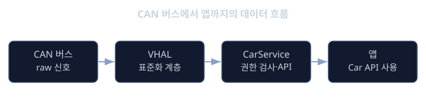
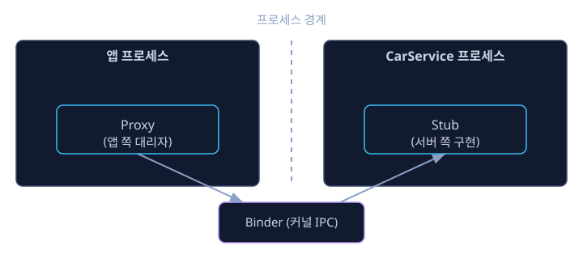

# CarService · AIDL

앞선 `vhal` 레슨에서 우리는 차량의 CAN 버스를 타고 흐르던 raw 신호(속도, RPM, 도어 상태 같은 것들)가 VHAL(Vehicle HAL)을 거쳐 VehicleProperty라는 표준화된 데이터 모델로 안드로이드 쪽에 들어오는 과정을 배웠습니다. get(), set(), subscribe() 같은 저수준 API로 속성 값을 읽고 쓰고 구독할 수 있다는 것까지 확인했습니다.

그런데 실제로 내비게이션 앱이나 공조(에어컨) 제어 앱을 만드는 개발자는 이 VHAL API를 직접 두드리지 않습니다. VHAL은 벤더(vendor)와 디바이스에 따라 구현이 다르고, 자바/코틀린으로 안드로이드 앱을 만드는 입장에서 쓰기에는 너무 저수준입니다. 게다가 "어떤 앱이 현재 속도를 읽어도 되는지", "어떤 앱이 에어컨 온도를 바꿔도 되는지" 같은 권한 통제도 필요합니다. 아무 앱이나 차량 속도나 공조를 건드릴 수 있다면 안전 문제로 직결되기 때문입니다.

이 빈틈을 채우는 것이 바로 이번 레슨의 주제인 CarService입니다. CarService는 VHAL과 앱 사이에 놓인 중간 계층(middleware)으로, 한쪽에서는 VHAL과 통신해 VehicleProperty 값을 가져오고, 다른 한쪽에서는 앱에게 훨씬 쓰기 편한 자바 API(Car API)를 제공하면서 동시에 권한도 검사합니다. 이 과정에서 프로세스 경계를 넘는 통신이 필요한데, 안드로이드는 이를 위해 AIDL(Android Interface Definition Language)이라는 도구를 사용합니다.

이번 레슨은 플랫폼 & OS 트랙의 Android Automotive 단계 중 마지막 레슨입니다. CarService와 AIDL의 역할을 이해하고 나면, "차량 버스의 신호가 어떻게 안드로이드 앱 화면까지 도달하는가"라는 이 트랙 전체의 질문에 답할 수 있게 됩니다.

## 학습 목표

- CarService가 VHAL과 안드로이드 앱 사이에서 어떤 역할을 하는지 설명할 수 있다.
- Car API(Car.createCar, CarPropertyManager 등)를 사용하는 전형적인 코드 흐름을 이해한다.
- 차량 프로퍼티 접근에 세분화된 권한(car permission)이 필요한 이유를 설명할 수 있다.
- AIDL이 무엇이고, 왜 프로세스 간 통신(IPC)에 필요한지 이해한다.
- AIDL이 생성하는 코드가 내부적으로 바인더(Binder)를 사용한다는 점을 안다.
- CAN 버스부터 앱까지 이어지는 전체 데이터 흐름을 한 문장으로 요약할 수 있다.

## 왜 CarService가 필요한가

같은 반에서 외국인 유학생과 대화한다고 생각해 봅시다. 유학생이 한국어를 전혀 모른다면 대화가 안 되겠지만, 통역사가 중간에 서면 서로 다른 언어를 쓰는 두 사람도 자연스럽게 대화할 수 있습니다. 여기서 통역사는 단순히 말을 옮기는 것뿐 아니라, "이 질문은 너무 사적이니 넘어가자"처럼 걸러주는 역할도 할 수 있습니다.

CarService가 바로 이 통역사입니다. VHAL은 벤더마다 구현이 다르고 저수준 데이터 구조(VehicleProperty)로 말하는 반면, 앱 개발자는 안드로이드에서 익숙한 자바/코틀린 매니저(Manager) 패턴으로 말하고 싶어 합니다. CarService는 VHAL의 언어를 앱의 언어로 바꿔주고, 동시에 "이 앱이 이 정보를 요청해도 되는지"를 걸러주는 문지기(gatekeeper) 역할도 합니다.

예를 들어 내비게이션 앱이 "지금 속도가 과속 기준을 넘었는지" 확인하려면, VHAL의 VehicleProperty.PERF_VEHICLE_SPEED 값을 직접 조회하는 대신, 안드로이드 Car API를 통해 CarService에게 "현재 속도 값을 알려줘"라고 요청합니다. CarService는 내부적으로 VHAL과 통신해 값을 가져온 뒤, 권한을 확인하고, 그 값을 앱에게 돌려줍니다.

## CarService 개요: VHAL과 앱 사이의 다리

CarService는 Android Automotive OS(AAOS)에서 부팅 시 함께 시작되는 시스템 서비스입니다. 시스템 서비스답게 일반 앱과는 별도의 프로세스로 동작하는 경우가 일반적이지만, 안드로이드 버전이나 구현에 따라 세부 구조가 다를 수 있으므로 "항상 이렇게 동작한다"고 단정하기보다는 "시스템 레벨에서 상시 구동되는 서비스"라는 큰 그림으로 이해하는 것이 안전합니다.

CarService의 역할은 크게 두 가지로 나눌 수 있습니다.

- VHAL 쪽: VHAL과 AIDL(또는 과거 버전에서는 HIDL)을 통해 통신하면서 VehicleProperty 값을 읽고 쓰고 구독합니다.
- 앱 쪽: CarPropertyService 같은 내부 서비스들을 AIDL 인터페이스로 노출하고, 앱은 이를 직접 다루는 대신 Car API라는 더 쉬운 자바 래퍼(wrapper)를 통해 접근합니다.

즉 CarService는 VHAL이라는 "차량 쪽 세계"와 앱이라는 "안드로이드 쪽 세계"를 잇는 다리입니다. 앱 개발자 입장에서는 VHAL이 존재한다는 사실조차 몰라도 Car API만 알면 차량 기능을 쓸 수 있다는 점이 핵심입니다.



## Car API 사용 흐름

앱이 차량 속성에 접근하는 전형적인 패턴은 다음과 같은 순서를 따릅니다.

- `Car.createCar(context)`를 호출해 Car 객체(차량 전체를 대표하는 진입점)를 얻습니다.
- Car 객체에서 필요한 매니저(Manager)를 얻습니다. 예를 들어 차량 속성을 다루려면 CarPropertyManager를 얻습니다.
- 매니저를 통해 `getProperty()`로 현재 값을 읽거나, `setProperty()`로 값을 바꾸거나, 콜백을 등록해 값이 바뀔 때마다 통지를 받습니다.

아래는 이 흐름을 단순화한 코드 예시입니다. 실제 메서드 시그니처는 안드로이드 버전마다 조금씩 다를 수 있으므로, 정확한 사용법은 사용 중인 AAOS 버전의 공식 문서를 확인해야 합니다. 여기서는 "매니저를 통해 속성을 읽고 구독한다"는 패턴 자체에 집중합니다.

```java
// 1. Car 객체 얻기
Car car = Car.createCar(context);

// 2. CarPropertyManager 얻기
CarPropertyManager propertyManager =
        (CarPropertyManager) car.getCarManager(Car.PROPERTY_SERVICE);

// 3. 현재 속도 값 읽기 (개념적 예시)
CarPropertyValue<Float> speed =
        propertyManager.getProperty(VehiclePropertyIds.PERF_VEHICLE_SPEED, 0);

// 4. 속도가 바뀔 때마다 통지받기 (과속 경고용)
propertyManager.registerCallback(callback, VehiclePropertyIds.PERF_VEHICLE_SPEED,
        CarPropertyManager.SENSOR_RATE_NORMAL);
```

이 코드만 보면 앱 개발자는 VHAL이나 AIDL의 존재를 전혀 신경 쓰지 않습니다. CarPropertyManager 뒤에서 CarService가 AIDL/바인더를 통해 실제 값을 받아오는 작업을 대신 처리해 주기 때문입니다.

## 차량 권한 모델: car permission

일반 안드로이드 앱에서도 위치 정보나 카메라 같은 민감한 기능에는 권한(permission)이 필요합니다. 차량 환경에서는 이보다 한 걸음 더 나아가, 기능별로 훨씬 세분화된 권한이 요구됩니다.

왜 더 세분화되어야 할까요. 스마트폰에서 위치 권한이 없어도 큰 사고로 이어지지는 않지만, 차량에서는 임의의 앱이 속도 데이터를 조작된 값으로 읽거나, 에어컨이 아닌 다른 안전 관련 제어 신호를 함부로 바꿀 수 있다면 실제 안전 사고로 이어질 수 있습니다. 그래서 "속도 읽기 권한"과 "공조 제어 권한"처럼 기능별로 권한을 나누어, 꼭 필요한 앱에만 꼭 필요한 권한만 부여하는 것이 원칙입니다.

CarService는 앱이 CarPropertyManager를 통해 특정 속성을 요청할 때마다, 해당 앱이 그 속성에 대응하는 car permission을 가지고 있는지 검사합니다. 권한이 없으면 SecurityException이 발생하거나 요청이 거부됩니다. 이 검사 로직이 바로 CarService가 "단순 중계자"가 아니라 "문지기" 역할도 한다고 말할 수 있는 이유입니다.

앱 개발자 입장에서는 이 권한 선언도 일반 안드로이드 권한과 똑같은 방식으로 `AndroidManifest.xml`에 적습니다.

```xml
<!-- 속도 정보를 읽기 위한 권한 선언 예시 -->
<uses-permission android:name="android.car.permission.CAR_SPEED" />
```

이렇게 선언된 권한은 설치 시점이나 시스템 설정에서 사용자(또는 OEM 정책)가 허용 여부를 결정하고, CarService는 런타임에 호출자의 권한 목록을 실제로 검사한 뒤에야 해당 프로퍼티 값을 돌려줍니다. 권한 선언 문법 자체는 익숙한 안드로이드 방식이지만, 그 뒤에서 어떤 프로퍼티가 어떤 권한에 묶여 있는지를 결정하고 검사하는 쪽은 일반 앱 프레임워크가 아니라 CarService라는 점이 차량 플랫폼의 특징입니다.

<details><summary><b>심화: 왜 읽기 권한과 쓰기 권한을 분리할까</b></summary>

속도 값을 "읽는 것"과 공조 온도를 "바꾸는 것"은 안전에 미치는 영향이 완전히 다릅니다. 읽기 전용 권한만 가진 앱이 실수로든 악의적으로든 차량 제어에 영향을 줄 수 없도록, 많은 차량 프로퍼티는 읽기용 권한과 쓰기(제어)용 권한을 따로 정의합니다. 이렇게 권한을 세밀하게 나누는 설계를 최소 권한 원칙(principle of least privilege)이라고 부르며, 차량처럼 안전이 중요한 시스템일수록 이 원칙이 더 엄격하게 적용됩니다.

</details>

## AIDL 기초: 프로세스 경계를 넘는 인터페이스

앱 프로세스와 CarService 프로세스는 서로 다른 프로세스입니다. 안드로이드에서 서로 다른 프로세스에 있는 두 컴포넌트가 메서드를 호출하듯 상호작용하려면 프로세스 간 통신(IPC, Inter-Process Communication)이 필요합니다. 이때 "인터페이스를 어떻게 정의하고, 그 인터페이스를 양쪽 프로세스에서 어떻게 구현/호출할 것인가"를 표준화한 것이 바로 AIDL(Android Interface Definition Language)입니다.

개발자는 `.aidl` 파일에 인터페이스를 선언만 하면 됩니다. 아래는 속도를 조회하는 가상의 AIDL 인터페이스 예시입니다.

```
// ICarSpeedService.aidl (개념 예시)
interface ICarSpeedService {
    float getCurrentSpeed();
    void registerSpeedListener(ISpeedListener listener);
}
```

이 `.aidl` 파일을 안드로이드 빌드 시스템이 컴파일하면, 자동으로 두 가지 코드가 생성됩니다.

- Stub: 서버 쪽(여기서는 CarService 프로세스)에서 실제 기능을 구현하는 추상 클래스.
- Proxy: 클라이언트 쪽(앱 프로세스)에서 원격 객체를 "마치 로컬 객체처럼" 호출할 수 있게 해주는 대리자 클래스.

앱 코드는 Proxy의 메서드를 호출하면 되고, 그 호출이 실제로 다른 프로세스에 있는 Stub까지 전달되어 실행된 뒤 결과가 돌아옵니다. 개발자는 이 모든 과정이 마치 같은 프로세스 안에서 메서드를 호출한 것처럼 느껴지도록 AIDL이 감춰줍니다.

## 바인더(Binder): AIDL 뒤에서 동작하는 IPC

그러면 Proxy가 Stub을 호출할 때 실제로는 어떤 일이 벌어질까요. 이 모든 통신은 안드로이드의 핵심 IPC 메커니즘인 바인더(Binder)를 통해 이루어집니다. AIDL은 바인더를 직접 다루는 번거로운 코드를 개발자가 작성하지 않도록, 바인더 위에서 동작하는 Proxy/Stub 코드를 자동으로 만들어 주는 도구라고 이해하면 됩니다.

조금 더 풀어서 말하면, Proxy의 메서드 호출은 내부적으로 데이터를 Parcel이라는 형태로 직렬화(marshalling)하고, 커널의 바인더 드라이버를 거쳐 상대 프로세스로 전달됩니다. 상대 프로세스의 Stub은 전달받은 데이터를 역직렬화해서 실제 구현 메서드를 호출하고, 결과를 다시 같은 경로로 돌려보냅니다. 앱 개발자는 이 과정을 전혀 몰라도 되지만, "AIDL로 만든 인터페이스 호출은 결국 바인더를 거치는 IPC다"라는 사실은 CarService처럼 프로세스를 넘나드는 프레임워크를 이해하는 데 중요한 전제가 됩니다.



바인더 호출에는 크게 두 가지 방식이 있습니다. 하나는 동기(synchronous) 호출로, 호출한 쪽이 결과가 돌아올 때까지 기다리는 방식입니다. `getProperty()`처럼 "지금 당장의 값을 알려 달라"는 요청이 여기에 해당합니다. 다른 하나는 `oneway`로 선언하는 비동기 호출로, 호출한 쪽은 결과를 기다리지 않고 바로 다음 코드를 실행합니다. 값이 바뀔 때마다 리스너에게 통지하는 콜백 인터페이스는 보통 `oneway`로 선언됩니다. 속도처럼 자주 바뀌는 값을 매번 동기 호출로 통지한다면 호출하는 쪽(VHAL이나 CarService)이 앱의 응답을 기다리느라 전체 시스템이 느려질 수 있기 때문에, 이런 이벤트 통지 경로는 비동기로 설계하는 것이 자연스럽습니다.

CarService가 다루는 범위는 차량 프로퍼티뿐만이 아닙니다. 예를 들어 CarWatchdog은 차량 안에서 동작하는 프로세스들의 CPU나 I/O 사용량을 감시해서, 하나의 앱이나 서비스가 과도한 자원을 차지하지 못하도록 관리하는 역할을 합니다. 이런 부가 기능들도 결국 CarService라는 하나의 프레임워크 아래에서 AIDL과 바인더를 통해 앱 및 다른 시스템 서비스와 통신한다는 점에서는 지금까지 다룬 구조와 동일합니다. 이 레슨에서 익힌 "AIDL로 인터페이스를 선언하고, 바인더로 프로세스 경계를 넘는다"는 패턴은 CarService의 거의 모든 기능에 공통으로 적용되는 기본 틀이라고 이해하면 됩니다.

<details><summary><b>심화: CarService는 정확히 어디서 실행되는가</b></summary>

CarService가 독립된 프로세스로 뜨는지, 혹은 system_server 안에서 함께 구동되는지는 안드로이드 버전과 구현에 따라 달라질 수 있습니다. 이 레슨에서는 정확한 프로세스 구조를 단정하기보다, "CarService는 시스템 레벨의 서비스이고, 앱과는 별도의 실행 맥락에서 동작하므로 앱과의 통신에는 IPC(AIDL/바인더)가 필요하다"는 큰 그림만 기억해도 충분합니다. 정확한 프로세스 구조가 필요한 작업을 한다면 사용 중인 AAOS 버전의 소스나 공식 문서를 반드시 확인해야 합니다.

</details>

<details><summary><b>심화: Stable AIDL과 HAL 경계</b></summary>

지금까지 다룬 AIDL은 앱 프로세스와 CarService 프로세스 사이, 즉 안드로이드 프레임워크 내부의 통신에 쓰이는 예시였습니다. 그런데 `vhal` 레슨에서 다룬 HAL 경계(프레임워크와 벤더 구현 사이)에서도 비슷한 개념이 쓰입니다. 다만 이 경계에서는 버전 호환성이 훨씬 엄격하게 요구되기 때문에, 안정적인 버전 관리가 보장되는 AIDL인 Stable AIDL이 사용됩니다. 실제로 최근 안드로이드 버전에서는 VHAL 인터페이스 자체도 과거의 HIDL 기반에서 Stable AIDL 기반으로 옮겨가는 흐름이 있었습니다. 즉 "앱과 CarService 사이의 AIDL"과 "CarService와 VHAL 사이의 (Stable) AIDL"은 같은 개념(AIDL과 바인더)이 서로 다른 경계에서 쓰이는 두 가지 사례라고 볼 수 있습니다.

</details>

**확인 문제.** 내비게이션 앱 개발자가 VHAL의 get()/set() API를 직접 호출하지 않고 CarService의 Car API(CarPropertyManager 등)를 통해서만 차량 속성에 접근하는 이유를 두 가지 이상 들어보세요.

<details><summary>답 보기</summary>

최소 두 가지 이유를 들 수 있습니다. 첫째, VHAL은 벤더/디바이스마다 구현이 다르고 저수준 데이터 구조로 되어 있어 앱 개발자가 직접 다루기 번거롭습니다. CarService는 이를 표준화된 자바 API(Car API)로 감싸서 훨씬 쓰기 쉽게 만들어 줍니다. 둘째, 차량 프로퍼티 접근에는 세분화된 권한(car permission) 검사가 필요한데, 이 검사를 CarService가 중앙에서 담당합니다. 앱이 VHAL을 직접 호출할 수 있다면 이런 권한 통제를 우회할 수 있어 안전상 문제가 됩니다.

</details>

**확인 문제.** `.aidl` 파일 하나를 컴파일하면 자동으로 생성되는 두 가지 코드는 무엇이고, 각각 어느 프로세스(클라이언트/서버) 쪽에서 쓰이나요?

<details><summary>답 보기</summary>

Proxy와 Stub입니다. Proxy는 클라이언트(호출하는 쪽, 예를 들어 일반 앱 프로세스)에서 원격 객체를 로컬 객체처럼 호출할 수 있게 해주는 대리자 코드이고, Stub은 서버(실제 구현을 가진 쪽, 예를 들어 CarService 프로세스)에서 들어온 호출을 받아 실제 메서드를 실행하는 추상 클래스입니다. 이 둘 사이의 실제 데이터 전달은 바인더(Binder)를 통해 이루어집니다.

</details>

## 정리

이 레슨으로 플랫폼 & OS 트랙의 Android Automotive 단계가 마무리됩니다. 지금까지의 흐름을 한 번에 복습해 봅시다.

- 차량 버스(CAN)를 타고 센서와 ECU의 신호가 흐릅니다.
- `vhal` 레슨에서 배운 VHAL이 이 신호를 디바이스/벤더에 맞게 구현해 받아들이고, VehicleProperty라는 표준화된 데이터 모델로 바꿔줍니다.
- 이번 레슨에서 배운 CarService가 VHAL과 통신해 VehicleProperty 값을 가져오고, 권한(car permission)을 검사한 뒤, AIDL과 바인더(Binder)를 통해 앱 프로세스에 그 값을 전달합니다.
- 앱은 Car API(Car.createCar, CarPropertyManager 등)라는 쉬운 자바 API만 알면, 그 뒤에 숨어 있는 CAN 버스나 VHAL, AIDL, 바인더를 전혀 몰라도 차량 기능을 활용할 수 있습니다.

요약하면 "CAN 버스 → VHAL(표준화) → CarService(권한 통제 + API 제공, AIDL/바인더로 통신) → 앱(Car API)"이라는 한 줄의 흐름으로 이 트랙 전체를 기억하면 됩니다. 과속 경고를 띄우는 내비게이션 앱이든, 온도를 바꾸는 공조 제어 앱이든, 결국은 이 파이프라인을 거쳐 차량과 소통하고 있는 것입니다.

## 참고 자료

- 안드로이드 공식 문서의 Car API(android.car 패키지) 레퍼런스
- 안드로이드 공식 문서의 AIDL 개요 및 바인더 IPC 설명
- Android Automotive OS(AAOS) 아키텍처 개요 문서
- Stable AIDL 및 HAL 인터페이스 버전 관리 관련 안드로이드 공식 문서
- 안드로이드 권한 모델(런타임 권한, 서명 권한) 공식 가이드
