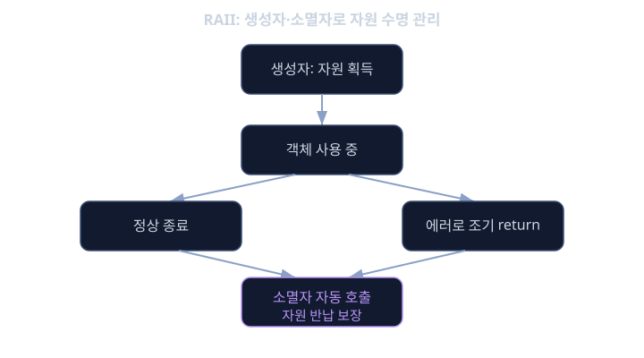
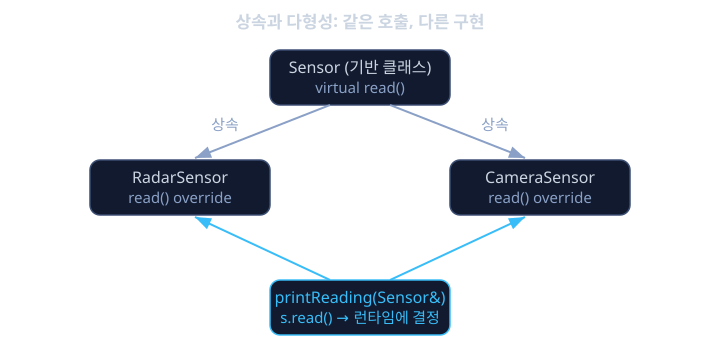

# C++ 기초

앞서 배운 C 언어는 엔진 ECU처럼 단순하고 빠른 제어 로직에는 완벽하지만, 요즘 차에 들어가는 자율주행 인지 모듈이나 인포테인먼트 시스템처럼 복잡한 소프트웨어를 짜려고 하면 금방 한계가 드러납니다. 카메라 센서 객체, 레이더 센서 객체, 퓨전 알고리즘 객체가 서로 메시지를 주고받고, 네트워크 소켓이나 파일, 메모리 같은 자원을 수십 개씩 열고 닫아야 하는 상황에서, C처럼 구조체와 함수를 손으로 일일이 연결하다 보면 "이 자원을 닫는 코드를 빠뜨렸다"거나 "이 포인터를 두 번 해제했다" 같은 실수가 생기기 쉽습니다. 실제로 최신 자동차 아키텍처 표준인 Adaptive AUTOSAR(어댑티브 아우토사르)는 이런 복잡한 서비스 지향 소프트웨어를 위해 C가 아니라 C++를 표준 언어로 채택했습니다.

C++는 C 위에 "객체(object)"라는 개념과 "자원을 자동으로 정리해 주는 규칙"을 얹은 언어입니다. 이 레슨에서는 왜 그런 개념이 필요한지를 자동차 소프트웨어의 실제 문제에서부터 시작해서, 클래스, RAII(자원 획득 즉 소멸, Resource Acquisition Is Initialization), 템플릿(template)이라는 세 가지 핵심 도구를 쌓아 올립니다. 이 세 가지를 모르면 Adaptive AUTOSAR 서비스 코드나 안드로이드 오토모티브의 네이티브 레이어(HAL, 하드웨어 추상화 계층) 코드를 한 줄도 제대로 이해할 수 없습니다.

앞서 배운 C의 포인터와 메모리 개념은 이 레슨 전체의 바탕입니다. C++의 클래스는 결국 "구조체에 함수를 붙인 것"이고, RAII는 "생성자와 소멸자를 이용해 포인터 해제를 자동화한 것"이며, 템플릿은 "타입을 바꿔가며 같은 코드를 컴파일 시점에 여러 번 찍어내는 것"입니다. 즉 전부 C에서 배운 개념의 연장선입니다.

## 학습 목표

- 클래스가 구조체와 함수를 어떻게 하나로 묶어 캡슐화하는지 설명할 수 있다.
- 생성자와 소멸자를 이용한 RAII 패턴으로 자원 누수를 방지하는 코드를 작성할 수 있다.
- 상속과 가상 함수(virtual function)를 이용한 다형성(polymorphism)의 동작 원리를 이해한다.
- 템플릿이 컴파일 시점에 타입별 코드를 생성하는 원리와 그 장점을 설명할 수 있다.
- 스마트 포인터(`unique_ptr`, `shared_ptr`)가 RAII를 어떻게 자동 메모리 관리에 적용하는지 안다.
- Adaptive AUTOSAR와 안드로이드 네이티브 환경에서 C++가 쓰이는 이유와 제약을 설명할 수 있다.

## 왜 C++인가: 서비스 지향 자동차 소프트웨어의 요구

전통적인 자동차 ECU(구형 AUTOSAR, 흔히 Classic AUTOSAR라고 부릅니다)는 운영체제 없이 고정된 주기로 돌아가는 단순한 작업들의 집합이었고, C언어의 절차적인 스타일이 잘 맞았습니다. 하지만 자율주행, 커넥티비티, 소프트웨어 정의 차량(SDV) 시대가 되면서, 하나의 고성능 컴퓨터(HPC) 위에서 리눅스 같은 운영체제가 돌고, 그 위에서 센서 퓨전 서비스, 경로 계획 서비스, 진단 서비스 같은 수십 개의 소프트웨어 컴포넌트가 서로 네트워크 메시지를 주고받는 구조로 바뀌었습니다. 이런 구조를 서비스 지향 아키텍처(SOA)라고 하며, 이를 표준화한 것이 Adaptive AUTOSAR입니다.

Adaptive AUTOSAR는 ARA(AUTOSAR Runtime for Adaptive applications)라는 런타임 환경을 C++14/17로 제공합니다. 왜 C가 아니라 C++일까요. 서비스 하나를 표현하려면 "이 서비스가 가진 상태(데이터)"와 "이 서비스가 할 수 있는 행동(함수)"을 하나의 단위로 묶어서, 여러 서비스 인스턴스를 만들고 서로 다른 구현으로 교체할 수 있어야 합니다. C에서는 이걸 구조체와 함수 포인터로 억지로 흉내 낼 수는 있지만, 코드가 장황해지고 실수하기도 쉽습니다. C++의 클래스, 상속, 템플릿은 이런 요구를 언어 차원에서 지원합니다.

## 클래스: 데이터와 행동을 하나로 묶기

구조체는 데이터만 묶지만, 클래스(class)는 데이터(멤버 변수)와 그 데이터를 다루는 함수(멤버 함수)를 하나로 묶습니다. 거기에 더해 어떤 멤버는 외부에서 볼 수 있게(`public`), 어떤 멤버는 내부에서만 쓰게(`private`) 감출 수 있습니다. 이를 캡슐화(encapsulation)라고 합니다.

```cpp
class TemperatureSensor {
public:
    TemperatureSensor(int channel) : channel_(channel), lastValue_(0) {}

    int read() {
        lastValue_ = readRawAdc(channel_);  // 하드웨어 접근은 내부에 숨긴다
        return lastValue_;
    }

    int getLastValue() const { return lastValue_; }

private:
    int channel_;
    int lastValue_;
    int readRawAdc(int channel);  // 외부에서는 호출할 수 없다
};
```

`TemperatureSensor` 객체를 사용하는 코드는 `readRawAdc`가 어떤 레지스터를 건드리는지 전혀 알 필요가 없습니다. `sensor.read()`만 호출하면 됩니다. 이렇게 "내부 구현을 감추고 필요한 동작만 공개하는" 설계는, 센서 종류가 다섯 개, 열 개로 늘어나도 사용하는 쪽 코드가 바뀌지 않게 해 줍니다. C로 같은 걸 만들면 `sensor_read(struct Sensor *self)`처럼 매번 구조체 포인터를 첫 번째 인자로 넘겨야 하는데, 클래스는 이 과정을 문법적으로 자동화해 줄 뿐입니다. 즉 클래스는 완전히 새로운 개념이 아니라, C에서 이미 하던 일을 더 안전하고 읽기 쉽게 표현한 것입니다.

## RAII: 생성자와 소멸자로 자원을 자동 관리하기

C에서 파일을 열었으면 반드시 닫아야 하고, 메모리를 `malloc`했으면 반드시 `free`해야 합니다. 문제는 함수 중간에 에러가 나서 일찍 `return`하는 경로가 여러 개 있을 때, 그 모든 경로에서 자원 해제를 빠뜨리지 않고 챙기는 일이 사람의 실수에 의존한다는 점입니다. 코드 리뷰 때마다 "이 함수 혹시 에러 경로에서 자원 안 닫고 나가는 데 있나" 하나하나 확인해야 한다면, 코드가 커질수록 사고가 날 확률도 커집니다.

C++는 이 문제를 생성자(constructor)와 소멸자(destructor)로 해결합니다. 생성자는 객체가 만들어질 때 자동으로 호출되는 함수이고, 소멸자는 객체가 사라질 때(스코프를 벗어날 때) 자동으로 호출되는 함수입니다. 자원을 획득하는 일을 생성자에, 자원을 반납하는 일을 소멸자에 넣어 두면, "객체의 생명주기가 끝나는 순간 자원도 반드시 반납된다"는 사실이 언어 차원에서 보장됩니다. 이 패턴의 이름이 RAII, 즉 "자원 획득은 곧 초기화다(Resource Acquisition Is Initialization)"입니다.

```cpp
class CanSocket {
public:
    CanSocket(const char *ifname) {
        fd_ = openCanInterface(ifname);  // 생성 시점에 자원 획득
    }
    ~CanSocket() {
        closeCanInterface(fd_);          // 소멸 시점에 자원 반납 (자동 호출)
    }
    void send(const CanFrame &frame) { sendCanFrame(fd_, frame); }

private:
    int fd_;
};

void diagnose() {
    CanSocket sock("can0");
    sock.send(buildDiagRequest());
    if (someErrorCondition()) {
        return;   // 여기서 함수가 끝나도 sock의 소멸자가 자동으로 호출되어 fd_가 닫힌다
    }
    // 정상 경로에서도 함수가 끝나면 소멸자가 호출된다
}
```

함수가 어떤 경로로 끝나든(정상 종료, 중간 `return`, 심지어 예외가 던져지는 경우까지) 스코프를 벗어나는 지역 객체의 소멸자는 반드시 호출됩니다. 그래서 "닫는 걸 잊어버리는" 종류의 버그가 구조적으로 사라집니다. 이것이 RAII가 임베디드와 자동차 소프트웨어처럼 안정성이 중요한 분야에서 특히 가치 있는 이유입니다.



## 상속과 다형성: 같은 인터페이스, 다른 구현

여러 종류의 센서(카메라, 레이더, 라이다)를 "센서"라는 공통된 관점에서 다루고 싶을 때가 많습니다. 각 센서는 구체적인 동작이 다르지만, "읽는다"는 인터페이스는 같습니다. C++에서는 공통 인터페이스를 가진 기반 클래스(base class)를 정의하고, 각 센서가 이를 상속(inheritance)해서 자신만의 구현을 채우는 방식으로 이를 표현합니다.

```cpp
class Sensor {
public:
    virtual int read() = 0;      // 순수 가상 함수: 구현은 자식 클래스에 맡긴다
    virtual ~Sensor() {}
};

class RadarSensor : public Sensor {
public:
    int read() override { return readRadarDistance(); }
};

class CameraSensor : public Sensor {
public:
    int read() override { return readCameraBrightness(); }
};

void printReading(Sensor &s) {
    printf("값: %d\n", s.read());  // 어떤 센서인지 몰라도 동작한다
}
```

`printReading` 함수는 `RadarSensor`인지 `CameraSensor`인지 전혀 모른 채 `s.read()`만 호출하는데, 실제로 어떤 코드가 실행되는지는 런타임에 결정됩니다. 이를 다형성(polymorphism)이라고 하며, `virtual` 키워드가 이를 가능하게 합니다. 내부적으로는 각 객체가 자신의 실제 타입에 맞는 함수 목록(가상 함수 테이블, vtable)을 가리키는 숨겨진 포인터를 갖고 있고, `s.read()` 호출은 이 테이블을 통해 올바른 함수로 연결됩니다. 센서 팀이 센서 종류를 추가해도, 이를 사용하는 퓨전 알고리즘 코드는 한 글자도 바꿀 필요가 없습니다.



## 템플릿: 타입마다 코드를 다시 쓰지 않기

레이더 거리값은 정수, 카메라 밝기값도 정수, 하지만 어떤 센서는 부동소수점 값을 돌려줄 수도 있습니다. "최근 N개 값의 평균을 내는 버퍼"처럼 타입과 무관하게 똑같은 로직을 여러 타입에 대해 쓰고 싶을 때, C에서는 타입마다 거의 똑같은 함수를 복사해서 다시 쓰거나, `void *`로 타입 정보를 지워버리고 캐스팅에 의존하는 위험한 방법을 써야 했습니다.

C++의 템플릿(template)은 "타입을 매개변수로 받는 코드"를 작성하게 해 줍니다. 컴파일러는 실제로 쓰이는 타입마다 그 타입에 맞는 코드를 컴파일 시점에 찍어내므로, 런타임에는 아무 추가 비용이 들지 않습니다.

```cpp
template <typename T, int N>
class MovingAverage {
public:
    void push(T value) {
        buf_[idx_] = value;
        idx_ = (idx_ + 1) % N;
    }
    T average() const {
        T sum = 0;
        for (int i = 0; i < N; ++i) sum += buf_[i];
        return sum / N;
    }
private:
    T buf_[N] = {};
    int idx_ = 0;
};

MovingAverage<int, 8> radarAvg;      // int, 8개짜리 버전
MovingAverage<float, 16> cameraAvg;  // float, 16개짜리 버전
```

`MovingAverage<int, 8>`과 `MovingAverage<float, 16>`은 컴파일러가 보기에 완전히 다른 두 개의 클래스로, 각각에 맞는 기계어가 생성됩니다. 런타임에는 "이게 int인지 float인지" 검사하는 분기 하나 없이, 처음부터 그 타입에 맞게 생성된 코드가 그대로 실행됩니다. 이것이 템플릿이 "런타임 오버헤드 없는 추상화(zero-overhead abstraction)"라고 불리는 이유이며, 성능이 중요한 임베디드 코드에서도 템플릿을 받아들일 수 있는 이유입니다.

## 스마트 포인터: RAII를 메모리 관리에 적용하기

`new`로 할당한 메모리를 `delete`로 해제하는 책임을 사람이 직접 지는 대신, RAII 원리를 메모리에도 적용한 것이 스마트 포인터(smart pointer)입니다. `std::unique_ptr`는 "이 포인터는 오직 하나의 소유자만 갖는다"는 규칙을 강제하며, 소유자가 스코프를 벗어나면 소멸자가 자동으로 `delete`를 호출합니다. `std::shared_ptr`는 여러 곳에서 같은 자원을 공유해야 할 때, 내부적으로 참조 카운트(reference count)를 세어서 마지막 소유자가 사라질 때 자원을 해제합니다.

```cpp
std::unique_ptr<CanSocket> sock = std::make_unique<CanSocket>("can0");
sock->send(frame);
// 함수가 끝나면 unique_ptr의 소멸자가 CanSocket을 자동으로 delete한다
```

이렇게 하면 `new`와 `delete`를 손으로 짝지어 맞출 필요가 없어지고, "메모리를 두 번 해제했다"거나 "해제를 잊어버렸다" 같은 버그의 상당수가 애초에 발생하지 않습니다.

<details><summary><b>심화: Adaptive AUTOSAR의 C++14 가이드라인</b></summary>

AUTOSAR는 "Guidelines for the use of the C++14 language in critical and safety-related systems"라는 문서를 통해, 안전이 중요한 자동차 소프트웨어에서 C++의 어떤 기능을 어떻게 제한해서 써야 하는지를 규정합니다. 예를 들어 예외(exception)는 전체 비용과 동작 예측 가능성 문제로 제한적으로만 허용되고, 동적 메모리 할당은 시스템 초기화 시점에만 하고 런타임 중 반복적인 할당·해제는 피하도록 권고합니다. RTTI(런타임 타입 정보, `dynamic_cast` 등)의 사용도 제한됩니다. 즉 Adaptive AUTOSAR가 C++을 쓴다고 해서 표준 C++의 모든 기능을 자유롭게 쓸 수 있는 것이 아니라, 안전과 예측 가능성을 위해 신중하게 선별된 부분집합만 쓴다는 점이 핵심입니다.

</details>

<details><summary><b>심화: 가상 함수의 비용과 임베디드에서의 trade-off</b></summary>

가상 함수는 유연하지만 공짜가 아니다. 객체마다 가상 함수 테이블을 가리키는 포인터(보통 8바이트)가 추가로 필요하고, 함수 호출 시 테이블을 한 번 더 거쳐 가야 하므로 직접 호출보다 약간 느리다. 또한 컴파일러가 호출될 함수를 컴파일 시점에 알 수 없으므로 인라인(inline) 최적화를 하기 어렵다. 인터럽트 서비스 루틴처럼 극도로 빠른 응답이 필요한 저수준 코드에서는 가상 함수 대신 템플릿이나 함수 포인터 같은 정적 기법을 선호하는 경우가 많다. 반면 Adaptive AUTOSAR의 서비스 레이어처럼 호출 빈도가 낮고 유연성이 중요한 상위 계층에서는 가상 함수의 비용이 무시할 만한 수준이라 널리 쓰인다. 즉 C++을 쓴다는 것이 모든 기능을 아무 데서나 쓴다는 뜻이 아니라, 계층에 맞는 도구를 고르는 판단력이 필요하다는 뜻이다.

</details>

**확인 문제.** 다음 코드는 왜 위험한가. RAII 관점에서 설명하라.

```cpp
void process() {
    FILE *fp = fopen("log.txt", "w");
    if (writeHeader(fp) != 0) {
        return;   // 에러 시 fclose를 호출하지 않고 함수가 끝난다
    }
    fclose(fp);
}
```

<details><summary>답 보기</summary>

`fopen`/`fclose`는 C 스타일 자원 관리로, 소멸자가 없기 때문에 자원 해제가 전적으로 프로그래머가 모든 경로에서 `fclose`를 호출했는지에 의존한다. `writeHeader`가 실패해서 `return`하는 경로에는 `fclose(fp)`가 없으므로 파일 핸들이 닫히지 않고 누수된다. RAII 스타일로 바꾸면, 파일을 감싸는 클래스를 만들어 생성자에서 `fopen`, 소멸자에서 `fclose`를 호출하게 한다. 그러면 `return`이 어디서 일어나든 그 지역 객체가 스코프를 벗어나는 순간 소멸자가 자동으로 호출되어 파일이 항상 닫힌다. 이것이 C 스타일 수동 자원 관리와 C++ RAII의 근본적인 차이다.

</details>

**확인 문제.** `MovingAverage<int, 8>`과 `MovingAverage<float, 16>`을 둘 다 쓰는 프로그램을 컴파일하면, 실행 파일에는 몇 개의 `average()` 함수 기계어가 들어가는가. 왜 그런가.

<details><summary>답 보기</summary>

두 개가 들어간다. 템플릿은 실제로 쓰이는 타입과 매개변수 조합마다 컴파일 시점에 별도의 코드를 생성하는데, 이를 템플릿 인스턴스화(instantiation)라고 한다. `MovingAverage<int, 8>`과 `MovingAverage<float, 16>`은 컴파일러 입장에서 완전히 서로 다른 두 개의 클래스이므로, 각각의 `average()`가 독립적으로 생성된다. 이는 런타임에 타입 분기가 전혀 없다는 장점이 있지만, 템플릿을 다양한 타입과 매개변수 조합으로 많이 쓰면 실행 파일의 크기가 커지는 코드 비대화(code bloat) 현상이 생길 수 있다는 단점도 동반한다.

</details>

## 정리

- 클래스는 구조체와 함수를 하나로 묶어 캡슐화하며, 내부 구현을 감추고 사용하는 쪽 코드를 단순하게 유지해 준다.
- RAII는 생성자와 소멸자를 이용해 자원 획득과 반납을 객체의 생명주기에 묶음으로써, 자원 누수 버그를 구조적으로 막는다.
- 상속과 가상 함수는 같은 인터페이스에 대해 서로 다른 구현을 런타임에 교체할 수 있게 해 주며, 센서 종류가 늘어도 사용하는 쪽 코드를 바꾸지 않아도 된다.
- 템플릿은 타입마다 코드를 컴파일 시점에 생성해, 런타임 오버헤드 없이 여러 타입에 재사용 가능한 코드를 쓰게 해 준다.
- Adaptive AUTOSAR와 안드로이드 오토모티브는 C++의 이런 기능들을 서비스 지향 소프트웨어의 복잡성을 다루는 데 쓰지만, 안전을 위해 예외·동적 할당 등 일부 기능은 신중하게 제한해서 사용한다.

C++는 C가 주는 하드웨어 제어력을 그대로 가지면서, 그 위에 복잡한 소프트웨어를 안전하고 체계적으로 짤 수 있는 도구를 더한 언어다. 이 레슨에서 익힌 클래스·RAII·템플릿의 감각은 이후 소프트웨어 아키텍처, AUTOSAR, 안드로이드 오토모티브 관련 레슨을 이해하는 데 핵심적인 바탕이 된다.

## 참고 자료

- Bjarne Stroustrup, "The C++ Programming Language" (4th Edition)
- Scott Meyers, "Effective Modern C++"
- ISO/IEC 14882, Programming languages — C++
- AUTOSAR, "Guidelines for the use of the C++14 language in critical and safety-related systems"
- AUTOSAR, "Explanation of Adaptive Platform Design" (AUTOSAR Adaptive Platform 문서군)
