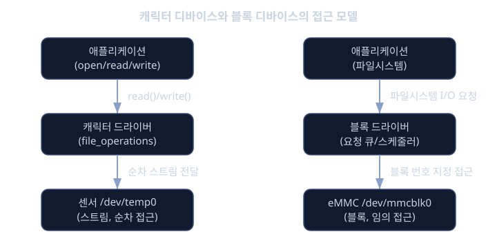
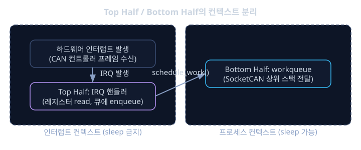

# 디바이스 드라이버

차량용 ECU(Electronic Control Unit) 한 대 안에는 생각보다 훨씬 많은 하드웨어가 들어 있다. CAN(Controller Area Network) 컨트롤러로 다른 ECU와 통신하고, I2C나 SPI 버스에 연결된 온도 센서와 가속도 센서로 주변 상태를 읽고, GPIO(General Purpose Input/Output)로 릴레이나 LED를 켜고 끄며, 카메라와 디스플레이로 영상을 주고받는다. 이 모든 하드웨어는 결국 CPU가 특정 메모리 주소에 값을 쓰거나 읽는 방식, 즉 레지스터(register) 접근으로 제어된다.

만약 유저 공간 애플리케이션이 이 레지스터에 직접 접근할 수 있다면 어떻게 될까. 당장은 빠르고 간단해 보이지만, 여러 프로세스가 동시에 같은 센서를 건드리면 충돌이 나고, 하나의 버그가 전체 시스템 메모리를 망가뜨릴 수도 있다. 더 큰 문제는 이식성이다. 차종이 바뀌어 CAN 컨트롤러 칩이 교체되면 애플리케이션 코드 전체를 다시 써야 한다. 그래서 커널은 디바이스 드라이버(device driver)라는 표준화된 계층을 두어, 하드웨어의 세부 사항을 숨기고 애플리케이션에는 일관된 인터페이스만 제공한다.

디바이스 드라이버는 커널의 일부로 동작하면서 하드웨어를 직접 제어하고, 그 결과를 `/dev` 아래의 파일처럼 보이는 추상화로 유저 공간에 노출한다. 애플리케이션 개발자는 CAN 컨트롤러 칩의 레지스터 맵을 몰라도 `open`, `read`, `write` 같은 익숙한 시스템 호출만으로 하드웨어를 다룰 수 있다. 이번 레슨에서는 이 계층이 어떤 종류로 나뉘고, 하드웨어가 발생시키는 인터럽트(interrupt)를 어떻게 받아 처리하며, 대용량 데이터를 CPU 부담 없이 옮기는 DMA(Direct Memory Access)가 왜 필요한지를 자동차 임베디드 예시로 살펴본다. 선수 레슨인 `kernel-intro`에서 다룬 커널의 기본 구조를 전제로 이야기를 이어간다.

## 학습 목표

- 캐릭터 디바이스와 블록 디바이스의 개념적 차이와 각각의 전형적인 사용 사례를 설명할 수 있다.
- `struct file_operations`, major/minor number, `cdev` 등록 과정을 통해 캐릭터 드라이버가 유저 공간과 연결되는 흐름을 이해한다.
- 인터럽트 컨텍스트와 프로세스 컨텍스트의 차이를 알고, top half와 bottom half로 작업을 나누는 이유를 설명할 수 있다.
- DMA가 CPU 개입을 줄이는 원리와 캐시 일관성 문제가 왜 생기는지 이해한다.
- 자동차 ECU의 CAN, I2C 센서, GPIO 릴레이 예시를 통해 각 개념이 실제로 어떻게 쓰이는지 설명할 수 있다.

## 캐릭터 디바이스: 스트림으로 하드웨어 다루기

캐릭터 디바이스(character device)는 데이터를 순서대로 흘려보내는 스트림(stream)처럼 다뤄지는 장치다. 시리얼 포트, CAN 컨트롤러, 센서처럼 "지금 들어온 값을 순서대로 읽는다" 혹은 "쓴 순서대로 전송한다"는 모델이 자연스러운 장치가 여기에 속한다. 임베디드 환경에서 흔히 보는 `/dev/ttyUSB0`, `/dev/can0` 같은 이름이 대표적인 예다.

커널은 캐릭터 드라이버를 `struct file_operations`라는 구조체로 표현한다. 이 구조체는 유저 공간에서 호출하는 `open`, `read`, `write`, `release`, `ioctl` 같은 시스템 호출이 들어왔을 때 실제로 실행할 함수 포인터의 모음이다.

```c
static struct file_operations temp_sensor_fops = {
    .owner          = THIS_MODULE,
    .open           = temp_sensor_open,
    .release        = temp_sensor_release,
    .read           = temp_sensor_read,
    .write          = temp_sensor_write,
    .unlocked_ioctl = temp_sensor_ioctl,
};
```

예를 들어 I2C로 연결된 온도 센서 드라이버라면, 유저 공간에서 `/dev/temp0`를 열고 `read()`를 호출할 때마다 `temp_sensor_read` 함수가 실행되어 I2C 버스로 센서 레지스터 값을 읽어온 뒤 사용자 버퍼에 복사해 돌려준다.

캐릭터 디바이스는 major number와 minor number라는 두 숫자로 식별된다. major number는 어떤 드라이버가 해당 장치를 다루는지를, minor number는 같은 드라이버가 관리하는 여러 장치 중 몇 번째인지를 나타낸다. 드라이버는 다음과 같은 순서로 커널에 자신을 등록한다.

```c
dev_t dev_num;
alloc_chrdev_region(&dev_num, 0, 1, "temp_sensor");

cdev_init(&temp_sensor_cdev, &temp_sensor_fops);
cdev_add(&temp_sensor_cdev, dev_num, 1);
```

`alloc_chrdev_region`으로 major/minor number를 할당받고, `cdev_init`으로 `struct cdev`와 `file_operations`를 연결한 뒤 `cdev_add`로 커널에 등록한다. 이렇게 등록이 끝나면 커널은 udev라는 유저 공간 데몬에 이벤트를 전달하고, udev가 `/dev/temp0` 같은 노드 파일을 자동으로 만들어 준다. 개발자가 직접 `mknod`로 노드를 만들던 과거 방식과 달리, 요즘 리눅스 시스템에서는 이 과정이 자동화되어 있다.

## 블록 디바이스: 저장장치를 다루는 또 다른 방식

캐릭터 디바이스가 순서대로 흘러가는 데이터를 다룬다면, 블록 디바이스(block device)는 고정된 크기의 블록 단위로 임의 접근(random access)이 가능한 장치를 다룬다. 차량 인포테인먼트 시스템의 eMMC나 SD 카드 같은 저장장치가 대표적이다. "처음부터 순서대로 읽는다"가 아니라 "N번째 블록을 바로 읽거나 쓴다"는 모델이기 때문에, 파일시스템이 임의의 위치에 있는 파일 데이터를 효율적으로 읽고 쓸 수 있다.

블록 디바이스 드라이버는 `struct block_device_operations`라는 별도의 구조체를 사용하며, 캐릭터 디바이스처럼 호출마다 바로 하드웨어로 요청을 전달하지 않는다. 대신 커널은 블록 I/O 요청을 요청 큐(request queue)에 모아두고, I/O 스케줄러가 여러 요청의 순서를 재배열하거나 병합해서 디스크 탐색 비용을 줄이는 방식으로 동작한다.

```c
static struct block_device_operations emmc_fops = {
    .owner = THIS_MODULE,
    .open  = emmc_open,
    .release = emmc_release,
};
```

정리하면, 캐릭터 디바이스는 "지금 흘러오는 값"을 다루는 스트림 지향 모델이고, 블록 디바이스는 "원하는 위치의 데이터"를 다루는 임의 접근 모델이다. 같은 I2C 버스에 연결된 장치라도 센서처럼 값을 스트림으로 읽는 장치는 캐릭터 디바이스에, eMMC처럼 블록 단위로 저장 공간을 다루는 장치는 블록 디바이스에 가깝다.



## 인터럽트: 하드웨어가 커널을 깨우는 방법

CPU가 센서 값이 들어왔는지 계속 확인하러 다니는 방식, 즉 폴링(polling)은 CPU를 낭비한다. 대신 하드웨어가 "준비됐다"는 신호를 CPU에 직접 보내는 방식이 인터럽트(interrupt)다. CAN 컨트롤러가 프레임을 수신하면 지정된 IRQ(Interrupt Request) 번호로 인터럽트를 발생시키고, CPU는 하던 일을 잠시 멈추고 해당 인터럽트에 등록된 핸들러 함수를 실행한다.

드라이버는 `request_irq()`로 특정 IRQ 번호에 자신의 핸들러 함수를 등록하고, 모듈이 해제될 때 `free_irq()`로 등록을 해지한다.

```c
static irqreturn_t can_irq_handler(int irq, void *dev_id)
{
    u32 status = readl(can_base + CAN_STATUS_REG);
    /* 레지스터에서 빠르게 데이터만 꺼내고 큐에 넣는다 */
    schedule_work(&can_rx_work);
    return IRQ_HANDLED;
}

request_irq(can_irq_num, can_irq_handler, IRQF_SHARED, "can0", dev);
```

여기서 중요한 제약이 있다. 인터럽트 핸들러는 인터럽트 컨텍스트(interrupt context)에서 실행되는데, 이 컨텍스트에서는 sleep이 금지되고 가능한 짧고 빠르게 끝내야 한다. 뮤텍스(mutex) 획득처럼 잠들 수 있는 동작을 인터럽트 핸들러 안에서 하면 시스템 전체가 멈출 위험이 있다. 반면 일반적인 드라이버 코드가 `read`나 `write`로 호출될 때는 프로세스 컨텍스트(process context)에서 실행되며, 여기서는 sleep이 허용된다.

이 제약 때문에 커널은 인터럽트 처리를 두 단계로 나누는 관례를 쓴다. 인터럽트가 발생한 그 순간 바로 실행되는 짧은 부분을 top half, 나중에 여유를 두고 처리해도 되는 나머지 작업을 bottom half라고 부른다. bottom half는 tasklet이나 workqueue, 또는 threaded IRQ로 구현한다. CAN 프레임을 받는 예시로 보면, top half(하드 IRQ 핸들러)는 레지스터에서 수신한 프레임 데이터만 빠르게 꺼내 내부 큐에 넣고 바로 리턴하고, 실제로 그 프레임을 SocketCAN 네트워크 스택에 전달하고 상위 프로토콜을 처리하는 무거운 작업은 workqueue로 미뤄서 처리한다. 이렇게 나누면 인터럽트 핸들러가 길어져서 다른 인터럽트를 놓치는 일을 막을 수 있다.



동기화도 컨텍스트에 따라 수단이 달라진다. 인터럽트 컨텍스트에서 공유 데이터를 보호해야 할 때는 sleep하지 않는 스핀락(spinlock)을 쓰고, 프로세스 컨텍스트끼리의 동기화에는 sleep이 가능한 뮤텍스(mutex)를 쓰는 것이 일반적인 규칙이다.

## DMA: CPU를 거치지 않는 데이터 이동

인터럽트로 데이터가 준비됐다는 신호를 받아도, 실제로 데이터를 메모리로 옮기는 작업을 CPU가 한 바이트씩 직접 복사한다면 여전히 느리고 CPU 자원을 많이 쓴다. 특히 차량 인포테인먼트(IVI, In-Vehicle Infotainment) 시스템에서 카메라 영상이나 디스플레이 출력처럼 대용량 데이터를 다룰 때는 이 복사 비용이 눈에 띄게 커진다. DMA(Direct Memory Access)는 DMA 컨트롤러라는 별도의 하드웨어가 CPU 개입 없이 메모리와 주변장치 사이에서 데이터를 직접 옮기도록 하는 메커니즘이다. CPU는 DMA 컨트롤러에게 "이 주소에서 저 주소로 이만큼 옮겨라"라고 지시만 내리고, 전송이 끝나면 인터럽트로 완료 통지를 받는다.

드라이버는 DMA에 사용할 메모리 영역을 `dma_alloc_coherent()`로 할당한다. 이 함수로 얻은 메모리는 CPU와 DMA 컨트롤러가 캐시를 거치지 않고도 일관된 값을 보도록 보장된 영역이다.

```c
dma_addr_t dma_handle;
void *buf = dma_alloc_coherent(dev, BUF_SIZE, &dma_handle, GFP_KERNEL);

camera_dma_start(dma_handle, BUF_SIZE);
```

전송할 데이터가 메모리 여러 곳에 흩어져 있을 때는 scatter-gather DMA를 쓴다. 이는 연속된 하나의 큰 버퍼 대신, 여러 조각으로 나뉜 메모리 영역들의 목록을 DMA 컨트롤러에 한 번에 넘겨 각 조각을 순서대로 전송하게 하는 방식이다. 카메라 프레임 버퍼처럼 큰 데이터를 다룰 때 메모리를 꼭 연속으로 할당할 필요가 없어진다는 장점이 있다.

DMA를 쓸 때 반드시 고려해야 하는 것이 캐시 일관성(cache coherency) 문제다. CPU는 캐시에 값을 들고 있는데 DMA 컨트롤러가 메모리를 직접 바꿔버리면, CPU가 캐시에 남아 있는 옛 값을 계속 읽는 상황이 생길 수 있다. `dma_alloc_coherent`로 할당한 메모리는 이런 문제를 하드웨어나 커널이 알아서 처리해 주지만, 그 외의 방식(스트리밍 DMA 매핑 등)을 쓸 때는 드라이버가 `dma_sync_*` 계열 함수로 명시적으로 캐시를 맞춰 주어야 하는 경우도 있다. 이 레슨에서는 "DMA를 쓸 때 캐시 일관성을 항상 신경 써야 한다"는 원칙만 기억해 두자.

## 자동차 임베디드에서의 조합: GPIO 릴레이와 I2C 센서

지금까지 다룬 개념들은 실제 ECU 안에서 따로따로가 아니라 함께 조합되어 쓰인다. GPIO로 제어하는 릴레이(relay)를 예로 들면, 상대적으로 간단한 장치라 인터럽트나 DMA 없이도 동작한다. 애플리케이션이 `/dev/gpio_relay0`에 `write()`로 1 또는 0을 쓰면 드라이버는 해당 GPIO 핀의 레지스터 값을 바로 바꿔 릴레이를 켜거나 끈다.

```c
static ssize_t relay_write(struct file *f, const char __user *buf,
                            size_t len, loff_t *off)
{
    char value;
    if (copy_from_user(&value, buf, 1))
        return -EFAULT;

    gpio_set_value(RELAY_GPIO_PIN, value == '1');
    return 1;
}
```

반면 I2C 가속도 센서는 흔히 "데이터 준비 완료(data ready)" 핀을 통해 인터럽트를 발생시킨다. 센서가 새 측정값을 준비하면 인터럽트가 발생하고, top half는 플래그만 세운 뒤 workqueue로 실제 I2C 읽기 작업을 넘긴다. I2C 트랜잭션 자체가 버스 중재와 응답 대기를 포함해 시간이 걸리는 작업이라 sleep이 필요할 수 있고, 이는 인터럽트 컨텍스트에서는 할 수 없는 일이기 때문이다.

CAN 컨트롤러는 더 복잡해서, 실제 리눅스 환경에서는 캐릭터 디바이스가 아니라 SocketCAN이라는 네트워크 디바이스(network device) 인터페이스로 다뤄진다. 다만 "인터럽트로 프레임 수신을 알리고, top half에서 레지스터를 읽어 큐에 넣고, bottom half에서 상위 스택에 전달한다"는 흐름 자체는 캐릭터 드라이버의 인터럽트 처리와 본질적으로 같은 패턴이다.

<details><summary><b>심화: udev가 /dev 노드를 만드는 과정</b></summary>

`cdev_add()`로 드라이버가 등록되는 것과 `/dev` 아래에 실제 파일이 보이는 것은 별개의 과정이다. 드라이버가 `device_create()` 같은 함수로 디바이스 등록 이벤트를 커널 내부의 sysfs/kobject 체계에 알리면, 커널은 이 이벤트를 netlink 소켓을 통해 유저 공간의 udev 데몬에 전달한다. udev는 미리 정의된 규칙(udev rule)에 따라 적절한 이름과 권한으로 `/dev` 아래에 노드 파일을 생성한다. 이 덕분에 드라이버 작성자는 더 이상 `mknod`로 디바이스 파일을 수동으로 만들 필요가 없고, 핫플러그로 꽂히는 USB 장치처럼 동적으로 나타나고 사라지는 장치도 자연스럽게 처리된다.

</details>

<details><summary><b>심화: SocketCAN은 왜 캐릭터 디바이스가 아닌가</b></summary>

CAN 버스는 여러 ECU가 동시에 참여하는 브로드캐스트 네트워크에 가깝다. 하나의 CAN 컨트롤러가 여러 ID의 프레임을 주고받고, 필터링, 우선순위, 오류 처리 같은 네트워크 스택의 기능이 그대로 필요하다. 리눅스는 이런 특성을 고려해 CAN을 캐릭터 디바이스가 아니라 이더넷과 비슷한 네트워크 디바이스로 다루는 SocketCAN이라는 서브시스템을 제공한다. 그래서 `/dev/can0`처럼 열어서 `read`/`write`를 하는 대신, 소켓 API(`socket(PF_CAN, ...)`)로 CAN 프레임을 주고받는다. 다만 이 레슨에서 다룬 캐릭터 디바이스 모델은 교육적으로 CAN 드라이버의 인터럽트 처리 구조를 이해하는 데 여전히 유용한 단순화된 모델이다.

</details>

<details><summary><b>심화: dma_alloc_coherent와 스트리밍 DMA의 차이</b></summary>

`dma_alloc_coherent()`로 얻는 메모리는 드라이버가 로드되어 있는 동안 계속 유지하면서 하드웨어와 반복적으로 주고받는 용도에 적합하다. 캐시 일관성을 하드웨어나 커널이 보장해 주지만, 할당과 해제 비용이 있어서 매 전송마다 새로 할당하기에는 비효율적이다. 반면 이미 커널이 다른 목적으로 쓰고 있는 버퍼(예: 네트워크 패킷 버퍼)를 짧은 시간 동안만 DMA 용도로 매핑하는 경우에는 스트리밍 DMA 매핑(`dma_map_single` 등)을 쓴다. 이 경우에는 전송 전후로 드라이버가 명시적으로 캐시를 플러시(flush)하거나 무효화(invalidate)해 주어야 하는 책임이 있다. 두 방식 모두 "CPU 캐시와 실제 메모리 사이의 값이 어긋나지 않게 하라"는 같은 문제를 다른 트레이드오프로 푸는 것이다.

</details>

**확인 문제.** CAN 컨트롤러의 인터럽트 핸들러를 top half 하나로만 작성해서, 수신한 프레임을 레지스터에서 읽자마자 곧바로 SocketCAN 상위 스택에 전달하고 필요하면 뮤텍스까지 잡아 처리하도록 구현했다. 이 설계의 문제점은 무엇이며, 어떻게 고쳐야 하는가.

<details><summary>답 보기</summary>

인터럽트 핸들러는 인터럽트 컨텍스트에서 실행되므로 sleep이 금지된다. 뮤텍스를 획득하려는 시도 자체가 잠들 가능성이 있는 동작이라 커널 패닉이나 시스템 정지로 이어질 수 있다. 또한 핸들러가 길어지면 그동안 다른 인터럽트가 지연되거나 손실될 위험도 커진다. 올바른 설계는 top half(하드 IRQ 핸들러)에서는 레지스터 값을 빠르게 읽어 내부 큐에 넣는 최소한의 작업만 하고, 뮤텍스를 쓰거나 시간이 걸리는 상위 프로토콜 처리는 workqueue 같은 bottom half로 넘겨서 프로세스 컨텍스트에서 처리하도록 분리하는 것이다.

</details>

**확인 문제.** 저장장치(eMMC)와 온도 센서를 각각 캐릭터 디바이스와 블록 디바이스 중 어디에 대응시켜야 자연스러운지, 그 이유와 함께 설명하라.

<details><summary>답 보기</summary>

온도 센서는 "현재 측정값을 순서대로 읽는다"는 스트림 지향 접근이 자연스러우므로 캐릭터 디바이스에 대응된다. 임의의 위치를 지정해서 읽을 필요가 없고, `read()`를 호출할 때마다 최신 값을 받으면 충분하다. 반면 eMMC 같은 저장장치는 파일시스템이 특정 블록 번호를 지정해서 임의 접근으로 읽고 써야 하므로 블록 디바이스에 대응된다. 블록 디바이스는 요청 큐와 I/O 스케줄러를 통해 여러 I/O 요청을 모으고 재배열할 수 있다는 점에서도 저장장치의 특성에 더 맞는다.

</details>

## 정리

디바이스 드라이버는 커널이 CAN 컨트롤러, I2C/SPI 센서, GPIO, 카메라 같은 다양한 하드웨어를 표준화된 방식으로 유저 공간에 노출하는 계층이다. 스트림처럼 순서대로 다루는 장치는 캐릭터 디바이스로, 블록 단위 임의 접근이 필요한 저장장치는 블록 디바이스로 모델링된다. 하드웨어가 이벤트를 알릴 때는 인터럽트를 쓰며, 인터럽트 컨텍스트의 제약 때문에 빠른 top half와 느긋한 bottom half로 작업을 나누는 것이 일반적인 패턴이다. 대용량 데이터를 CPU 부담 없이 옮겨야 할 때는 DMA를 쓰고, 이때 캐시 일관성을 항상 신경 써야 한다. 이 모든 개념은 CAN, I2C 센서, GPIO 릴레이, 카메라처럼 실제 차량 ECU에 들어가는 하드웨어를 다루는 드라이버 코드 안에서 함께 맞물려 동작한다.

## 참고 자료

- Linux Device Drivers, 3rd Edition (Jonathan Corbet, Alessandro Rubini, Greg Kroah-Hartman)
- Linux Kernel Development (Robert Love)
- 리눅스 커널 공식 문서: Documentation/driver-api 디렉터리
- 리눅스 커널 공식 문서: Documentation/core-api/dma-api 관련 설명
- SocketCAN 관련 리눅스 커널 네트워킹 문서
