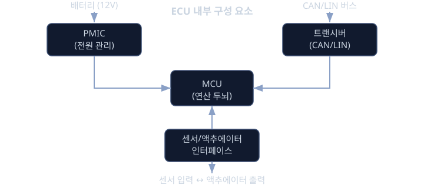
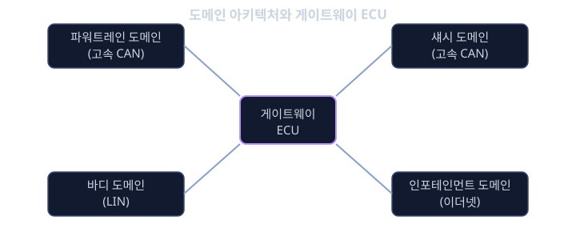

# ECU · 전장 아키텍처

평범한 중형 세단 한 대를 뜯어보면 엔진실, 운전석 아래, 트렁크, 도어 안쪽, 천장 어딘가에 작은 금속 상자들이 수십 개씩 박혀 있다. 이 상자 하나하나가 ECU(전자제어장치, Electronic Control Unit)다. 고급차는 100개를 훌쩍 넘기고, 보급형 소형차도 70개 안팎의 ECU를 품는다. 엔진을 제어하는 ECU, 변속기를 제어하는 ECU, 브레이크를 제어하는 ECU는 물론이고, 파워 윈도우 하나, 사이드미러 접이 기능 하나에도 작은 ECU가 붙어 있는 경우가 많다. 앞서 배운 CAN·LIN 통신에서는 이 ECU들이 "어떤 말을 주고받는가"를 다뤘다면, 이번 레슨은 그보다 한 단계 더 근본적인 질문을 다룬다. 이 수십 개, 많으면 백 수십 개에 이르는 ECU들에 전기를 어떻게 공급하고, 어디에 접지시키고, 어떤 묶음으로 나눠서 설계·생산·정비가 가능하게 만드는가 하는 문제다.

이 질문이 왜 중요한지는 구체적인 사고 실험으로 체감할 수 있다. 차를 주차장에 세워두고 일주일을 그냥 방치했는데 시동이 걸리지 않는 경우가 있다. 많은 경우 원인은 어느 한 ECU가 "잠들어야 할 때 깨어 있었던 것"이다. 모든 ECU를 더하면 차가 꺼져 있을 때도 흐르는 전류, 즉 암전류(parasitic current)가 ECU 하나당 1 mA도 안 되더라도, 그런 모듈이 백 개 가까이 쌓이면 합계가 수십 mA에 이르고, 배터리를 몇 주 안에 방전시킬 수 있다. 또 다른 예로, 겨울철 시동을 걸 때 헤드램프가 잠깐 어두워지는 경험을 해 봤을 것이다. 스타터 모터가 수백 A의 전류를 순간적으로 끌어가면서 배터리 단자 전압이 크게 떨어지는데(크랭킹 전압 저하, cranking voltage dip), 이 짧은 순간에도 엔진 ECU만큼은 멈추지 않고 계속 동작해야 한다. 전원 설계가 허술하면 바로 이 순간에 ECU가 리셋되어 시동이 꺼져버릴 수 있다.

접지(ground) 설계가 잘못됐을 때 생기는 문제도 체감하기 쉽다. 라디오를 켠 상태에서 와이퍼를 작동시켰더니 스피커에서 "윙" 하는 잡음이 섞여 나오는 증상을 본 적이 있다면, 그 원인의 상당수가 접지 루프(ground loop)다. 서로 다른 지점에서 차체에 접지된 두 ECU 사이에 미세한 전위차가 생기고, 그 전위차가 신호에 잡음으로 끼어드는 현상이다. 마지막으로, ECU 개수가 늘어날수록 각 ECU를 전원선·접지선·통신선으로 연결하는 배선 뭉치, 즉 와이어링 하니스(wiring harness)도 기하급수적으로 복잡해진다. 그래서 자동차 업계는 기능이 비슷한 ECU들을 도메인(domain)이라는 단위로 묶어서 설계하고, 그 경계를 넘나드는 통신을 중재하는 별도의 ECU를 두는 방향으로 발전해 왔다. 이번 레슨에서는 ECU 한 대의 내부 구성부터, 전원·접지·배선이라는 하드웨어적 제약, 그리고 그 제약을 풀어내는 도메인 아키텍처와 게이트웨이(gateway)라는 해법까지 차례로 살펴본다.

## 학습 목표

- ECU 한 대가 MCU, 전원 관리 IC, 트랜시버, 센서/액추에이터 인터페이스로 어떻게 구성되는지 설명할 수 있다.
- 배터리 전압 범위와 크랭킹 전압 저하가 ECU 전원 설계에 어떤 제약을 거는지 수치로 설명할 수 있다.
- 암전류와 슬립 모드의 관계를 이해하고, 간단한 전류-시간 계산으로 방전 시간을 추정할 수 있다.
- 접지 설계가 왜 중요한지, 접지 루프가 생기는 원리를 전기적으로 설명할 수 있다.
- ECU 개수 증가가 와이어링 하니스에 어떤 부담을 주는지, 그리고 이를 완화하는 도메인·게이트웨이 구조를 설명할 수 있다.
- 도메인 컨트롤러와 게이트웨이 ECU의 역할 차이를 구분할 수 있다.

## ECU의 내부 구성 요소

ECU 한 대를 열어보면 대략 네 가지 블록으로 나눌 수 있다. 첫째는 MCU(마이크로컨트롤러 유닛, Micro Controller Unit)로, 앞서 배운 임베디드 소프트웨어가 실제로 돌아가는 연산 두뇌다. 입력으로 들어온 값을 해석하고, 제어 로직을 계산해서 출력을 결정한다. 둘째는 전원 관리 IC(Power Management IC, 흔히 PMIC라고 부른다)로, 배터리에서 들어오는 불안정한 12 V 전압을 MCU가 실제로 쓸 수 있는 안정된 5 V나 3.3 V로 낮춰주고, 과전압·저전압·과열 같은 이상 상황을 감지해서 MCU를 보호한다. 셋째는 트랜시버(transceiver)로, 앞서 CAN·LIN 레슨에서 배운 바로 그 부품이다. MCU가 처리한 논리적인 비트열을 실제 전선 위의 전기 신호로 바꿔 내보내고, 반대로 전선 위의 신호를 받아서 MCU가 읽을 수 있는 디지털 값으로 되돌린다. 넷째는 센서/액추에이터 인터페이스로, 온도 센서의 미세한 전압 변화나 압력 센서의 저항 변화 같은 아날로그 신호를 디지털로 변환하는 입력단과, MCU의 판단을 모터나 밸브, 릴레이의 실제 움직임으로 바꿔주는 출력단을 포함한다.

전자식 스로틀 제어 ECU를 예로 들면 이 네 블록이 어떻게 맞물리는지 분명해진다. 운전자가 가속 페달을 밟으면 페달 위치 센서가 전압 신호를 만들고, 센서 인터페이스가 이를 디지털 값으로 바꿔 MCU에 전달한다. MCU는 이 값과 다른 여러 조건(엔진 회전수, 변속기 상태 등)을 함께 고려해서 스로틀을 몇 도 열어야 하는지 계산하고, 그 결과를 액추에이터 인터페이스를 통해 스로틀 모터로 내보낸다. 동시에 PMIC는 이 모든 연산과 구동에 필요한 전력을 안정적으로 공급하고, 트랜시버는 "지금 스로틀이 몇 도 열려 있다"는 정보를 CAN 버스에 실어서 엔진 ECU나 계기판 ECU에 알려준다. ECU 한 대가 하나의 작은 폐쇄 시스템이면서, 동시에 더 큰 차량 시스템의 일부로 동작하는 구조다.

## 전원 설계 - 배터리와 전압의 세계

차량 전기 시스템의 기준 전압은 보통 12 V다(일부 상용차나 마일드 하이브리드는 48 V 보조 전원을 함께 쓰고, 순수 전기차의 구동용 배터리는 수백 V에 달하지만, ECU 대부분이 쓰는 저전압 전원은 여전히 12 V 계열이다). 그런데 이 "12 V"는 항상 정확히 12 V가 아니다. 완전히 충전된 배터리는 무부하 상태에서 12.6 V ~ 13 V 정도를 내고, 엔진이 돌면서 발전기(alternator)가 충전할 때는 13.5 V ~ 14.5 V까지 올라가며, 반대로 전기를 많이 쓰는 상황에서는 더 낮아진다. 그래서 ECU의 전원 설계는 하나의 숫자가 아니라 넓은 전압 범위 전체에서 정상 동작을 보장해야 하는 문제다.

이 범위에서 가장 가혹한 순간이 시동을 거는 크랭킹(cranking) 구간이다. 스타터 모터는 정지해 있던 무거운 엔진을 강제로 돌리기 위해 150 A ~ 300 A에 이르는 큰 전류를 순간적으로 끌어간다. 배터리에는 내부 저항이 있고, 배터리와 ECU를 잇는 전선에도 저항이 있기 때문에, 전류가 커질수록 옴의 법칙에 따라 전압이 떨어진다.

$$
V = IR
$$

예를 들어 배터리와 배선을 합친 내부 저항이 0.02 옴이고 크랭킹 전류가 150 A라면, 이 저항에 걸리는 전압 강하는 $0.02 \times 150 = 3\text{ V}$다. 평소 12.6 V이던 단자 전압이 크랭킹 순간에는 9.6 V 근처까지 내려갈 수 있다는 뜻이다. 엔진 ECU는 이 짧은 전압 저하 구간에도 리셋되지 않고 계속 연료 분사와 점화를 제어해야 하므로, 전원 관리 IC는 이보다 더 낮은 전압에서도 MCU에 필요한 5 V, 3.3 V를 안정적으로 만들어낼 여유(margin)를 갖도록 설계된다. 전력 관점에서 보면 이 관계는 다음과 같이도 쓸 수 있다.

$$
P = VI
$$

즉 ECU 하나가 일정한 전력 $P$를 필요로 한다면, 입력 전압 $V$가 낮아질수록 같은 전력을 뽑아내기 위해 끌어가는 전류 $I$는 커진다. 이는 전원 설계에서 저전압 구간일수록 배선과 커넥터에 더 큰 전류 부담이 걸린다는 뜻이기도 하다.

<b>심화: 크랭킹 전압 저하 시 레귤레이터 동작 여유도 계산</b>

ECU 내부에서 12 V 계열 전원을 3.3 V로 낮추는 데 가장 널리 쓰이는 방식 중 하나가 선형 레귤레이터(LDO, Low Drop-Out regulator)다. LDO는 입력 전압에서 출력 전압을 뺀 값이 최소 드롭아웃 전압(dropout voltage) 이상이어야 정상 동작한다. 드롭아웃 전압을 $V_{do}$, 목표 출력을 $V_{out}$이라 하면 동작 조건은 다음과 같다.

$$
V_{in} \geq V_{out} + V_{do}
$$

예를 들어 3.3 V를 출력하는 LDO의 드롭아웃 전압이 1.5 V라면, 정상 동작을 위한 최소 입력 전압은 $3.3 + 1.5 = 4.8\text{ V}$다. 앞서 계산한 크랭킹 순간의 9.6 V는 이 조건을 충분히 만족하므로 안전하다. 하지만 배선이 길고 접촉 저항이 큰 노후 차량에서 전압 강하가 더 커져 입력이 5 V 밑으로 떨어진다면, LDO는 더 이상 3.3 V를 제대로 유지하지 못하고 MCU가 예기치 않게 리셋될 수 있다. 이런 위험을 줄이기 위해 중요도가 높은 ECU(엔진, 브레이크, 에어백 관련)에는 드롭아웃 전압이 더 작은 레귤레이터를 쓰거나, 크랭킹 구간에서만 임시로 버텨주는 보조 축전 소자를 추가하기도 한다. 동작 여유도는 흔히 다음 식으로 정의한다.

$$
\text{margin} = V_{in} - (V_{out} + V_{do})
$$

이 margin이 0에 가깝거나 음수가 되는 순간이 바로 "크랭킹 중 계기판이 깜빡이거나 ECU가 재부팅되는" 현상의 전기적 원인이다. 전원 설계자는 최악의 경우(가장 추운 날, 가장 방전된 배터리, 가장 큰 크랭킹 전류)를 가정하고 이 margin이 항상 양수로 남도록 부품을 고른다.

## 암전류와 슬립 모드

시동을 끄고 차에서 내려도 모든 ECU가 완전히 전원을 끊는 것은 아니다. 도난 방지 시스템은 리모컨 신호를 계속 기다려야 하고, 일부 바디 ECU는 다음에 문을 열 때를 대비해 깨어 있을 준비를 해야 한다. 이렇게 시동이 꺼진 상태에서도 흐르는 작은 전류를 암전류(parasitic current, quiescent current)라고 부른다. ECU 한 개의 암전류는 보통 1 mA 미만으로 설계하지만, 차량 한 대에 깨어 있는 ECU가 수십 개 쌓이면 합계는 수십 mA 단위로 커진다.

이 숫자가 왜 중요한지는 간단한 계산으로 알 수 있다. 전류와 시간, 전하량의 관계는 다음과 같다.

$$
Q = It
$$

배터리 용량을 60 Ah(암페어시)라 하고, 모든 ECU의 암전류 합이 40 mA라고 하면, 완전 방전까지 걸리는 시간은 $t = Q / I = 60 \div 0.04 = 1500$시간, 즉 약 62일이다. 두 달 가까이 차를 세워두면 배터리가 바닥날 수 있다는 뜻이다. 그래서 ECU를 설계할 때는 "깨어 있어야 하는 이유가 없으면 즉시 슬립 모드(sleep mode)로 들어간다"는 원칙을 철저히 지킨다. 슬립 모드에서는 MCU의 클럭을 멈추거나 대부분의 회로를 끄고, CAN 버스에 특정한 깨우기 신호(wake-up signal)가 들어올 때만 다시 활성화된다. 반대로 어느 ECU가 소프트웨어 버그 때문에 슬립 모드로 들어가지 못하고 계속 깨어 있는 상태를 흔히 "다크 커런트 드레인(dark current drain)" 문제라고 부르며, 실제 차량 리콜의 흔한 원인 중 하나다.

**확인 문제.** 배터리 용량이 50 Ah인 차량에서 모든 ECU의 암전류 합이 25 mA로 측정되었다. 완전 방전까지 대략 며칠이 걸리는지 계산해 보라.

답 보기

$Q = It$ 관계에서 시간 $t = Q / I$다. $Q = 50\text{ Ah}$, $I = 0.025\text{ A}$이므로 $t = 50 \div 0.025 = 2000$시간이다. 하루는 24시간이므로 $2000 \div 24 \approx 83.3$일, 즉 대략 83일, 두 달 반 정도가 지나면 배터리가 완전히 방전된다는 계산이 나온다. 실제로는 배터리가 완전 방전 직전에 시동이 걸리지 않는 수준까지만 떨어져도 문제가 되므로, 실제 "시동 불가"까지 걸리는 시간은 이보다 더 짧을 수 있다.

## 접지 설계와 접지 루프

전원만큼 중요하지만 눈에 잘 보이지 않는 요소가 접지(ground)다. 모든 ECU는 전류가 흘러나가는 통로, 즉 기준이 되는 0 V 지점이 필요하다. 자동차에서는 보통 금속 차체(섀시) 자체를 공용 접지 통로로 쓴다. 문제는 차체도 완전한 도체가 아니라서 아주 작지만 분명한 저항을 가진다는 점이다. 서로 멀리 떨어진 두 지점, 예를 들어 엔진룸의 접지점과 트렁크의 접지점 사이에는 미세한 전위차가 존재할 수 있고, 이 둘을 서로 다른 지점에서 접지한 두 ECU가 신호선으로 연결되면, 그 전위차가 신호에 잡음으로 끼어든다. 이 현상을 접지 루프(ground loop)라고 부른다. 배터리 관리 시스템처럼 밀리볼트 단위의 미세한 전압을 다루는 ECU일수록 접지 루프에 특히 취약하다.

이 문제를 완화하는 가장 근본적인 방법은 두 가지다. 하나는 접지 지점을 체계적으로 통합해서, 가능한 한 적은 수의 "기준 접지점"으로 전체 전위를 맞추는 것이다. 다른 하나는 신호를 전달하는 방식 자체를 바꾸는 것인데, 앞서 배운 CAN 통신이 바로 이 방법을 쓴다. CAN은 CAN_H와 CAN_L 두 선의 전압 차이로 신호를 표현하는 차동 신호(differential signaling) 방식이라, 두 선에 똑같이 끼어드는 공통 잡음(접지 전위차 포함)은 차이를 계산하는 과정에서 서로 상쇄되어 사라진다. 즉 접지 루프라는 하드웨어적 문제의 상당 부분을 통신 프로토콜 설계로 완화한 것이다.

<b>심화: 접지 루프의 전기적 원리와 차동 신호가 이를 완화하는 방식</b>

두 ECU A, B가 각각 차체의 지점 $P_1$, $P_2$에 접지되어 있다고 하자. 차체 자체도 저항 $R_g$를 가지므로, 어떤 제3의 전류(예: 다른 고전류 부하가 차체를 통해 흘리는 전류 $I_g$)가 $P_1$과 $P_2$ 사이를 흐르면 두 지점 사이에는 다음과 같은 전위차가 생긴다.

$$
V_g = I_g R_g
$$

ECU A가 보내는 단일 신호선의 전압을 수신 측에서 "자신의 접지 기준 $P_2$에 대한 전압"으로 읽는다고 하면, 실제로 읽히는 값은 원래 보내고자 한 신호 $V_s$에 이 $V_g$가 더해진 $V_s + V_g$가 된다. $V_g$가 바로 접지 루프 잡음이다.

차동 신호는 이 문제를 구조적으로 피한다. CAN_H에는 $V_s/2$를, CAN_L에는 $-V_s/2$를 실어 보낸다고 하면, 두 선 모두 같은 접지 잡음 $V_g$를 공통으로 겪으므로 수신 측에서 읽는 두 선의 전압은 각각 $V_s/2 + V_g$, $-V_s/2 + V_g$다. 수신기는 신호를 두 선의 차이로 복원하므로,

$$
(V_s/2 + V_g) - (-V_s/2 + V_g) = V_s
$$

가 되어 접지 잡음 $V_g$가 완전히 상쇄된다. 이것이 CAN뿐 아니라 USB, 이더넷의 차동 페어, 오디오 장비의 밸런스 케이블이 공통으로 쓰는 원리이며, "왜 민감한 신호선은 한 가닥이 아니라 꼭 짝을 지어 꼬아서 배선하는가(twisted pair)"에 대한 답이기도 하다.

## 와이어링 하니스의 복잡도

ECU 개수가 늘어날수록 전원선, 접지선, 통신선을 모아 놓은 배선 뭉치인 와이어링 하니스(wiring harness)도 함께 늘어난다. 중형 세단 한 대에 들어가는 하니스를 모두 풀어서 이으면 길이가 1.5 km를 넘기는 경우가 흔하고, 무게도 25 kg ~ 40 kg에 이른다. 고급 대형차는 하니스 무게만 60 kg을 넘기도 한다. 이는 차체 조립 공정에서 가장 손이 많이 가는 작업 중 하나이며, 무게 측면에서는 연비에도 영향을 주는 요인이다.

만약 모든 ECU가 각각 다른 모든 ECU와 직접 전선으로 연결되어야 한다면, ECU 개수 $n$이 늘어날 때 필요한 연결선 수는 $n(n-1)/2$로 늘어난다. ECU가 10개면 45개의 연결이 필요하지만, 100개가 되면 4950개의 연결이 필요해진다는 뜻이다. 실제로는 이런 전수 연결 대신, 앞서 배운 CAN·LIN처럼 하나의 공유 버스(bus)에 여러 ECU를 매달아 통신선 자체는 크게 줄이는 방법을 쓴다. 하지만 전원선과 접지선은 여전히 ECU 하나하나까지 개별적으로 가야 하는 경우가 많고, 통신 버스도 결국 차량 전체를 가로질러야 하므로, 버스를 쓰더라도 하니스의 물리적 복잡도 자체가 사라지지는 않는다. 이 복잡도를 줄이는 다음 단계가 바로 도메인 아키텍처와 게이트웨이다.

<b>심화: 와이어링 하니스의 전압 강하 계산</b>

긴 전선은 저항을 가지므로, 전선 양 끝에서 측정하는 전압이 달라진다. 구리선의 저항은 길이에 비례하고 단면적에 반비례한다.

$$
R = \rho \frac{L}{A}
$$

여기서 $\rho$는 구리의 비저항(약 $1.68 \times 10^{-8}\ \Omega \cdot \text{m}$), $L$은 전선 길이, $A$는 전선의 단면적이다. 예를 들어 길이 4 m, 단면적 1.5 $\text{mm}^2$(=$1.5 \times 10^{-6}\ \text{m}^2$)인 전선의 저항은 다음과 같다.

$$
R = 1.68 \times 10^{-8} \times \frac{4}{1.5 \times 10^{-6}} \approx 0.045\ \Omega
$$

이 전선에 5 A의 전류가 흐른다면, 전압 강하는 $V = IR = 5 \times 0.045 \approx 0.22\text{ V}$다. 5 V 전원을 쓰는 민감한 센서라면 이 정도 강하도 오차의 원인이 될 수 있어서, 배선 설계자는 전류가 큰 구간일수록 단면적이 더 큰(즉 더 굵고 무거운) 전선을 쓰거나, 전원선을 ECU 가까이까지 최대한 짧게 끌어가는 식으로 $L$을 줄인다. 반대로 전선을 가늘게 해서 무게와 비용을 아끼려는 요구와, 전압 강하를 줄이기 위해 전선을 굵게 해야 하는 요구는 항상 트레이드오프 관계에 있다. 이 트레이드오프가 와이어링 하니스 설계를 ECU 개수와 배치만큼이나 까다로운 문제로 만든다.

## 기능 도메인별 ECU 분류와 도메인 컨트롤러

ECU가 몇 개뿐이던 시절에는 기능 하나마다 ECU 하나를 그냥 추가하는 분산형(distributed) 구조로도 충분했다. 하지만 ECU 수가 70개, 100개를 넘어가면서, 이렇게 평평하게 흩어진 구조는 설계, 생산, 정비 모든 단계에서 감당하기 어려워졌다. 그래서 자동차 업계는 기능이 비슷한 ECU들을 몇 개의 큰 묶음, 즉 도메인(domain)으로 분류하는 방식을 택했다. 대표적인 도메인 구분은 다음과 같다.

- 파워트레인(powertrain) 도메인: 엔진, 변속기, 하이브리드/전기 구동 제어처럼 차를 움직이는 핵심 기능.
- 섀시(chassis) 도메인: 브레이크, 조향, 서스펜션처럼 차체의 움직임과 안전에 관련된 기능.
- 바디(body) 도메인: 도어, 윈도우, 조명, 공조처럼 탑승자의 편의와 직결된 기능.
- 인포테인먼트(infotainment) 도메인: 내비게이션, 오디오, 디스플레이처럼 정보와 엔터테인먼트를 다루는 기능.
- ADAS(첨단 운전자 보조 시스템, Advanced Driver Assistance System) 도메인: 카메라, 레이더, 라이다 데이터를 처리해서 차선 유지나 자동 긴급 제동 같은 기능을 수행하는 영역.

도메인 아키텍처에서는 각 도메인 안의 여러 개별 기능을 하나의 도메인 컨트롤러(domain controller)가 통합해서 맡는다. 예를 들어 과거에는 좌측 파워 윈도우, 우측 파워 윈도우, 도어 락, 사이드미러 접이 기능이 각각 독립된 작은 ECU로 존재했을 수 있지만, 바디 도메인 컨트롤러 한 대가 이 기능들을 모두 소프트웨어적으로 처리하도록 통합할 수 있다. 이렇게 하면 물리적인 ECU 개수와 그만큼의 전원선·접지선·커넥터가 줄어들고, 와이어링 하니스의 부담도 함께 줄어든다. 다만 그 대신 도메인 컨트롤러 한 대가 처리해야 하는 연산량과 소프트웨어 복잡도는 커지고, 그 한 대가 고장 나면 영향을 받는 기능의 범위도 넓어진다는 새로운 과제가 생긴다.

## 게이트웨이 ECU의 역할

도메인별로 ECU를 나누고 나면, 서로 다른 도메인에 속한 ECU들이 어떻게 정보를 주고받을지가 새로운 문제가 된다. 파워트레인 도메인은 응답 속도가 중요해서 고속 CAN 버스를 쓰고, 바디 도메인은 상대적으로 느리고 저렴한 LIN 버스를 섞어 쓰는 경우가 많다. 이렇게 서로 다른 버스, 서로 다른 프로토콜로 나뉜 영역들을 하나로 묶어주는 역할을 하는 ECU가 게이트웨이(gateway)다.

게이트웨이는 비유하자면 여러 나라말을 쓰는 사무실들을 연결하는 통역사 겸 안내 데스크에 가깝다. 파워트레인 버스에서 들어온 메시지가 바디 도메인의 특정 ECU에 전달되어야 한다면, 게이트웨이가 이를 받아서 필요한 형식으로 바꾸고 올바른 목적지 버스로 다시 내보낸다. 또한 모든 도메인을 넘나드는 트래픽이 게이트웨이를 거치기 때문에, 외부에서 진단 장비를 연결했을 때도 게이트웨이가 각 도메인 버스로 진단 메시지를 중재해서 전달하는 역할을 맡는다. 더 나아가 최근의 게이트웨이는 보안 측면에서도 중요한 위치를 차지한다. 외부와 연결되는 통신(예: 인포테인먼트의 무선 연결)을 통해 침입하려는 시도가 있을 때, 게이트웨이가 일종의 방화벽처럼 작동해서 파워트레인이나 섀시처럼 안전에 직결된 도메인으로 그 트래픽이 함부로 넘어가지 못하게 막는 역할도 한다.

**확인 문제.** 분산형 아키텍처에서 도메인 아키텍처로 바뀌면서 와이어링 하니스와 ECU 개수 측면에서는 어떤 문제가 완화되었는가? 반대로 어떤 새로운 과제가 생겼는가?

답 보기

분산형 아키텍처에서는 기능 하나마다 독립된 ECU가 필요했으므로, 기능이 늘어날수록 ECU 개수와 그만큼의 전원선·접지선·커넥터, 그리고 와이어링 하니스의 길이와 무게가 함께 늘어났다. 도메인 아키텍처는 비슷한 기능을 하나의 도메인 컨트롤러로 통합함으로써 물리적인 ECU 개수를 줄이고, 그 결과 배선 부담과 커넥터 수를 함께 줄였다. 반대로 새로 생긴 과제는, 도메인 컨트롤러 한 대가 처리해야 하는 연산량과 소프트웨어 복잡도가 커졌다는 점, 그리고 그 한 대가 고장 나거나 소프트웨어 결함이 생기면 영향을 받는 기능의 범위가 과거보다 훨씬 넓어진다는 점이다. 즉 복잡도가 "배선의 문제"에서 "소프트웨어와 고장 영향 범위의 문제"로 일부 옮겨간 것이라고 볼 수 있다.

<b>심화: 중앙집중형(centralized) vs 분산형(distributed) 설계의 트레이드오프</b>

분산형과 중앙집중형(또는 그 중간 단계인 도메인/존 구조)의 선택은 결국 비용을 어디에 쓸 것인가의 문제로 환원된다. 분산형에서는 ECU 개수가 많은 대신 각 ECU는 단순하고 저렴하며, 한 ECU의 고장이 보통 그 ECU가 맡은 좁은 기능에만 영향을 준다. 반면 배선 비용(전선 자체의 재료비, 조립 공정의 인건비, 무게에 따른 연비 손실)이 ECU 개수에 거의 비례해서 늘어난다는 단점이 있다.

중앙집중형에서는 반대 방향의 트레이드오프가 나타난다. 적은 수의 고성능 컴퓨터가 다수의 기능을 소프트웨어로 처리하므로, 전원선·접지선·통신선 각각의 총량과 ECU 개수 자체는 줄어든다. 그런데 하나의 중앙 컴퓨터에 의존하는 기능의 수가 많아질수록, 그 컴퓨터 하나의 고장이 영향을 미치는 범위(failure domain)가 넓어진다. 이를 보완하려면 중앙 컴퓨터 내부에, 혹은 별도의 백업 경로로 이중화(redundancy)를 두어야 하는데, 이는 다시 비용과 설계 복잡도를 끌어올린다.

정량적으로 단순화하면, 분산형의 전체 비용은 대략 "ECU 개수 $\times$ ECU당 단가"와 "배선 길이 $\times$ 단위 길이당 배선 비용"의 합으로, 전자는 크고 후자도 크다. 중앙집중형의 전체 비용은 "소수의 고성능 컴퓨터 단가(개당 단가는 훨씬 높음)"와 "줄어든 배선 비용", 그리고 "이중화에 드는 추가 비용"의 합이다. 실제 양산차 설계에서는 이 둘의 중간인 도메인/존 구조가 가장 널리 쓰이는데, 이는 배선 절감 효과를 상당 부분 누리면서도, 고장 영향 범위를 도메인 단위로 제한해 분산형의 안전성 이점을 일부 유지하려는 절충이라고 볼 수 있다.

## 정리

- ECU 한 대는 MCU, 전원 관리 IC, 트랜시버, 센서/액추에이터 인터페이스라는 네 블록으로 구성된다.
- 전원 설계는 12 V 배터리를 기준으로 하지만, 크랭킹 전압 저하 같은 극단적인 상황까지 견뎌야 하는 넓은 전압 범위를 다뤄야 한다.
- 암전류는 ECU 하나당 작지만 수십 개가 모이면 배터리 방전 시간을 좌우하므로, 슬립 모드 설계가 중요하다.
- 접지 루프는 서로 다른 접지점 사이의 전위차에서 생기며, 차동 신호 같은 통신 방식으로 상당 부분 완화할 수 있다.
- ECU 개수 증가는 와이어링 하니스의 복잡도를 끌어올리고, 이를 완화하기 위해 기능을 도메인으로 묶는 도메인 컨트롤러와, 도메인 사이를 중재하는 게이트웨이 ECU가 등장했다.

결국 ECU 구성과 전장 아키텍처는 "전기를 안정적으로 공급하고(전원), 신호를 깨끗하게 전달하고(접지), 배선을 감당할 수 있는 수준으로 유지하면서(하니스), 늘어나는 기능을 관리 가능한 단위로 묶는(도메인·게이트웨이)" 네 가지 제약을 동시에 풀어내는 공학적 균형의 결과물이다. 앞서 배운 CAN·LIN이 ECU들 사이의 "말"을 다뤘다면, 이번 레슨은 그 말을 주고받는 ECU들이 애초에 어떻게 전기적으로, 구조적으로 존재할 수 있는지를 다룬 셈이다. 다음 단계에서는 이 도메인·게이트웨이 구조가 더 큰 데이터 대역폭을 요구하게 되면서 등장한 차량용 이더넷과 존 기반 아키텍처로 이어진다.

## 참고 자료

- William B. Ribbens, "Understanding Automotive Electronics: An Engineering Perspective"
- Konrad Reif (편), "Automotive Mechatronics: Automotive Networking, Driving Stability Systems, Electronics"
- Robert Bosch GmbH, "Bosch Automotive Electrics and Automotive Electronics"
- ISO 26262, "Road vehicles — Functional safety" (전장 시스템의 안전 설계 표준)
- SAE International, J1939/J2534 관련 기술 문서 시리즈 (전장 네트워크 및 진단 아키텍처)
