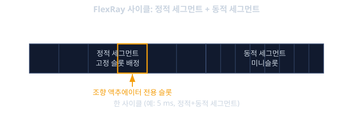
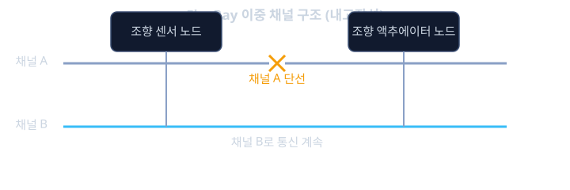

# FlexRay · CAN-FD

전자식 조향 보조 장치가 고장 났다고 가정해 보자. 기계적으로 운전대와 바퀴가 연결되어 있다면 운전자는 힘을 더 줘서라도 차를 세울 수 있다. 그런데 스티어-바이-와이어(steer-by-wire)처럼 운전대와 바퀴 사이에 기계적 연결이 전혀 없고 오직 전자 신호로만 조향 명령이 전달되는 구조라면 이야기가 달라진다. 조향 명령을 담은 메시지가 단 몇 밀리초라도 늦게 도착하거나, 더 나쁘게는 다른 메시지에 밀려 아예 전달되지 못한다면, 그 결과는 승차감 저하가 아니라 사고로 직결될 수 있다.

앞서 CAN · LIN 통신에서 배운 비트 중재(bit arbitration)는 ID가 작은 메시지가 항상 이긴다는 점에서 우선순위 보장은 확실하다. 그런데 뒤집어 보면, ID가 낮은 메시지가 계속 쏟아지면 ID가 조금 높은 메시지는 "언제 전송될지"를 보장받지 못한다는 뜻이기도 하다. 이런 현상을 우선순위 역전(priority inversion)이라 부르는데, 보통의 센서·상태 신호라면 몇 번 늦어도 큰 문제가 아니지만, 스티어-바이-와이어나 브레이크-바이-와이어(brake-by-wire)처럼 "최악의 경우에도 정해진 시간 안에 반드시 도착해야 하는" 신호에는 이 불확실성 자체가 치명적이다.

이런 요구를 만족시키기 위해 자동차 업계는 두 가지 방향으로 답을 내놓았다. 하나는 기존 CAN의 틀을 유지하면서 데이터량과 속도를 끌어올린 CAN FD(Flexible Data-rate)이고, 다른 하나는 아예 통신 방식 자체를 시간 분할 기반으로 새로 설계한 FlexRay다. CAN FD는 익숙한 CAN 생태계를 그대로 쓰면서 처리량 문제를 푸는 실용적인 해법이고, FlexRay는 "최악의 경우 지연 시간을 수학적으로 계산할 수 있는" 진짜 결정론(determinism)을 제공하기 위해 설계된 프로토콜이다. 이번 레슨에서는 CAN FD를 조금 더 깊이 들여다본 뒤, FlexRay가 어떻게 시간을 쪼개어 통신의 순서를 미리 확정해 두는지를 살펴본다.

## 학습 목표

- CAN의 비트 중재가 왜 최악의 경우 지연 시간을 보장하지 못하는지, 우선순위 역전이 왜 일어나는지 설명할 수 있다.
- CAN FD가 비트레이트 전환과 더 긴 CRC로 처리량과 신뢰성을 동시에 높이는 방식을 이해한다.
- FlexRay의 TDMA(Time Division Multiple Access) 기반 정적 세그먼트가 어떻게 결정론적 지연을 보장하는지 설명할 수 있다.
- FlexRay 동적 세그먼트의 미니슬롯 구조가 유연성을 어떻게 더해 주는지 이해한다.
- 이중 채널(dual channel)과 클럭 동기화가 FlexRay의 내고장성(fault tolerance)에 기여하는 원리를 설명할 수 있다.
- CAN FD와 FlexRay 중 어떤 통신이 어떤 상황에 적합한지 비교해 판단할 수 있다.

## 결정론이 왜 필요한가: 비트 중재의 한계

CAN 버스의 비트 중재는 "ID가 낮은 메시지는 반드시 ID가 높은 메시지를 이긴다"는 점에서 우선순위 보장은 완벽하다. 문제는 그 반대쪽이다. 아주 급한 메시지 하나가 아니라, ID가 낮은 메시지 여러 개가 연달아, 반복적으로 버스에 올라오는 상황을 생각해 보자. 이 경우 ID가 조금이라도 높은 메시지는 그 메시지들이 모두 지나갈 때까지 계속 밀릴 수 있다. 이런 식으로 더 급해 보이는 다수의 메시지에 밀려 특정 메시지의 전송이 한없이 늦어지는 현상을 우선순위 역전이라 부른다.

실시간 시스템에서 중요한 것은 평균 지연 시간이 아니라 최악의 경우 지연 시간(worst-case latency)이다. CAN 버스에서는 이 최악의 경우를 이론적으로 계산할 수는 있지만(이를 응답 시간 분석, response-time analysis이라 부른다), 그 값은 버스에 걸린 모든 메시지의 수와 주기, 크기에 따라 달라지며, 새로운 메시지 하나를 추가할 때마다 기존 메시지들의 최악의 경우 지연까지 다시 계산해야 한다. 시스템이 복잡해질수록 이 분석과 보장은 점점 더 다루기 어려워진다. 반면 TDMA(Time Division Multiple Access, 시분할 다중 접속) 방식은 "이 시간 구간에는 이 메시지만 보낸다"는 것을 설계 시점에 고정해 버리기 때문에, 최악의 경우 지연이 애초에 설계에 의해 상한선이 정해진다. 이 차이가 바로 FlexRay가 CAN과 근본적으로 다른 길을 선택한 이유다.

## CAN FD 다시 보기: 더 빠르고, 더 안전하게

CAN · LIN 통신에서 CAN FD가 데이터 필드를 최대 64바이트로 늘리고, 데이터 구간의 속도를 끌어올린다는 점을 배웠다. 여기서 조금 더 깊이 들어가 보면, CAN FD 프레임은 전송 도중 속도가 두 번 바뀐다는 특징이 있다. 프레임이 시작되고 중재(ID 비교)가 일어나는 구간은 기존 CAN과 완전히 같은 속도(예: 500 kbps)로 유지되는데, 이는 CAN FD 노드와 클래식 CAN 노드가 같은 버스 위에서 ID 중재 단계까지는 똑같이 동작해야 같은 버스를 공유할 수 있기 때문이다. 중재가 끝나고 실제 데이터와 CRC를 보내는 구간에서만 더 높은 속도(예: 2 Mbps)로 전환하고, 프레임이 끝나기 직전 다시 중재 속도로 돌아온다.

데이터가 늘어난 만큼 오류 검출 능력도 함께 강화되었다. 클래식 CAN은 15비트 CRC를 썼지만, CAN FD는 데이터 길이에 따라 17비트 또는 21비트 CRC를 쓴다. 데이터가 길어질수록 우연히 같은 체크섬이 나올 확률이 커지므로, 더 긴 CRC로 그 확률을 다시 충분히 낮춰야 하기 때문이다. 또한 CAN FD는 비트 스터핑(bit stuffing, 같은 값이 연속되는 것을 막기 위해 강제로 삽입하는 비트) 횟수를 세는 스터프 비트 카운터(stuff bit counter)를 추가해, 수신 쪽이 스터프 비트를 잘못 세는 드문 오류까지 잡아낼 수 있게 했다.

숫자로 체감해 보면, 64바이트(512비트) 데이터를 중재 속도 500 kbps, 데이터 속도 2 Mbps로 전송한다고 가정했을 때 데이터 구간만 걸리는 시간은 다음과 같다.

$$
t_{data} = \frac{512\ \text{bit}}{2{,}000{,}000\ \text{bps}} = 256\ \mu s
$$

같은 데이터를 중재 속도만으로(500 kbps) 보냈다면 $512 / 500{,}000 = 1{,}024\ \mu s$가 걸리므로, 데이터 구간을 4배 빠르게 전환한 것만으로 약 4분의 1 수준까지 시간이 줄어든다. 다만 이것으로도 FlexRay가 제공하는 "설계 시점에 고정된 최악의 지연"과는 종류가 다르다는 점은 분명히 짚어 둘 필요가 있다. CAN FD는 여전히 비트 중재 기반이므로, 처리량은 커졌지만 근본적인 결정론의 성격 자체가 바뀐 것은 아니다.

<b>심화: CAN FD의 비트레이트 전환은 왜 ID 구간에서 일어나지 않는가</b>

CAN FD가 ID 중재 구간의 속도를 그대로 두는 이유는 비트 중재의 전기적 원리와 직결된다. 비트 중재가 올바르게 동작하려면, 한 노드가 버스에 비트를 실은 뒤 그 비트가 버스 반대편 끝까지 전파되고 다시 돌아오는 왕복 시간이 한 비트의 시간보다 충분히 짧아야 한다. 속도를 높이면 한 비트의 시간이 줄어들기 때문에, 전파 지연이 그대로인 물리적인 버스 길이에서는 중재 속도를 무작정 높일 수 없다.

반면 데이터 구간에서는 더 이상 여러 노드가 동시에 신호를 실어 비교하는 경쟁이 없다. 중재에서 이미 승자가 정해졌으므로, 이후 구간은 그 승자 하나가 단독으로 버스를 쓰는 점대점 전송과 다를 바 없다. 점대점 전송에서는 왕복 전파 지연을 신경 쓸 필요가 없으므로 훨씬 높은 속도를 낼 수 있다. CAN FD는 이 차이를 이용해, 경쟁이 필요한 구간은 안전하게 느린 속도로 유지하고, 경쟁이 끝난 구간만 선택적으로 빠르게 전환하는 전략을 쓴다.

## FlexRay의 기본 틀: 사이클과 정적 세그먼트

FlexRay는 시간을 사이클(cycle)이라는 고정된 길이의 반복 단위로 쪼갠다. 하나의 사이클은 보통 몇 ms 단위로 설계되고, 전체 네트워크의 모든 노드가 같은 사이클 경계를 공유한다. 각 사이클은 다시 정적 세그먼트(static segment)와 동적 세그먼트(dynamic segment)라는 두 구간으로 나뉜다.

정적 세그먼트는 FlexRay의 핵심이다. 이 구간은 다시 동일한 길이의 타임 슬롯(time slot)들로 쪼개지고, 각 슬롯은 네트워크를 설계할 때 특정 노드에게 미리 배정된다. 예를 들어 슬롯 1은 항상 조향 센서 노드가, 슬롯 2는 항상 조향 액추에이터 제어기가 쓰도록 고정해 두면, 그 노드는 매 사이클마다 "자기 슬롯이 돌아오면" 다른 어떤 노드의 간섭도 없이 자신의 메시지를 보낼 수 있다. CAN의 비트 중재처럼 "누가 이기는가"를 실시간으로 다툴 필요가 없다. 슬롯 배정이 설계 시점에 고정되어 있으므로, 어떤 메시지가 언제 전송될지, 그리고 최악의 경우 몇 사이클 안에 도착하는지가 네트워크를 설계하는 그 순간에 수학적으로 확정된다.

이 구조를 간단한 숫자로 보자. 한 사이클의 길이가 5 ms이고, 정적 세그먼트에 100개의 슬롯이 균등하게 배정되어 있다면, 슬롯 하나의 길이는 대략 다음과 같다.

$$
t_{slot} \approx \frac{5\ ms}{100} = 50\ \mu s
$$

조향 액추에이터 제어기가 슬롯 번호 10번을 배정받았다면, 이 노드는 매 사이클이 시작된 뒤 정확히 $9 \times 50\ \mu s = 450\ \mu s$ 지점부터 자신의 슬롯이 시작된다는 것을 미리 알고 있다. 버스가 얼마나 바쁜지, 다른 노드가 몇 개나 더 있는지와 전혀 상관없이 이 타이밍은 변하지 않는다. 이것이 바로 FlexRay가 "설계 시점에 고정된 결정론"을 제공한다고 말하는 이유다.

## 동적 세그먼트: 유연함을 더하는 미니슬롯

정적 세그먼트만으로는 모든 통신 요구를 만족시키기 어렵다. 어떤 메시지는 매 사이클마다 규칙적으로 보낼 필요가 없고, 이벤트가 발생했을 때만 가끔 보내면 충분한 경우도 많다. 이런 상황을 위해 FlexRay는 사이클의 뒷부분에 동적 세그먼트를 둔다.

동적 세그먼트는 정적 세그먼트보다 훨씬 짧은 단위인 미니슬롯(minislot)으로 쪼개진다. 각 노드에는 여기서도 우선순위에 해당하는 슬롯 번호가 배정되어 있지만, 동작 방식이 다르다. 미니슬롯 번호가 돌아왔을 때 해당 노드가 보낼 데이터가 있으면 그 미니슬롯부터 실제 메시지를 전송하고, 보낼 데이터가 없으면 그 미니슬롯은 아주 짧게 비어 있다가 다음 미니슬롯으로 즉시 넘어간다. 즉 CAN의 비트 중재와 비슷하게 "번호가 낮은 쪽이 먼저"라는 우선순위 개념을 쓰면서도, 할 말이 없는 노드 때문에 시간을 낭비하지 않도록 빈 미니슬롯을 빠르게 건너뛰는 식으로 효율을 높인다.

정적 세그먼트와 동적 세그먼트를 함께 쓰는 설계는 FlexRay의 실용적인 타협점을 보여준다. 조향, 제동처럼 반드시 정해진 시간에 와야 하는 신호는 정적 세그먼트의 전용 슬롯에 배정하고, 상태 조회나 진단처럼 가끔씩만 필요한 통신은 동적 세그먼트에 배정해 대역폭을 아낀다. 결정론이 필요한 곳에는 결정론을, 유연성이 필요한 곳에는 유연성을 주는 구조다.

**확인 문제.** 한 사이클의 길이가 4 ms이고, 정적 세그먼트에 슬롯이 균등하게 80개 배정되어 있다. 브레이크 액추에이터 노드가 슬롯 번호 20번을 배정받았다면, 사이클이 시작된 뒤 몇 µs 지점부터 이 노드의 전송이 시작되는가?

답 보기

슬롯 하나의 길이는 $4\ ms / 80 = 50\ \mu s$다. 슬롯 번호 20번은 앞선 19개의 슬롯(슬롯 1번부터 19번까지)이 모두 지나간 뒤에 시작되므로, 사이클 시작 후 $19 \times 50\ \mu s = 950\ \mu s$ 지점부터 전송이 시작된다. 이 값은 버스의 혼잡도나 다른 노드의 상태와 무관하게 항상 동일하게 유지된다.

## 이중 채널과 클럭 동기화: 내고장성을 만드는 두 축

조향이나 제동처럼 안전과 직결된 기능은 통신 선 하나가 끊어졌다고 해서 전체 시스템이 멈춰서는 안 된다. FlexRay는 이를 위해 물리적으로 독립된 두 개의 채널, 채널 A(channel A)와 채널 B(channel B)를 둔다. 같은 메시지를 두 채널에 동시에 실어 보내는 설계도 가능하고, 서로 다른 메시지를 각 채널에 나누어 처리량을 두 배로 늘리는 설계도 가능하다. 안전이 중요한 신호는 보통 두 채널 모두에 중복으로 실어서, 한쪽 채널의 배선이 끊어지거나 손상되어도 나머지 채널로 통신이 계속되도록 설계한다.

TDMA 기반 통신이 제대로 동작하려면 모든 노드의 시계가 정확히 맞아야 한다는 전제가 필요하다. 슬롯의 경계가 노드마다 다르게 느껴진다면, 두 노드가 서로 다른 슬롯이라고 믿으면서 동시에 전송을 시도하는 충돌이 일어날 수 있다. FlexRay는 이를 막기 위해 특정 노드들을 동기화 노드(sync node)로 지정해, 이들이 보내는 프레임에 찍힌 타임스탬프를 바탕으로 모든 노드가 자신의 내부 시계를 주기적으로 보정하게 한다. 이 보정은 평균을 이용한 결함 허용(fault-tolerant) 알고리즘으로 이루어지는데, 일부 동기화 노드의 시계가 고장 나거나 비정상적인 값을 보내더라도 전체 네트워크의 시간 기준이 그 하나의 고장에 휘둘리지 않도록 설계되어 있다.

<b>심화: 결함 허용 중간값 알고리즘으로 시계를 맞추는 원리</b>

FlexRay의 클럭 동기화는 결함 허용 중간값 알고리즘(fault-tolerant midpoint algorithm)이라는 방식을 쓴다. 기본 아이디어는 단순하다. 여러 동기화 노드로부터 받은 시간 오차 측정값들을 모은 뒤, 가장 크게 벗어난 값들(비정상적으로 빠르거나 느린 값) 몇 개를 양쪽에서 잘라내고, 남은 값들 중 최댓값과 최솟값의 중간점을 보정값으로 쓴다.

예를 들어 동기화 노드가 5개이고 그중 1개까지는 고장 날 수 있다고 설계했다면, 5개의 오차 측정값 중 가장 큰 값 1개와 가장 작은 값 1개를 버리고, 남은 3개 중 최댓값과 최솟값의 평균을 보정값으로 쓰는 식이다. 이렇게 하면 단 하나의 노드가 극단적으로 잘못된 시간 정보를 보내더라도, 그 값이 평균을 크게 왜곡시키기 전에 걸러진다. 이 방식이 중요한 이유는, 안전이 중요한 네트워크에서는 "시간 기준 자체를 제공하는 노드"가 고장 났을 때도 전체 네트워크의 동기화가 깨지지 않아야 하기 때문이다. 단순히 모든 값의 평균을 쓰는 방식이었다면, 고장 난 노드 하나의 극단적인 값이 전체 평균을 크게 끌고 가 버릴 위험이 있다.

## CAN FD와 FlexRay, 어디에 무엇을 쓰는가

두 기술은 경쟁 관계가 아니라 적용 영역이 다른 보완 관계로 이해하는 것이 정확하다. CAN FD는 기존 CAN 생태계(트랜시버, 소프트웨어 스택, 개발 도구)를 거의 그대로 재사용할 수 있고, 노드를 추가하거나 메시지를 바꾸는 유연성도 CAN과 동일하게 유지된다. 그래서 바디 제어, 인포테인먼트 연동, 진단처럼 어느 정도의 유연성이 중요하고 CAN의 생태계를 계속 쓰고 싶은 영역에 적합하다.

FlexRay는 설계와 검증이 CAN FD보다 훨씬 까다롭다. 모든 노드의 슬롯을 사전에 설계해야 하고, 새로운 메시지를 하나 추가하려면 전체 슬롯 배정을 다시 검토해야 하는 경우도 있다. 그 대신 최악의 경우 지연 시간을 설계 시점에 수학적으로 보장할 수 있고, 이중 채널로 단선 고장에도 견딜 수 있다. 이런 특성 때문에 FlexRay는 스티어-바이-와이어, 전자식 서스펜션처럼 "지연이 흔들리면 안 되고, 통신 선 하나가 끊어져도 기능이 유지되어야 하는" 섀시·안전 영역에 주로 쓰인다. 실제로는 하나의 차량 안에 CAN FD와 FlexRay가 영역별로 함께 쓰이는 경우가 많으며, 어떤 신호를 어느 네트워크에 태울지는 "이 신호가 최악의 경우에도 보장된 시간 안에 도착해야 하는가"라는 질문에서 출발해 결정된다.

## 정리

- CAN의 비트 중재는 우선순위는 보장하지만, 메시지가 많아지면 우선순위 역전으로 최악의 경우 지연 시간을 예측하기 어려워진다.
- CAN FD는 중재 구간은 기존 속도로 유지하고 데이터 구간만 빠르게 전환하며, 더 긴 CRC와 스터프 비트 카운터로 처리량과 신뢰성을 함께 높인다.
- FlexRay는 사이클을 정적 세그먼트와 동적 세그먼트로 나누고, 정적 세그먼트의 고정 슬롯 배정으로 설계 시점에 고정된 결정론을 제공한다.
- 동적 세그먼트의 미니슬롯은 빈 슬롯을 빠르게 건너뛰며 유연성과 효율을 동시에 확보한다.
- 이중 채널은 단선 고장에 대한 내고장성을, 결함 허용 클럭 동기화는 일부 노드 고장에도 흔들리지 않는 시간 기준을 제공한다.
- CAN FD는 유연성과 생태계 재사용이 중요한 영역에, FlexRay는 최악의 경우 지연 보장이 필수적인 섀시·안전 영역에 주로 적용된다.

FlexRay와 CAN FD는 결국 같은 질문에 대한 서로 다른 답이다. "통신이 느려지거나 늦어지면 무슨 일이 벌어지는가"라는 질문에 대해, 조금 늦어도 괜찮은 영역은 CAN FD로 처리량을 늘리는 선택을 하고, 한순간도 늦으면 안 되는 영역은 FlexRay로 시간 자체를 설계에 박아 넣는 선택을 한다. 이런 구분은 이후 차량 이더넷과 TSN을 배울 때도 똑같이 반복되는 패턴이므로, 지금 이해한 결정론의 개념을 계속 가지고 가는 것이 좋다.

## 참고 자료

- ISO 17458 (Road vehicles — FlexRay communications system)
- FlexRay Consortium, "FlexRay Communications System Protocol Specification"
- ISO 11898-1 (CAN, CAN FD 포함)
- Robert Bosch GmbH, "CAN with Flexible Data-Rate Specification"
- Nicolas Navet, Françoise Simonot-Lion, "Automotive Embedded Systems Handbook"
