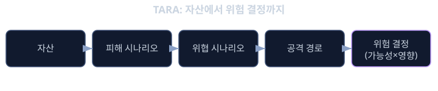
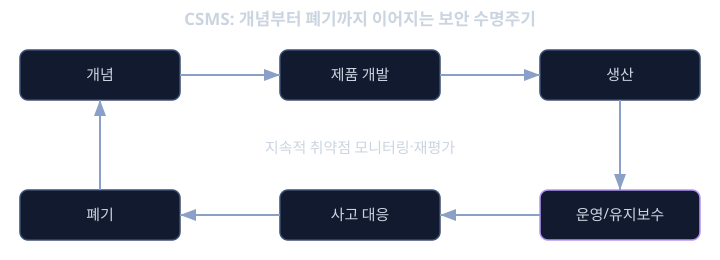

# 사이버보안 ISO/SAE 21434

2015년, 두 명의 보안 연구자가 인터넷에 연결된 상태의 지프 체로키(Jeep Cherokee)를 수 km 떨어진 곳에서 원격으로 조작해 고속도로 주행 중 에어컨, 라디오를 넘어 결국 변속기와 제동 계통까지 제어할 수 있음을 시연했다. 공격의 시작점은 차량 내 인포테인먼트 시스템에 연결된 셀룰러 통신 모듈이었고, 거기서부터 CAN 버스를 통해 안전 critical한 제어 ECU까지 명령이 전달될 수 있었다. 이 사건이 충격적이었던 이유는, 그 차량의 제동 시스템 자체는 ISO 26262에 따라 기능안전 관점에서 매우 꼼꼼하게 설계되었을 가능성이 높다는 점이다. 센서 고장, 통신 끊김, 전원 이상 같은 "무작위로 발생하는 고장"에 대해서는 철저히 대비되어 있었지만, "의도를 가진 공격자가 외부에서 침입해 정상적인 명령처럼 위장한 메시지를 보내는 상황"은 기능안전의 분석 틀에 들어 있지 않았다.

앞서 배운 ISO 26262(iso26262)의 기능안전은 "고장은 무작위로, 의도 없이 발생한다"는 전제 위에 서 있다. 센서가 잡음으로 오작동하거나, 반도체가 우주선(cosmic ray)에 맞아 비트가 뒤집히는 상황을 분석하고 대응책을 설계한다. 그런데 사이버 공격자는 무작위가 아니라 목적을 가지고, 시스템의 약점을 적극적으로 찾아내고, 때로는 "정상적인 신호처럼 보이는" 공격을 설계한다. 기능안전의 분석 기법(FMEA, FTA)은 "확률적으로 드물게 일어나는 고장"을 가정하지만, 보안 위협은 "한 번이라도 뚫리면 그 취약점이 알려지는 순간 누구나 반복해서 악용할 수 있다"는 전혀 다른 성격을 가진다. 이 근본적인 차이 때문에 자동차 산업은 기능안전과 별도로 사이버보안을 다루는 독립된 국제 표준, ISO/SAE 21434를 만들었다.

또한 자동차가 점점 더 많은 외부 연결(커넥티드카, V2X, OTA 업데이트)을 갖게 되면서 공격 표면(attack surface)도 급격히 넓어졌다. 과거의 차량은 물리적으로 접근해야만 손댈 수 있었지만, 오늘날의 차량은 셀룰러 네트워크, 블루투스, Wi-Fi, 심지어 타이어 공기압 센서(TPMS)의 무선 신호까지 외부에서 접근할 수 있는 통로가 된다. ISO/SAE 21434는 이런 환경에서 "차량의 전체 수명주기 동안 사이버보안을 어떻게 체계적으로 관리할 것인가"를 규정하는 표준이며, 자동차 업계에서는 이 표준을 따르지 않은 제품이 주요 시장의 법규 요구사항(유엔 UNECE R155 등)을 충족하지 못할 수도 있다는 점에서 사실상 필수 요건이 되어가고 있다.

## 학습 목표

- 기능안전과 사이버보안이 다루는 위험의 성격이 왜 근본적으로 다른지 설명할 수 있다.
- TARA(위협 분석 및 위험 평가)의 각 단계와 자산, 위협 시나리오, 공격 경로의 관계를 설명할 수 있다.
- 공격 가능성(Attack Feasibility)과 영향(Impact)의 조합으로 사이버보안 위험이 어떻게 평가되는지 이해한다.
- 개념·개발·생산·운영·폐기로 이어지는 보안 수명주기(Cybersecurity Lifecycle)의 전체 구조를 설명할 수 있다.
- CSMS(사이버보안 관리 체계)와 ISO 26262의 안전 수명주기 사이의 공통점과 차이를 설명할 수 있다.

## 기능안전과 사이버보안, 비슷해 보이지만 다른 두 세계

ISO 26262와 ISO/SAE 21434는 둘 다 "위험을 식별하고 등급을 매겨 그에 비례한 노력을 투입한다"는 구조를 공유하지만, 그 바탕에 있는 가정이 다르다.

- 기능안전의 전제: 고장은 의도가 없고, 통계적으로 예측 가능한 빈도로 발생한다. 그래서 "이 고장이 일어날 확률은 얼마인가"를 수치로 추정하고, 그 확률을 낮추는 설계(중복, 진단)를 한다.
- 사이버보안의 전제: 공격자는 의도를 가지고 시스템의 가장 약한 지점을 적극적으로 찾는다. 공격자의 능력, 시간, 자원은 시간이 지날수록 향상되며, 한 번 발견된 취약점은 전 세계 어디서나 반복해서 악용될 수 있다. 그래서 "확률"보다는 "그 공격이 얼마나 실행 가능한가(feasibility)"와 "뚫렸을 때 영향이 얼마나 큰가"를 함께 따진다.

이 차이는 실제 분석 기법에도 영향을 준다. 기능안전의 FMEA는 "이 부품이 어떤 식으로 고장 날 수 있는가"를 부품 단위로 체계적으로 나열하는 데 강점이 있다. 반면 사이버보안에서는 공격자가 "자산에 도달하기 위해 어떤 경로를 거칠 수 있는가"를 추적하는 것이 더 중요하다. 예를 들어 인포테인먼트 시스템 자체는 안전 critical하지 않더라도, 그것이 게이트웨이를 거쳐 섀시 제어 ECU까지 이어지는 경로의 한 부분이라면, 그 경로 전체가 보안 분석의 대상이 되어야 한다. 이처럼 사이버보안은 "개별 부품의 안전성"이 아니라 "시스템 전체에서 공격자가 이용할 수 있는 연결 경로"를 중심으로 사고한다는 점이 기능안전과 가장 크게 다른 부분이다.

## TARA: 위협을 체계적으로 찾아내는 방법

ISO/SAE 21434가 요구하는 핵심 분석 기법은 위협 분석 및 위험 평가(Threat Analysis and Risk Assessment, TARA)다. TARA는 다음과 같은 단계로 진행된다.

1. 자산(Asset) 식별: 보호해야 할 대상을 정의한다. 자산은 물리적인 부품만이 아니라, 통신 메시지, 소프트웨어, 암호 키, 개인정보 같은 무형의 것도 포함한다. 예를 들어 "조향각 제어 명령을 전달하는 CAN 메시지"나 "펌웨어 업데이트에 쓰이는 서명 검증 키"가 자산이 될 수 있다.
2. 피해 시나리오(Damage Scenario) 도출: 그 자산이 침해되었을 때 차량과 탑승자, 주변 환경에 어떤 피해가 생기는지를 서술한다. 예를 들어 "조향각 제어 명령이 위조되어 운전자 의도와 다른 조향이 실행된다."
3. 위협 시나리오(Threat Scenario) 도출: 그 피해가 발생하기 위해 공격자가 자산의 어떤 보안 속성(기밀성, 무결성, 가용성)을 어떻게 침해해야 하는지를 서술한다. 예를 들어 "공격자가 게이트웨이를 거쳐 CAN 버스에 접근해, 정상적인 조향 제어 메시지의 무결성을 위조된 메시지로 침해한다."
4. 공격 경로(Attack Path) 분석: 공격자가 실제로 그 위협을 실행하기 위해 거쳐야 하는 구체적인 단계들을 추적한다. 예를 들어 "셀룰러 모듈의 취약점으로 인포테인먼트 시스템에 침입 → 게이트웨이 ECU의 펌웨어 취약점을 이용해 CAN 버스로 전환 → 조향 제어 ECU로 위조된 메시지 전송."
5. 공격 가능성(Attack Feasibility) 평가: 그 공격 경로를 실제로 실행하는 데 필요한 전문성, 시간, 장비, 접근 기회 등을 평가해 "이 공격이 현실적으로 얼마나 실행하기 쉬운가"를 등급화한다.
6. 영향(Impact) 평가: 공격이 성공했을 때 안전, 금전, 운영, 개인정보(프라이버시) 측면에서 피해가 얼마나 큰지 평가한다.
7. 위험 결정 및 처리: 공격 가능성과 영향을 조합해 사이버보안 위험(Cybersecurity Risk)을 산정하고, 그 수준에 따라 위험을 줄이거나(보안 대책 적용), 수용하거나, 공유하거나, 회피할지를 결정한다.

이 흐름에서 자산 식별부터 피해 시나리오, 위협 시나리오, 공격 경로로 내려가는 구조가 기능안전의 HARA(위험 분석 및 평가)에서 아이템 정의로부터 위험 상황을 도출하는 흐름과 유사한 패턴을 보이지만, "공격 경로"라는 단계가 추가된다는 점이 핵심적인 차이다. 공격자는 단일 지점이 아니라 여러 시스템을 거쳐 목표에 도달하기 때문에, 사이버보안 분석은 반드시 이 경로 전체를 추적해야 한다.

<b>심화: 공격 가능성 평가에 쓰이는 요소들</b>

ISO/SAE 21434는 공격 가능성을 평가할 때 여러 요소를 함께 고려하도록 안내한다. 대표적으로 다음과 같은 요소들이 있다.

- 소요 시간(elapsed time): 공격을 준비하고 실행하는 데 걸리는 시간.
- 전문성(specialist expertise): 공격에 필요한 지식의 수준 (일반인 수준부터 다중 전문 분야 수준까지).
- 시스템에 대한 지식(knowledge of the item): 공격 대상 시스템의 설계 정보를 얼마나 알아야 하는지 (공개 정보만으로 충분한지, 비밀 설계 정보가 필요한지).
- 접근 기회(window of opportunity): 공격자가 대상에 접근할 수 있는 기회가 얼마나 자주, 얼마나 쉽게 주어지는지.
- 장비(equipment): 공격에 필요한 장비가 표준 장비인지, 특수 제작된 고가 장비인지.

이 요소들을 종합하면 "이론적으로는 가능하지만 세계적으로 몇 명의 전문가만 실행할 수 있는 공격"과 "누구나 저가의 장비로 쉽게 실행할 수 있는 공격"을 구분할 수 있다. 다만 여기서 중요한 함정은, 공격 가능성 평가가 "현재 시점"의 평가라는 점이다. 오늘은 전문가 수준의 지식이 필요한 공격이라도, 해당 취약점이 공개되거나 공격 도구가 자동화되어 유포되면 내일은 누구나 실행할 수 있는 공격으로 바뀔 수 있다. 그래서 ISO/SAE 21434는 위험 평가를 한 번 하고 끝내는 것이 아니라, 차량의 운영 기간 내내 새로운 취약점 정보를 지속적으로 모니터링하고 재평가하는 것을 요구한다.

## 보안 수명주기: 개념부터 폐기까지

ISO/SAE 21434는 사이버보안을 특정 개발 단계의 일회성 활동이 아니라, 차량의 전체 수명에 걸친 관리 체계로 다룬다. 이를 사이버보안 관리 체계(Cybersecurity Management System, CSMS)라 부르며, 크게 다음 단계로 구성된다.

- 개념(Concept) 단계: 아이템을 정의하고 TARA를 수행해 보안 목표(Cybersecurity Goal)와 보안 요구사항을 도출한다. 이는 ISO 26262의 안전 목표 도출 과정과 구조적으로 대응한다.
- 제품 개발(Product Development) 단계: 보안 요구사항을 설계와 구현에 반영하고, 보안 관점의 코드 리뷰와 침투 테스트(penetration testing), 취약점 분석을 수행한다.
- 생산(Production) 단계: 제조 공정에서 암호 키가 안전하게 주입되는지, 생산 라인 자체가 공격의 통로가 되지 않는지를 관리한다. 예를 들어 공장에서 디버그 포트가 열린 채로 출고되면 그 자체가 심각한 취약점이 된다.
- 운영 및 유지보수(Operations and Maintenance) 단계: 차량이 출시된 후에도 새로운 취약점 정보를 지속적으로 수집(사이버보안 모니터링)하고, 심각한 취약점이 발견되면 평가하고 대응한다. 이 단계에서 뒤에 배울 OTA(Over-the-Air) 업데이트가 중요한 대응 수단이 된다.
- 사고 대응(Incident Response): 실제로 공격이 발생했거나 취약점이 악용된 사례가 보고되면, 원인을 분석하고 영향을 받는 차량군을 파악해 대응 조치를 취한다.
- 폐기(Decommissioning) 단계: 차량이 수명을 다했을 때도 저장된 개인정보나 암호 키가 안전하게 폐기되거나 무력화되도록 관리한다.

이 전체 구조에서 중요한 점은, 보안 활동이 "출시 전에 한 번 검사받고 끝나는 것"이 아니라 "출시 후에도 계속 모니터링하고 재평가하는 살아있는 프로세스"라는 것이다. 왜냐하면 공격자의 능력과 알려진 취약점의 목록은 시간이 지날수록 늘어나지만, 차량은 한 번 판매되면 수년에서 십수 년 동안 도로 위를 달리기 때문이다. 출시 당시에는 안전했던 암호 알고리즘이나 설계가, 10년 후에는 더 이상 충분한 보안을 제공하지 못할 수도 있다는 점을 CSMS는 전제하고 있다.

이런 지속적 관리 요구사항은 유엔 UNECE 규정 R155(사이버보안 관리 체계에 대한 법규)와 R156(소프트웨어 업데이트 관리 체계에 대한 법규)으로 이어져, 많은 국가에서 신규 차종 인증의 법적 요건으로 자리 잡았다. 즉 ISO/SAE 21434를 준수하는 CSMS를 운영하는 것이 더 이상 선택이 아니라, 특정 시장에 차량을 판매하기 위한 전제조건이 되어가고 있는 것이다.

**확인 문제.** 어떤 차량의 타이어 공기압 센서(TPMS)가 암호화되지 않은 무선 신호로 공기압 값을 전송한다고 하자. 공격자가 이 신호를 가로채 가짜 공기압 값을 주입할 수 있다는 위협이 식별되었다. 이 상황을 TARA의 단계(자산, 피해 시나리오, 위협 시나리오)에 맞춰 각각 어떻게 서술할 수 있는지 예시를 들어 설명하라.

답 보기

자산은 "TPMS가 전송하는 공기압 데이터"가 된다. 위협 시나리오는 "공격자가 무선 채널을 통해 TPMS 신호의 무결성을 침해해, 실제와 다른 조작된 공기압 값을 ECU에 주입한다"로 서술할 수 있다. 피해 시나리오는 그 침해가 실제로 가져오는 결과를 서술하는 것으로, 예를 들어 "운전자가 실제 공기압 이상을 인지하지 못하게 되어, 타이어 공기압 부족 상태에서 계속 주행해 타이어 손상이나 그로 인한 제어 불능 상황이 발생할 수 있다"가 될 수 있다. 이 예시에서 볼 수 있듯, 자산 하나의 보안 속성(여기서는 무결성) 침해가 어떻게 구체적인 물리적 피해로 이어지는지를 명시적으로 연결하는 것이 TARA 서술의 핵심이다.

**확인 문제.** 어떤 보안 취약점에 대한 공격 가능성이 출시 당시에는 "다중 전문 분야의 전문가와 특수 장비가 필요해 매우 낮음"으로 평가되었다. 그런데 2년 후, 해당 취약점을 자동으로 악용하는 도구가 공개되어 인터넷에 무료로 배포되었다. 이 상황이 ISO/SAE 21434의 보안 수명주기 관점에서 왜 중요한 의미를 가지는지 설명하라.

답 보기

이 상황은 동일한 취약점이라도 공격 가능성 평가가 시간에 따라 바뀔 수 있음을 보여준다. 출시 당시에는 전문가 수준의 지식과 특수 장비가 필요해 공격 가능성이 낮게 평가되었지만, 공격 도구가 자동화되어 공개되면 전문성과 장비 요구사항이 사실상 사라져 누구나 실행할 수 있는 공격으로 바뀐다. 이는 위험 수준이 출시 이후에도 상승할 수 있다는 뜻이며, ISO/SAE 21434가 운영 및 유지보수 단계에서 지속적인 취약점 모니터링과 재평가를 요구하는 이유이기도 하다. 이런 재평가 결과 위험이 허용 수준을 넘어선다면, 소프트웨어 업데이트(OTA)나 다른 완화 조치를 통해 실제로 대응해야 한다.

## 정리

- 기능안전은 의도 없는 무작위 고장을, 사이버보안은 의도를 가진 공격자의 행동을 전제로 한다는 점에서 두 분야의 분석 방식이 근본적으로 다르다.
- TARA는 자산, 피해 시나리오, 위협 시나리오, 공격 경로를 차례로 도출하고, 공격 가능성과 영향을 조합해 사이버보안 위험을 산정한다.
- 공격 가능성은 소요 시간·전문성·시스템 지식·접근 기회·장비 등으로 평가되며, 시간이 지나며 취약점 공개나 도구 자동화로 바뀔 수 있다.
- ISO/SAE 21434의 사이버보안 관리 체계(CSMS)는 개념부터 폐기까지 차량 전체 수명에 걸쳐 지속적으로 운영되는 살아있는 프로세스다.
- UNECE R155/R156 같은 법규가 ISO/SAE 21434 준수를 사실상 자동차 시장 진입의 전제조건으로 만들고 있다.

ISO/SAE 21434는 기능안전이 다루지 못하는 "의도를 가진 위협"이라는 새로운 차원의 위험을 체계적으로 다루기 위한 표준이다. 이 표준이 요구하는 위협 분석과 수명주기 관리가 실제로 구현되기 위해서는, 뒤에서 다룰 보안 부팅과 HSM, 암호와 키 관리 같은 구체적인 기술적 대책이 뒷받침되어야 한다. TARA가 "어디를 지켜야 하는가"를 알려준다면, 그 다음 레슨들은 "어떻게 지킬 것인가"에 대한 답을 제공한다.

## 참고 자료

- ISO/SAE 21434:2021, "Road vehicles — Cybersecurity engineering"
- UNECE Regulation No. 155, "Cyber security and cyber security management system"
- UNECE Regulation No. 156, "Software update and software update management system"
- Charlie Miller, Chris Valasek, "Remote Exploitation of an Unaltered Passenger Vehicle" (2015 Jeep Cherokee 연구 발표 자료)
- SAE J3061 (ISO/SAE 21434 이전의 차량 사이버보안 가이드북, 역사적 배경 참고용)
