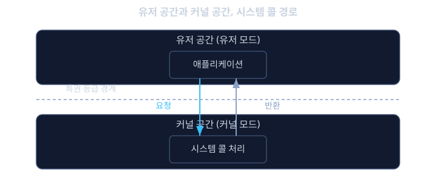
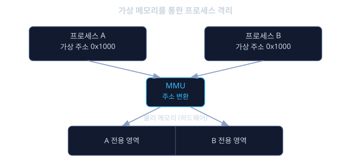

# 리눅스 커널 입문

지금까지 다룬 베어메탈 펌웨어에는 "운영체제"라는 것이 없었다. 코드 한 뭉치가 플래시에 구워져 있고, 그 코드가 전체 메모리와 모든 레지스터를 아무 제약 없이 직접 건드렸다. 그런데 최신 차량의 인포테인먼트 시스템, 디지털 클러스터, 일부 ADAS(첨단 운전자 보조 시스템) 도메인 컨트롤러는 더 이상 이런 단순한 구조로 만들어지지 않는다. 내비게이션 앱, 음악 재생 앱, 블루투스 연결 관리자, 카메라 영상 처리 프로그램 같은 수십 개의 서로 다른 소프트웨어가 하나의 CPU와 메모리를 나눠 써야 하기 때문이다. 이렇게 복잡해진 소프트웨어 생태계를 관리하려면 베어메탈의 "모든 것을 직접 제어"하는 방식 대신, 여러 프로그램이 서로를 침범하지 않도록 중재하고 자원을 공정하게 나눠주는 새로운 소프트웨어 계층이 필요하다. 바로 리눅스 커널(Linux kernel)이다.

인포테인먼트 시스템에서 내비게이션 앱이 버그로 멈추거나 심지어 충돌(crash)해도, 그 옆에서 음악을 재생하는 앱이나 후방 카메라 영상이 함께 멈춰서는 안 된다. 베어메탈처럼 모든 프로그램이 같은 메모리 공간을 공유하며 직접 하드웨어를 건드리는 구조에서는, 한 프로그램의 버그가 메모리의 아무 곳이나 덮어쓸 수 있고, 그 여파가 시스템 전체로 퍼지기 쉽다. 리눅스 커널은 각 프로그램에게 "당신은 이 메모리 영역만 쓸 수 있고, 하드웨어를 직접 만지려면 반드시 나를 통해야 한다"는 규칙을 강제함으로써 이 문제를 근본적으로 막는다. 이것이 가능한 이유는 커널이 CPU 공간을 커널 공간(kernel space)과 유저 공간(user space)이라는 두 개의 서로 다른 특권 등급으로 나누기 때문이다.

이 구분을 회사의 보안 등급에 비유하면 이해가 쉽다. 일반 직원(유저 공간 프로그램)은 사무실 안에서는 무엇이든 자유롭게 할 수 있지만, 서버실 문을 열거나 전체 전원을 끄는 일처럼 회사 전체에 영향을 주는 작업은 직접 할 수 없다. 그런 작업이 필요하면 반드시 보안 담당자(커널)에게 정해진 절차로 요청해야 한다. 이 요청 절차가 바로 시스템 콜(system call)이다. 이렇게 권한을 나누고 중재자를 두는 구조 덕분에, 수십 개의 앱이 동시에 돌아가면서도 서로를 침범하지 않고, 하나의 CPU 코어를 수십 개의 프로세스가 번갈아 쓰면서도 겉보기에 모두 동시에 돌아가는 것처럼 보이게 만들 수 있다.

이번 레슨에서는 커널 공간과 유저 공간이 CPU 하드웨어 수준에서 어떻게 구분되는지, 유저 공간 프로그램이 커널의 기능을 빌려 쓰는 통로인 시스템 콜이 무엇인지, 그리고 여러 프로세스를 하나의 CPU 코어 위에서 돌리는 커널 스케줄러의 동작 방식을 살펴본다. 이 내용은 앞서 RTOS 레슨에서 배운 태스크 스케줄링 개념을 훨씬 더 복잡한 범용 운영체제의 관점으로 확장한 것이라 볼 수 있다.

## 학습 목표

- 커널 공간과 유저 공간이 왜 나뉘어 있고, CPU의 특권 등급(privilege level) 하드웨어가 이 구분을 어떻게 뒷받침하는지 설명할 수 있다.
- 시스템 콜이 무엇이며, 유저 공간 프로그램이 파일을 읽거나 하드웨어를 제어할 때 왜 반드시 커널을 거쳐야 하는지 설명할 수 있다.
- 프로세스와 가상 메모리의 기본 개념, 그리고 커널이 각 프로세스를 서로 격리시키는 원리를 설명할 수 있다.
- 리눅스 커널의 완전 공정 스케줄러(CFS)가 RTOS의 우선순위 스케줄링과 어떤 목표의 차이를 가지는지 설명할 수 있다.
- 임베디드 리눅스에서 일반 PC용 리눅스와 다르게 신경 써야 하는 점(부팅 시간, 메모리 제약, 실시간성)을 설명할 수 있다.

## 커널 공간과 유저 공간: 특권을 나누는 하드웨어 울타리

리눅스 같은 범용 운영체제는 CPU가 제공하는 특권 등급(privilege level) 기능을 이용해 소프트웨어를 두 세계로 나눈다. ARM 아키텍처에서는 이를 실행 레벨(exception level, EL0/EL1 등)이라 부르고, x86에서는 보호 링(protection ring)이라 부르지만 개념은 같다. 커널은 가장 높은 특권 등급(커널 모드, kernel mode)에서 실행되며 메모리 전체, 모든 레지스터, 모든 주변장치에 아무 제약 없이 접근할 수 있다. 반면 일반 애플리케이션은 가장 낮은 특권 등급(유저 모드, user mode)에서 실행되며, 자신에게 할당된 메모리 영역 밖은 건드릴 수 없고 하드웨어 레지스터에도 직접 접근할 수 없다.

이 구분이 하드웨어 수준에서 강제되기 때문에, 유저 공간의 애플리케이션 코드에 심각한 버그가 있어 잘못된 메모리 주소에 접근하려 해도, CPU가 그 순간 예외(exception)를 발생시켜 그 프로세스만 강제로 종료시킬 뿐 커널이나 다른 프로세스에는 영향을 주지 못한다. 이것이 베어메탈과 결정적으로 다른 점이다. 베어메탈에서는 코드 전체가 사실상 커널 모드로 동작하는 것과 같아서, 포인터 하나만 잘못 다뤄도 전체 시스템이 멈추거나 이상 동작을 일으킬 수 있었다.

## 시스템 콜: 유저 공간이 커널에게 일을 부탁하는 유일한 통로

유저 공간 프로그램은 하드웨어를 직접 만질 권한이 없으므로, 파일을 읽거나 네트워크 패킷을 보내거나 화면에 무언가를 그리는 일조차 스스로 할 수 없다. 이런 작업이 필요할 때 프로그램은 시스템 콜(system call)이라는 특수한 호출을 통해 커널에게 "이 일을 대신 해 달라"고 요청한다. 시스템 콜은 일반 함수 호출과 겉보기에는 비슷하지만, 내부적으로는 CPU에게 "지금부터 특권 등급을 유저 모드에서 커널 모드로 바꿔 달라"고 지시하는 특수한 명령(ARM에서는 `svc`, x86에서는 `syscall` 명령 등)을 실행한다.

예를 들어 리눅스 유저 공간 프로그램에서 `read()`라는 C 라이브러리 함수를 호출해 파일을 읽는다고 하자. 이 함수 내부에서는 다음과 같은 일이 일어난다.

```c
#include <unistd.h>

int main(void) {
    char buffer[64];
    /* read()는 C 라이브러리가 제공하는 래퍼(wrapper) 함수일 뿐이고,
       내부적으로는 read 시스템 콜을 실행해 커널에게 작업을 넘긴다 */
    ssize_t n = read(0, buffer, sizeof(buffer));
    return 0;
}
```

`read()` 호출이 실행되면 CPU는 특권 등급을 커널 모드로 전환하고, 커널 안에 있는 `read` 시스템 콜 처리 코드로 점프한다. 커널은 이 요청이 정말로 허용된 요청인지(이 프로세스가 그 파일을 열 권한이 있는지 등)를 확인한 뒤, 실제로 디스크나 드라이버를 통해 데이터를 읽어와 유저 공간이 넘겨준 버퍼에 복사하고, 다시 특권 등급을 유저 모드로 되돌려 `read()` 호출이 끝난 지점으로 복귀한다. 이 모든 과정이 애플리케이션 개발자에게는 평범한 함수 호출 한 줄처럼 보이지만, 실제로는 특권 등급을 두 번 오가는 상당히 무거운 작업이다. 그래서 시스템 콜 호출 자체에도 적지 않은 시간 비용(수백 나노초에서 수 마이크로초)이 들며, 성능이 중요한 임베디드 애플리케이션은 시스템 콜 호출 횟수를 줄이는 것도 중요한 설계 고려사항이 된다.



## 프로세스와 가상 메모리: 서로를 보지 못하게 나누기

커널은 유저 공간에서 실행되는 각각의 독립적인 프로그램 인스턴스를 프로세스(process)라 부르며 관리한다. 각 프로세스에게는 자신만의 가상 메모리 공간(virtual memory space)이 주어지는데, 이는 그 프로세스가 보기에는 "메모리 전체를 혼자 쓰는 것처럼" 보이지만, 실제로는 커널과 CPU의 메모리 관리 장치(MMU, Memory Management Unit)가 그 가상의 주소를 실제 물리 메모리의 어딘가로 몰래 번역해 주는 구조다.

이 덕분에 두 가지 중요한 효과가 생긴다. 첫째, 프로세스 A가 자신의 가상 주소 `0x1000`에 값을 쓰는 것과, 프로세스 B가 자신의 가상 주소 `0x1000`에 값을 쓰는 것은 실제로는 물리 메모리의 완전히 다른 위치를 가리키므로 서로 영향을 주지 않는다. 둘째, 프로세스 A가 자신에게 할당되지 않은 물리 메모리 영역에 접근하려고 시도하면, MMU가 이를 즉시 감지해 커널에게 알리고 커널은 그 프로세스를 강제로 종료시킨다(흔히 "세그멘테이션 폴트", segmentation fault라 부르는 바로 그 상황이다). 베어메탈에서는 모든 코드가 물리 주소를 직접 다뤘지만, 리눅스에서는 가상 메모리라는 한 겹의 번역 장치가 프로세스 간의 격리를 하드웨어 수준에서 보장해 준다.



## 커널 스케줄러: 공정하게 나눠 쓰기

RTOS 레슨에서 배운 우선순위 기반 선점형 스케줄링은 "가장 중요한 작업이 항상 가장 먼저 끝나야 한다"는 목표를 가졌다. 반면 리눅스처럼 범용 목적의 커널은 조금 다른 목표를 가진다. 수십 개의 서로 다른 애플리케이션이 CPU 시간을 비교적 공평하게 나눠 가지면서도, 응답성이 중요한 작업(사용자 입력에 반응하는 UI 등)은 체감상 끊김 없이 돌아가도록 하는 것이다. 이를 위해 리눅스 커널의 기본 스케줄러인 CFS(Completely Fair Scheduler, 완전 공정 스케줄러)는 각 프로세스가 "이미 얼마나 CPU 시간을 썼는가"를 계속 추적하면서, 아직 적게 쓴 프로세스에게 우선적으로 다음 실행 기회를 준다.

이 때문에 CFS는 RTOS의 우선순위 스케줄링과는 보장하는 성질이 다르다. RTOS의 레이트 모노토닉 스케줄링은 "이 태스크는 반드시 10 ms 안에 끝난다"는 수학적 보장을 추구했지만, CFS는 "모든 프로세스가 장기적으로 공평하게 CPU를 나눠 쓴다"는 공정성을 추구할 뿐, 특정 프로세스가 특정 시한 안에 반드시 끝난다는 보장은 기본적으로 제공하지 않는다. 그래서 엔진 점화 타이밍처럼 수백 마이크로초 단위의 엄격한 데드라인이 걸린 제어 로직은 여전히 일반 리눅스 프로세스가 아니라, RTOS나 베어메탈로 동작하는 별도의 MCU가 담당하는 경우가 많다. 리눅스는 주로 내비게이션, 멀티미디어, 복잡한 UI처럼 "대체로 빠르고 응답성이 좋으면 충분한" 영역에서 강점을 가진다.

<details><summary><b>심화: 리눅스의 실시간 확장, PREEMPT_RT</b></summary>

리눅스가 처음부터 하드 실시간(hard real-time) 보장을 목표로 설계된 것은 아니지만, 자동차와 산업 자동화 분야에서 리눅스의 풍부한 기능(네트워킹 스택, 파일시스템, 수많은 드라이버)을 쓰면서도 어느 정도의 실시간성을 확보하려는 요구가 계속 있었다. 이를 위해 등장한 것이 PREEMPT_RT라는 커널 패치 세트다. PREEMPT_RT는 커널 내부에서 상당 시간 동안 인터럽트나 선점을 막아두던 구간들(커널 코드도 스스로 선점당하지 않는 긴 임계 구간을 가지고 있었다)을 잘게 쪼개고, 커널 내부의 많은 락(lock)을 우선순위 상속을 지원하는 뮤텍스로 바꿔서, 중요한 태스크가 낮은 우선순위 작업 때문에 예측할 수 없이 오래 기다리는 상황을 크게 줄인다.

PREEMPT_RT를 적용한 리눅스는 일반 리눅스보다 응답 지연의 최대값(worst-case latency)을 훨씬 낮고 예측 가능하게 만들어서, 수 밀리초 단위의 데드라인이 걸린 산업용 제어나 로보틱스, 일부 차량용 통신 게이트웨이 소프트웨어에도 쓰일 수 있게 한다. 다만 여전히 엔진 점화나 에어백처럼 수백 마이크로초 이하의 극단적으로 엄격한 데드라인이 걸린 영역에서는 PREEMPT_RT 리눅스조차 전용 MCU의 베어메탈/RTOS 코드를 대체하지 못한다. 리눅스는 2024년을 전후로 PREEMPT_RT 패치의 핵심 부분이 메인라인 커널에 정식으로 병합되어, 이제는 별도의 패치가 아니라 커널 설정 옵션으로 활성화할 수 있게 되었다.

</details>

<details><summary><b>심화: 커널 모듈과 모놀리식 커널 구조</b></summary>

리눅스는 모놀리식 커널(monolithic kernel) 구조를 따른다. 이는 프로세스 관리, 메모리 관리, 파일시스템, 네트워크 스택, 디바이스 드라이버 같은 핵심 기능들이 모두 하나의 커널 모드 안에서 동작한다는 뜻이다. 이와 대비되는 구조가 마이크로커널(microkernel)로, QNX 같은 운영체제는 프로세스 관리와 메시지 전달 같은 극히 최소한의 기능만 커널 모드에 두고, 파일시스템이나 많은 드라이버를 오히려 유저 공간의 독립된 프로세스로 돌려서 한 드라이버의 결함이 전체 커널을 무너뜨리지 않도록 설계한다.

리눅스는 모놀리식 구조를 기본으로 하면서도, 커널 모듈(loadable kernel module)이라는 기능으로 유연성을 더한다. 디바이스 드라이버 같은 코드를 커널 이미지 자체에 미리 다 포함시키지 않고, `.ko` 파일 형태로 따로 빌드해 두었다가 필요할 때 `insmod`나 `modprobe` 명령으로 실행 중인 커널에 동적으로 끼워 넣을 수 있다. 이렇게 하면 모든 하드웨어 드라이버를 하나의 거대한 커널 이미지에 미리 포함시킬 필요가 없어서, 임베디드 보드처럼 플래시 용량이 제한된 환경에서 꼭 필요한 드라이버만 선택적으로 올릴 수 있다는 실용적인 이점이 있다. 다만 커널 모듈 역시 커널 모드에서 실행되므로, 모듈 안의 버그는 유저 공간 프로세스의 버그와 달리 커널 전체를 무너뜨릴 수 있다는 점은 모놀리식 구조의 근본적인 특성으로 남아 있다.

</details>

**확인 문제.** 어떤 인포테인먼트 애플리케이션이 버그로 인해 자신에게 할당되지 않은 메모리 영역에 접근을 시도했다. 베어메탈 환경과 리눅스 유저 공간 환경에서 이 사고가 각각 어떤 다른 결과로 이어지는지, 그리고 그 차이를 만드는 하드웨어/소프트웨어 메커니즘은 무엇인지 설명하라.
<details><summary>답 보기</summary>

베어메탈 환경에서는 사실상 모든 코드가 특권 제약 없이 물리 메모리 전체에 접근할 수 있으므로, 잘못된 메모리 접근이 다른 중요한 변수나 심지어 벡터 테이블 영역까지 덮어써서 시스템 전체가 예측할 수 없는 방식으로 오동작하거나 멈출 수 있다. 이를 막아줄 하드웨어적 울타리가 없기 때문이다.

리눅스 유저 공간 환경에서는 각 프로세스가 가상 메모리 공간을 가지고 있고, CPU의 메모리 관리 장치(MMU)가 그 프로세스에게 할당되지 않은 가상 주소로의 접근을 즉시 감지한다. 이 감지된 위반은 예외를 발생시켜 커널에게 전달되고, 커널은 그 프로세스만 강제로 종료시킨다(세그멘테이션 폴트). 결과적으로 버그를 일으킨 그 애플리케이션 하나만 멈추고, 같은 CPU 위에서 동시에 돌고 있던 음악 재생이나 카메라 영상 처리 같은 다른 프로세스, 그리고 커널 자체는 전혀 영향을 받지 않는다. 이 차이는 CPU의 특권 등급 구분과 MMU라는 하드웨어, 그리고 그것을 활용하는 커널의 가상 메모리 관리 소프트웨어가 함께 만들어내는 격리 덕분이다.

</details>

**확인 문제.** 엔진 점화 타이밍처럼 수백 마이크로초 단위의 엄격한 데드라인이 걸린 제어 로직을, 일반적인 리눅스의 CFS 스케줄러가 관리하는 프로세스로 구현하는 것이 왜 바람직하지 않은지 설명하라.
<details><summary>답 보기</summary>

CFS는 모든 프로세스가 장기적으로 CPU 시간을 공평하게 나눠 갖도록 하는 것을 목표로 하며, 특정 프로세스가 특정 시한 안에 반드시 실행을 끝낸다는 수학적 보장을 제공하지 않는다. 다른 프로세스들이 일시적으로 많은 작업을 요구하거나, 커널 내부에서 처리해야 하는 다른 작업이 늘어나면, 점화 타이밍을 계산하는 프로세스가 실행될 차례를 얼마간 기다려야 하는 상황이 생길 수 있다. 이 지연의 정도는 RTOS의 레이트 모노토닉 스케줄링처럼 사전에 수학적으로 한계를 계산할 수 있는 성질의 것이 아니다. 엔진 점화처럼 아주 짧은 지연조차 엔진 효율 저하나 노킹으로 이어질 수 있는 영역에서는 이런 불확실성을 감당할 수 없으므로, 여전히 전용 MCU에서 RTOS나 베어메탈로 결정론적인 실행 시간을 보장하는 방식을 쓰는 것이 일반적이다.

</details>

## 정리

- 리눅스 커널은 CPU의 특권 등급 하드웨어를 이용해 커널 공간과 유저 공간을 나누고, 이를 통해 한 애플리케이션의 버그가 시스템 전체로 퍼지는 것을 막는다.
- 유저 공간 프로그램은 파일, 네트워크, 하드웨어 자원을 직접 다룰 수 없고, 시스템 콜을 통해서만 커널에게 작업을 요청할 수 있다.
- 각 프로세스는 자신만의 가상 메모리 공간을 가지며, MMU와 커널이 함께 프로세스 간 메모리 격리를 하드웨어 수준에서 보장한다.
- CFS 같은 범용 커널 스케줄러는 "공정한 분배"를 목표로 하며, RTOS의 우선순위 스케줄링이 제공하는 "반드시 데드라인을 지킨다"는 수학적 보장과는 성격이 다르다.
- PREEMPT_RT 같은 실시간 확장은 일반 리눅스의 응답 지연을 크게 줄여주지만, 엔진 점화처럼 극단적으로 엄격한 데드라인 영역은 여전히 전용 MCU가 담당한다.

이번 레슨에서는 리눅스 커널이 왜 필요하고 어떤 하드웨어적 뒷받침으로 프로세스를 격리하며 자원을 나눠주는지를 살펴보았다. 다음 단계로 나아가면, 이런 커널이 전원 인가 직후부터 어떻게 메모리에 올라가서 실행을 시작하는지, 즉 부트로더가 담당하는 부팅 과정을 자세히 다루게 된다.

## 참고 자료

- Robert Love, "Linux Kernel Development"
- Daniel P. Bovet, Marco Cesati, "Understanding the Linux Kernel"
- Michael Kerrisk, "The Linux Programming Interface"
- Linux Kernel 공식 문서 (kernel.org Documentation, Scheduler/CFS 및 PREEMPT_RT 관련 절)
- Jonathan Corbet, Alessandro Rubini, Greg Kroah-Hartman, "Linux Device Drivers"
