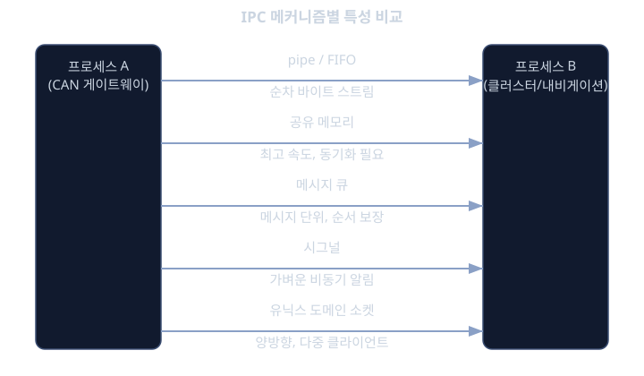
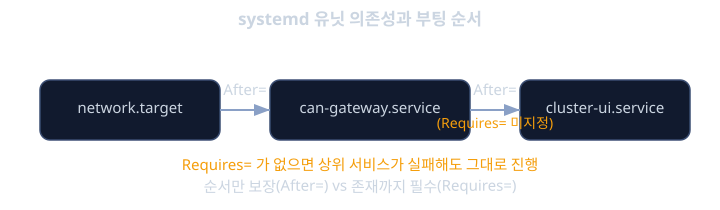

# 유저공간 · IPC

앞선 레슨에서는 디바이스 드라이버가 커널 공간에서 CAN 컨트롤러나 센서 같은 하드웨어를 어떻게 다루는지 살펴봤다. 그런데 운전자가 실제로 보고 만지는 것 - 내비게이션 지도, 클러스터에 뜨는 속도계, 음악 재생 화면 - 은 커널이 아니라 유저공간에서 돌아가는 평범한 응용 프로그램들이다. 이 프로그램들은 각자 독립된 프로세스로 실행되며, 커널이 디바이스 드라이버를 통해 하드웨어에서 읽어온 데이터를 넘겨받아 화면에 보여주거나 다른 시스템으로 전달하는 역할을 한다.

문제는 여기서부터 시작된다. 리눅스는 보안과 안정성을 위해 프로세스마다 독립된 메모리 공간을 준다. 한 프로세스가 다른 프로세스의 메모리를 직접 들여다볼 수 없다는 뜻이다. 그런데 차량 안의 소프트웨어는 협력해야 한다. CAN 버스에서 차량 속도 신호를 받아오는 게이트웨이 데몬이 있다고 하면, 이 속도 값은 클러스터 프로세스(계기판 표시)에도 가야 하고, 내비게이션 프로세스(경로 재탐색 판단)에도 가야 한다. 서로 격리된 프로세스들이 데이터를 "건너서" 주고받는 방법이 필요한데, 이것을 IPC(Inter-Process Communication, 프로세스 간 통신)라고 부른다.

그리고 이 많은 프로세스를 누가 띄우고, 어떤 순서로 띄우고, 문제가 생기면 어떻게 재시작할지 관리하는 주체도 필요하다. 차량은 키를 돌리는 순간부터 몇 초 안에 클러스터 화면이 떠야 한다는 매우 엄격한 부팅시간 요구사항을 갖는다. 이 전체 생명주기를 관리하는 것이 리눅스의 init 시스템인 systemd다.

이번 레슨은 "유저공간에서 여러 프로그램이 동시에 돌고, 서로 데이터를 주고받고, 적절한 순서로 기동되는 원리"를 다룬다. 프로세스와 스레드의 기본 개념, 공유 자원을 안전하게 쓰는 동기화의 필요성, 다양한 IPC 메커니즘의 비교, D-Bus라는 표준 메시지 버스, 그리고 systemd로 서비스 생명주기를 관리하는 방법까지 순서대로 짚어본다.

## 학습 목표

- fork()와 exec()로 프로세스가 만들어지는 과정을 설명하고, 프로세스와 스레드의 차이를 구분할 수 있다.
- race condition이 왜 발생하는지 이해하고, mutex/semaphore/condition variable이 이를 막는 원리를 설명할 수 있다.
- 파이프, 공유 메모리, 메시지 큐, 시그널, 유닉스 도메인 소켓의 특징을 비교하고 상황에 맞는 메커니즘을 고를 수 있다.
- D-Bus가 유저공간 서비스들 사이에서 어떤 역할을 하는지 설명할 수 있다.
- systemd 유닛 파일로 서비스 간 의존성과 기동 순서를 제어하는 방법을 익힌다.
- 소켓 액티베이션이 차량의 부팅시간 최적화에 왜 유리한지 설명할 수 있다.

## 프로세스와 스레드

프로세스는 실행 중인 프로그램에게 커널이 할당해주는 독립된 "실행 환경"이다. 자기만의 메모리 공간(주소 공간), 자기만의 파일 디스크립터 테이블, 자기만의 PID를 갖는다. 리눅스에서 새 프로세스를 만드는 전통적인 방법은 fork()와 exec() 두 함수의 조합이다.

fork()는 현재 실행 중인 프로세스를 그대로 복제한다. 호출 시점의 메모리 내용, 열려 있는 파일, 실행 위치까지 거의 동일한 "쌍둥이" 프로세스가 하나 더 생긴다. 다만 복제된 자식 프로세스는 fork()의 반환값으로 0을 받고, 원래의 부모 프로세스는 자식의 PID를 받는다. 이 반환값으로 "나는 부모인가 자식인가"를 구분한 뒤, 자식 쪽에서 exec() 계열 함수(execve 등)를 호출하면 그 프로세스의 메모리 내용이 완전히 다른 실행 파일로 교체된다. 즉 "복제해서 자식을 만들고, 그 자식을 다른 프로그램으로 바꿔치기한다"는 두 단계로 새 프로세스가 실행된다.

```c
pid_t pid = fork();
if (pid == 0) {
    /* 자식 프로세스: 진단 서비스 프로그램으로 교체 */
    execve("/usr/bin/diag-service", argv, envp);
} else if (pid > 0) {
    /* 부모 프로세스: 자식의 PID를 기억해둔다 */
    printf("자식 프로세스 생성됨, pid=%d\n", pid);
} else {
    perror("fork 실패");
}
```

스레드는 이와 다르다. 하나의 프로세스 안에 여러 개의 실행 흐름(스레드)을 둘 수 있는데, 이 스레드들은 같은 프로세스에 속하므로 메모리 공간, 파일 디스크립터를 전부 공유한다. 리눅스에서 스레드는 보통 POSIX 스레드(pthread) 라이브러리로 다룬다.

```c
void *recv_worker(void *arg) {
    /* CAN 프레임을 계속 수신하는 스레드 */
    while (1) {
        receive_can_frame();
    }
    return NULL;
}

pthread_t tid;
pthread_create(&tid, NULL, recv_worker, NULL);
```

예를 들어 CAN 게이트웨이 데몬 하나를 멀티스레드로 설계한다면, 한 스레드는 CAN 버스에서 프레임을 계속 받아들이고(수신 스레드), 다른 스레드는 받은 데이터를 해석해서 다른 프로세스로 전달하는(처리 스레드) 식으로 역할을 나눌 수 있다. 프로세스를 나누는 것보다 가볍고, 메모리를 공유하니 데이터를 주고받기도 간단하다. 다만 "메모리를 공유한다"는 바로 이 특징 때문에 다음 절에서 다룰 동기화 문제가 생긴다.

프로세스든 스레드든 실제로 CPU 위에서 돌아가려면 커널의 스케줄러가 CPU 시간을 나눠줘야 한다. CPU 코어 수보다 실행할 작업이 많은 것이 보통이므로, 스케줄러는 우선순위와 정책(일반 작업, 실시간 작업 등)에 따라 아주 짧은 시간 단위로 작업을 번갈아 실행시킨다. 사용자 입장에서는 여러 프로세스가 "동시에" 도는 것처럼 보이지만, 실제로는 스케줄러가 쪼개놓은 시간을 빠르게 나눠 쓰는 것이다.

## 동기화 기초: 공유 자원을 안전하게 쓰기

스레드들이 메모리를 공유한다는 것은 편리하지만 동시에 위험하다. 두 스레드가 같은 변수를 동시에 읽고 쓰면 예상치 못한 결과가 나올 수 있는데, 이를 race condition(경쟁 상태)이라 부른다.

간단한 예로, 두 스레드가 똑같이 "카운터 값을 읽고, 1을 더하고, 다시 저장"하는 작업을 한다고 하자. 이 세 단계는 하나의 원자적인 동작이 아니다. 스레드 A가 값을 읽은 직후 스레드 B도 같은 값을 읽어버리면, 두 스레드 모두 "옛날 값+1"을 저장하게 되어 결국 카운터는 1만 증가하고 끝난다. 두 번 증가해야 할 값이 한 번만 증가한 것이다. CAN 수신 카운터처럼 단순한 값이라도 이런 식으로 조용히 틀려질 수 있다.

이를 막기 위해 "공유 자원에 접근하는 코드 구간(critical section)에는 한 번에 하나의 스레드만 들어가게" 강제하는 도구들이 쓰인다.

- mutex(상호 배제): 자원을 잠그고(lock), 다 쓰면 푸는(unlock) 방식. 한 스레드가 잠긴 mutex를 풀기 전까지 다른 스레드는 그 지점에서 기다린다.
- semaphore: mutex와 비슷하지만 "동시에 접근 가능한 개수"를 카운트로 관리할 수 있다. 예를 들어 리소스가 3개 있다면 동시에 3개의 스레드까지만 통과시킨다.
- condition variable: "조건이 만족될 때까지 기다렸다가, 조건이 충족되면 깨어나는" 용도로, mutex와 함께 쓰여서 "버퍼가 비었으면 기다리고, 데이터가 들어오면 깨어나서 처리" 같은 생산자-소비자 패턴을 구현할 때 쓰인다.

```c
pthread_mutex_t lock = PTHREAD_MUTEX_INITIALIZER;
int speed_value;

void update_speed(int v) {
    pthread_mutex_lock(&lock);
    speed_value = v;
    pthread_mutex_unlock(&lock);
}
```

이 레슨에서는 동기화를 깊게 다루지는 않지만, "메모리를 공유하는 순간부터 동기화는 선택이 아니라 필수"라는 감각만은 꼭 기억해두자. 뒤에서 다룰 공유 메모리 기반 IPC에서도 똑같은 문제가 그대로 따라온다.

## IPC 메커니즘 비교: 무엇으로 데이터를 주고받을까

서로 메모리 공간이 격리된 프로세스들이 데이터를 주고받으려면 커널이 중간에서 도와줘야 한다. 리눅스는 여러 종류의 IPC 메커니즘을 제공하는데, 각각 성격이 다르므로 상황에 맞게 골라 써야 한다.

- 파이프(pipe)와 FIFO(이름 있는 파이프): 한쪽에서 쓰면 다른 쪽에서 읽는 단방향 바이트 스트림이다. 일반 pipe()는 부모-자식처럼 관계가 있는 프로세스 사이에서만 쓸 수 있고, FIFO(mkfifo로 만드는 이름 있는 파이프)는 파일 시스템에 이름을 남기므로 관계없는 프로세스도 그 이름을 통해 접근할 수 있다. 구조가 단순한 순차적 데이터 전달에 적합하다.
- 공유 메모리(shared memory, POSIX shm): 여러 프로세스가 같은 물리 메모리 영역을 각자의 주소 공간에 매핑해서 쓰는 방식이다. 데이터를 커널을 거쳐 복사할 필요가 없으므로 속도가 가장 빠르다. 다만 "공유 메모리에 접근하는 순서"는 커널이 관리해주지 않으므로, 앞서 본 mutex나 semaphore 같은 동기화 수단을 응용 프로그램이 직접 책임져야 한다. 영상 프레임처럼 큰 데이터를 자주 넘길 때 적합하다.
- 메시지 큐(message queue): 데이터를 "메시지" 단위로 큐에 넣고(send), 다른 프로세스가 꺼내가는(receive) 방식이다. 메시지 단위로 우선순위를 둘 수 있고, 보내는 쪽과 받는 쪽의 타이밍이 어긋나도 큐에 쌓여 있으므로 안전하다. 이벤트성 데이터를 순서대로, 유실 없이 전달하고 싶을 때 적합하다.
- 시그널(signal): 커널이 프로세스에게 "무언가 일어났다"를 비동기로 알려주는 가장 가벼운 수단이다. SIGTERM(종료 요청), SIGUSR1 같은 사용자 정의 시그널 등이 있다. 데이터를 싣고 가는 용도가 아니라, "지금 이 사건이 일어났다"는 신호 자체만 전달하는 경량 알림에 적합하다.
- 유닉스 도메인 소켓(Unix domain socket): 네트워크 소켓과 같은 API(socket, bind, send, recv 등)를 쓰지만 실제로는 로컬 머신 안에서만 동작하며 TCP/IP 스택을 거치지 않으므로 빠르다. 스트림(연속된 바이트, SOCK_STREAM)과 데이터그램(메시지 단위, SOCK_DGRAM) 둘 다 지원하고, 양방향 통신과 여러 클라이언트 연결(클라이언트가 여러 개인 서버 구조)을 자연스럽게 지원한다는 점이 다른 IPC보다 유리하다.



자동차 예시로 정리해보면, CAN 게이트웨이 데몬이 버스에서 속도 신호를 수신했을 때 이를 유닉스 도메인 소켓을 통해 클러스터 프로세스와 내비게이션 프로세스에 각각 전달하는 구조를 흔히 볼 수 있다. 게이트웨이 데몬이 서버 역할을 하는 소켓을 하나 열어두면, 클러스터와 내비게이션은 각자 클라이언트로 접속해서 필요한 신호를 구독하는 식이다.

```c
/* 유닉스 도메인 소켓 서버 측 핵심 흐름 (개념 예시) */
int srv = socket(AF_UNIX, SOCK_STREAM, 0);
struct sockaddr_un addr = { .sun_family = AF_UNIX };
strcpy(addr.sun_path, "/run/can-gateway.sock");
bind(srv, (struct sockaddr *)&addr, sizeof(addr));
listen(srv, 5);

int client_fd = accept(srv, NULL, NULL);
send(client_fd, &speed_frame, sizeof(speed_frame), 0);
```

대용량 데이터(카메라 영상 프레임 등)는 공유 메모리로, 가벼운 이벤트 알림은 시그널이나 소켓으로, 순서가 중요한 이벤트 스트림은 메시지 큐나 소켓으로 처리하는 식으로 상황에 맞춰 조합해 쓰는 것이 일반적이다.

## D-Bus: 서비스들을 위한 표준 메시지 버스

유닉스 도메인 소켓만으로도 두 프로세스를 연결할 수 있지만, 시스템 안에 수십 개의 서비스가 있고 서로 호출 규칙을 맞춰야 한다면 매번 소켓 프로토콜을 직접 설계하는 건 비효율적이다. 이런 상황을 위해 리눅스 유저공간에는 D-Bus라는 표준화된 메시지 버스 미들웨어가 존재한다.

D-Bus는 하나의 중앙 버스(데몬)를 통해 서비스들이 서로를 이름으로 찾고(서비스 디스커버리), 메서드 호출(method call, 함수를 부르듯 요청-응답을 주고받는 방식)과 신호(signal, 특정 사건이 발생했다는 것을 구독자들에게 알리는 방식)를 표준화된 형식으로 주고받을 수 있게 해준다. 내부적으로는 유닉스 도메인 소켓 위에서 동작하지만, 응용 프로그램 입장에서는 소켓 바이트 스트림을 직접 다룰 필요 없이 D-Bus 라이브러리의 API로 "어떤 서비스의 어떤 메서드를 호출한다"처럼 다룰 수 있다.

리눅스 데스크톱 환경에서 널리 쓰이는 D-Bus는 임베디드 자동차 영역에서도 자리를 잡았다. GENIVI나 Automotive Grade Linux(AGL) 계열의 IVI 소프트웨어 스택에서는 미디어 플레이어, 내비게이션, 전화 연동 서비스 등이 D-Bus를 통해 서로의 상태를 질의하거나 이벤트를 구독하는 구조를 자주 쓴다. 예를 들어 "전화가 걸려왔다"는 신호를 전화 서비스가 D-Bus로 내보내면, 미디어 플레이어는 그 신호를 구독해서 음악을 자동으로 줄이는 식의 연동이 가능해진다.

## systemd: 서비스 매니저와 부팅 시간

지금까지는 프로세스들이 "떠 있다"고 가정하고 서로 통신하는 방법을 다뤘다. 그런데 이 프로세스들을 애초에 누가, 어떤 순서로 띄우는가 하는 문제가 남는다. 현대 대부분의 리눅스 배포판은 이를 systemd라는 init 시스템(PID 1번으로 실행되며 모든 다른 프로세스의 조상이 되는 특별한 프로세스)이자 서비스 매니저로 처리한다.

systemd는 관리할 서비스마다 유닛 파일(.service 확장자를 가진 설정 파일)을 둔다. 유닛 파일에는 어떤 실행 파일을 띄울지, 언제 띄울지, 다른 서비스와의 관계는 어떤지를 선언적으로 적어둔다.

```ini
[Unit]
Description=CAN Gateway Daemon
After=network.target

[Service]
ExecStart=/usr/bin/can-gateway
Restart=on-failure

[Install]
WantedBy=multi-user.target
```

여기서 After=는 "이 서비스가 지정된 서비스 다음에 뜬다"는 순서 관계를 나타낸다. Requires=는 순서를 넘어서 "이 서비스가 없으면 나도 돌 수 없다"는 의존 관계를 나타낸다. 예를 들어 클러스터 UI 프로세스의 유닛 파일에 After=can-gateway.service를 적어두면, systemd는 부팅 시 CAN 게이트웨이 데몬을 먼저 띄운 다음에야 클러스터 UI를 띄운다. CAN 데이터를 받을 준비가 안 된 상태에서 화면이 먼저 뜨는 것을 막을 수 있다.



systemd의 또 다른 중요한 기능은 소켓 액티베이션(socket activation)이다. 보통은 서비스 프로그램이 직접 자신의 소켓을 만들고 bind, listen까지 수행한 다음에야 요청을 받을 수 있다. 소켓 액티베이션을 쓰면 systemd가 부팅 초기에 소켓만 먼저 만들어서 열어두고, 실제로 그 소켓에 요청이 들어올 때까지 서비스 프로그램 자체의 실행은 뒤로 미룬다. 요청이 들어오는 순간 systemd가 그제서야 프로그램을 실행시키고 이미 만들어둔 소켓을 건네준다.

이것이 왜 차량 기동시간에 중요한가 하면, 모든 서비스를 "필요할 가능성이 있으니 미리 다 띄워놓는" 방식은 부팅 초기에 CPU와 메모리를 한꺼번에 많이 요구해서 정작 가장 먼저 봐야 하는 클러스터 화면이 늦게 뜨는 역효과를 낳을 수 있다. 소켓 액티베이션으로 당장 필요하지 않은 서비스의 실제 기동을 늦추면, 부팅 초기의 자원을 클러스터 디스플레이처럼 우선순위가 높은 프로세스에 몰아줄 수 있다. 즉 systemd의 의존성 선언과 소켓 액티베이션은 "무엇을 먼저 보여줄 것인가"를 소프트웨어 차원에서 설계하는 도구다.

<details><summary><b>심화: 좀비 프로세스와 wait()</b></summary>

자식 프로세스가 종료되면 커널은 그 종료 상태를 바로 치우지 않고 남겨둔다. 부모 프로세스가 wait() 또는 waitpid()를 호출해서 "자식이 어떻게 끝났는지" 확인해줘야 비로소 커널이 그 정보를 치운다. 부모가 이를 확인하지 않으면 이미 실행이 끝났지만 프로세스 테이블에 흔적만 남아 있는 상태가 되는데, 이를 좀비(zombie) 프로세스라 부른다. 좀비 프로세스는 메모리를 거의 쓰지 않지만 PID를 계속 점유하므로, 자식을 많이 만드는 데몬(예: 여러 진단 서비스를 fork로 띄우는 관리 프로세스)은 반드시 자식의 종료를 수거해야 한다. systemd가 서비스를 직접 관리하는 경우에는 systemd 자체가 부모 역할을 하면서 이 수거를 대신 해준다.

</details>

<details><summary><b>심화: 공유 메모리는 누가 동기화를 책임지나</b></summary>

공유 메모리는 커널이 "메모리를 매핑해주는 것"까지만 책임지고, 그 메모리에 "누가 언제 읽고 쓰는지"는 전혀 관여하지 않는다. 즉 pipe나 소켓처럼 커널이 자연스럽게 순서를 보장해주는 메커니즘과 달리, 공유 메모리는 응용 프로그램이 직접 세마포어나 뮤텍스로 접근 순서를 통제해야 한다. 흔히 "공유 메모리 영역 자체"와 "그 영역을 보호하는 세마포어"를 한 쌍으로 묶어 설계하는데, 둘 중 하나라도 빠지면 레이스 컨디션이 그대로 재현된다. 대용량 영상 프레임을 공유 메모리로 주고받는 카메라 처리 파이프라인에서 이 패턴이 자주 쓰인다.

</details>

<details><summary><b>심화: 소켓 액티베이션의 동작 원리</b></summary>

소켓 액티베이션은 서비스용 .service 유닛과 짝을 이루는 .socket 유닛으로 구성된다. systemd는 부팅 시 .socket 유닛에 정의된 소켓만 먼저 만들어서 listen 상태로 둔다. 이 소켓에 실제 연결 요청이 들어오면 systemd는 짝이 되는 .service 유닛의 프로그램을 그제서야 실행시키고, 이미 열려 있던 소켓의 파일 디스크립터를 환경을 통해 그 프로그램에 넘겨준다. 프로그램 입장에서는 자신이 소켓을 만든 것처럼 그 파일 디스크립터를 그대로 이어받아 쓴다. 이 방식의 장점은 서비스 프로그램이 아직 실행되지 않은 순간에도 그 서비스에 대한 요청이 유실되지 않고 대기열에 쌓인다는 점과, 당장 쓰이지 않는 서비스라면 끝까지 실행조차 되지 않아도 된다는 점이다.

</details>

**확인 문제.** CAN 게이트웨이 데몬이 수신한 대용량 카메라 영상 프레임을 서라운드 뷰 처리 프로세스에 가능한 한 빠르게 전달하고 싶다. 반면 "문이 열렸다"는 단순한 이벤트는 여러 프로세스에게 가볍게 알리기만 하면 된다. 이 두 상황에 각각 어떤 IPC 메커니즘이 더 적합할지 고르고 이유를 설명해보자.

<details><summary>답 보기</summary>

영상 프레임처럼 데이터가 크고 반복적으로 전달되는 경우에는 공유 메모리가 적합하다. 커널을 거쳐 데이터를 복사하지 않고 같은 물리 메모리를 양쪽이 직접 참조하므로 복사 비용 없이 빠르게 전달할 수 있기 때문이다. 다만 어느 프로세스가 언제 읽고 쓰는지를 뮤텍스나 세마포어로 직접 동기화해야 한다. 반면 "문이 열렸다"처럼 데이터 자체는 거의 없고 사건이 발생했다는 사실만 전달하면 되는 경우에는 시그널이나 유닉스 도메인 소켓을 통한 가벼운 알림(혹은 D-Bus의 signal)이 더 적합하다. 큰 데이터를 옮기는 데 설계된 공유 메모리를 단순 알림에 쓰면 오히려 동기화 설계의 부담만 커진다.

</details>

**확인 문제.** systemd 유닛 파일에서 After=can-gateway.service만 적고 Requires=can-gateway.service는 적지 않았다. 이 경우 생길 수 있는 문제는 무엇일까?

<details><summary>답 보기</summary>

After=는 순서만 보장할 뿐 "그 서비스가 반드시 성공적으로 실행되고 있어야 한다"는 것까지는 보장하지 않는다. 즉 can-gateway.service가 시작에 실패하거나 중간에 죽어도, After=만 걸려 있는 다른 서비스는 "순서상 뒤에 떠야 한다"는 조건만 지켜지면 그대로 기동을 시도한다. CAN 게이트웨이가 꼭 떠 있어야만 의미가 있는 서비스라면 Requires=도 함께 선언해서, 게이트웨이가 없으면 해당 서비스도 같이 기동하지 않도록(또는 실패로 처리하도록) 의존 관계를 명시해야 한다.

</details>

## 정리

유저공간은 디바이스 드라이버가 올려주는 하드웨어 데이터를 실제로 활용하는 여러 응용 프로세스들이 사는 공간이다. fork()와 exec()로 독립된 프로세스를 만들고, pthread로 메모리를 공유하는 가벼운 스레드를 만들 수 있지만, 메모리를 공유하는 순간부터는 race condition을 막기 위한 mutex, semaphore 같은 동기화 수단이 필요하다. 서로 격리된 프로세스들끼리 데이터를 주고받으려면 pipe, 공유 메모리, 메시지 큐, 시그널, 유닉스 도메인 소켓 중 상황에 맞는 IPC 메커니즘을 골라야 하고, 서비스가 많아지면 D-Bus 같은 표준 메시지 버스가 통신 규칙을 통일해준다. 마지막으로 systemd는 유닛 파일의 의존성 선언과 소켓 액티베이션으로 "어떤 서비스를 언제 띄울지"를 제어하며, 이는 차량이 켜진 뒤 클러스터 화면이 뜨기까지의 시간을 결정짓는 핵심 요소다. 이 모든 조각들이 합쳐져야 CAN 게이트웨이 데몬이 수신한 신호가 클러스터와 내비게이션에 제때 전달되는, 눈에 보이는 차량 소프트웨어 경험이 완성된다.

## 참고 자료

- Linux man-pages: fork(2), execve(2), pthread_create(3)
- Linux man-pages: pipe(2), shm_overview(7), mq_overview(7), socket(7), unix(7)
- D-Bus Specification (freedesktop.org D-Bus 프로젝트 공식 문서)
- systemd.service, systemd.socket, systemd.unit man 페이지
- Michael Kerrisk, "The Linux Programming Interface"
- Automotive Grade Linux(AGL) 및 GENIVI/COVESA 아키텍처 관련 자료
