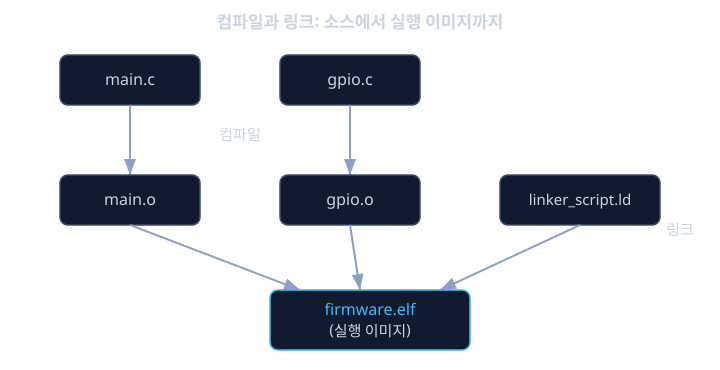
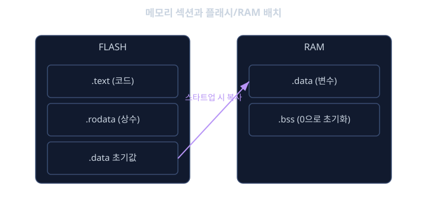

# 메모리 · 링커 · 빌드

베어메탈 펌웨어의 스타트업 코드를 보면 `_data_flash_start`, `_bss_end` 같은 이름의 심볼이 등장했다. 그런데 그 심볼의 실제 주소값, 즉 "플래시의 몇 번지부터 몇 번지까지가 `.data`이고, RAM의 몇 번지부터가 `.bss`인가"는 C 코드 어디에도 적혀 있지 않았다. 이 값들은 어디서 정해지는가. 이 질문에 답하려면 소스 코드를 실행 파일로 바꾸는 과정에서 흔히 그늘에 숨어 있는 도구, 즉 링커(linker)와 그 설계도인 링커 스크립트(linker script)를 알아야 한다.

C 컴파일러는 `.c` 파일 하나하나를 독립적으로 번역해서 오브젝트 파일(`.o`)이라는 조각으로 만든다. 이 조각들에는 아직 최종 메모리 주소가 정해지지 않은 채로, "이 함수는 다른 파일에 있는 `led_on`을 호출한다" 같은 미해결 참조들이 남아 있다. 이 조각들을 모두 모아서 서로의 참조를 연결하고, 각 함수와 변수에 실제 메모리 주소를 할당해 하나의 완성된 실행 이미지로 합치는 작업이 바로 링크(link)다. 그리고 이 작업에서 "플래시의 어느 구간에 코드를 놓고, RAM의 어느 구간에 변수를 놓을지"를 지시하는 설계도가 링커 스크립트다.

PC에서 프로그램을 돌릴 때는 운영체제가 가상 메모리라는 기술로 "내가 쓰는 주소는 전부 내 것인 것처럼" 착각하게 만들어주기 때문에, 개발자가 물리적인 메모리 주소를 신경 쓸 일이 거의 없다. 하지만 자동차용 MCU는 플래시 512 KB, RAM 128 KB처럼 물리적으로 정해진 용량만 가지고 있고, 가상 메모리 같은 안전장치도 없다. 코드와 데이터를 어디에 배치할지를 1바이트 단위까지 정확하게 계획하지 않으면, 빌드는 성공해도 보드에 올리는 순간 아무것도 동작하지 않거나, "플래시 용량 초과"라는 알아보기 힘든 오류 메시지만 받고 멈춰버린다. 이 레슨을 모르면 그런 오류 메시지 앞에서 무엇을 확인해야 하는지조차 알 수 없다.

여기에 한 가지 문제가 더 있다. 지금 코드를 작성하고 있는 개발 PC는 대부분 x86 계열 CPU를 쓰지만, 최종적으로 코드가 돌아갈 자동차 ECU는 ARM 같은 전혀 다른 아키텍처를 쓴다. 이 둘의 명령어 체계가 다르기 때문에, PC용 컴파일러로 만든 실행 파일은 MCU에서 단 한 줄도 실행되지 않는다. 이 간극을 메우는 것이 크로스 컴파일(cross compilation)이다. 이번 레슨에서는 컴파일과 링크의 역할 분담, `.text`/`.data`/`.bss`/`.rodata` 같은 메모리 섹션의 의미, 링커 스크립트의 핵심 문법, 크로스 컴파일의 개념, 그리고 빌드 결과를 숫자로 확인하는 맵 파일(map file) 읽기까지를 다룬다.

## 학습 목표

- 컴파일과 링크의 역할 차이를 설명하고, 오브젝트 파일에서 최종 실행 이미지가 만들어지는 과정을 설명할 수 있다.
- `.text`, `.rodata`, `.data`, `.bss` 네 가지 메모리 섹션이 각각 어떤 내용을 담고 플래시/RAM 중 어디에 위치하는지 설명할 수 있다.
- 링커 스크립트의 `MEMORY` 블록과 `SECTIONS` 블록이 각각 무엇을 정의하는지 읽고 이해할 수 있다.
- 크로스 컴파일이 왜 필요한지와 호스트(host)/타겟(target)의 구분을 설명할 수 있다.
- 맵 파일(.map)을 읽어 플래시/RAM 사용량과 심볼의 실제 주소를 확인할 수 있다.

## 번역과 조립: 컴파일러와 링커의 역할 분담

빌드 과정은 크게 두 단계로 나뉜다. 첫 단계는 컴파일(compile)로, 컴파일러가 `.c` 파일 하나를 받아 그 안의 C 문법을 CPU가 이해하는 기계어 명령으로 번역해 `.o`(오브젝트) 파일을 만든다. 이 단계에서는 파일 하나만 들여다보기 때문에, 다른 파일에 정의된 함수를 호출하는 코드가 있어도 "이 이름을 가진 함수는 나중에 어딘가에서 찾아서 연결해 달라"는 식의 미해결 참조(undefined reference)로 남겨둔다.

두 번째 단계가 링크(link)다. 링커는 프로젝트에서 만들어진 모든 `.o` 파일과, 필요하다면 표준 라이브러리의 `.a`(아카이브) 파일까지 한꺼번에 모아 놓고, 각 파일에 남아 있던 미해결 참조를 실제 주소로 채워 넣는다. 예를 들어 `main.o` 안에서 `led_on`을 호출하는 코드가 있다면, 링커는 `gpio.o` 안에 정의된 `led_on` 함수의 최종 주소를 찾아서 그 호출 지점에 채워 넣는다. 이 과정이 모두 끝나면 플래시에 그대로 구워 넣을 수 있는 하나의 완성된 이미지, 보통 `.elf`나 `.bin`/`.hex` 형식의 파일이 만들어진다. 즉 컴파일러는 "문법을 기계어로 번역하는 번역가"이고, 링커는 "번역된 조각들을 모아 최종 주소를 매기고 하나로 합치는 조립공"이라고 생각하면 된다.



## 메모리 섹션: .text, .rodata, .data, .bss

링커가 코드와 데이터를 배치할 때는 아무 순서 없이 늘어놓는 것이 아니라, 성격이 같은 것들을 묶어서 섹션(section)이라는 단위로 분류한다. 자주 등장하는 네 가지 섹션은 다음과 같다.

- `.text`: 실제로 실행되는 기계어 명령, 즉 함수 코드가 들어가는 섹션이다. 전원이 꺼져도 사라지면 안 되므로 플래시 같은 비휘발성 메모리에 저장된다.
- `.rodata`: 바뀌지 않는 상수 데이터, 예를 들어 `const char msg[] = "ERROR";`같이 선언된 읽기 전용 데이터가 들어간다. 역시 전원이 꺼져도 유지되어야 하므로 플래시에 저장되며, 이름에서 보듯 read-only data의 줄임말이다.
- `.data`: 초기값이 있는 전역/정적 변수가 들어간다. 예를 들어 `int sensor_offset = 100;`은 실행 중에 값이 바뀔 수 있어야 하므로 RAM에 있어야 하지만, 초기값 100은 전원이 꺼져도 사라지면 안 되므로 그 초기값 자체는 플래시에 보관해 둔다. 그래서 `.data`는 "초기값은 플래시에, 실제 변수는 RAM에"라는 두 집 살림을 하는 특이한 섹션이며, 베어메탈 레슨에서 본 스타트업 코드가 매 전원 인가 때마다 플래시의 초기값을 RAM으로 복사해 주는 이유가 바로 여기에 있다.
- `.bss`: 초기값이 없는(또는 0으로 초기화되는) 전역/정적 변수가 들어간다. 어차피 0으로 채우기만 하면 되므로 플래시에 초기값을 따로 저장해 둘 필요가 없고, 그 결과 `.bss`는 플래시 용량을 전혀 차지하지 않는다. 대신 스타트업 코드가 전원이 켜질 때마다 이 영역을 RAM에서 직접 0으로 채운다.

정리하면, `.text`와 `.rodata`는 플래시에만 존재하면 되고, `.bss`는 RAM에만 존재하면 되며, `.data`만 플래시(초기값 보관)와 RAM(실제 변수) 양쪽에 걸쳐 존재한다. 이 네 섹션의 크기를 모두 더한 것이 곧 그 펌웨어가 실제로 차지하는 플래시 용량과 RAM 용량이 된다.



## 링커 스크립트 들여다보기: MEMORY와 SECTIONS

링커 스크립트는 크게 두 부분으로 이루어진다. `MEMORY` 블록은 실제 하드웨어에 존재하는 메모리 영역의 이름, 시작 주소, 크기를 선언한다. `SECTIONS` 블록은 앞서 설명한 `.text`/`.rodata`/`.data`/`.bss` 같은 섹션들을 어느 메모리 영역에 배치할지 지정한다. GNU 링커(ld)가 사용하는 스크립트 언어로 단순화한 예시는 다음과 같다.

```
MEMORY
{
    FLASH (rx)  : ORIGIN = 0x08000000, LENGTH = 512K
    RAM   (rwx) : ORIGIN = 0x20000000, LENGTH = 128K
}

SECTIONS
{
    .text :
    {
        *(.text)
        *(.rodata)
    } > FLASH

    .data :
    {
        _data_flash_start = LOADADDR(.data);
        _data_ram_start = .;
        *(.data)
        _data_ram_end = .;
    } > RAM AT > FLASH

    .bss :
    {
        _bss_start = .;
        *(.bss)
        _bss_end = .;
    } > RAM
}
```

`MEMORY` 블록은 "FLASH라는 이름의 메모리는 주소 0x08000000부터 512 킬로바이트 크기이고, 읽기(r)와 실행(x)이 가능하다. RAM이라는 이름의 메모리는 주소 0x20000000부터 128 킬로바이트 크기이고, 읽기·쓰기·실행이 모두 가능하다"고 선언하는 부분이다. 이 숫자는 MCU 데이터시트에 명시된 실제 하드웨어 사양을 그대로 옮긴 것이다.

`SECTIONS` 블록에서 `.data : { ... } > RAM AT > FLASH` 구문이 바로 앞서 설명한 `.data`의 특이한 두 집 살림을 그대로 표현한 문법이다. "실행 중에 이 섹션이 위치해야 할 곳은 RAM이지만, 플래시에 구워 넣을 때는 FLASH 쪽에 저장해 둬라"는 뜻이다. 그리고 그 안에 있는 `_data_flash_start`, `_data_ram_start`, `_data_ram_end` 같은 심볼이 바로 베어메탈 레슨의 스타트업 코드가 참조하던 그 심볼들이다. `.` 기호는 "지금 링커가 배치하고 있는 현재 위치"를 가리키는 특수한 문법으로, 이 위치를 심볼에 대입해 두면 스타트업 코드가 그 심볼을 읽어 정확한 복사 범위를 알아낼 수 있다. 결국 스타트업 코드와 링커 스크립트는 서로 짝을 이루는 한 쌍의 설계라는 것을 알 수 있다.

## 크로스 컴파일: 다른 세상을 위한 코드를 만들기

개발자가 코드를 작성하고 빌드 명령을 실행하는 컴퓨터를 호스트(host)라 하고, 그 결과물이 실제로 실행될 컴퓨터를 타겟(target)이라 한다. PC에서 평소에 쓰는 `gcc`는 호스트와 타겟이 모두 같은 x86 PC인 네이티브 컴파일(native compilation) 도구다. 하지만 자동차 ECU 펌웨어를 만들 때는 호스트가 x86 PC이고 타겟은 ARM Cortex-M이나 Cortex-A 같은 전혀 다른 명령어 집합을 쓰는 MCU다. 이렇게 호스트와 타겟의 아키텍처가 다른 상황에서 쓰는 컴파일 도구 모음을 크로스 컴파일 툴체인(cross-compilation toolchain)이라 한다.

예를 들어 ARM Cortex-M용으로 널리 쓰이는 `arm-none-eabi-gcc`는 이름 자체가 이 툴체인의 성격을 말해준다. `arm`은 타겟 아키텍처가 ARM이라는 뜻이고, `none`은 특정 운영체제를 타겟으로 하지 않는다는 뜻이며(베어메탈용이라는 의미), `eabi`는 임베디드 애플리케이션 바이너리 인터페이스(Embedded Application Binary Interface)라는 함수 호출 규약을 따른다는 뜻이다. 실제 빌드 명령은 다음과 같은 모습이다.

```sh
arm-none-eabi-gcc -mcpu=cortex-m4 -mthumb -O2 \
    -T linker_script.ld \
    -o firmware.elf main.c gpio.c startup.s
```

`-mcpu=cortex-m4`는 타겟 CPU 종류를 지정하고, `-T linker_script.ld`는 앞서 살펴본 링커 스크립트 파일을 링커에 전달하는 옵션이다. 호스트 PC에서는 이 `arm-none-eabi-gcc`를 실행할 수 있지만, 이 명령이 만들어낸 `firmware.elf`는 PC(x86)에서는 절대 실행되지 않는다. 오직 ARM 명령어를 이해하는 MCU에 플래시로 구워 넣었을 때만 의미가 있는 결과물이다.

## 맵 파일 읽기: 빌드 결과를 숫자로 확인하기

빌드가 끝나면 링커는 `.map` 확장자를 가진 맵 파일을 함께 만들어줄 수 있다(GNU 링커 기준 `-Map=firmware.map` 옵션). 맵 파일은 최종적으로 각 함수와 변수가 정확히 어느 주소에 배치되었는지, 그리고 각 섹션이 얼마나 많은 용량을 차지했는지를 텍스트로 보여주는 보고서다. 단순화한 예시는 다음과 같다.

```
Memory Configuration

Name             Origin             Length             Attributes
FLASH            0x08000000         0x00080000         xr
RAM              0x20000000         0x00020000         xrw

.text           0x08000000      0x00005a40
.rodata         0x08005a40      0x00000210
.data           0x20000000      0x00000180    load address 0x08005c50
.bss            0x20000180      0x00001200

                0x08005c50                sensor_offset (main.o)
                0x20000184                error_count (main.o)
```

이 숫자들로 두 가지를 확인할 수 있다. 하나는 사용량이다. `.text`와 `.rodata`를 합한 값이 플래시 전체 용량(이 예시에서는 512 킬로바이트)을 넘기면 링크 자체가 "플래시 용량 초과"라는 오류로 실패한다. `.data`와 `.bss`를 합한 값이 RAM 전체 용량을 넘기면 마찬가지로 실패하거나, 어떤 툴체인에서는 경고만 내고 빌드가 성공해 버려서 실행 중에 스택이 다른 변수의 영역을 덮어쓰는 훨씬 찾기 어려운 버그로 나타나기도 한다. 다른 하나는 특정 심볼의 실제 위치 확인이다. 디버거로 특정 주소에서 무엇이 깨졌는지 봐야 할 때, 맵 파일에서 그 주소가 어떤 변수나 함수에 해당하는지 거꾸로 찾아볼 수 있다. 맵 파일을 읽을 줄 모르면 "RAM이 부족하다"는 오류 앞에서 무엇을 줄여야 할지 전혀 가늠할 수 없다.

<details><summary><b>심화: 스택과 힙은 왜 섹션 표에 안 보이는가</b></summary>

앞서 본 `.text`/`.rodata`/`.data`/`.bss`는 모두 컴파일 시점에 크기가 정해지는, 정적(static) 영역이다. 반면 스택(stack)은 함수가 호출될 때마다 지역 변수와 복귀 주소를 쌓아 올리고 함수가 끝나면 다시 줄어드는, 실행 중에 크기가 계속 바뀌는 영역이다. 그래서 스택은 `.bss`처럼 고정된 섹션으로 표시되지 않고, 링커 스크립트에서 보통 RAM의 맨 끝 주소에서부터 아래쪽으로 자라도록 스택 포인터의 초기값만 지정해 둔다.

힙(heap)은 `malloc` 같은 동적 메모리 할당 함수가 필요에 따라 떼어주는 영역으로, 베어메탈이나 자원이 매우 제한된 임베디드 환경에서는 힙 사용을 아예 피하거나 매우 제한적으로만 쓰는 경우가 많다. 동적 할당은 실행 중에 메모리가 얼마나 쓰이는지 미리 예측하기 어렵게 만들고, 할당과 해제가 반복되며 사용 가능한 메모리가 작은 조각들로 쪼개지는 메모리 단편화(fragmentation) 문제를 일으킬 수 있기 때문이다. `.bss`가 RAM의 앞부분에서 자라고, 힙이 그 뒤를 이어 자라고, 스택이 RAM의 맨 끝에서 거꾸로 자라는 구조에서, 힙과 스택이 서로를 침범하면 어느 쪽 데이터가 먼저 깨지는지도 모르는 채 시스템이 오동작한다. 이런 이유로 결정론적 실행 시간을 요구하는 자동차 임베디드 소프트웨어에서는 힙 사용량 자체를 설계 초기에 엄격히 제한하는 경우가 흔하다.

</details>

<details><summary><b>심화: 정적 링크와 동적 링크, 그리고 임베디드가 정적 링크를 쓰는 이유</b></summary>

리눅스나 윈도우용 애플리케이션을 빌드할 때는 공유 라이브러리(`.so`, `.dll`)를 쓰는 동적 링크(dynamic linking)가 일반적이다. 동적 링크는 실행 파일 안에 라이브러리 코드를 직접 포함하지 않고, 프로그램이 실행되는 시점에 운영체제가 필요한 라이브러리를 메모리에 올려 연결해 주는 방식이다. 여러 프로그램이 같은 라이브러리를 공유해서 메모리와 디스크 용량을 아낄 수 있고, 라이브러리만 업데이트하면 그 라이브러리를 쓰는 모든 프로그램이 함께 업데이트 효과를 받는다는 장점이 있다.

하지만 베어메탈이나 단순한 임베디드 펌웨어에서는 거의 항상 정적 링크(static linking)를 쓴다. 필요한 라이브러리 코드를 링크 시점에 실행 이미지 안에 전부 포함시켜, 실행 중에는 더 이상 외부에서 코드를 찾아 연결할 필요가 없게 만드는 방식이다. 그 이유는 분명하다. 베어메탈 환경에는 "실행 중에 라이브러리를 찾아서 올려주는" 운영체제의 동적 로더(dynamic loader) 자체가 없다. 또한 자동차 ECU 소프트웨어는 한번 플래시에 구워지면 그 안의 모든 코드와 데이터 배치가 고정되어야 하고, 실행 중에 알 수 없는 코드가 새로 연결되는 불확실성은 결정론적 실행 시간과 안전성 분석을 어렵게 만든다. 정적 링크는 최종 실행 이미지 하나만 보면 그 안에 어떤 코드가 어느 주소에 있는지가 빌드 시점에 완전히 결정되어 있다는 점에서, 뒤 레슨에서 다룰 커널이나 부트로더보다도 더 엄격하게 결정론을 요구하는 베어메탈 펌웨어에 훨씬 더 적합하다.

</details>

**확인 문제.** `int retry_count = 3;`과 `static int error_flag;` 두 변수가 있다고 하자. 각각이 어떤 메모리 섹션에 들어가며, 그 초기값이 플래시와 RAM 중 어디에 저장되는지 설명하라.
<details><summary>답 보기</summary>

`retry_count`는 초기값 3을 가진 전역 변수이므로 `.data` 섹션에 들어간다. 이 변수의 초기값 3은 전원이 꺼져도 사라지면 안 되므로 플래시에 저장되고, 실제로 프로그램이 읽고 쓰는 변수 자체는 RAM에 존재한다. 전원이 켜질 때마다 스타트업 코드가 플래시에 저장된 초기값 3을 RAM의 `retry_count` 위치로 복사한다.

`error_flag`는 초기값을 명시하지 않았으므로 C 표준에 따라 0으로 초기화되어야 하는 변수이고, 따라서 `.bss` 섹션에 들어간다. `.bss`는 플래시에 아무 데이터도 저장해 두지 않고, 전원이 켜질 때마다 스타트업 코드가 RAM의 해당 영역을 직접 0으로 채운다. 즉 `error_flag`는 플래시 용량을 전혀 차지하지 않는다.

</details>

**확인 문제.** 어떤 프로젝트를 빌드했더니 맵 파일에서 `.data`와 `.bss`를 합한 크기가 RAM 전체 용량보다 작게 나와 빌드가 성공했지만, 실행 중에 함수 호출이 깊어지는 특정 상황에서만 변수 값이 이상하게 깨지는 문제가 발생했다. 어떤 영역이 원인일 가능성이 높은지, 그리고 그 영역이 왜 맵 파일의 섹션 표에 별도로 나타나지 않는지 설명하라.
<details><summary>답 보기</summary>

가장 가능성이 높은 원인은 스택 오버플로우(stack overflow)다. 스택은 `.text`/`.data`/`.bss`처럼 컴파일 시점에 크기가 고정되는 정적 섹션이 아니라, 함수 호출이 깊어질수록(또는 지역 변수가 많을수록) 실행 중에 계속 자라나는 동적 영역이기 때문에 맵 파일의 섹션 표에는 고정된 크기로 나타나지 않는다. `.data`와 `.bss`가 RAM 용량에 여유가 있어 보여도, 실행 중 스택이 예상보다 많이 자라서 `.bss`나 힙 영역을 침범하면 그 자리에 있던 변수의 값이 알 수 없는 패턴으로 깨진다. 이런 문제는 함수 호출 깊이나 재귀 횟수에 따라 증상이 달라지므로, 정적 분석 도구로 각 함수의 최대 스택 사용량을 추정하거나 링커 스크립트에서 스택 영역의 크기를 충분히 확보해 두고 경계를 넘는지 감시하는 가드(guard) 기법을 쓰는 것이 일반적인 대응책이다.

</details>

## 정리

- 컴파일은 `.c` 파일 하나를 기계어로 번역해 `.o` 파일을 만드는 단계이고, 링크는 여러 `.o` 파일을 모아 최종 주소를 매기고 하나의 실행 이미지로 합치는 단계다.
- `.text`와 `.rodata`는 플래시에만, `.bss`는 RAM에만 존재하고, `.data`는 초기값은 플래시에 두고 실제 변수는 RAM에 두는 두 집 살림을 한다.
- 링커 스크립트의 `MEMORY` 블록은 하드웨어 메모리 영역을 선언하고, `SECTIONS` 블록은 각 섹션을 그 메모리 영역에 배치하면서 스타트업 코드가 참조할 심볼의 주소를 계산해 넣어준다.
- 크로스 컴파일 툴체인은 호스트(개발 PC)와 타겟(MCU)의 명령어 집합이 다를 때 필요하며, 맵 파일은 빌드가 끝난 뒤 플래시/RAM 사용량과 각 심볼의 실제 주소를 확인할 수 있는 유일한 창이다.

이번 레슨에서 다룬 링커 스크립트와 빌드 과정은 베어메탈 펌웨어뿐 아니라, 다음 단계부터 다룰 리눅스 커널과 부트로더 이미지를 만들 때도 똑같이 바닥에서 동작하는 원리다. 다음 레슨에서는 이렇게 정적으로 배치된 코드와 데이터 위에서, 여러 프로세스를 동시에 돌리고 메모리를 보호해 주는 리눅스 커널의 기본 구조를 살펴본다.

## 참고 자료

- Ian Lance Taylor, "Linkers and Loaders" (John R. Levine 저서 기반 링커 이론 해설)
- GNU Binutils, "ld: The GNU linker" 공식 문서
- ARM, "ELF for the ARM Architecture" (ARM 공식 ABI 명세)
- GCC 공식 문서, "GNU Compiler Collection (GCC) Internals" 중 크로스 컴파일 관련 절
- Chris Hallinan, "Embedded Linux Primer" (크로스 툴체인과 빌드 시스템 관련 장)
