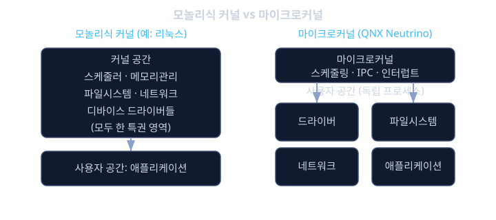
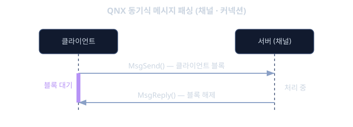

# QNX · 상용 RTOS

앞선 `car-framework`에서는 안드로이드 기반 차량 플랫폼 위에서 CarService 와 AIDL 로 앱과 차량 기능을 잇는 구조를 다뤘고, `autosar-adaptive`에서는 POSIX 위에서 동작하는 고성능 차량 소프트웨어 플랫폼과 ara::com 같은 서비스 지향 통신을 살펴봤다. 두 경우 모두 운영체제(OS)는 "그 위에 무언가를 올리는 바닥"으로만 등장했다. 그런데 디지털 계기판이나 ADAS(Advanced Driver Assistance System) 도메인 컨트롤러처럼 사람의 안전과 직결되는 영역으로 가면, "어떤 OS를 바닥으로 깔 것인가" 자체가 가장 먼저 결정해야 할 문제가 된다.

여기서 흔히 떠오르는 선택지가 범용 리눅스(Linux)다. 공짜이고, 개발 도구가 풍부하며, 수많은 엔지니어가 다룰 줄 안다. 그런데 완성차 업체들은 안전이 중요한 영역에서는 비용을 치르면서까지 QNX 같은 상용 RTOS(Real-Time Operating System)를 선택하는 경우가 많다. 왜 돈을 내고 상용 OS를 쓸까. 이유는 크게 두 가지다. 하나는 안전 인증(safety certification)이다. 계기판에 속도계와 경고등이 멈추거나, ADAS 가 긴급 제동 신호를 제때 못 내면 그대로 사고로 이어질 수 있다. 이런 시스템은 ISO 26262 같은 기능안전(functional safety) 표준에 맞춰 "이 소프트웨어는 이렇게까지 검증되었다"는 것을 증명해야 하는데, 범용 리눅스는 애초에 그런 증명을 염두에 두고 만들어지지 않았다.

다른 하나는 결정론적 응답성(deterministic responsiveness)이다. `embedded-sw`에서 봤듯 자동차 소프트웨어의 핵심은 "평균적으로 빠른 것"이 아니라 "정해진 시한 안에 반드시 끝나는 것"이다. 범용 리눅스 커널은 처리량(throughput)과 범용성을 위해 설계되어, 최악의 경우 어떤 작업이 언제 끝날지를 수치로 보장하기가 상대적으로 어렵다. 반면 QNX 같은 RTOS는 설계 단계부터 "우선순위가 높은 작업은 정해진 시간 안에 반드시 CPU를 받는다"는 것을 구조적으로 보장하도록 만들어졌다.

이번 레슨에서는 QNX 가 어떤 구조로 이 두 가지를 달성하는지를, 마이크로커널(microkernel)이라는 핵심 설계부터 시작해 장애 격리, 메시지 패싱, 안전 인증, 그리고 선수 학습과의 연결까지 차례로 살펴본다. QNX 는 현재 BlackBerry 가 소유한 상용 RTOS 제품군이라는 점을 미리 기억해 두자.

## 학습 목표

- 마이크로커널 아키텍처가 모놀리식 커널과 어떻게 다른지, 그리고 왜 안전이 중요한 차량 시스템에서 유리한지 설명할 수 있다.
- 장애 격리와 고가용성이 마이크로커널 구조에서 어떻게 자연스럽게 따라오는지 구체적 예시로 설명할 수 있다.
- QNX 의 동기식 메시지 패싱 IPC 와 우선순위 기반 선점형 스케줄링의 특징, 그리고 그것이 왜 예측 가능한 지연시간을 주는지 이해한다.
- 사전 인증된 RTOS 가 완성차 업체와 애플리케이션 개발사의 인증 부담을 어떻게 줄여 주는지 설명할 수 있다.
- QNX 의 POSIX 준수가 AUTOSAR Adaptive Platform 같은 상위 소프트웨어를 올리는 기반이 된다는 점을 선수 학습과 연결해 설명할 수 있다.

## 마이크로커널 아키텍처: 커널은 최소한만 한다

QNX Neutrino 의 가장 큰 특징은 마이크로커널(microkernel) 구조라는 점이다. 이 개념을 이해하려면 먼저 리눅스가 속한 모놀리식 커널(monolithic kernel)과 비교해 보는 것이 빠르다.

모놀리식 커널에서는 운영체제가 해야 할 거의 모든 일, 즉 작업 스케줄링, 메모리 관리, 파일시스템, 네트워크 스택, 그리고 수많은 디바이스 드라이버(device driver)까지 전부 하나의 커널 공간(kernel space)에서 함께 동작한다. 커널 공간은 CPU 의 가장 높은 권한으로 돌아가는, 메모리 보호의 울타리 안쪽이다. 즉 네트워크 카드 드라이버 코드 한 줄도 커널과 같은 특권 영역에서 실행된다. 이 구조는 성능 면에서 유리하다. 서로 다른 기능들이 함수 호출만으로 직접 서로를 부를 수 있기 때문이다. 하지만 대가가 있다. 드라이버 하나에 버그가 있으면 그 버그가 커널 전체를 오염시키거나 시스템 전체를 멈추게 할 수 있다.

마이크로커널은 정반대 철학을 택한다. 커널 자체는 정말 최소한의 기능만 담당한다. 구체적으로 QNX Neutrino 의 마이크로커널이 맡는 일은 대체로 작업 스케줄링, 프로세스 간 통신(IPC, Inter-Process Communication) 인 메시지 패싱, 그리고 인터럽트(interrupt) 전달 정도다. 그러면 디바이스 드라이버, 파일시스템, 네트워크 스택 같은 나머지 기능들은 어디로 갈까. 이들은 전부 커널 바깥, 즉 사용자 공간(user space)의 독립된 프로세스로 빠져나간다. 네트워크 스택도 하나의 프로세스, USB 드라이버도 하나의 프로세스, 파일시스템도 하나의 프로세스인 식이다.

이 차이를 직관적으로 그려 보자.

```
[모놀리식 커널 (예: 리눅스)]
  커널 공간: 스케줄러 + 메모리관리 + 파일시스템 + 네트워크 + 드라이버들 ... (한 덩어리)
  사용자 공간: 애플리케이션

[마이크로커널 (QNX Neutrino)]
  커널 공간: 스케줄러 + IPC + 인터럽트 전달 (최소한)
  사용자 공간: 드라이버 프로세스 | 파일시스템 프로세스 | 네트워크 프로세스 | 애플리케이션
```

커널이 작아진다는 것은 단순히 코드 줄 수가 준다는 뜻만이 아니다. "특권을 가진 영역"이 작아진다는 뜻이다. 안전 인증에서 검증해야 할 핵심 신뢰 기반(trusted computing base)이 작을수록 검증이 쉽고 믿을 만해진다. 뒤에서 볼 장애 격리와 안전 인증의 이점이 모두 이 작은 커널에서 흘러나온다.



## 장애 격리와 고가용성: 드라이버가 죽어도 계기판은 산다

마이크로커널 구조의 가장 실용적인 이점은 장애 격리(fault isolation)다. 드라이버와 서비스가 각각 독립된 사용자 공간 프로세스이고, 서로 메모리가 분리되어 있기 때문에, 한 프로세스가 비정상 종료되어도 그 피해가 그 프로세스 안에 갇힌다.

구체적인 예를 들어 보자. 디지털 계기판을 돌리는 도메인 컨트롤러에서 네트워크 드라이버 프로세스가 어떤 버그 때문에 갑자기 죽었다고 하자. 모놀리식 커널이었다면 이 드라이버가 커널 공간에 있으므로 커널 패닉(kernel panic)으로 번져 시스템 전체, 즉 계기판 디스플레이까지 함께 멈출 위험이 있다. 운전 중에 속도계와 경고등이 통째로 꺼지는 상황이다. 반면 마이크로커널에서는 네트워크 드라이버가 사용자 공간의 한 프로세스일 뿐이므로, 그 프로세스만 죽고 커널과 다른 프로세스(그래픽 드라이버, 계기판 렌더링 프로세스 등)는 아무 영향 없이 계속 동작한다. 운전자 입장에서는 속도계와 경고등이 멀쩡히 유지된다.

여기서 한 걸음 더 나아가면 고가용성(high availability)이다. 단지 다른 부분이 안 죽는 것에서 그치지 않고, 죽은 프로세스를 자동으로 되살리는 것이다. QNX 계열에는 프로세스들을 감시하다가 비정상 종료를 감지하면 그 프로세스를 재시작하는 감시 메커니즘, 개념적으로 High Availability Manager 같은 관리자가 있다. 이 관리자는 "네트워크 드라이버 프로세스가 사라졌다"는 것을 알아채고 즉시 그 프로세스를 다시 띄운다. 운전자는 잠깐의 네트워크 끊김조차 모르고 지나갈 수 있다. 모놀리식 구조에서 "재부팅 외에는 답이 없는" 상황이, 마이크로커널에서는 "문제 프로세스 하나만 조용히 재시작"으로 바뀌는 것이다. 이것이 안전이 중요한 차량 시스템에서 QNX 가 매력적인 핵심 이유 중 하나다.

## 메시지 패싱 기반 IPC: 예측 가능한 지연시간

커널이 작아지고 기능들이 전부 별도 프로세스로 흩어졌다면, 이들은 서로 어떻게 대화할까. 모놀리식 커널에서는 함수 호출 한 번이면 끝날 일이, 마이크로커널에서는 프로세스 사이를 건너야 하는 일이 된다. 이 소통을 담당하는 것이 바로 메시지 패싱(message passing) 기반 IPC 이고, QNX 설계의 심장이다.

QNX 의 메시지 패싱은 기본적으로 동기식(synchronous)이다. 어떤 프로세스(클라이언트)가 다른 프로세스(서버)에 메시지를 보내면, 클라이언트는 서버가 그 메시지를 받아 처리하고 응답을 돌려줄 때까지 블록(block)되어 기다린다. 예를 들어 애플리케이션이 파일을 읽고 싶으면, 파일시스템 프로세스에 "이 파일을 읽어 달라"는 메시지를 보내고 응답이 올 때까지 멈춘다. 얼핏 비효율처럼 보이지만, 이 동기식 구조가 주는 큰 장점이 하나 있다. 바로 지연시간이 예측 가능(bounded)하다는 점이다. 누가 누구를 기다리는지, 그리고 그동안 우선순위가 어떻게 전달되는지가 명확하게 정의되어 있어서, 최악의 경우 지연시간을 분석하고 보장하기가 쉬워진다.

여기서 `autosar-adaptive`에서 배운 ara::com 의 서비스 지향 통신을 떠올려 보면 좋다. ara::com 은 "어떤 서비스를 제공하는 쪽과 그것을 쓰는 쪽"을 느슨하게 연결하는 상위 수준의 통신 모델이었다. QNX 의 메시지 패싱은 그보다 훨씬 아래, OS 커널이 직접 중개하는 저수준 통신이다. 흥미로운 점은 AUTOSAR Adaptive 같은 상위 플랫폼의 서비스 통신도 결국 어떤 OS 위에서 돌아가야 하며, 그 OS 가 QNX 라면 그 바닥에는 이런 메시지 패싱 메커니즘이 깔려 있다는 것이다.

스케줄링 측면도 `embedded-sw`에서 다룬 우선순위 기반 선점형 스케줄링(priority-based preemptive scheduling)과 그대로 이어진다. QNX 역시 각 스레드에 우선순위를 부여하고, 더 높은 우선순위 스레드가 준비되면 즉시 선점(preemption)해서 먼저 실행한다. 게다가 메시지 패싱과 스케줄링이 맞물려, 클라이언트가 서버에 일을 맡길 때 클라이언트의 우선순위가 서버 처리에 반영되도록 설계되어 있어서, `embedded-sw`에서 본 우선순위 역전(priority inversion) 같은 문제를 구조적으로 다루기 수월하다.



## 안전 인증: 사전 인증된 바닥을 산다

이제 왜 돈을 내는지로 돌아오자. QNX 제품군에는 기능안전을 위해 특별히 준비된 계열, 예컨대 QNX OS for Safety 같은 제품이 있다. 이들은 ISO 26262(자동차 기능안전)나 IEC 61508(산업 일반 기능안전) 같은 표준에 맞춰, 사전 인증(pre-certified)된 형태로 제공된다. 즉 "이 OS 는 이러이러한 안전 표준의 요구사항을 만족하도록 개발되었고, 그것을 뒷받침하는 증거와 문서가 함께 딸려 온다"는 것이다.

이것이 왜 실무적으로 그렇게 중요한지 생각해 보자. 기능안전 인증은 최종 제품 전체에 대해 이뤄진다. 완성차 업체가 어떤 ADAS 도메인 컨트롤러를 인증받으려면, 그 위에 올라간 애플리케이션뿐 아니라 그 아래 OS 까지 포함한 전체가 안전하다는 것을 논증해야 한다. 만약 바닥의 OS 가 아무 인증 근거 없는 범용 리눅스라면, 그 OS 가 안전하다는 것까지 전부 자기 책임으로 증명해야 하는데, 이는 사실상 불가능에 가까운 작업이다.

반대로 사전 인증된 RTOS 를 쓰면, OS 벤더가 이미 "OS 계층은 이만큼 검증되었다"는 인증 산출물(safety manual, 인증 증거 등)을 제공한다. 그러면 그 위에 올라가는 애플리케이션 개발사나 완성차 업체는 자신들이 추가한 부분과 OS 를 쓰는 방식만 논증하면 되므로, 전체 인증 부담이 크게 줄어든다. 비유하자면, 안전 인증을 받은 건물 골조를 사서 그 위에 인테리어만 책임지는 것과, 기초 공사부터 전부 혼자 증명하는 것의 차이다. 완성차 업체가 라이선스 비용을 치르고도 상용 RTOS 를 선택하는 가장 현실적인 이유가 바로 이 "인증 부담의 이전"에 있다.

## POSIX 준수와 AUTOSAR Adaptive 와의 관계

QNX 가 안전 인증만을 위한 특수 OS 였다면 쓰기가 무척 불편했을 것이다. 다행히 QNX 는 POSIX(Portable Operating System Interface) API 를 폭넓게 지원한다. POSIX 는 유닉스 계열 운영체제들이 공유하는 표준 인터페이스로, 파일 입출력, 스레드(pthread), 프로세스 관리 같은 기능을 표준화된 함수로 제공한다. 리눅스를 다뤄 본 개발자라면 익숙한 바로 그 API 다.

이 POSIX 준수가 선수 학습과 직결된다. `autosar-adaptive`에서 AUTOSAR Adaptive Platform 이 POSIX 기반으로 정의되어 있다는 점을 배웠다. 즉 Adaptive Platform 은 특정 OS 를 못 박지 않고 "POSIX 를 제공하는 OS 위에서 동작한다"고 규정한다. 그렇다면 POSIX 를 지원하면서 동시에 안전 인증까지 된 QNX 는, AUTOSAR Adaptive Platform 을 올리기에 이상적인 바닥이 된다. 실제로 고성능 ADAS 나 도메인 컨트롤러에서 "안전 인증된 QNX 위에 AUTOSAR Adaptive 를 올리는" 구성이 자연스럽게 성립한다.

정리하면 이런 그림이다. 맨 아래에 마이크로커널 기반의 안전 인증된 QNX 가 있고, 그 위에 POSIX API 를 통해 AUTOSAR Adaptive Platform 이 올라가며, 다시 그 위에서 ara::com 같은 서비스 지향 애플리케이션이 동작한다. 두 선수 레슨에서 각각 따로 배운 조각들이 하나의 층층 구조(스택)로 맞물리는 지점이다.

## 실제 자동차 적용과 다음으로 이어지는 영역

QNX 는 실제 차량에서 폭넓게 쓰인다. 대표적으로 디지털 계기판(digital cluster)처럼 반드시 안정적으로 떠 있어야 하는 화면, 인포테인먼트(infotainment) 시스템, 그리고 ADAS 도메인 컨트롤러가 있다. 특히 계기판과 ADAS 는 안전과 직결되므로 사전 인증된 RTOS 의 가치가 분명하게 드러나는 영역이다.

여기서 한 가지 구성 패턴을 가볍게 언급해 둘 만하다. 하나의 강력한 하드웨어 위에, 안전이 중요한 계기판은 QNX 가 담당하고, 동시에 안드로이드(`car-framework`에서 다룬 바로 그 안드로이드 차량 플랫폼) 같은 비안전 OS 를 인포테인먼트용으로 함께 돌리고 싶은 경우가 있다. 이때 두 OS 를 안전하게 한 칩 위에서 공존시키기 위해 하이퍼바이저(hypervisor)를 두고, 그 위에 QNX 와 안드로이드를 각각 게스트 OS 로 올리는 구성이 쓰인다. 다만 이 하이퍼바이저와 가상화는 바로 이어지는 별도의 영역이므로, 여기서는 "QNX 가 그런 구성의 안전 담당 축으로 등장한다" 정도로만 기억하고 깊이 들어가지 않는다.

<details><summary><b>심화: 적응형 파티셔닝으로 CPU 시간을 보장하기</b></summary>

우선순위 기반 선점형 스케줄링만 쓰면 한 가지 걱정이 생긴다. 높은 우선순위 작업이 CPU 를 독점해서, 낮은 우선순위 작업이 영영 실행 기회를 못 얻는 기아(starvation) 상태에 빠질 수 있다는 점이다. QNX 는 이를 다루기 위해 적응형 파티셔닝(Adaptive Partitioning)이라는 스케줄링 기법을 제공한다. 핵심 아이디어는 스레드들을 그룹(파티션)으로 묶고, 각 파티션에 "CPU 시간의 최소 몇 퍼센트"를 예산(budget)으로 보장하는 것이다.

예를 들어 계기판 렌더링 파티션에 40퍼센트, 네트워크 처리 파티션에 30퍼센트, 백그라운드 작업 파티션에 30퍼센트를 배정했다고 하자. 중요한 점은 이것이 고정 분할이 아니라 "적응형"이라는 것이다. 시스템에 여유가 있을 때, 즉 어떤 파티션이 자기 예산을 다 쓰지 않을 때는 다른 파티션이 남는 시간을 빌려 써서 CPU 를 놀리지 않는다. 그러다 시스템이 바빠져 경쟁이 생기는 순간에는, 보장된 최소 비율이 강제되어 각 파티션이 적어도 자기 몫을 받는다. 이렇게 하면 평소에는 자원을 최대한 활용하면서도, 최악의 경우에는 중요한 작업군의 실행 시간을 수치로 보장할 수 있다.

</details>

<details><summary><b>심화: 메시지 패싱의 내부 - 채널과 커넥션</b></summary>

QNX 의 메시지 패싱은 채널(channel)과 커넥션(connection)이라는 두 개념 위에 세워져 있다. 메시지를 받는 쪽, 즉 서버 프로세스는 먼저 채널을 하나 만든다. 채널은 "여기로 메시지를 보내면 내가 받는다"는 수신 창구라고 보면 된다. 서버는 이 채널에서 메시지를 기다리는 상태(MsgReceive 호출)로 블록된다.

메시지를 보내려는 쪽, 즉 클라이언트는 그 채널에 대한 커넥션을 연다. 커넥션은 클라이언트가 특정 서버의 채널로 통하는 일종의 전화선이다. 커넥션이 열리면 클라이언트는 메시지를 보내고(MsgSend) 응답이 올 때까지 블록된다. 서버는 기다리던 메시지를 받아 처리한 뒤 응답을 돌려주고(MsgReply), 그 순간 클라이언트의 블록이 풀린다. 이 "보내고-받고-응답하는" 한 번의 왕복이 QNX IPC 의 기본 단위다.

이 구조가 중요한 이유는, 커널이 이 왕복 전 과정을 중개하면서 누가 누구를 기다리는지를 완전히 파악하기 때문이다. 덕분에 클라이언트의 우선순위를 서버 처리에 반영하는 등, 앞서 말한 예측 가능한 지연시간과 우선순위 관리가 커널 차원에서 깔끔하게 이뤄진다.

</details>

**확인 문제.** 모놀리식 커널 기반 시스템과 QNX 같은 마이크로커널 기반 시스템에서 각각 네트워크 드라이버에 심각한 버그가 생겨 비정상 종료되었다. 두 경우 계기판 디스플레이에 어떤 차이가 생길 수 있는지, 그리고 그 차이가 왜 발생하는지 설명하라.

<details><summary>답 보기</summary>

모놀리식 커널에서는 네트워크 드라이버가 커널 공간에서 커널과 같은 특권으로 동작한다. 따라서 드라이버의 심각한 버그가 커널 전체를 오염시켜 커널 패닉으로 번질 수 있고, 그 결과 같은 시스템 위에서 돌던 계기판 디스플레이까지 함께 멈출 위험이 있다.

QNX 같은 마이크로커널에서는 네트워크 드라이버가 사용자 공간의 독립된 프로세스이고 다른 프로세스와 메모리가 분리되어 있다. 따라서 드라이버 프로세스만 죽을 뿐 커널과 계기판 렌더링 프로세스는 영향을 받지 않아 디스플레이가 정상 유지된다. 나아가 High Availability Manager 같은 감시 메커니즘이 죽은 드라이버 프로세스를 자동으로 재시작할 수 있어, 네트워크 기능도 짧은 시간 안에 복구될 수 있다. 이 차이는 결국 "드라이버가 특권 영역 안에 있는가, 아니면 격리된 사용자 공간 프로세스인가"라는 커널 구조의 차이에서 비롯된다.

</details>

**확인 문제.** 어떤 완성차 업체가 ADAS 도메인 컨트롤러를 ISO 26262 에 맞춰 인증받으려 한다. 바닥 OS 로 사전 인증된 QNX OS for Safety 를 선택하는 것이, 범용 리눅스를 직접 인증하려는 것보다 인증 부담 측면에서 왜 유리한지 설명하라.

<details><summary>답 보기</summary>

기능안전 인증은 OS 를 포함한 제품 전체에 대해 안전성을 논증해야 한다. 범용 리눅스를 쓰면 OS 계층이 안전하다는 것까지 전부 업체가 스스로 증명해야 하는데, 리눅스는 애초에 그런 인증을 염두에 두고 개발되지 않아 사실상 불가능에 가까운 작업이 된다.

반면 사전 인증된 QNX OS for Safety 를 쓰면, OS 벤더가 이미 OS 계층이 ISO 26262 요구사항을 만족하도록 개발되었다는 인증 산출물과 증거, safety manual 등을 제공한다. 그러면 완성차 업체는 자신들이 추가한 애플리케이션과 OS 를 사용하는 방식만 논증하면 되므로, 바닥 전체를 직접 증명할 필요가 없어 전체 인증 부담이 크게 줄어든다. 이것이 라이선스 비용을 치르고도 상용 RTOS 를 선택하는 핵심적인 실무 이유다.

</details>

## 정리

- QNX Neutrino 는 BlackBerry 가 소유한 마이크로커널 상용 RTOS 로, 커널은 스케줄링, 메시지 패싱 IPC, 인터럽트 전달 같은 최소 기능만 담당하고 드라이버, 파일시스템, 네트워크 스택은 모두 사용자 공간의 독립된 프로세스로 동작한다. 이는 드라이버까지 커널 공간에 넣는 리눅스 같은 모놀리식 커널과 명확히 대비된다.
- 이 구조 덕분에 한 드라이버 프로세스가 죽어도 커널과 다른 프로세스는 영향을 받지 않는 장애 격리가 자연스럽게 이뤄지고, High Availability Manager 같은 감시 메커니즘이 죽은 프로세스를 재시작하는 고가용성까지 얻을 수 있다.
- 동기식 메시지 패싱 IPC 와 우선순위 기반 선점형 스케줄링이 맞물려, 최악의 경우 지연시간을 예측 가능하게 보장한다. 이는 `embedded-sw`의 우선순위 스케줄링, `autosar-adaptive`의 서비스 지향 통신과 자연스럽게 이어진다.
- QNX OS for Safety 같은 제품은 ISO 26262, IEC 61508 에 맞춰 사전 인증된 형태로 제공되어, 그 위에 올라가는 완성차 업체와 애플리케이션 개발사의 인증 부담을 크게 줄여 준다.
- QNX 는 POSIX 를 지원하므로 POSIX 기반인 AUTOSAR Adaptive Platform 을 올리는 이상적인 바닥이 되며, 디지털 계기판, 인포테인먼트, ADAS 도메인 컨트롤러 등에 쓰이고 하이퍼바이저와 결합해 안드로이드 같은 비안전 OS 와 공존하는 구성으로도 이어진다.

이번 레슨에서 다룬 마이크로커널과 안전 인증의 개념은, 앞으로 하나의 하드웨어 위에서 안전 OS 와 비안전 OS 를 함께 돌리는 가상화와 하이퍼바이저 영역으로 자연스럽게 이어진다. QNX 는 그 구성에서 안전을 책임지는 축으로 다시 등장하게 된다.

## 참고 자료

- QNX Neutrino RTOS 공식 문서 (BlackBerry QNX)
- QNX OS for Safety 제품 설명 자료 (BlackBerry QNX)
- ISO 26262 "Road vehicles — Functional safety" 표준
- IEC 61508 "Functional safety of electrical/electronic/programmable electronic safety-related systems" 표준
- AUTOSAR Adaptive Platform 공식 명세 (POSIX 기반 플랫폼 요구사항)
- Andrew S. Tanenbaum, Herbert Bos, "Modern Operating Systems" (마이크로커널과 모놀리식 커널 비교)
