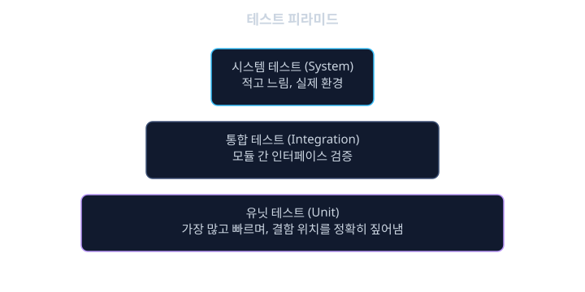
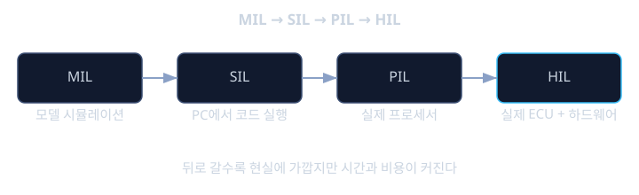

# 검증 · 테스트

"컴파일이 되고, 시뮬레이션에서 잘 동작했다"는 사실은 그 소프트웨어가 차량에 들어가도 안전하다는 것을 증명하지 못한다. 앞서 배운 ISO 26262(iso26262)는 안전 목표에서 시작해 소프트웨어 요구사항까지 내려가는 V 모델을 제시했는데, 그 V자의 오른쪽 절반, 즉 "내려갈 때 정한 요구사항을 실제 구현이 지키는지 올라가며 확인하는 과정"이 바로 검증과 확인(Verification and Validation, V&V)이다. 안전 요구사항이 아무리 정교하게 작성되어도, 그 요구사항이 실제 코드와 실제 하드웨어에서 지켜진다는 것을 증거로 보여주지 못하면 안전 목표는 종이 위의 약속에 그친다.

여기서 검증(Verification)과 확인(Validation)이라는 두 단어를 구분할 필요가 있다. 검증은 "우리가 요구사항을 올바르게 구현했는가(did we build it right)"를 묻는다. 반면 확인은 "우리가 올바른 요구사항을 만들었는가(did we build the right thing)"를 묻는다. 예를 들어 "제동 명령을 받으면 50 밀리초 안에 압력을 발생시킨다"는 요구사항을 코드가 정확히 지킨다면 검증은 통과하지만, 그 50 밀리초라는 요구사항 자체가 실제 차량 역학적으로 충분히 빠른 값인지는 확인의 영역이다. 이 레슨은 주로 검증, 즉 "요구사항대로 구현되었는가"를 증명하는 다양한 테스트 기법을 다룬다.

왜 자동차 소프트웨어는 이렇게까지 철저한 검증을 요구할까? 일반 소프트웨어는 버그가 발견되면 패치를 배포하면 되지만, 주행 중인 차량의 제어 소프트웨어는 결함이 발견되는 순간이 곧 사고가 발생하는 순간일 수 있다. 그리고 자동차 소프트웨어는 센서 입력, 통신 지연, 전원 변동, 극한 온도 등 실제 환경의 변수가 워낙 많아서, 개발자의 머릿속 시나리오만으로는 결코 모든 경로를 다 점검할 수 없다. 그래서 ISO 26262는 ASIL 등급에 따라 어떤 테스트 기법을 어느 수준까지 적용해야 하는지를 구체적으로 요구한다. 이 레슨에서는 유닛 테스트부터 HIL(Hardware-in-the-Loop) 테스트까지 이어지는 테스트 피라미드, 커버리지라는 척도, 그리고 "테스트를 충분히 했다"는 것을 어떻게 증거로 남기는지를 살펴본다.

## 학습 목표

- 검증(Verification)과 확인(Validation)의 차이, 그리고 V 모델에서 이 둘이 차지하는 위치를 설명할 수 있다.
- 유닛·통합·시스템 테스트로 이어지는 테스트 피라미드의 구조와 각 단계의 목적을 구별할 수 있다.
- MC/DC를 포함한 코드 커버리지 지표의 종류와 ASIL 등급별 요구 수준을 이해한다.
- SIL·HIL 테스트의 차이와 각각이 검증하는 대상을 설명할 수 있다.
- 동등 분할·경계값 분석 같은 블랙박스 테스트 설계 기법을 적용할 수 있다.

## 테스트 피라미드: 작은 단위에서 전체 시스템까지

안전 critical 소프트웨어를 한 번에 통째로 테스트하는 것은 비효율적이고 결함의 원인을 찾기도 어렵다. 그래서 검증은 보통 작은 단위부터 큰 단위로 올라가는 계층 구조, 흔히 테스트 피라미드라 부르는 구조로 설계한다.

- 유닛 테스트(Unit Test): 함수나 모듈 하나를 떼어내, 그 모듈이 의존하는 다른 모듈을 스텁(stub)이나 목(mock)으로 대체한 뒤 입력과 출력만으로 동작을 검증한다. 가장 빠르게 많은 횟수를 돌릴 수 있고, 결함의 위치를 정확히 짚어낼 수 있다.
- 통합 테스트(Integration Test): 여러 모듈을 실제로 연결해, 모듈 간 인터페이스(함수 호출 규약, 데이터 형식, 타이밍 가정)가 서로 맞는지 검증한다. 각 모듈이 유닛 테스트를 통과했더라도, 서로 데이터를 주고받는 방식에 대한 가정이 어긋나면 통합 단계에서 결함이 드러난다.
- 시스템 테스트(System Test): 실제 ECU 또는 그에 준하는 환경에서 전체 소프트웨어를 하드웨어와 함께 동작시켜, 시스템 수준의 요구사항(예: 안전 목표에서 내려온 요구사항)을 만족하는지 확인한다.

피라미드라는 이름이 붙은 이유는, 아래 단계일수록 테스트 개수가 많고 빠르게 실행되며, 위로 갈수록 개수는 줄지만 더 현실적인 환경에서 더 느리고 비싼 테스트가 이루어지기 때문이다. 유닛 테스트에서 걸러낼 수 있는 결함을 시스템 테스트 단계까지 끌고 가면, 결함의 원인을 찾는 데 훨씬 많은 시간이 들고 비용도 커진다. 예를 들어 제동 압력 계산 함수에 부호 오류가 있다면, 유닛 테스트에서는 그 함수에 몇 가지 입력값을 넣어보는 것만으로 몇 초 안에 잡을 수 있지만, 이를 놓치고 시스템 테스트 단계까지 가면 "왜 실제 차량에서 제동이 이상하게 걸리는가"라는 훨씬 넓은 범위에서 원인을 거꾸로 추적해야 한다.

```c
int16_t calc_brake_pressure(int16_t pedal_pos, int16_t speed_kph) {
    if (pedal_pos < 0) {
        return 0;
    }
    return pedal_pos * 2 - speed_kph / 10;
}
```

이 함수에 대한 유닛 테스트는 `calc_brake_pressure`만 분리해 호출하면서, 페달 위치가 음수인 경계 상황, 속도가 0인 상황, 일반적인 상황 등을 넣어 기대값과 비교한다. 이때 이 함수가 속해 있는 더 큰 ECU 소프트웨어 전체를 빌드하거나 실제 하드웨어가 필요하지 않다는 점이 유닛 테스트의 강점이다.



## 커버리지: "충분히 테스트했다"를 어떻게 증명할까

몇 가지 테스트 케이스를 통과했다는 사실만으로는 "충분히 테스트했다"고 말할 수 없다. 코드 안에 테스트되지 않은 경로가 남아 있다면, 그 경로에 숨은 결함은 여전히 발견되지 않은 채로 남는다. 이 "얼마나 빠짐없이 테스트했는가"를 정량화하는 척도가 코드 커버리지(code coverage)다. 대표적인 지표는 다음과 같다.

- 구문 커버리지(Statement Coverage): 코드의 모든 구문(줄)이 적어도 한 번 실행되었는지를 측정한다. 가장 기본적인 지표지만 느슨하다.
- 분기 커버리지(Branch Coverage, Decision Coverage): `if`, `while` 같은 모든 분기에서 참과 거짓 양쪽 경로가 모두 한 번씩 실행되었는지를 측정한다.
- 수정 조건/결정 커버리지(Modified Condition/Decision Coverage, MC/DC): 여러 조건이 결합된 복합 조건문에서, 각 개별 조건이 "독립적으로" 전체 결정 결과를 바꿀 수 있음을 보여주는 테스트 케이스 집합을 요구한다.

MC/DC가 왜 더 엄격한지 예시로 보자.

```c
if ((speed > 100) && (gear == PARK) && !brake_active) {
    disable_shift();
}
```

분기 커버리지는 이 `if` 문이 참이 되는 경우와 거짓이 되는 경우 각각 한 번만 실행되면 만족된다. 하지만 이 방식으로는 `gear == PARK`라는 개별 조건 하나가 정말로 전체 결과에 영향을 미치는지, 혹은 다른 조건들의 조합 때문에 우연히 결과가 맞아떨어진 것인지 구분하지 못한다. MC/DC는 "다른 조건들은 고정한 채, 조건 하나만 값을 바꾸었을 때 전체 결정 결과도 함께 바뀌는" 테스트 케이스 쌍을 모든 개별 조건에 대해 요구한다. 세 개의 독립 조건이 있다면 이런 쌍을 효율적으로 구성할 경우 최소 네 개의 테스트 케이스로 충분하다는 것이 알려져 있다. ISO 26262는 ASIL D처럼 가장 엄격한 등급의 소프트웨어 단위 테스트에는 MC/DC 수준의 커버리지를 강력히 권고하고, ASIL B나 C에는 분기 커버리지를, ASIL A나 QM에는 구문 커버리지를 상대적으로 완화된 수준에서 요구하는 식으로 등급에 비례한 엄격함을 적용한다.

<details><summary><b>심화: 커버리지가 100%여도 결함이 남을 수 있는 이유</b></summary>

MC/DC 100%를 달성했다고 해서 소프트웨어에 결함이 없다고 보장되지는 않는다. 커버리지는 "코드가 작성된 대로 실행되는 경로를 빠짐없이 테스트했는가"를 측정할 뿐, "요구사항에 있어야 할 코드가 빠져 있지는 않은가"는 측정하지 못한다. 예를 들어 "속도가 200km/h를 넘으면 특정 경고를 켜야 한다"는 요구사항이 있는데 개발자가 그 조건문 자체를 코드에서 빠뜻렸다면, 존재하지 않는 코드는 커버리지 계산에 포함되지 않으므로 나머지 코드에 대한 커버리지는 100%가 될 수 있다. 이런 "빠진 요구사항"을 잡아내는 것은 커버리지가 아니라 요구사항 기반 테스트(requirements-based testing), 즉 요구사항 하나하나에 대응하는 테스트 케이스가 존재하는지를 양방향으로 추적하는 작업의 역할이다. 그래서 실무에서는 코드 커버리지와 요구사항 커버리지(요구사항 대비 테스트 케이스의 추적성)를 함께 관리한다.

</details>

## 블랙박스 테스트 설계: 동등 분할과 경계값 분석

커버리지는 "이미 작성된 테스트가 코드를 얼마나 훑었는가"를 사후에 측정하는 지표다. 반면 테스트 케이스를 처음부터 효율적으로 설계하는 기법도 필요하다. 입력값의 범위가 매우 넓을 때, 모든 값을 다 테스트할 수는 없으므로 "비슷하게 동작할 것으로 예상되는 입력들을 그룹으로 묶고, 그룹마다 대표값 하나씩만 테스트"하는 접근을 동등 분할(Equivalence Partitioning)이라 한다.

앞의 제동 압력 계산 함수를 예로 들면, `pedal_pos`는 "음수(유효하지 않음)", "0 이상의 유효한 범위" 두 그룹으로 나눌 수 있다. 그리고 결함은 그룹의 경계 근처에서 가장 자주 발생하므로, 각 그룹의 경계값을 집중적으로 테스트하는 경계값 분석(Boundary Value Analysis)을 함께 적용한다. 예를 들어 `pedal_pos`가 정확히 0, -1, 그리고 int16_t의 최대값 근처 같은 경계 지점을 테스트 케이스로 선정한다. 이런 블랙박스(black-box) 기법은 내부 코드 구조를 보지 않고 요구사항과 입력 범위만으로 테스트 케이스를 설계한다는 점에서, 코드를 보고 설계하는 화이트박스(white-box) 기법인 커버리지 기반 테스트와 상호 보완적이다.

## SIL과 HIL: 점점 현실에 가까워지는 테스트 환경

소프트웨어가 유닛·통합 테스트를 통과했다고 해도, 실제 ECU 하드웨어나 실제 센서·액추에이터와 결합했을 때 비로소 드러나는 문제들이 있다. 이를 점진적으로 검증하기 위해 여러 단계의 "루프(Loop)" 테스트 환경이 쓰인다.

- MIL(Model-in-the-Loop): 제어 알고리즘을 아직 C 코드로 구현하기 전, 수학적 모델(예: Simulink 모델) 상태에서 시뮬레이션으로 검증한다.
- SIL(Software-in-the-Loop): 실제로 작성된 C 코드를 개발 PC나 서버에서 컴파일해, 타겟 하드웨어 없이 시뮬레이션된 입력으로 돌려본다. 실제 타겟 프로세서가 아니므로 타이밍은 정확하지 않지만, 로직 자체의 정확성을 빠르게 반복 검증할 수 있다.
- PIL(Processor-in-the-Loop): 실제 타겟 프로세서(또는 같은 아키텍처의 평가 보드)에서 코드를 실행해, 컴파일러와 프로세서 특성(예: 정수 연산 방식, 부동소수점 처리)으로 인한 차이를 검증한다.
- HIL(Hardware-in-the-Loop): 실제 ECU 하드웨어를 실제 배선과 비슷한 환경에 연결하고, 센서와 액추에이터는 실시간 시뮬레이터로 대체해 신호를 주고받는다. 예를 들어 실제 바퀴 속도 센서 신호를 전기적으로 모사하는 장비가 ECU에 신호를 보내고, ECU가 내보내는 제어 신호를 시뮬레이터가 받아 "가상의 차량이 그 신호에 따라 어떻게 움직이는지"를 실시간으로 계산해 되돌려준다.

이 네 단계는 뒤로 갈수록 실제 환경에 가까워지지만, 동시에 테스트 한 번을 돌리는 데 드는 시간과 비용도 커진다. 그래서 실무에서는 MIL과 SIL 단계에서 대부분의 로직 결함을 걷어내고, PIL과 HIL은 "실제 하드웨어·실시간 제약에서만 드러나는 문제"를 집중적으로 찾는 데 활용한다. 예를 들어 소프트웨어 로직은 완벽해도, 실제 CAN 버스의 통신 지연이나 ADC(analog-to-digital converter)의 양자화 오차 때문에 생기는 문제는 HIL 단계에 가서야 드러나는 경우가 많다. HIL은 또한 실제 차량으로는 재현하기 위험한 고장 시나리오, 예를 들어 "주행 중 속도 센서가 갑자기 끊긴다"는 상황을 안전하게 반복적으로 주입해 테스트할 수 있다는 중요한 장점도 있다.



**확인 문제.** 다음 조건문에 대해 MC/DC를 만족하려면 최소 몇 개의 테스트 케이스가 필요한지, 그리고 그 이유를 설명하라.

```c
if (door_open && !engine_running) {
    sound_alarm();
}
```

<details><summary>답 보기</summary>

이 조건문은 `door_open`과 `!engine_running`이라는 두 개의 독립 조건으로 이루어져 있다. MC/DC는 각 조건이 "다른 조건을 고정한 채 혼자 바뀌었을 때 전체 결과도 함께 바뀌는" 테스트 케이스 쌍을 요구한다. 두 개의 독립 조건에 대해서는 보통 세 개의 테스트 케이스로 구성할 수 있다. 예를 들어 (door_open=참, engine_running=끄짐→전체 참), (door_open=거짓, engine_running=끄짐→전체 거짓, door_open만 바뀜을 보여줌), (door_open=참, engine_running=켜짐→전체 거짓, engine_running만 바뀜을 보여줌) 세 가지 조합으로 두 조건 각각이 독립적으로 결과에 영향을 미친다는 것을 보여줄 수 있다. 분기 커버리지라면 단순히 전체 조건이 참인 경우와 거짓인 경우 하나씩, 즉 두 개의 테스트 케이스만으로도 만족되지만, 이는 두 조건 각각의 독립적 영향력을 증명하지 못한다는 점에서 MC/DC보다 느슨하다.

</details>

**확인 문제.** 어떤 팀이 특정 ECU 소프트웨어 모듈에 대해 분기 커버리지 100%를 달성했다고 보고했다. 이 결과만으로 "이 모듈은 요구사항을 모두 충족한다"고 결론 내릴 수 있는가?

<details><summary>답 보기</summary>

결론 내릴 수 없다. 분기 커버리지 100%는 "코드에 작성된 모든 분기 경로가 적어도 한 번씩 실행되었다"는 것만 보장하며, 요구사항에 있어야 할 코드가 통째로 빠져 있는 경우는 애초에 커버리지 측정 대상이 되지 않는다. 또한 각 분기가 실행되었다는 사실이 "그 결과가 요구사항에서 정한 올바른 값과 일치하는지"를 자동으로 보장하지도 않는다. 따라서 요구사항을 실제로 충족하는지 확인하려면, 커버리지 지표와 별도로 요구사항 하나하나에 대응하는 테스트 케이스가 존재하고 그 테스트가 기대값과 실제 출력을 비교해 통과했는지를 확인하는 요구사항 기반 테스트 추적이 함께 필요하다.

</details>

## 정리

- 검증(요구사항대로 구현했는가)과 확인(올바른 요구사항을 만들었는가)은 서로 다른 질문이며, V 모델은 이 둘을 체계적으로 연결한다.
- 유닛·통합·시스템 테스트로 이어지는 테스트 피라미드는 결함을 가능한 한 이른 단계에서, 적은 비용으로 걸러내기 위한 구조다.
- 구문·분기·MC/DC 커버리지는 "얼마나 빠짐없이 테스트했는가"를 정량화하며, ASIL 등급이 높을수록 더 엄격한 커버리지가 요구된다.
- 동등 분할과 경계값 분석은 코드가 아니라 요구사항과 입력 범위를 기준으로 효율적인 테스트 케이스를 설계하는 블랙박스 기법이다.
- MIL·SIL·PIL·HIL로 이어지는 루프 테스트는 점점 현실에 가까운 환경에서 로직 결함부터 하드웨어·타이밍 관련 결함까지 단계적으로 걸러낸다.

검증과 테스트는 "안전 목표를 지켰다"는 주장을 추측이 아니라 증거로 바꾸는 과정이다. 어떤 테스트 기법도 결함이 전혀 없다는 것을 완벽하게 증명할 수는 없지만, 커버리지·요구사항 추적·단계적 루프 테스트를 조합하면 "놓친 부분이 어디인지 스스로 알 수 있는" 상태에 가까워질 수 있고, 이것이 바로 안전 critical 소프트웨어 개발이 지향하는 현실적인 목표다.

## 참고 자료

- ISO 26262-6:2018, "Product development at the software level" (단위·통합·시스템 테스트 요구사항)
- RTCA DO-178C, "Software Considerations in Airborne Systems and Equipment Certification" (MC/DC 개념의 원류)
- Boris Beizer, "Software Testing Techniques" (동등 분할, 경계값 분석 등 테스트 설계 기법)
- dSPACE, National Instruments 등 HIL 시뮬레이터 공급사의 자동차 HIL 테스트 개요 자료
- ISTQB(International Software Testing Qualifications Board), "Foundation Level Syllabus" (테스트 설계 기법 전반)
