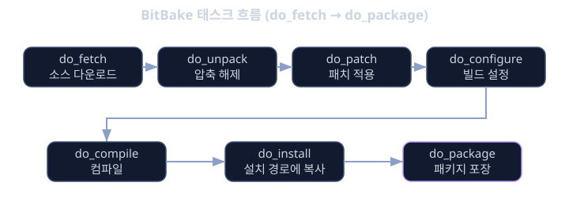
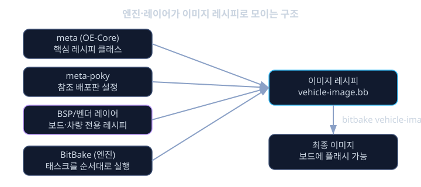

# Yocto · 빌드 시스템

차량에 들어가는 리눅스는 노트북에서 쓰는 Ubuntu와는 전혀 다른 물건입니다. 데스크톱 배포판은 수만 개의 패키지, 다양한 하드웨어, 다양한 사용자 요구를 모두 포괄하는 "범용" 리눅스입니다. 반면 자동차의 ECU(Electronic Control Unit)나 IVI(In-Vehicle Infotainment) 보드는 정해진 SoC 하나, 정해진 주변장치 몇 개만 지원하면 되고, 부팅 시간은 몇 초 안으로 짧아야 하며, 보안 취약점이 될 수 있는 불필요한 패키지는 아예 없어야 합니다. 라이선스 추적도 엄격해야 합니다 — 양산 차량에 올라가는 소프트웨어는 어떤 오픈소스 라이선스가 몇 개 섞여 있는지 법무 검토를 통과해야 하기 때문입니다.

이런 "맞춤 리눅스"를 매번 손으로 커널 컴파일하고 루트파일시스템(rootfs)을 직접 구성해서 만든다면, 보드가 바뀔 때마다, 패키지 버전이 바뀔 때마다 처음부터 다시 삽질해야 합니다. Yocto 프로젝트(Yocto Project)는 바로 이 문제를 풀기 위해 만들어졌습니다. "레시피(recipe)"라는 작은 설명서 단위로 각 소프트웨어를 어떻게 가져오고 빌드하고 설치할지 정의하고, 이 레시피들을 "레이어(layer)"라는 묶음으로 조합해서, 같은 입력이면 항상 같은 결과가 나오는 재현 가능한(reproducible) 방식으로 전체 이미지를 빌드합니다.

실제로 자동차 업계의 대표적인 오픈소스 차량용 리눅스 배포판인 AGL(Automotive Grade Linux)도 Yocto를 기반으로 만들어져 있습니다. 완성차 업체나 Tier 1 공급사가 자체 보드를 위한 커널, 부트로더, 디스플레이 드라이버, CAN 통신 유틸리티를 하나의 이미지로 묶어낼 때 Yocto의 레시피·레이어 구조를 그대로 활용합니다. 이번 레슨에서는 Yocto가 왜 필요한지부터, BitBake라는 빌드 엔진이 레시피를 어떻게 실행하는지, 레이어와 설정 파일을 어떻게 구성하는지, 그리고 최종적으로 이미지가 어떻게 만들어지는지까지 차근차근 살펴봅니다. 선수 레슨인 kernel-intro에서 다룬 커널 구조에 대한 이해가 있으면 이번 내용을 따라오기 훨씬 쉽습니다.

## 학습 목표

- 데스크톱 배포판 대신 Yocto로 임베디드 리눅스를 빌드해야 하는 이유를 설명할 수 있다.
- BitBake가 레시피의 태스크를 어떤 순서로 실행하는지 이해한다.
- 레시피(.bb)와 레이어(meta-*)의 역할과 관계를 구분해서 설명할 수 있다.
- local.conf, layer.conf, machine 설정이 각각 무엇을 담당하는지 안다.
- 이미지 레시피가 여러 패키지를 묶어 최종 이미지를 만드는 과정을 설명할 수 있다.
- 실제 차량 보드를 위한 커스텀 이미지를 구성할 때 어떤 요소들을 조합해야 하는지 그림을 그릴 수 있다.

## 왜 Yocto가 필요한가

일반 PC용 배포판을 보드에 그대로 올리면 어떤 문제가 생길까요. 우선 패키지 매니저, GUI 셸, 문서 뷰어 같은 ECU나 IVI에는 전혀 필요 없는 소프트웨어가 가득 들어 있어서 저장공간과 부팅 시간을 낭비합니다. 둘째, 커널이 그 보드의 특정 SoC와 주변장치에 맞게 패치되어 있지 않아서 CAN 컨트롤러나 디스플레이 드라이버 같은 핵심 기능이 아예 동작하지 않을 수 있습니다. 셋째, 보안 관점에서 쓰지 않는 패키지가 많을수록 공격 표면(attack surface)이 넓어집니다. 넷째, 양산 차량에는 어떤 오픈소스 라이선스가 포함되어 있는지 정확히 추적해야 하는데, 범용 배포판은 이 추적이 거의 불가능합니다.

Yocto는 이 네 가지 문제를 "필요한 것만 골라서, 재현 가능하게, 추적 가능하게 빌드한다"는 방식으로 해결합니다. 예를 들어 차량용 ARM 기반 SoC 보드를 위해 커널 + 부트로더 + 디스플레이 드라이버 + CAN 유틸리티만 담은 이미지를 만든다고 하면, 그 보드를 지원하는 BSP(Board Support Package) 레이어 하나와, 필요한 애플리케이션 레시피들을 추가해서 이미지 레시피 하나로 조합하면 끝입니다. 똑같은 설정 파일과 레시피 세트를 그대로 다시 빌드하면 몇 달 뒤에도 동일한 결과물이 나옵니다. 이 재현성 덕분에 완성차 업체는 "이 버전의 이미지는 이 레시피 조합으로 만들어졌다"는 것을 정확히 문서화할 수 있고, AGL 같은 산업 표준 배포판도 이 구조 위에 세워져 있습니다.

## BitBake와 레시피

Yocto의 빌드 엔진은 BitBake입니다. BitBake는 레시피 파일(.bb)에 적힌 태스크들을 의존성 그래프에 따라 순서대로 실행하는 태스크 스케줄러입니다. 하나의 레시피가 빌드되는 과정은 보통 다음 태스크 흐름을 따릅니다.

- do_fetch — SRC_URI에 적힌 소스코드(git, tarball 등)를 다운로드
- do_unpack — 받아온 소스를 작업 디렉터리에 풀기
- do_patch — 패치 파일을 적용
- do_configure — configure 스크립트나 cmake 등으로 빌드 환경 설정
- do_compile — 실제 컴파일 수행
- do_install — 빌드 결과물을 가상의 설치 경로(D)에 설치
- do_package — 설치된 파일들을 rpm, deb, ipk 같은 패키지 형식으로 포장



이 흐름은 do_fetch ~ do_install 구간이 특히 레시피 작성자가 가장 많이 손대는 부분입니다. 예를 들어 차량의 CAN 버스 통신을 위한 can-utils 패키지를 레시피로 작성하면 다음과 같은 형태가 됩니다.

```
DESCRIPTION = "CAN 버스 통신 유틸리티 (candump, cansend 등)"
LICENSE = "GPL-2.0-only"
LIC_FILES_CHKSUM = "file://COPYING;md5=b234ee4d69f5fce4486a80fdaf4a4263"

SRC_URI = "git://github.com/linux-can/can-utils.git;branch=master;protocol=https"
SRCREV = "a1b2c3d4e5f67890a1b2c3d4e5f67890a1b2c3d4"

S = "${WORKDIR}/git"

inherit autotools

do_install:append() {
    install -d ${D}${bindir}
    install -m 0755 ${B}/candump ${D}${bindir}
    install -m 0755 ${B}/cansend ${D}${bindir}
}
```

SRC_URI는 소스를 어디서 가져올지, SRCREV는 어떤 커밋을 기준으로 할지, S는 소스가 풀리는 위치, inherit autotools는 이 패키지가 autotools 빌드 방식을 따른다는 뜻입니다. do_install:append()는 기본 설치 태스크에 이어서 candump, cansend 같은 실행 파일을 추가로 설치 경로에 복사하는 부분입니다. 레시피 하나가 "이 소프트웨어를 가져와서 어떻게 빌드하고 어디에 설치할지"를 완전히 선언적으로 담고 있다는 점이 핵심입니다.

## 레이어: 레시피를 모듈로 묶기

레시피가 하나의 패키지를 정의한다면, 레이어(layer)는 관련된 레시피와 설정을 하나의 디렉터리 단위로 묶은 모듈입니다. 레이어는 보통 meta- 접두사를 붙여 이름을 짓습니다. Yocto의 기본 레이어 구성은 다음과 같습니다.

- meta — OpenEmbedded-Core. 가장 기본적인 레시피 클래스와 공통 메타데이터를 담은 핵심 레이어
- meta-poky — Poky 참조 배포판에 특화된 설정 레이어
- meta-yocto-bsp — Yocto 프로젝트가 기본으로 제공하는 참조 보드용 BSP 레이어
- BSP 레이어 — 특정 보드(SoC)를 지원하는 레이어. 부트로더, 커널 설정, 디바이스 트리 등을 포함
- 벤더/제조사 레이어 — 자동차 업체나 Tier 1이 자사 보드와 애플리케이션을 위해 만드는 레이어 (예: meta-automotive류)

레이어의 큰 장점 중 하나는 다른 레이어의 레시피를 건드리지 않고도 확장할 수 있다는 점입니다. 이때 쓰는 것이 .bbappend 파일입니다. 예를 들어 차량용 보드 BSP 레이어에서 커널 레시피에 CAN 드라이버 패치를 추가하고 싶다면, 커널 레시피 자체를 수정하는 대신 같은 이름의 .bbappend 파일을 BSP 레이어 안에 만듭니다.

```
# meta-vehicle-bsp/recipes-kernel/linux/linux-yocto_%.bbappend

FILESEXTRAPATHS:prepend := "${THISDIR}/files:"

SRC_URI += "file://0001-add-can-controller-support.patch"
KERNEL_FEATURES:append = " cfg/can.scc"
```

%는 버전 와일드카드라서 linux-yocto의 어떤 버전에도 이 bbappend가 적용됩니다. 이렇게 레이어를 쌓아 올리는 방식 덕분에, core 레이어는 그대로 두고 보드별·제조사별 차이만 별도 레이어로 관리할 수 있어서 여러 차량 플랫폼을 동시에 유지보수하기가 훨씬 수월해집니다.

## 핵심 설정 파일

레시피와 레이어가 "무엇을" 빌드할지를 정의한다면, 설정 파일들은 "어떤 환경에서" 빌드할지를 결정합니다. 가장 자주 다루는 세 가지 설정은 다음과 같습니다.

- local.conf — 빌드 전체에 적용되는 환경 설정. 타겟 MACHINE, 패키지 포맷, 병렬 빌드 작업 수 등을 지정
- layer.conf — 각 레이어 안에 있는 메타데이터 파일로, 이 레이어가 어떤 레시피 경로를 포함하는지, 어떤 레이어에 의존하는지를 선언
- machine 설정 (conf/machine/*.conf) — MACHINE 변수가 가리키는 파일로, 타겟 보드의 CPU 아키텍처, 커널 종류, 부트로더 등을 정의

local.conf의 전형적인 내용은 다음과 같습니다.

```
MACHINE = "vehicle-socboard"
DISTRO = "poky"
PACKAGE_CLASSES = "package_rpm"
BB_NUMBER_THREADS = "8"
PARALLEL_MAKE = "-j 8"
```

layer.conf는 레이어 자신의 정체성을 선언하는 파일입니다.

```
BBPATH .= ":${LAYERDIR}"
BBFILES += "${LAYERDIR}/recipes-*/*/*.bb \
            ${LAYERDIR}/recipes-*/*/*.bbappend"

BBFILE_COLLECTIONS += "meta-vehicle-bsp"
BBFILE_PATTERN_meta-vehicle-bsp = "^${LAYERDIR}/"
BBFILE_PRIORITY_meta-vehicle-bsp = "7"
LAYERDEPENDS_meta-vehicle-bsp = "core"
LAYERSERIES_COMPAT_meta-vehicle-bsp = "kirkstone"
```

BBFILES는 BitBake가 이 레이어에서 어떤 경로의 .bb/.bbappend 파일을 레시피로 인식할지 알려주고, LAYERDEPENDS는 이 레이어가 core 레이어에 의존한다는 것을 명시합니다. MACHINE에 지정한 값(vehicle-socboard)과 같은 이름의 파일이 BSP 레이어의 conf/machine/ 아래에 있어야 하며, 그 파일 안에서 실제 CPU, 커널 제공자, 부트로더 종류 등을 정의합니다.

## 이미지 레시피와 빌드 산출물

지금까지의 레시피와 레이어는 모두 재료입니다. 이 재료들을 실제로 하나의 완성된 루트파일시스템(rootfs)과 부팅 이미지로 묶어내는 것이 이미지 레시피(image recipe)입니다. Yocto가 기본으로 제공하는 core-image-minimal은 부팅에 필요한 최소한의 패키지만 담은 이미지 레시피이고, 여기에 필요한 패키지를 추가해서 자체 이미지 레시피를 만드는 것이 일반적입니다.

```
# recipes-vehicle/images/vehicle-image.bb

require recipes-core/images/core-image-minimal.bb

IMAGE_INSTALL:append = " can-utils display-driver vehicle-app"
IMAGE_FSTYPES = "wic ext4"
```

require로 core-image-minimal.bb의 내용을 가져온 뒤, IMAGE_INSTALL:append에 CAN 유틸리티, 디스플레이 드라이버, 차량 애플리케이션 패키지를 추가합니다. IMAGE_FSTYPES는 최종 결과물을 어떤 이미지 포맷(.wic, ext4 등)으로 만들지 지정합니다. 이제 다음 명령 한 줄로 전체 빌드가 시작됩니다.

```
bitbake vehicle-image
```

BitBake는 vehicle-image가 요구하는 모든 레시피의 의존성을 분석해서, 커널부터 부트로더, CAN 유틸리티, rootfs 패키징까지 필요한 모든 태스크를 순서대로 실행하고 최종적으로 보드에 바로 플래시(flash)할 수 있는 이미지 파일을 생성합니다.

## 전체 구조 한눈에 보기

지금까지 나온 조각들을 정리하면 다음과 같은 계층 구조가 됩니다.

- BitBake — 레시피의 태스크를 의존성 순서대로 실행하는 빌드 엔진
- OpenEmbedded-Core (meta) — 레시피 클래스와 공통 메타데이터
- Poky — OpenEmbedded-Core와 BitBake, 그리고 참조용 메타데이터 레이어들을 묶어서 바로 시작할 수 있게 제공하는 참조 배포판
- BSP/벤더 레이어 — 실제 보드와 차량 애플리케이션에 맞게 추가되는 레이어들
- 이미지 레시피 — 모든 것을 조합해 최종 이미지를 만드는 최상위 레시피

즉 Poky는 "OpenEmbedded-Core(메타데이터) + BitBake(엔진) + 기본 레이어들"의 조합이고, 실제 차량 프로젝트는 여기에 자신의 BSP 레이어와 애플리케이션 레이어를 얹어서 빌드합니다. 애플리케이션 개발자에게는 전체 빌드 환경을 다 설치하게 하는 대신, Yocto가 생성해 주는 eSDK(extensible SDK)를 배포해서 해당 보드용 툴체인과 라이브러리만 간편하게 설치하도록 할 수도 있습니다.



전체 이미지를 매번 다시 빌드하면서 레시피를 디버깅하는 것은 비효율적입니다. 그래서 Yocto는 특정 레시피만 따로 들여다보고 수정할 수 있는 보조 도구도 함께 제공합니다. 예를 들어 `devtool modify can-utils`를 실행하면 해당 레시피의 소스를 작업 디렉터리로 꺼내 와서 일반적인 Git 저장소처럼 수정하고, 수정이 끝나면 `devtool build`와 `devtool finish`로 다시 레시피에 반영할 수 있습니다. 또한 `bitbake -c cleansstate <레시피>`로 특정 레시피의 캐시만 지우고 다시 빌드하거나, `bitbake -e <레시피>`로 해당 레시피에 실제로 어떤 변수 값이 적용되었는지 전체 환경을 출력해서 확인할 수도 있습니다. 차량 보드처럼 CAN 드라이버 패치 하나가 제대로 적용되었는지 빠르게 확인해야 하는 상황에서는, 전체 이미지를 처음부터 다시 빌드하기 전에 이런 레시피 단위 도구로 먼저 좁혀서 디버깅하는 습관이 큰 시간 절약으로 이어집니다.

<details><summary><b>심화: sstate-cache로 빌드 속도 높이기</b></summary>

전체 이미지를 매번 처음부터 다시 빌드하면 몇 시간씩 걸릴 수 있습니다. Yocto는 각 태스크의 입력(소스, 설정, 의존성)을 해시로 계산해서 shared state cache(sstate-cache)에 결과를 저장해 두고, 같은 입력이 반복되면 캐시된 결과를 그대로 재사용합니다. 예를 들어 커널 설정을 바꾸지 않았다면 do_compile 결과를 캐시에서 가져와서 재컴파일을 건너뛰는 식입니다. 여러 보드를 동시에 유지보수하는 프로젝트에서는 이 캐시를 팀 전체가 공유하는 서버에 두어 빌드 시간을 크게 줄이는 것이 일반적인 운영 방식입니다.

</details>

<details><summary><b>심화: 라이선스 추적과 매니페스트</b></summary>

레시피마다 선언하는 LICENSE, LIC_FILES_CHKSUM 필드는 단순히 문서용이 아닙니다. BitBake는 빌드가 끝나면 이미지에 포함된 모든 패키지의 라이선스 목록을 모아 라이선스 매니페스트(license manifest) 파일로 남깁니다. 완성차 업체는 양산 전에 이 매니페스트를 법무 검토에 제출해서, GPL 계열처럼 소스 공개 의무가 있는 라이선스가 섞여 있는지, 상용 제품과 함께 배포해도 문제가 없는지를 확인합니다. 데스크톱 배포판에서는 이런 추적이 거의 불가능하지만 Yocto 레시피 구조에서는 자동으로 따라옵니다.

</details>

<details><summary><b>심화: eSDK로 애플리케이션 개발자 분리하기</b></summary>

플랫폼 팀이 전체 이미지를 빌드하는 동안, 차량 애플리케이션을 개발하는 팀은 매번 몇 시간씩 걸리는 전체 빌드 환경을 설치할 필요가 없습니다. bitbake -c populate_sdk_ext 같은 태스크로 생성하는 extensible SDK(eSDK)는 해당 MACHINE에 맞는 크로스 컴파일 툴체인과 필요한 라이브러리, 헤더만 담은 설치 패키지입니다. 애플리케이션 개발자는 이 eSDK만 설치해서 독립적으로 코드를 빌드하고, 완성된 결과물만 플랫폼 팀에게 전달하면 됩니다.

</details>

**확인 문제.** BitBake 레시피에서 do_fetch ~ do_install 사이의 태스크 흐름을 순서대로 설명하고, 각 태스크가 하는 일을 한 줄씩 요약해 보세요.

<details><summary>답 보기</summary>

do_fetch는 SRC_URI에 지정된 소스코드를 다운로드하고, do_unpack은 받아온 소스를 작업 디렉터리에 풉니다. do_patch는 필요한 패치 파일을 적용하고, do_configure는 빌드 전에 configure나 cmake 등으로 빌드 환경을 설정합니다. do_compile은 실제 컴파일을 수행하고, do_install은 컴파일된 결과물을 가상의 설치 경로(D)에 설치합니다. BitBake는 이 태스크들을 레시피에 선언된 의존성에 따라 자동으로 순서를 맞춰 실행합니다.

</details>

**확인 문제.** 기존 커널 레시피를 직접 수정하지 않고 차량용 CAN 드라이버 패치를 추가하려면 어떤 방법을 쓸 수 있을까요?

<details><summary>답 보기</summary>

같은 이름의 .bbappend 파일을 자신의 BSP 레이어 안에 만들어서 SRC_URI에 패치 파일을 추가하면 됩니다. 원본 커널 레시피가 속한 레이어는 그대로 유지한 채, bbappend가 있는 레이어에서 추가 패치와 설정만 덧붙이는 방식이기 때문에 여러 보드나 벤더가 같은 커널 레시피를 공유하면서도 각자 필요한 수정만 독립적으로 관리할 수 있습니다.

</details>

## 정리

Yocto는 범용 데스크톱 배포판이 해결할 수 없는 임베디드 리눅스의 요구사항 — 최소한의 패키지, 보드별 맞춤 커널, 추적 가능한 라이선스, 재현 가능한 빌드 — 을 레시피와 레이어라는 모듈 구조로 풀어냅니다. BitBake는 레시피에 적힌 do_fetch ~ do_package 태스크를 의존성 순서대로 실행하는 엔진이고, 레이어는 이 레시피들과 설정을 모듈 단위로 묶어 BSP나 벤더별 차이를 .bbappend로 비침투적으로 확장할 수 있게 해 줍니다. local.conf, layer.conf, machine 설정이 빌드 환경과 타겟 보드를 결정하고, 이미지 레시피가 이 모든 것을 조합해 실제 보드에 올라갈 최종 이미지를 만들어 냅니다. Poky가 OpenEmbedded-Core와 BitBake, 기본 레이어들을 묶은 참조 배포판이라는 것, 그리고 AGL 같은 차량용 리눅스 배포판도 이 구조 위에 세워져 있다는 것을 기억해 두면, 실제 차량 보드용 이미지를 구성할 때 어디서부터 손을 대야 할지 훨씬 명확해집니다.

## 참고 자료

- Yocto Project 공식 문서의 Reference Manual, Mega-Manual
- Poky 참조 배포판 소스 저장소와 그 안의 meta, meta-poky, meta-yocto-bsp 레이어 구조
- BitBake User Manual의 태스크 실행 모델과 변수 오버라이드 문법(:append, :prepend 등) 설명
- Automotive Grade Linux(AGL) 프로젝트 문서 — Yocto 기반 차량용 리눅스 배포판의 레이어 구성 사례
- OpenEmbedded Layer Index — 공개된 BSP 레이어와 벤더 레이어를 검색할 수 있는 저장소
